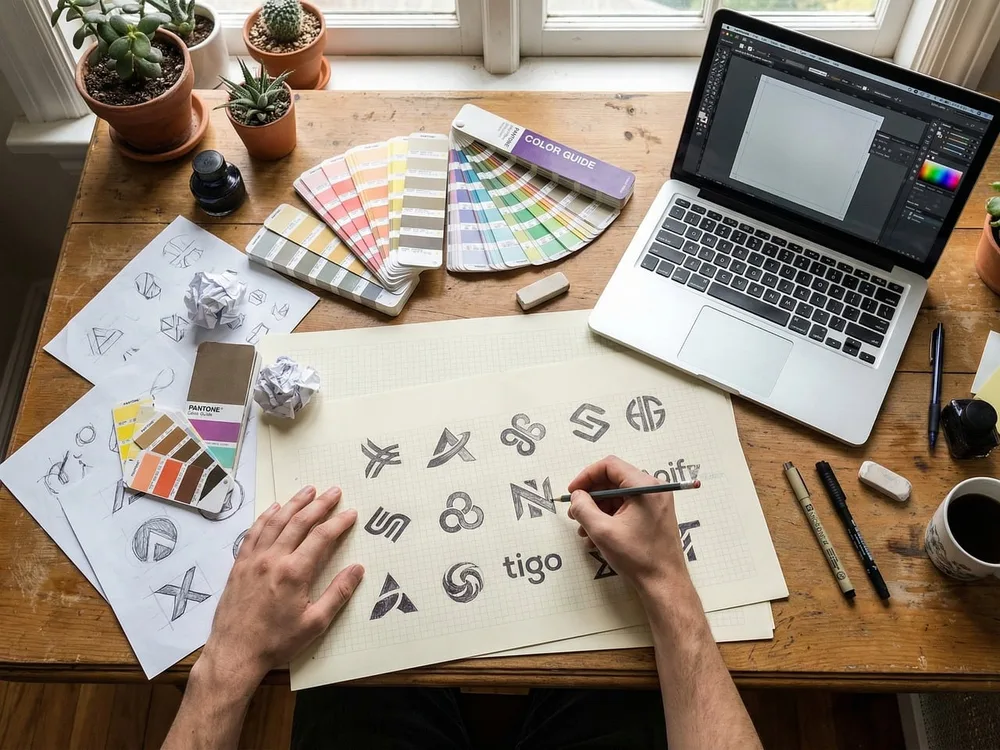
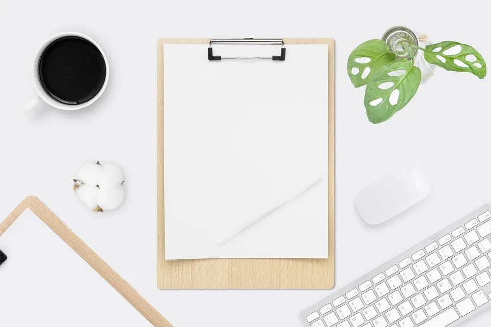
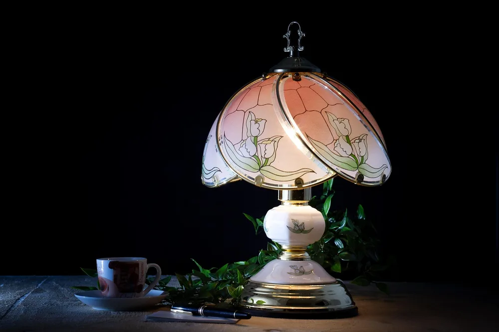
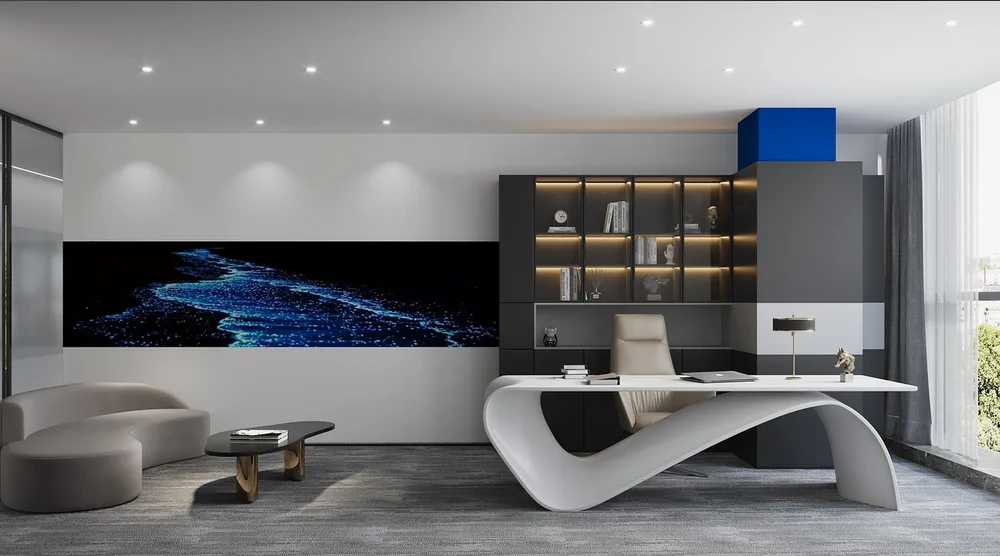
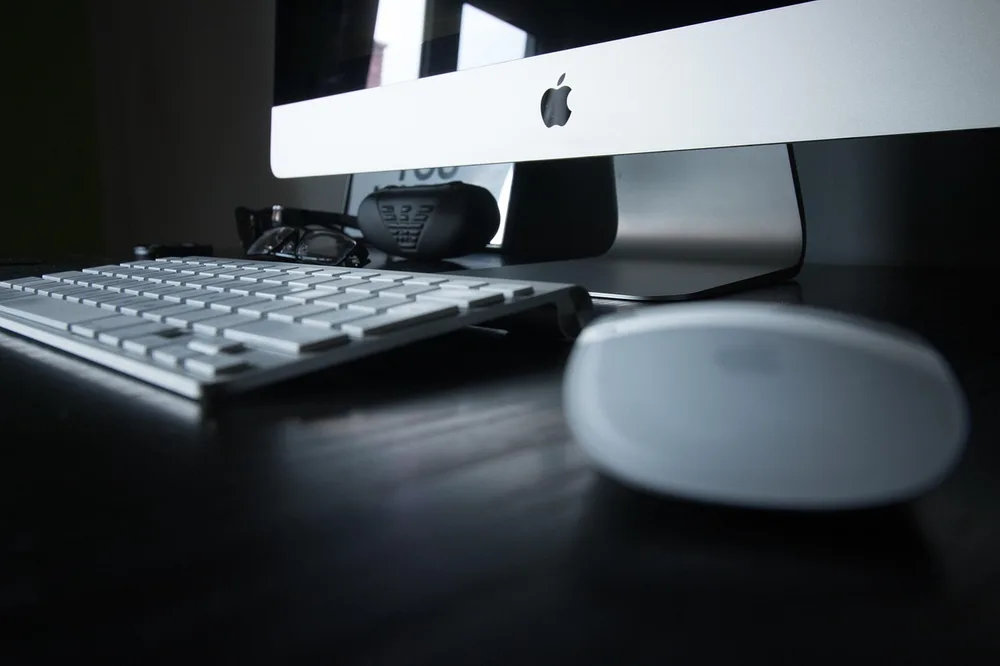
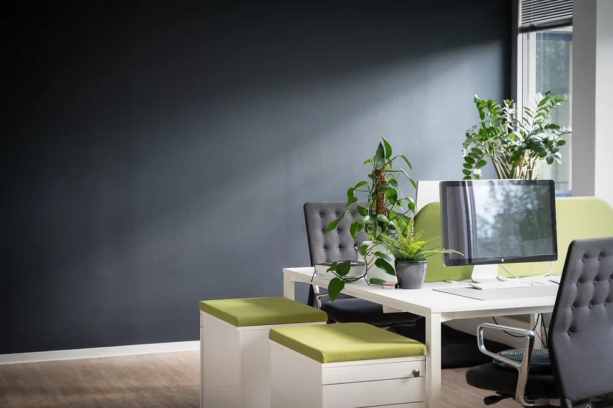
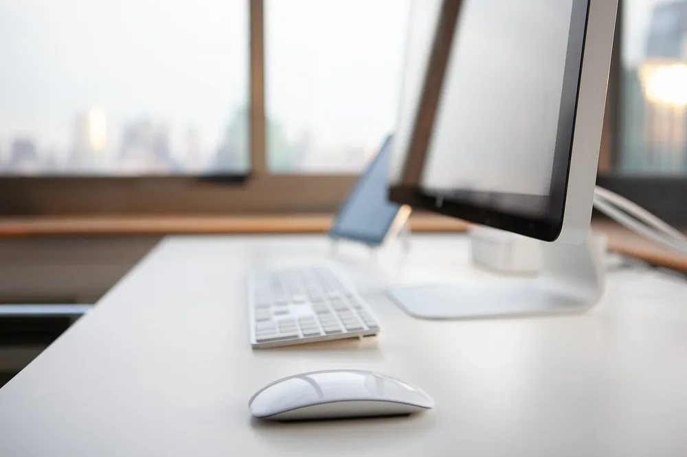
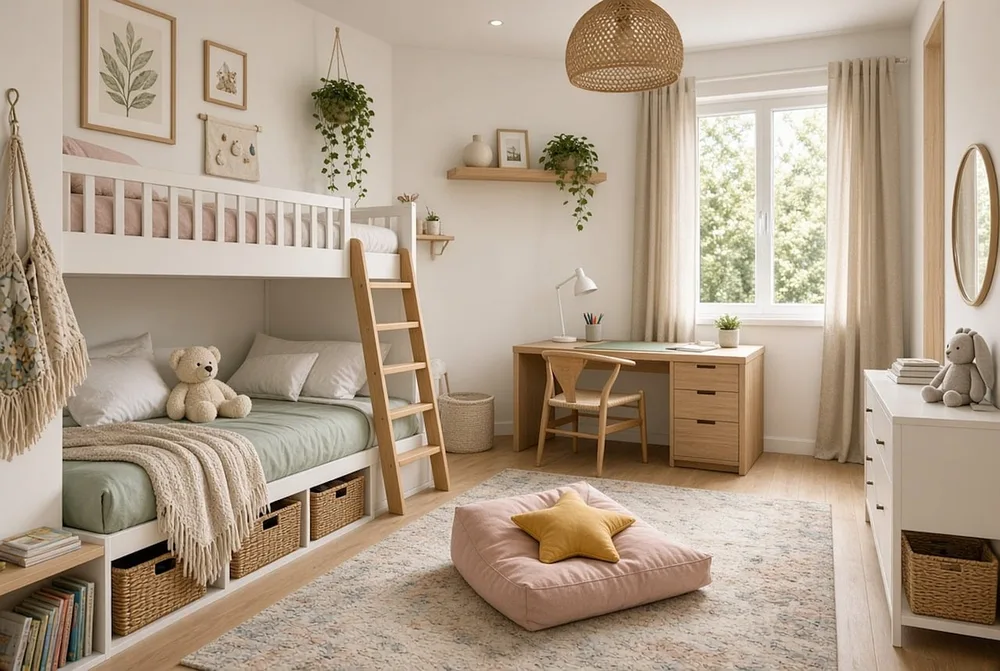

<figure class="pin-figure"><figcaption>Photo by <a href="https://pixabay.com/users/MonsterDealz-57057939/" rel="nofollow noopener" target="_blank">MonsterDealz</a> on <a href="https://pixabay.com/photos/headphones-notebook-watch-pencil-10416939/" rel="nofollow noopener" target="_blank">Pixabay</a></figcaption></figure>

An aesthetic desk setup is not about buying the trendiest accessories. It is about a few deliberate choices that make the whole desk look cohesive: a palette, a focal point and nothing out of place.

These ideas help you style a desk that looks great in photos and feels good to work at every day. Start with color and the base layer, then add the details.

<h2>1. Pick a Three-Color Palette</h2>

<figure class="pin-figure"><figcaption>Photo by <a href="https://pixabay.com/users/Simonrtr120-55507787/" rel="nofollow noopener" target="_blank">Simonrtr120</a> on <a href="https://pixabay.com/photos/graphic-design-workspace-laptop-10235458/" rel="nofollow noopener" target="_blank">Pixabay</a></figcaption></figure>

Choose three colors and stick to them: a main neutral, a secondary tone and one accent color. Combinations like white, light oak and sage green, or black, walnut and cream, always look intentional because every item relates to the others.

From now on, every new item you add to the desk should fit the palette. This single rule does more for an aesthetic setup than any individual product, and it makes shopping easier because you instantly know what fits and what does not.

<h2>2. Use a Large Desk Mat as the Base</h2>

<figure class="pin-figure"><figcaption>Photo by <a href="https://pixabay.com/users/Anlomaja27-17048178/" rel="nofollow noopener" target="_blank">Anlomaja27</a> on <a href="https://pixabay.com/photos/office-desk-minimalist-clipboard-6180926/" rel="nofollow noopener" target="_blank">Pixabay</a></figcaption></figure>

A large desk mat works like a rug for your desk. It ties the keyboard, mouse and notebook together into one composition, protects the surface from scratches and adds a block of color or texture that anchors the whole setup visually, so the desk reads as one designed space instead of scattered pieces.

Felt, leather and plain fabric mats in your palette tend to look the cleanest. Avoid busy prints and loud patterns, because they compete with everything placed on top of them and make even a tidy desk look cluttered in photos.

<h2>3. Add One Statement Lamp</h2>

<figure class="pin-figure"><figcaption>Photo by <a href="https://pixabay.com/users/Sponchia-443272/" rel="nofollow noopener" target="_blank">Sponchia</a> on <a href="https://pixabay.com/photos/table-lamp-coffee-workplace-3813016/" rel="nofollow noopener" target="_blank">Pixabay</a></figcaption></figure>

A distinctive lamp acts as the focal point of the desk. A mushroom-shaped lamp, a sculptural arm lamp or a glass globe lamp gives the setup personality while still doing the practical job of lighting your work in the evening.

Choose just one statement piece and keep everything else around it simple and quiet. Two or three bold items compete with each other for attention and make the desk look busy instead of curated, so let the lamp be the star and pick the other accessories in plain shapes and colors from your palette.

<h2>4. Style One Shelf of Favorites</h2>

<figure class="pin-figure"><figcaption>Photo by <a href="https://pixabay.com/users/ST4N-964064/" rel="nofollow noopener" target="_blank">ST4N</a> on <a href="https://pixabay.com/photos/office-home-office-interior-design-6804135/" rel="nofollow noopener" target="_blank">Pixabay</a></figcaption></figure>

A floating shelf above the desk is the perfect place for personality: a small print, a plant, a few favorite books and one or two objects you love. Grouping these items on one shelf keeps the desk itself clear for work.

Arrange items in odd numbers and vary their heights so the shelf has a pleasing rhythm, with taller pieces at the ends or in the back. Leave empty space between the groups, so each piece can be seen on its own and the shelf looks styled and intentional rather than packed with everything you own.

<h2>5. Choose Matching Peripherals</h2>

<figure class="pin-figure"><figcaption>Photo by <a href="https://pixabay.com/users/Pexels-2286921/" rel="nofollow noopener" target="_blank">Pexels</a> on <a href="https://pixabay.com/photos/apple-black-business-desk-keyboard-1838564/" rel="nofollow noopener" target="_blank">Pixabay</a></figcaption></figure>

A keyboard, mouse, headphones and speakers in matching colors make a desk look finished and deliberate. White peripherals feel light and airy, while black ones look sleek and modern, so choose the color that fits your palette and the overall mood you want, and the rest of the desk will feel more cohesive around them.

You do not need to replace everything at once to get there. Swap items gradually as they wear out or break, always choosing the new ones in your palette. In a few months the whole setup will match, without a big one-time expense and without throwing away gear that still works perfectly well.

<h2>6. Add Greenery</h2>

<figure class="pin-figure"><figcaption>Photo by <a href="https://pixabay.com/users/asundermeier-448808/" rel="nofollow noopener" target="_blank">asundermeier</a> on <a href="https://pixabay.com/photos/work-desk-office-management-8715739/" rel="nofollow noopener" target="_blank">Pixabay</a></figcaption></figure>

Plants soften the technical look of screens, keyboards and cables. A small plant on the desk and a trailing one on the shelf above add natural color that fits almost any palette, bring some life into the corner and make the workspace feel calmer and more welcoming during long days at the computer.

If your room has limited natural light, choose low-light plants or high-quality artificial greenery instead. For the look of the desk, the color and texture of the leaves matter more than the species, so pick whatever will stay healthy and green in your space rather than a plant that slowly turns brown.

<h2>7. Use Soft Warm LED Lighting</h2>

<figure class="pin-figure"><figcaption>Photo by <a href="https://pixabay.com/users/Spudaitis-1096661/" rel="nofollow noopener" target="_blank">Spudaitis</a> on <a href="https://pixabay.com/photos/dj-equipment-music-party-laptop-8347229/" rel="nofollow noopener" target="_blank">Pixabay</a></figcaption></figure>

A warm LED strip under the shelf or behind the monitor adds depth and makes the desk glow softly in the evening. Keep it warm white or a soft tone from your palette rather than bright rainbow effects, which rarely look calm.

Indirect light reads as calm and elegant, because you see the glow without seeing the light source. Dim it at night to create a relaxed mood while you browse or write, without having to turn on the harsh main lights.

<h2>8. Frame a Print Above the Desk</h2>

<figure class="pin-figure"><figcaption>Photo by <a href="https://pixabay.com/users/652234-652234/" rel="nofollow noopener" target="_blank">652234</a> on <a href="https://pixabay.com/photos/mosaic-tiles-template-texture-3394375/" rel="nofollow noopener" target="_blank">Pixabay</a></figcaption></figure>

A framed print gives the wall above the desk a clear purpose and completes the composition. Choose art that uses colors from your palette, such as a simple line drawing, a calm landscape or an abstract shape in muted tones.

Lean the frame on the shelf for a relaxed, easy-to-change look, or hang it centered above the monitor for a more formal and balanced composition. Either way, the print ties the wall and the desk together into one styled scene, and it gives your eyes a pleasant place to rest between tasks.

<h2>9. Make Cables Invisible</h2>

<figure class="pin-figure"><figcaption>Photo by <a href="https://pixabay.com/users/77wang-17960537/" rel="nofollow noopener" target="_blank">77wang</a> on <a href="https://pixabay.com/photos/desktop-computer-keyboard-mouse-5500347/" rel="nofollow noopener" target="_blank">Pixabay</a></figcaption></figure>

Nothing breaks an aesthetic setup faster than a tangle of cables. Use a cable tray under the desk, run the monitor cable through the channel of its arm and choose wireless peripherals where possible, so the surface stays clean and the only lines you see on the desk are the ones you chose on purpose.

Hidden cables are the difference between a nice desk and a desk that looks styled. Take care of them before adding any decor, because even the best lamp and print cannot hide a mess of wires running across the surface.

<h2>10. Refresh the Look With Seasonal Swaps</h2>

<figure class="pin-figure"><figcaption>Photo by <a href="https://pixabay.com/users/amazing_designs-54740218/" rel="nofollow noopener" target="_blank">amazing_designs</a> on <a href="https://pixabay.com/photos/kids-room-bunk-bed-10517288/" rel="nofollow noopener" target="_blank">Pixabay</a></figcaption></figure>

Keep the base of the desk the same all year and swap a few small items with the seasons: a different desk mat, a warmer lamp shade, a new print or a small seasonal object. Small changes make the setup feel fresh without starting over.

Store the off-season items together in one labeled box, so the swap takes only a few minutes when the weather changes. It keeps the desk interesting and enjoyable to sit at throughout the year, without adding clutter to the surface or requiring new purchases every time you want a fresh look.

<h2>Final Thoughts</h2>

An aesthetic desk comes from a palette, a strong base and a few chosen details, with cables out of sight. Start with the three colors and the desk mat, then add one statement piece and some greenery.

