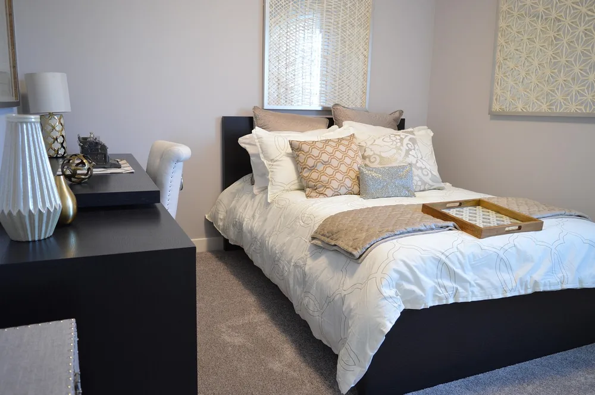
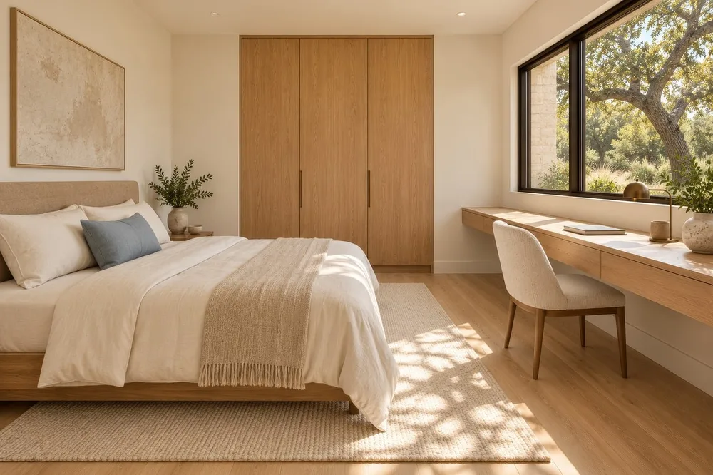
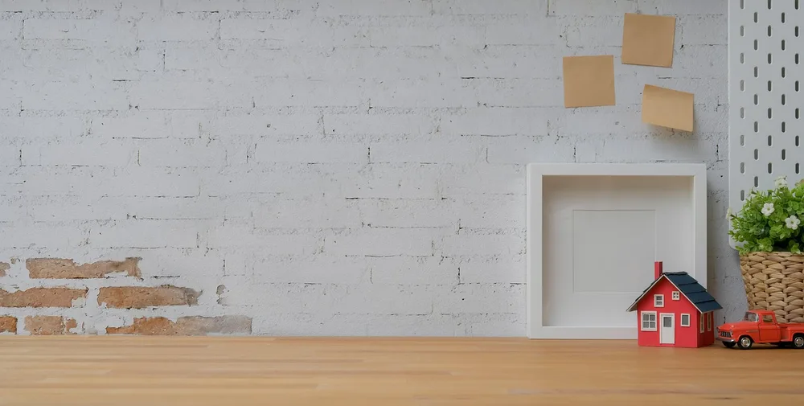
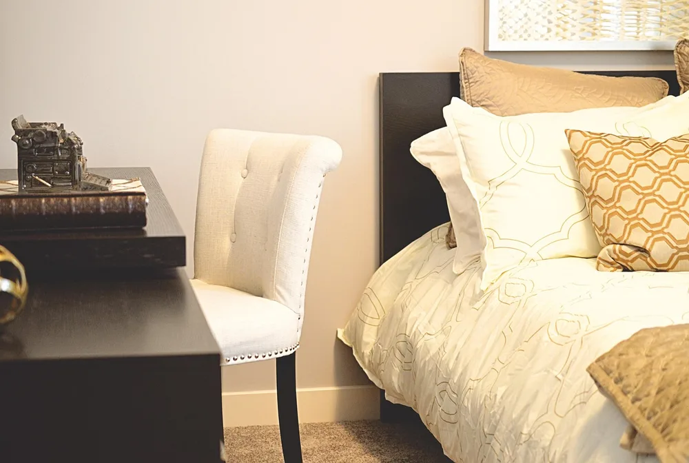
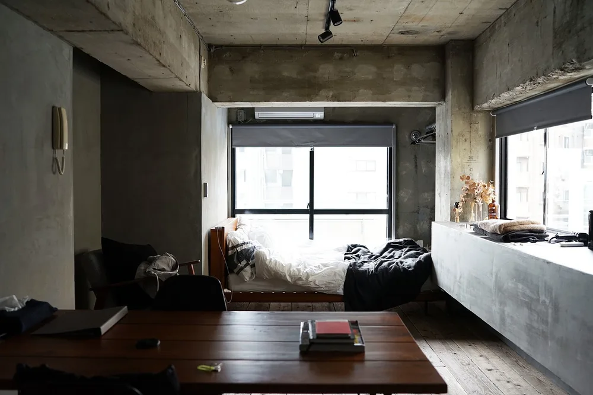

<figure class="pin-figure"><figcaption>Photo by <a href="https://pixabay.com/users/ErikaWittlieb-427626/" rel="nofollow noopener" target="_blank">ErikaWittlieb</a> on <a href="https://pixabay.com/photos/bedroom-bed-desk-house-home-1078890/" rel="nofollow noopener" target="_blank">Pixabay</a></figcaption></figure>

Working from the bedroom is common, but it blurs the line between work and rest. A desk that sits in plain view of the bed can make it harder to focus by day and harder to switch off at night.

These bedroom desk setup ideas help you create a real work zone in a shared room, with placement, light and small routines that keep work from spilling into your sleep space.

<h2>1. Place the Desk Away From the Bed View</h2>

<figure class="pin-figure"><figcaption>Photo by <a href="https://pixabay.com/users/AberrantRealities-38952538/" rel="nofollow noopener" target="_blank">AberrantRealities</a> on <a href="https://pixabay.com/photos/modern-bedroom-wooden-floors-10509557/" rel="nofollow noopener" target="_blank">Pixabay</a></figcaption></figure>

If you can, position the desk so you do not see the bed while you work, and so the desk is not the last thing you see before falling asleep. Facing a wall or a window works much better than facing the bed, because each view keeps its own purpose.

Even turning the desk ninety degrees can make a big difference in how the room feels. The goal is to create two distinct zones in one room, each with its own view and purpose, so your brain can switch between work mode and rest mode more easily.

<h2>2. Use a Divider or Curtain</h2>

<figure class="pin-figure"><figcaption>Photo by <a href="https://pixabay.com/users/Pexels-2286921/" rel="nofollow noopener" target="_blank">Pexels</a> on <a href="https://pixabay.com/photos/coffee-cup-macbook-laptop-working-1284041/" rel="nofollow noopener" target="_blank">Pixabay</a></figcaption></figure>

A folding screen, an open shelf or a curtain hung from the ceiling creates a visual separation between the desk and the bed. It does not need to block everything; it only needs to define two areas clearly enough that each one feels like its own space.

An open bookshelf works twice: as storage for both zones and as a soft barrier between them. A curtain can be drawn at the end of the day to hide the office completely, which is a simple and satisfying way to mark the end of work.

<h2>3. Match the Desk to the Bedroom Style</h2>

<figure class="pin-figure"><figcaption>Photo by <a href="https://pixabay.com/users/LUM3N-1066559/" rel="nofollow noopener" target="_blank">LUM3N</a> on <a href="https://pixabay.com/photos/home-office-work-to-learn-rug-2844640/" rel="nofollow noopener" target="_blank">Pixabay</a></figcaption></figure>

An office desk in black metal can look out of place next to soft bedding and wooden nightstands. Choosing a desk in the same wood tone or color as the rest of the bedroom makes it feel like part of the room rather than an intrusion from the office.

Keep the accessories in the bedroom palette too, such as a fabric-covered box instead of a plastic organizer. A matching desk makes the room feel calmer and less like you are sleeping in an office, which helps you relax when the workday ends.

<h2>4. Try a Floating Desk</h2>

<figure class="pin-figure"><figcaption>Photo by <a href="https://pixabay.com/users/bongkarngraphic-16126984/" rel="nofollow noopener" target="_blank">bongkarngraphic</a> on <a href="https://pixabay.com/photos/brick-business-creative-decoration-5066286/" rel="nofollow noopener" target="_blank">Pixabay</a></figcaption></figure>

Bedrooms are often short on floor space. A wall-mounted floating desk takes up no floor area, looks light and airy and can be installed at exactly the height that fits your chair, which is not always possible with a standard desk.

Add a shelf above it for storage and choose a stool or compact chair that tucks completely underneath when you are done. The whole setup almost disappears visually when you are not working, which keeps the bedroom feeling like a bedroom and leaves more open floor space for moving around comfortably.

<h2>5. Plan Lighting for Day and Night</h2>

<figure class="pin-figure"><figcaption>Photo by <a href="https://pixabay.com/users/zcn赵-20704144/" rel="nofollow noopener" target="_blank">zcn赵</a> on <a href="https://pixabay.com/photos/bed-bedroom-tv-desk-lamp-6099032/" rel="nofollow noopener" target="_blank">Pixabay</a></figcaption></figure>

A bedroom needs warm, dim light at night and brighter light for work during the day. Use a dedicated desk lamp with neutral white light for working hours, kept separate from the warm bedside lamps you use when winding down.

At night, switch the desk lamp off and use only the warm bedside light. Keeping the two sets of lights apart helps your brain associate each zone with its purpose, so the bedroom feels restful in the evening even with a desk in it.

<h2>6. Keep Work Gear in One Closed Box</h2>

<figure class="pin-figure"><figcaption>Photo by <a href="https://pixabay.com/users/ds_30-1795490/" rel="nofollow noopener" target="_blank">ds_30</a> on <a href="https://pixabay.com/photos/cardboard-box-white-package-5324172/" rel="nofollow noopener" target="_blank">Pixabay</a></figcaption></figure>

Papers, chargers and notebooks spread easily into the rest of a bedroom, ending up on the nightstand or the bed. Keep all work items in one closed box or drawer, and put everything back there at the end of each workday.

When the box is closed, work is done. It is a simple physical signal that makes switching off much easier than seeing your unfinished tasks on the desk all evening, and it keeps the bedroom tidy with almost no extra effort.

<h2>7. Choose a Quiet, Compact Chair</h2>

<figure class="pin-figure"><figcaption>Photo by <a href="https://pixabay.com/users/ErikaWittlieb-427626/" rel="nofollow noopener" target="_blank">ErikaWittlieb</a> on <a href="https://pixabay.com/photos/bed-desk-bedroom-chair-pillows-2167252/" rel="nofollow noopener" target="_blank">Pixabay</a></figcaption></figure>

A large gaming or executive chair can dominate a small bedroom and make it feel like an office. A compact chair with good back support fits much better, tucks under the desk and keeps the room feeling open and calm.

Look for soft wheels or felt pads if you share the room with someone else, so you do not wake anyone when you start work early or finish late. A quiet chair is a small detail that makes sharing a bedroom office much easier.

<h2>8. Use the Window Spot</h2>

<figure class="pin-figure"><figcaption>Photo by <a href="https://pixabay.com/users/StockSnap-894430/" rel="nofollow noopener" target="_blank">StockSnap</a> on <a href="https://pixabay.com/photos/house-home-residence-interior-2609090/" rel="nofollow noopener" target="_blank">Pixabay</a></figcaption></figure>

The space in front of a bedroom window is often left unused. Placing the desk there gives you the best natural light, a view to rest your eyes on during breaks and keeps the bed out of sight while you work.

Position the monitor so the window is to the side rather than directly behind the screen. This avoids glare on the display and prevents you from appearing as a dark silhouette on video calls, which happens when the window is behind you.

<h2>9. Keep Cables Off the Bedroom Floor</h2>

<figure class="pin-figure"><figcaption>Photo by <a href="https://pixabay.com/users/Taken-336382/" rel="nofollow noopener" target="_blank">Taken</a> on <a href="https://pixabay.com/photos/plug-round-electricity-power-672223/" rel="nofollow noopener" target="_blank">Pixabay</a></figcaption></figure>

Cables stretched across a bedroom floor are a tripping hazard in the dark and make the room look messy. Mount a small cable tray under the desk and run a single cable to the outlet along the wall, so the floor stays clear.

A cable box can also hide a charging strip near the bed for your phone and earbuds. Fewer visible cables help the bedroom feel like a place to rest rather than a workstation, they make cleaning the floor much quicker and they remove one more small source of visual stress before sleep.

<h2>10. Close the Office at the End of the Day</h2>

<figure class="pin-figure"><figcaption>Photo by <a href="https://pixabay.com/users/StockSnap-894430/" rel="nofollow noopener" target="_blank">StockSnap</a> on <a href="https://pixabay.com/photos/office-desk-lamp-light-night-926590/" rel="nofollow noopener" target="_blank">Pixabay</a></figcaption></figure>

Create a short shutdown routine at the end of each workday: close the laptop, put work items back in their box, switch off the desk lamp and push in the chair. If you have a curtain or screen, close it too.

This takes about two minutes and tells your brain clearly that the workday is over. Over time, the bedroom starts to feel restful again even with a desk in it, and falling asleep gets easier because work is literally out of sight.

<h2>Final Thoughts</h2>

A bedroom desk works when it has clear boundaries: its own view, its own light and a routine that closes it at night. Start with placement and the shutdown habit, then add a divider or floating desk if you need more separation.

