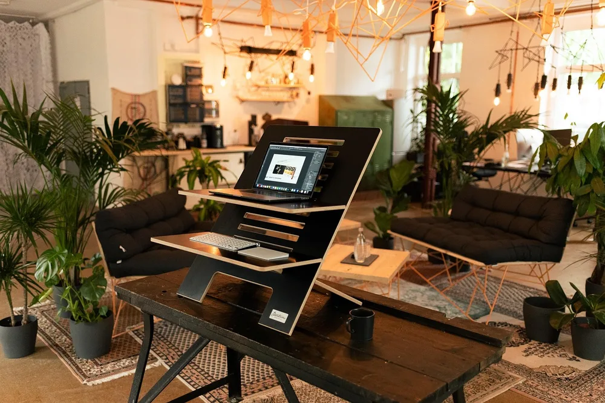
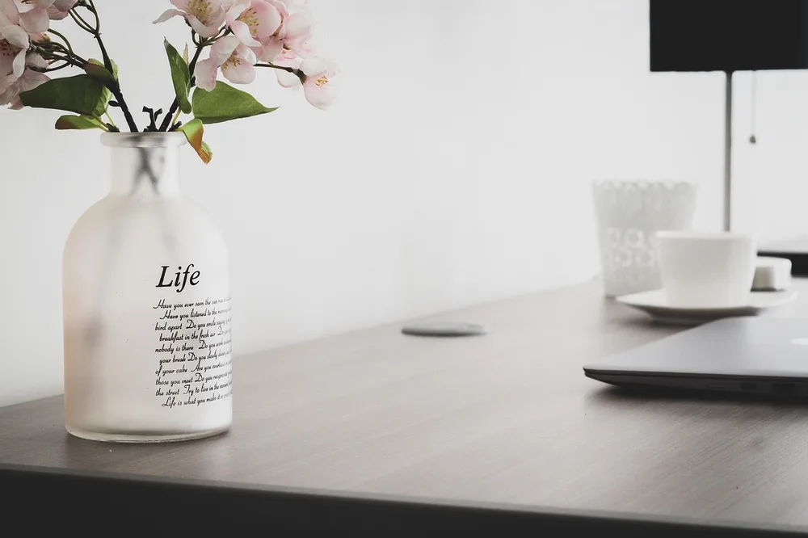
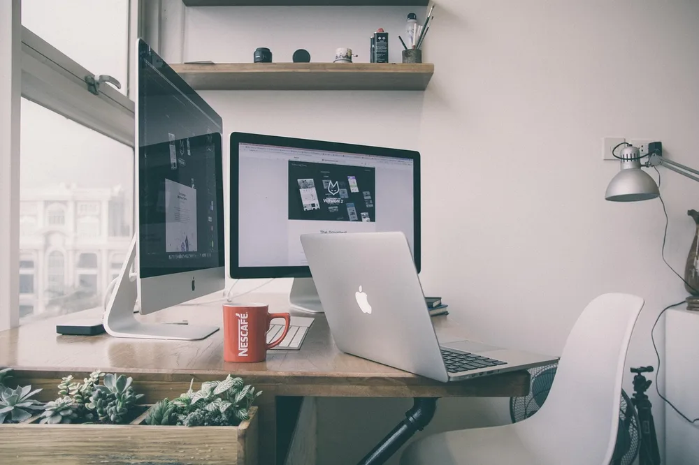
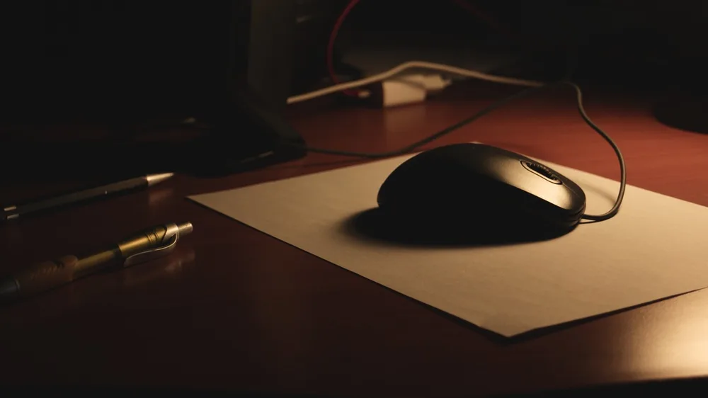
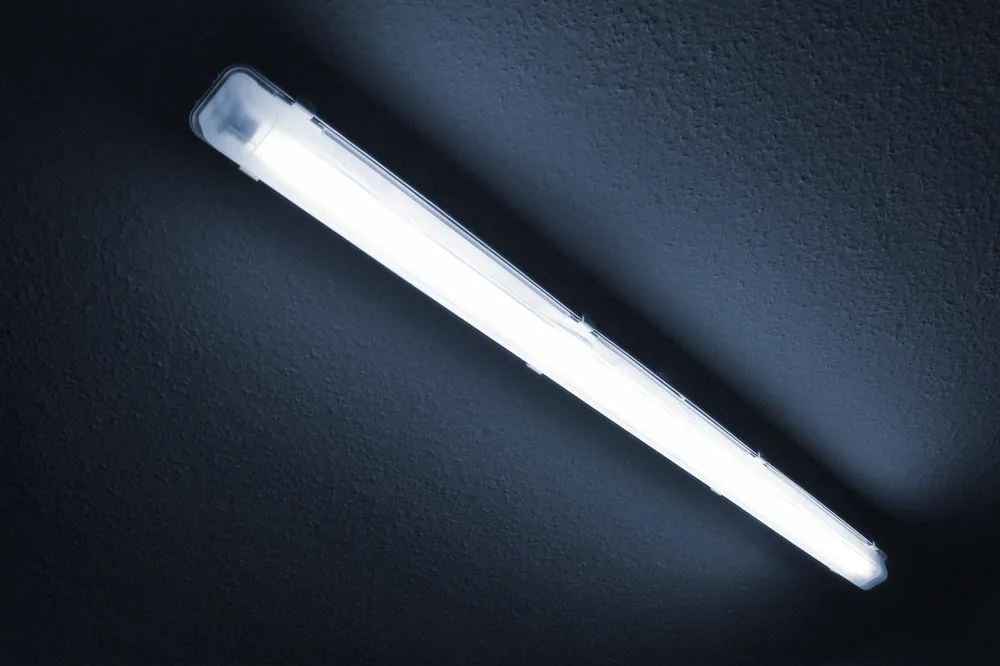
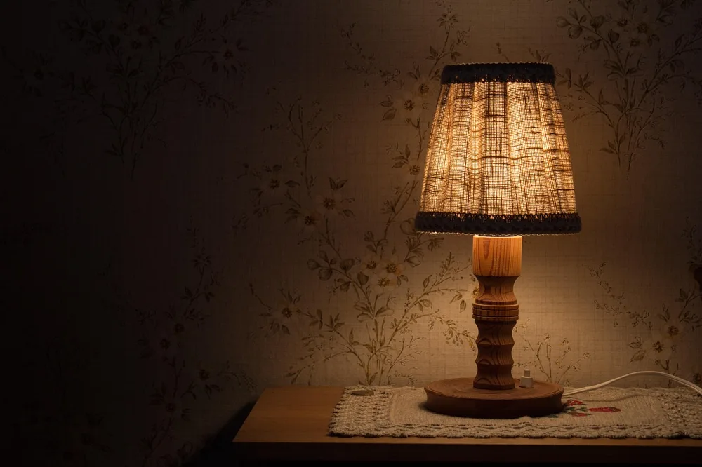

<figure class="pin-figure"><figcaption>Photo by <a href="https://pixabay.com/users/Standsome-18205472/" rel="nofollow noopener" target="_blank">Standsome</a> on <a href="https://pixabay.com/photos/home-office-interior-design-6816369/" rel="nofollow noopener" target="_blank">Pixabay</a></figcaption></figure>

Lighting is the most overlooked part of a home office. Poor light causes glare on the screen, tired eyes and dull video calls, even when the rest of the setup is perfect.

These home office lighting ideas start with daylight and work through task lights, screen lighting and the evening, so your workspace is comfortable from the first email to the last.

<h2>1. Put the Window to Your Side</h2>

<figure class="pin-figure"><figcaption>Photo by <a href="https://pixabay.com/users/ArtDreams92-55472075/" rel="nofollow noopener" target="_blank">ArtDreams92</a> on <a href="https://pixabay.com/photos/woman-architecture-desk-workplace-10347246/" rel="nofollow noopener" target="_blank">Pixabay</a></figcaption></figure>

Daylight is the best light you have, but the direction it comes from matters a lot. A window behind the monitor makes your eyes fight the strong contrast, and a window behind you causes glare and reflections on the screen.

Position the desk so the window is to your left or right side instead. You get plenty of natural light on the desk without reflections, squinting or a dark face on video calls, and it costs nothing but a few minutes of moving furniture.

<h2>2. Add a Task Lamp on the Opposite Side</h2>

<figure class="pin-figure"><figcaption>Photo by <a href="https://pixabay.com/users/ricardorv30-2418232/" rel="nofollow noopener" target="_blank">ricardorv30</a> on <a href="https://pixabay.com/photos/flower-vase-decoration-workspace-5517745/" rel="nofollow noopener" target="_blank">Pixabay</a></figcaption></figure>

A desk lamp lights your keyboard, notebook and documents directly, filling in where daylight and ceiling lights fall short. Place it on the side opposite your writing hand, so your own hand does not cast a shadow over the page while you write.

An adjustable arm lets you aim the light exactly where you need it and keep it out of your eyes. Being able to move it also helps on gray days and in the evening, when you need more light on the desk than in the rest of the room.

<h2>3. Use a Monitor Light Bar</h2>

<figure class="pin-figure"><figcaption>Photo by <a href="https://pixabay.com/users/StockSnap-894430/" rel="nofollow noopener" target="_blank">StockSnap</a> on <a href="https://pixabay.com/photos/table-chair-desk-lamp-room-office-2587226/" rel="nofollow noopener" target="_blank">Pixabay</a></figcaption></figure>

A light bar sits on top of the monitor and shines down onto the desk without reflecting off the screen. It is ideal for small desks, because it takes no surface space at all and keeps the light close to where you actually work.

Many models let you adjust both brightness and color temperature with a small dial or remote. That flexibility lets you keep the same comfortable light from the morning to the evening, simply turning it warmer and dimmer as the day goes on, without adding another lamp to an already crowded desk.

<h2>4. Add Bias Lighting Behind the Screen</h2>

<figure class="pin-figure"><figcaption>Photo by <a href="https://pixabay.com/users/StockSnap-894430/" rel="nofollow noopener" target="_blank">StockSnap</a> on <a href="https://pixabay.com/photos/work-desk-office-mouse-pad-table-2598577/" rel="nofollow noopener" target="_blank">Pixabay</a></figcaption></figure>

Working in a dim room with only a bright screen makes your eyes adjust constantly between the display and the darkness around it. A soft light behind the monitor raises the ambient light around the screen and reduces that strain.

Keep this light dim and neutral or warm. It should be a gentle glow on the wall behind the screen, not a bright decoration, and it is most helpful in the evening when the rest of the room is dark.

<h2>5. Choose Neutral White Bulbs for Work Hours</h2>

<figure class="pin-figure"><figcaption>Photo by <a href="https://pixabay.com/users/konkapo-55292388/" rel="nofollow noopener" target="_blank">konkapo</a> on <a href="https://pixabay.com/photos/online-learning-e-learning-10207405/" rel="nofollow noopener" target="_blank">Pixabay</a></figcaption></figure>

The color of light affects how alert you feel. Neutral white light, close to the color of soft daylight, works well for focused tasks and keeps colors accurate on paper and on screen, which matters for reading and design work.

Use these neutral bulbs in the task lamp and the main fixture you rely on during work hours. Keep warmer bulbs for the rest of the room, so you can shift the whole mood simply by switching which lights are on.

<h2>6. Make Every Light Dimmable</h2>

<figure class="pin-figure"><figcaption>Photo by <a href="https://pixabay.com/users/Feygrace-51357910/" rel="nofollow noopener" target="_blank">Feygrace</a> on <a href="https://pixabay.com/photos/businessman-casual-professional-10364898/" rel="nofollow noopener" target="_blank">Pixabay</a></figcaption></figure>

Light that is too bright can be almost as tiring as light that is too dim. Dimmable lamps and smart bulbs let you adjust the brightness to the time of day, the weather and the task in front of you.

Lower the brightness on gray afternoons when the screen starts to feel harsh, and raise it when you are reading paper documents or doing detailed work. These small adjustments through the day keep your eyes noticeably more comfortable, and they take only a second once your lights are dimmable.

<h2>7. Soften Harsh Ceiling Light</h2>

<figure class="pin-figure"><figcaption>Photo by <a href="https://pixabay.com/users/kalhh-86169/" rel="nofollow noopener" target="_blank">kalhh</a> on <a href="https://pixabay.com/photos/neon-tube-neon-light-blue-light-269365/" rel="nofollow noopener" target="_blank">Pixabay</a></figcaption></figure>

A single bright ceiling light creates flat light and glare on screens. If you cannot change the fixture itself, use a diffusing shade or switch to lower-brightness bulbs and rely more on lamps for the light you need at the desk.

Layering light at different heights, from the ceiling, the desk and the floor, gives the room depth and makes it far more comfortable for long workdays. It also makes a small home office feel more like a pleasant room you enjoy spending time in, rather than a corner lit like a waiting room.

<h2>8. Diffuse Daylight With Sheer Curtains</h2>

<figure class="pin-figure"><figcaption>Photo by <a href="https://pixabay.com/users/ImaArtist-11400164/" rel="nofollow noopener" target="_blank">ImaArtist</a> on <a href="https://pixabay.com/photos/woman-room-window-curtains-wind-5458524/" rel="nofollow noopener" target="_blank">Pixabay</a></figcaption></figure>

Direct sun on the desk or the screen causes glare, heats up the room and washes out the display so you have to squint. Sheer curtains or light-filtering blinds soften the daylight while still keeping the room bright and connected to the outside, which gives you the best of both worlds.

Add a blackout layer behind the sheers if you need full control of the light for video calls or presentations at certain times of day. Being able to choose between soft daylight and darkness makes the office comfortable and usable in every season, from bright summer mornings to low winter sun.

<h2>9. Light Your Face for Video Calls</h2>

<figure class="pin-figure"><figcaption>Photo by <a href="https://pixabay.com/users/geralt-9301/" rel="nofollow noopener" target="_blank">geralt</a> on <a href="https://pixabay.com/photos/video-conference-home-office-desk-10318099/" rel="nofollow noopener" target="_blank">Pixabay</a></figcaption></figure>

On video calls, light coming from behind you turns your face into a dark silhouette. Make sure the main light source is in front of you, slightly above eye level, such as a window facing you or a soft light placed behind the monitor.

A small soft light, or a lamp bounced off the wall in front of you, gives even and natural-looking light without harsh shadows under your eyes or nose. It is a small and inexpensive change that makes you look much more professional and awake on camera, especially on late afternoon calls.

<h2>10. Switch to Warm Light After Work</h2>

<figure class="pin-figure"><figcaption>Photo by <a href="https://pixabay.com/users/simonprodl-143860/" rel="nofollow noopener" target="_blank">simonprodl</a> on <a href="https://pixabay.com/photos/bedside-lamp-light-bedside-table-843461/" rel="nofollow noopener" target="_blank">Pixabay</a></figcaption></figure>

Bright neutral light late in the evening keeps your brain in work mode long after you have closed the laptop for the day. When the workday ends, switch off the task light and the light bar, and turn on only the warm lamps in the room to signal that it is time to slow down.

This simple change helps the room transition from office to living space and makes it easier to wind down before bed. Over time, the switch in lighting becomes a reliable signal that work is over for the day, which is especially helpful when your office and your home are the same place.

<h2>Final Thoughts</h2>

Good home office lighting comes in layers: daylight from the side, a task lamp, soft light around the screen and warm light after work. Start by moving the desk relative to the window, then add one task light.

