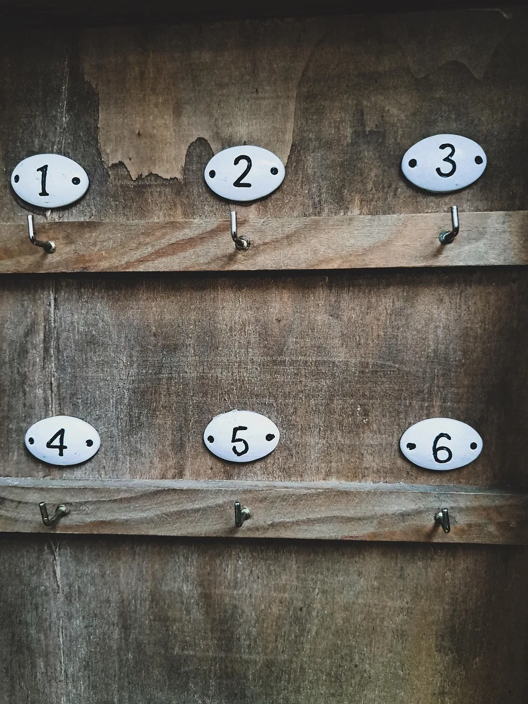
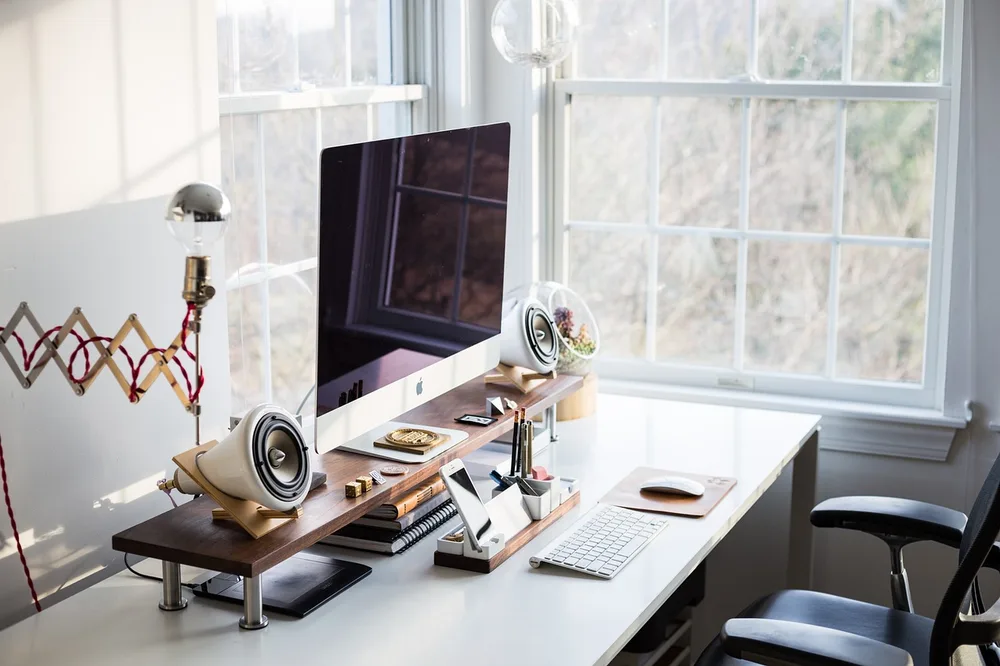
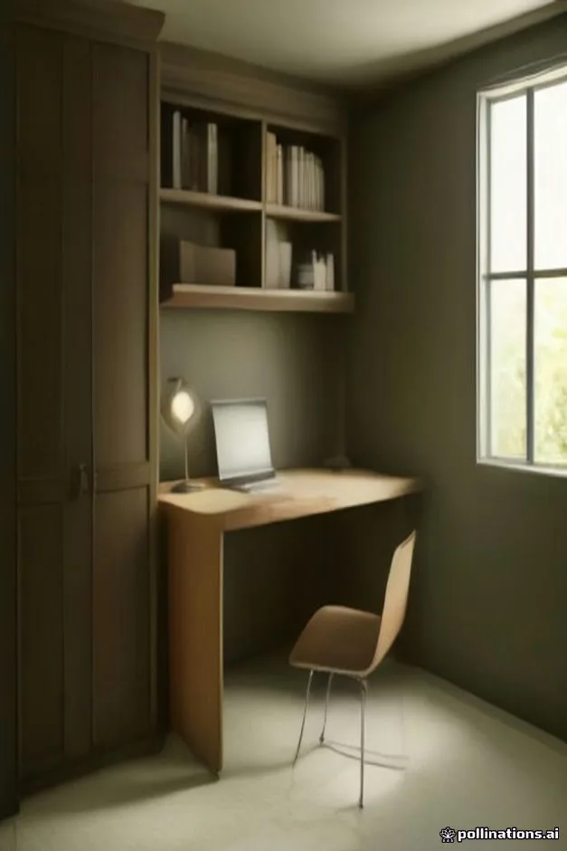
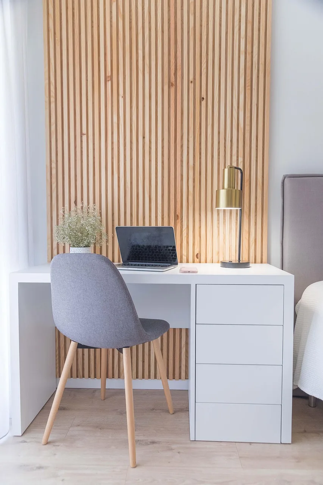
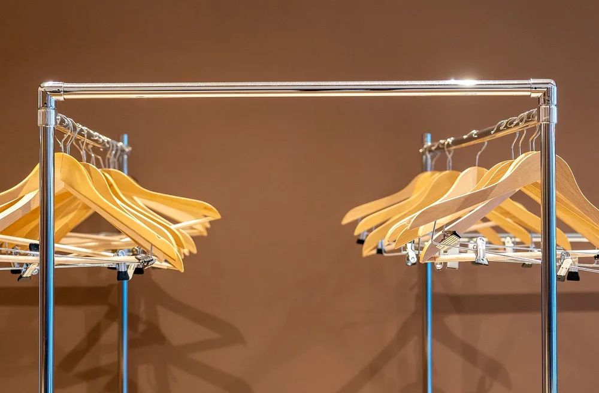
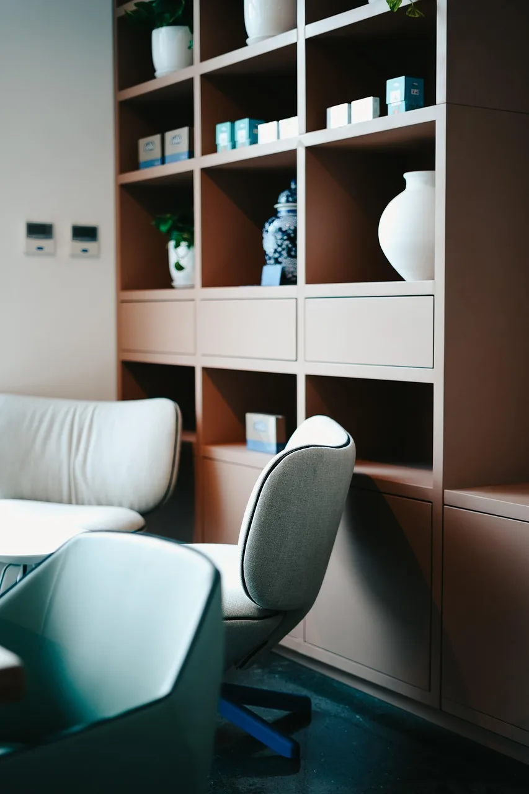
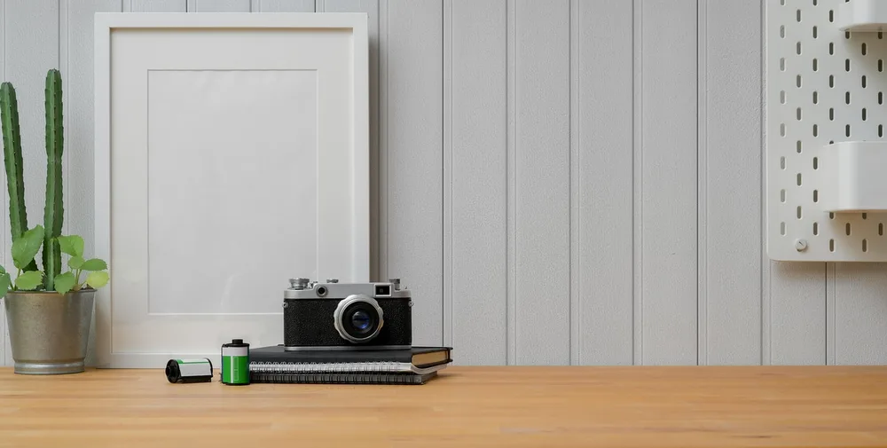

<figure class="pin-figure"><figcaption>Photo by <a href="https://pixabay.com/users/Janvanbizar-22575084/" rel="nofollow noopener" target="_blank">Janvanbizar</a> on <a href="https://pixabay.com/photos/keys-key-cabinet-closet-lock-up-7846408/" rel="nofollow noopener" target="_blank">Pixabay</a></figcaption></figure>

A spare closet can become one of the most practical home offices you will ever have. It already has walls on three sides, it fits a desk surprisingly well and, best of all, you can close the doors at the end of the day and leave work behind you, even in a small apartment.

These closet office ideas cover the desk surface, storage, lighting, power and the small design details that make a converted closet feel like a proper workspace. Most can be done in a weekend, and many work in rentals with only minor, reversible changes.

<h2>1. Remove the Doors or Swap Them for Curtains</h2>

<figure class="pin-figure"><figcaption>Photo by <a href="https://pixabay.com/users/StockSnap-894430/" rel="nofollow noopener" target="_blank">StockSnap</a> on <a href="https://pixabay.com/photos/computer-keyboard-apple-electronics-2565478/" rel="nofollow noopener" target="_blank">Pixabay</a></figcaption></figure>

Hinged closet doors often get in the way of the chair, so many closet offices work better without them. Remove the doors and store them safely, then hang a curtain on a ceiling track so you can still hide the workspace at the end of the day.

If you keep sliding or bifold doors, check that they open far enough to give you full access to the desk. A curtain in a soft, neutral fabric adds warmth to the room and makes the closed closet look like a deliberate design choice instead of a hidden mess.

<h2>2. Install a Wall-to-Wall Desk Surface</h2>

<figure class="pin-figure"><figcaption>Photo by <a href="https://pixabay.com/users/Mariakray-23567841/" rel="nofollow noopener" target="_blank">Mariakray</a> on <a href="https://pixabay.com/photos/cloakroom-wardrobe-closet-hook-8275684/" rel="nofollow noopener" target="_blank">Pixabay</a></figcaption></figure>

A single board spanning the full width of the closet makes the most of every inch and looks like built-in furniture. Support it with wall cleats on three sides, which are strong, simple to install and leave the space underneath completely free for your legs and chair.

Butcher block or plywood with a good edge finish both work well. Set the height around twenty eight to thirty inches, checking it with your own chair before you fix anything. Leave a small gap at the back for cables to drop through to a power strip below.

<h2>3. Stack Shelves Above the Desk</h2>

<figure class="pin-figure"><figcaption>AI-generated image</figcaption></figure>

The vertical space above the desk is where a closet office gets its storage. Two or three shelves running the full width hold books, binders, boxes and a printer, while keeping the desk itself clear for the computer and whatever you are working on right now.

Use adjustable shelving standards if you think your needs may change, or simple fixed shelves for a cleaner look. Keep the first shelf high enough to clear your monitor, and store the things you use least on the top shelf, closest to the ceiling.

<h2>4. Add Lighting Inside the Closet</h2>

<figure class="pin-figure"><figcaption>Photo by <a href="https://pixabay.com/users/sandraicrei-20216502/" rel="nofollow noopener" target="_blank">sandraicrei</a> on <a href="https://pixabay.com/photos/interior-design-bedroom-table-chair-6012873/" rel="nofollow noopener" target="_blank">Pixabay</a></figcaption></figure>

Closets are usually dark, and a workspace in shadow is tiring to use. An LED strip mounted under the lowest shelf lights the entire desk evenly and hides out of sight, which is ideal for a narrow space where a large lamp would take up too much room.

Choose a strip with a neutral or warm white color and a dimmer if possible. A small clamp lamp can add focused light for paperwork. Plug-in strips and battery lights are good options if you do not want to add any wiring inside a rented closet.

<h2>5. Wallpaper the Back Wall</h2>

<figure class="pin-figure"><figcaption>Photo by <a href="https://pixabay.com/users/Mariakray-23567841/" rel="nofollow noopener" target="_blank">Mariakray</a> on <a href="https://pixabay.com/photos/cloakroom-wardrobe-closet-hook-8275686/" rel="nofollow noopener" target="_blank">Pixabay</a></figcaption></figure>

Because a closet office is a small, enclosed space, it is the perfect place to try a bold wallpaper or paint color you might not use on a full room. A patterned back wall turns the open closet into a feature and makes the workspace feel special every time you sit down.

Peel and stick wallpaper suits rentals and goes up quickly in a small area. Choose a pattern that is lively but not too busy at close range, such as a soft botanical, a small geometric or a textured grasscloth look, so it stays pleasant to look at all day.

<h2>6. Choose a Chair That Tucks All the Way In</h2>

<figure class="pin-figure"><figcaption>Photo by <a href="https://pixabay.com/users/shadahotel-44959483/" rel="nofollow noopener" target="_blank">shadahotel</a> on <a href="https://pixabay.com/photos/hotel-chair-shelves-interior-desk-8980555/" rel="nofollow noopener" target="_blank">Pixabay</a></figcaption></figure>

In a closet office the chair often has to disappear when the curtain or doors close. A compact armless chair or an upholstered stool that slides fully under the desk keeps the room tidy and the closet closable, while still being comfortable enough for a full workday.

Measure the clearance under the desk before buying, including any cleats or drawers. If you work long hours, choose an adjustable task chair without arms rather than a dining chair, so you can still set the height properly for your posture and the desk.

<h2>7. Use the Side Walls for Vertical Storage</h2>

<figure class="pin-figure"><figcaption>Photo by <a href="https://pixabay.com/users/bongkarngraphic-16126984/" rel="nofollow noopener" target="_blank">bongkarngraphic</a> on <a href="https://pixabay.com/photos/brick-business-creative-decoration-5066283/" rel="nofollow noopener" target="_blank">Pixabay</a></figcaption></figure>

The narrow side walls of a closet are easy to overlook, yet they are perfect for pegboards, hooks and slim wall pockets. Hang headphones, a bag, cables and notebooks there, and the desk and shelves stay free for the things you reach for most often.

A pegboard on one side and a magnetic or cork board on the other gives you flexible storage and a spot for notes. Keep heavier items low and lighter ones higher, and do not overload the side walls, since a closet already feels compact and can easily become crowded.

<h2>8. Plan Power and Cables Before You Build</h2>

<figure class="pin-figure"><figcaption>Photo by <a href="https://pixabay.com/users/stux-12364/" rel="nofollow noopener" target="_blank">stux</a> on <a href="https://pixabay.com/photos/headphones-equalizer-controller-414061/" rel="nofollow noopener" target="_blank">Pixabay</a></figcaption></figure>

Most closets have no outlet, so think about power before the desk goes in. A power strip mounted under the desk, fed by a single flat extension cord along the baseboard, keeps everything plugged in without wires crossing the floor where someone could trip on them.

Add a cable tray under the desk and a small grommet hole at the back so cables drop straight down. Use a heavy duty, properly rated power strip, never daisy chain several strips, and leave the cable path clear so the doors or curtain can close without pinching anything.

<h2>9. Keep the Palette Light and Simple</h2>

<figure class="pin-figure"><figcaption>Photo by <a href="https://pixabay.com/users/Pexels-2286921/" rel="nofollow noopener" target="_blank">Pexels</a> on <a href="https://pixabay.com/photos/iphone-laptop-macbook-pro-notebook-1852901/" rel="nofollow noopener" target="_blank">Pixabay</a></figcaption></figure>

Light colors make a small enclosed space feel larger and brighter. White or soft beige walls, a light wood desk and simple storage boxes in one or two colors keep the closet office calm, so it does not feel like you are working inside a cupboard.

If you chose a bold back wall, keep everything else neutral so the pattern stands out. Limit decor to a plant, one framed print and a few useful objects. In such a small space, every extra item is noticeable, so editing regularly matters more than in a full room.

<h2>10. Close It Up at the End of the Day</h2>

<figure class="pin-figure"><figcaption>Photo by <a href="https://pixabay.com/users/SnapwireSnaps-692569/" rel="nofollow noopener" target="_blank">SnapwireSnaps</a> on <a href="https://pixabay.com/photos/man-work-desk-business-person-597178/" rel="nofollow noopener" target="_blank">Pixabay</a></figcaption></figure>

The best feature of a closet office is that it disappears. Closing the curtain or doors when work is done creates a clear boundary between work and home, which can be hard to find when your desk is in the bedroom or living room and always in view.

Make it a routine: clear the desk, plug in devices to charge and close the closet. A small tray for the things you leave out helps. Over time this simple ritual signals the end of the workday and makes the rest of the room feel like home again.

<h2>Final Thoughts</h2>

A closet office gives you a focused workspace without giving up a whole room, and you can close it when the workday ends. Start with a solid desk surface and good lighting, then add shelves, storage and a little personality until the closet feels like a real office.

