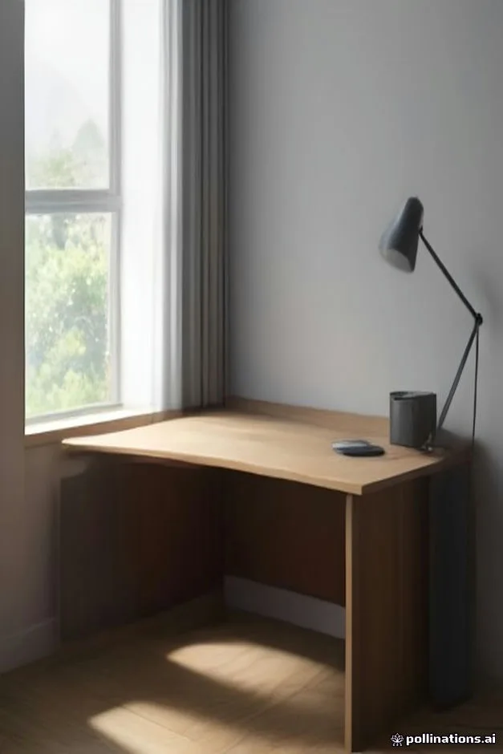
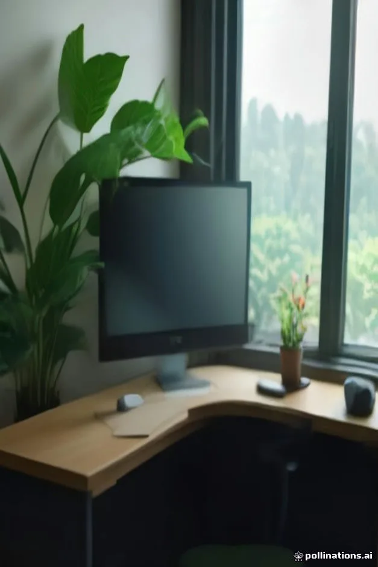
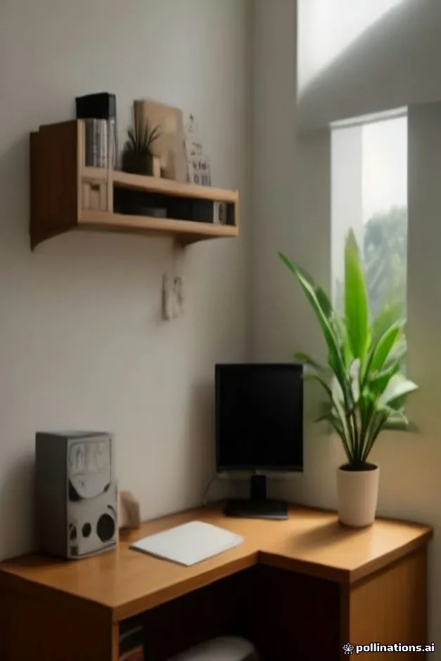
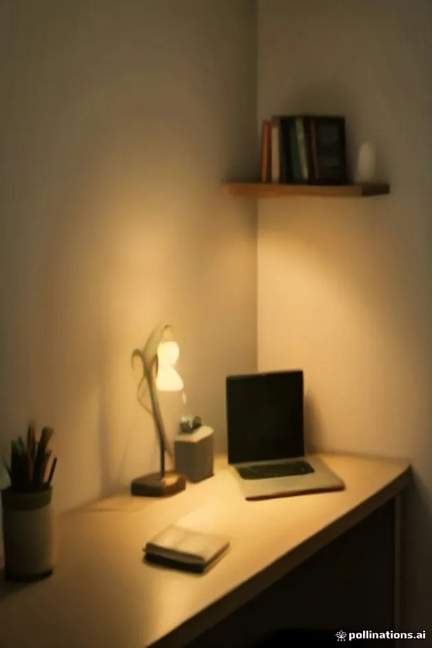
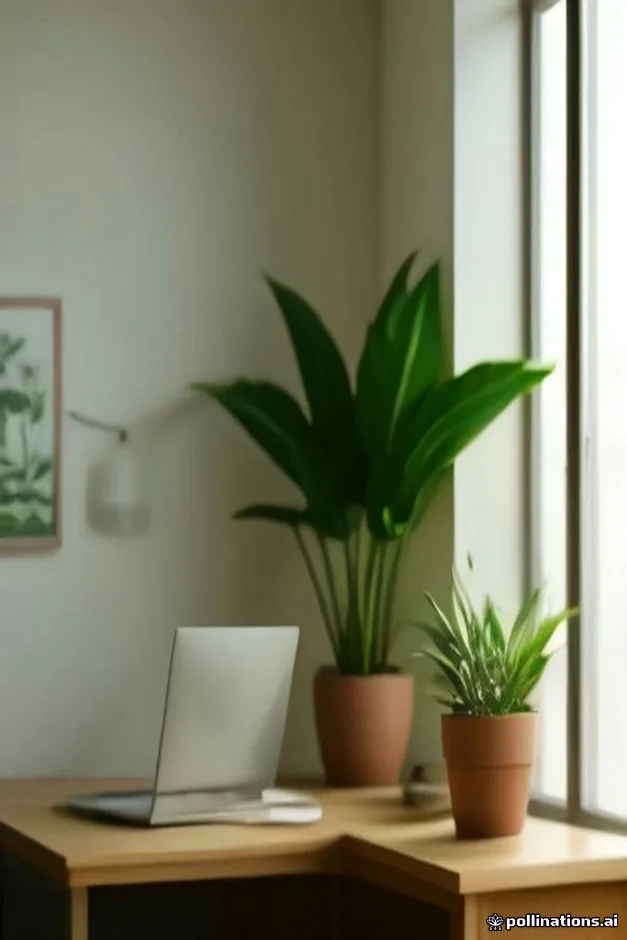
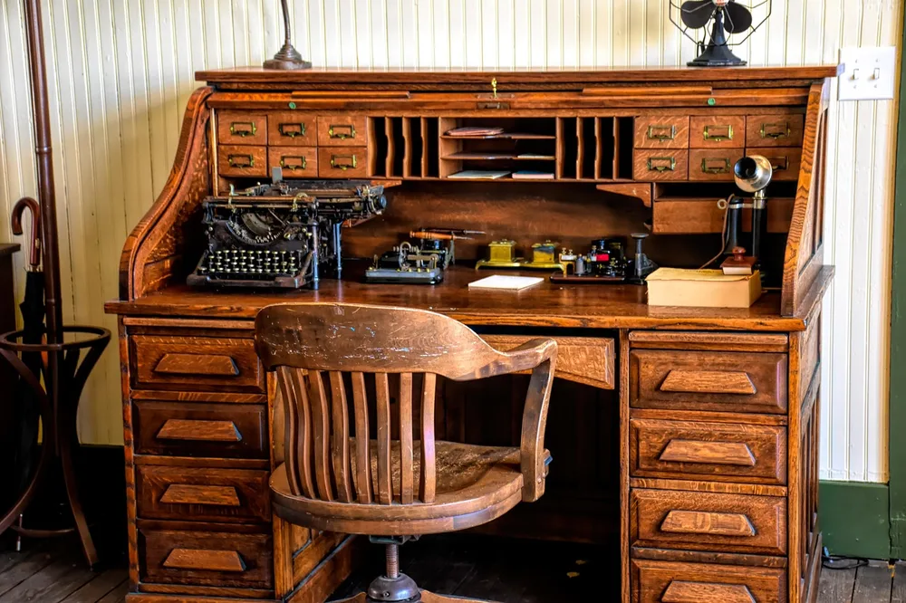
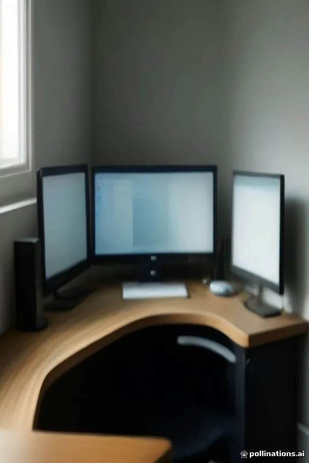
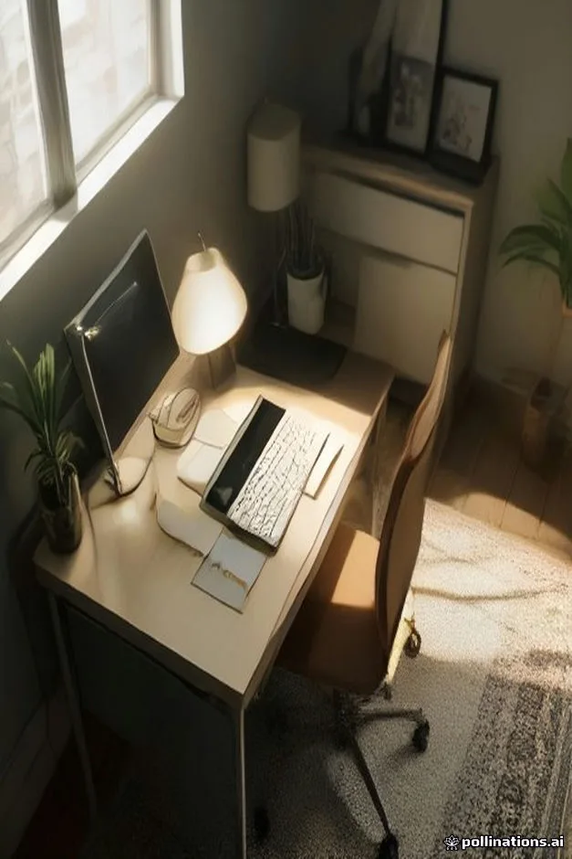

<figure class="pin-figure"><figcaption>Photo by <a href="https://pixabay.com/users/StartupStockPhotos-690514/" rel="nofollow noopener" target="_blank">StartupStockPhotos</a> on <a href="https://pixabay.com/photos/office-startup-business-home-office-594132/" rel="nofollow noopener" target="_blank">Pixabay</a></figcaption></figure>

Corners are often the most wasted space in a room. Furniture does not fit them well, light rarely reaches them and they slowly collect boxes and laundry. Yet a corner is also a naturally enclosed spot, which makes it a surprisingly good place to sit down and focus on work.

These corner desk setup ideas turn that awkward space into a complete workspace, whether you are working with a large L-shaped desk or a narrow floating shelf. They cover layout, screens, storage, lighting and cables, so the corner feels deliberate instead of squeezed in.

<h2>1. Use an L-Shaped Desk for Two Work Zones</h2>

<figure class="pin-figure"><figcaption>AI-generated image</figcaption></figure>

An L-shaped desk fits a corner perfectly and gives you two distinct surfaces. Use one side for the computer and the other for writing, sketching or a second project, so switching tasks means turning your chair instead of clearing the whole desk every time.

Measure both walls carefully before buying, including window frames, radiators and outlets. Leave enough room behind the chair to roll back comfortably, roughly three feet. If space is tight, choose a model with one shorter return, which still gives you the benefit of two zones.

<h2>2. Angle the Monitor Into the Corner</h2>

<figure class="pin-figure"><figcaption>AI-generated image</figcaption></figure>

Placing the monitor where the two desk surfaces meet uses the deepest part of the corner and leaves both wings free for other things. Because corner desks are deeper at that point, you can sit at a comfortable distance from even a large screen without it crowding you.

A monitor arm clamped near the corner makes this even easier, since the screen can float forward over the deep spot. Make sure your chair and keyboard line up with the center of the screen, so you are not twisting your body slightly to one side all day long.

<h2>3. Add Corner Shelves Above the Desk</h2>

<figure class="pin-figure"><figcaption>AI-generated image</figcaption></figure>

The wall space above a corner desk is easy to forget. Corner shelves, either a set of triangular shelves or two straight shelves meeting at the corner, give you storage for books, a speaker, a plant and small boxes without taking any desk space at all.

Keep the lowest shelf high enough that it does not block the top of the monitor or feel like it hangs over your head. Styling the shelves with a mix of books and objects helps the corner look intentional, which makes a real difference on video calls.

<h2>4. Try a Floating Corner Desk</h2>

<figure class="pin-figure"><figcaption>Photo by <a href="https://pixabay.com/users/milad2fan-21674765/" rel="nofollow noopener" target="_blank">milad2fan</a> on <a href="https://pixabay.com/photos/bubbles-soap-bubbles-round-floating-7406112/" rel="nofollow noopener" target="_blank">Pixabay</a></figcaption></figure>

When floor space is tight, a wall mounted floating desk in the corner gives you a work surface without legs, which makes the room feel more open and is easy to clean under. A triangular or curved floating desk can be surprisingly roomy for a laptop and a lamp.

Mount it into wall studs with strong brackets, and decide the height with your chair before drilling, typically around twenty eight to thirty inches. A small floating shelf above it for supplies completes the setup while keeping the whole corner visually light.

<h2>5. Light the Corner Properly</h2>

<figure class="pin-figure"><figcaption>AI-generated image</figcaption></figure>

Corners are naturally darker than the rest of the room, so a corner desk often needs its own light. A desk lamp on the secondary wing or a clip lamp on a shelf lights the work surface, while an LED strip under a shelf brightens the corner evenly without any glare.

A floor lamp in or near the corner adds soft background light in the evening and makes the space feel less like a cave. Warm white bulbs feel calmer, while neutral white is better for detailed work. Having both lets you choose depending on the task and time of day.

<h2>6. Route Cables Along the Corner Seam</h2>

<figure class="pin-figure"><figcaption>Photo by <a href="https://pixabay.com/users/congerdesign-509903/" rel="nofollow noopener" target="_blank">congerdesign</a> on <a href="https://pixabay.com/photos/books-old-books-computer-4802927/" rel="nofollow noopener" target="_blank">Pixabay</a></figcaption></figure>

Corners are perfect for hiding cables, because the seam where the walls meet is already a natural line. Run cables down the corner in a paintable cable raceway or along the inside leg of the desk, and they almost disappear from view when you look at the setup.

A cable tray mounted under the back of the desk keeps the power strip and chargers off the floor. With everything gathered into one channel, adding or swapping a device later only takes a minute, and the corner looks clean even when several devices are plugged in.

<h2>7. Put a Plant on the Outer Edge</h2>

<figure class="pin-figure"><figcaption>AI-generated image</figcaption></figure>

A tall plant placed at the open end of a corner desk frames the workspace and softens the straight lines of the furniture. It also creates a light visual boundary between the desk and the rest of the room, which helps a corner office feel like its own space.

Choose a plant that suits the light in that part of the room, and use a pot with a saucer to protect the floor. If the corner gets very little daylight, a low light plant or a smaller pot on the desk wing is a better choice than a large plant that struggles.

<h2>8. Use the Deep Corner for Storage</h2>

<figure class="pin-figure"><figcaption>Photo by <a href="https://pixabay.com/users/Ray_Shrewsberry-7673058/" rel="nofollow noopener" target="_blank">Ray_Shrewsberry</a> on <a href="https://pixabay.com/photos/vintage-office-typewriter-table-4018107/" rel="nofollow noopener" target="_blank">Pixabay</a></figcaption></figure>

The space under the corner of an L-shaped desk is deep and hard to reach, so it suits things you use occasionally. A rolling drawer unit, a small file cabinet or a basket for spare cables fits there neatly and keeps everyday items out of the main legroom.

Keep the area directly in front of your chair clear so you can move your legs freely. Rolling storage is especially useful in a corner, because you can pull it out when you need it and push it back into the deep spot when you are done.

<h2>9. Add a Second Screen on the Side Wing</h2>

<figure class="pin-figure"><figcaption>AI-generated image</figcaption></figure>

A corner desk makes a two screen setup comfortable, because the second monitor can sit on the side wing at a natural angle. Use it for chat, reference material or a calendar, and keep the main screen in front of you for focused work, so your neck mostly faces forward.

Turning the second monitor vertically suits documents, code and long web pages. Match the heights of both screens as closely as possible, and place the one you use most directly in front of your keyboard rather than splitting the difference between them.

<h2>10. Define the Corner With a Rug</h2>

<figure class="pin-figure"><figcaption>AI-generated image</figcaption></figure>

A rug under the desk and chair separates the corner office from the rest of the room, which is especially helpful in bedrooms and living rooms. It signals that this spot is for work, and that small visual boundary can make it easier to switch into focus mode.

Choose a rug large enough for the chair to stay on it when you roll back. A low pile rug lets the chair glide easily, or you can lay a clear chair mat on top of a thicker one. Neutral colors keep the corner calm and match most furniture.

<h2>Final Thoughts</h2>

A corner desk setup turns one of the most neglected spots in a room into a focused workspace. Start with the right desk shape and screen position, then add shelves, light and a rug until the corner feels like a deliberate office instead of a leftover space.

