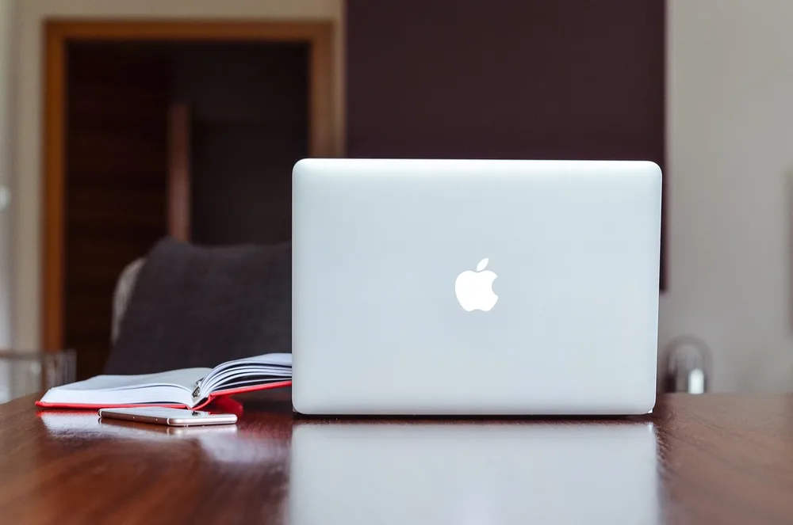
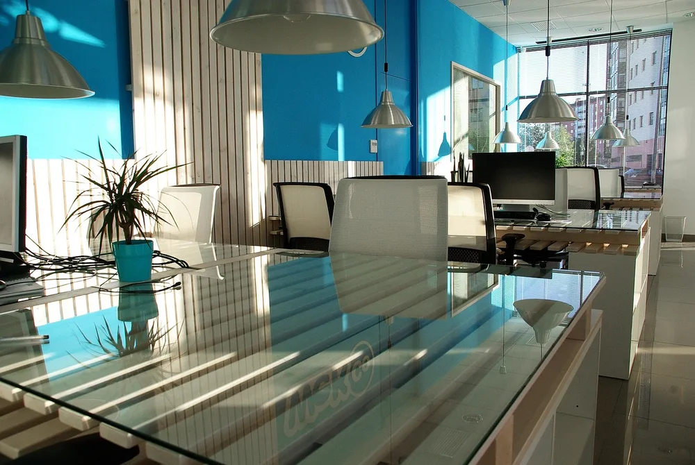
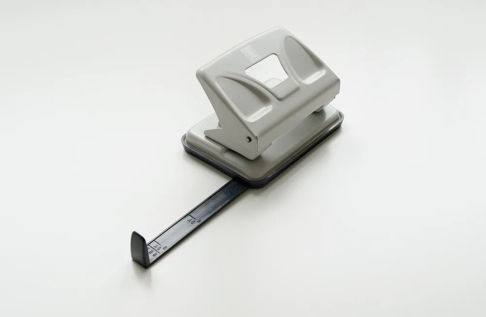
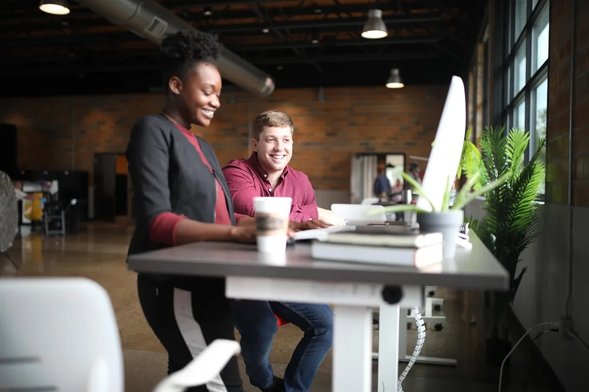
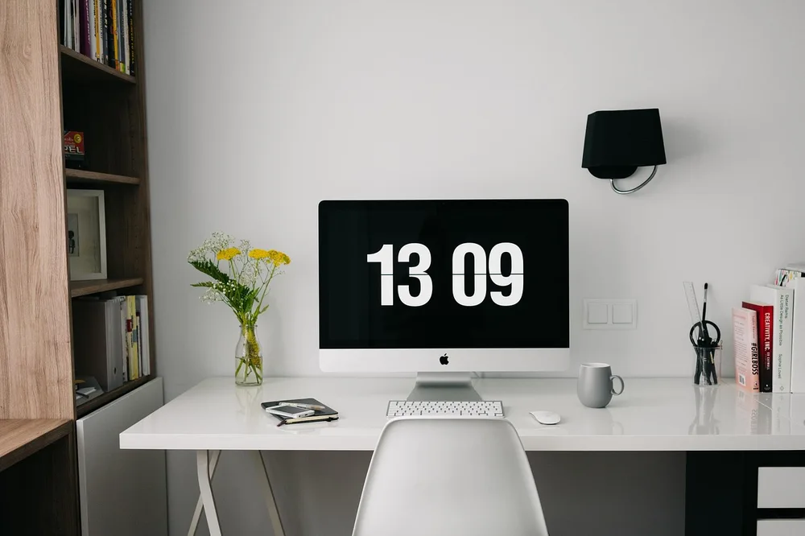
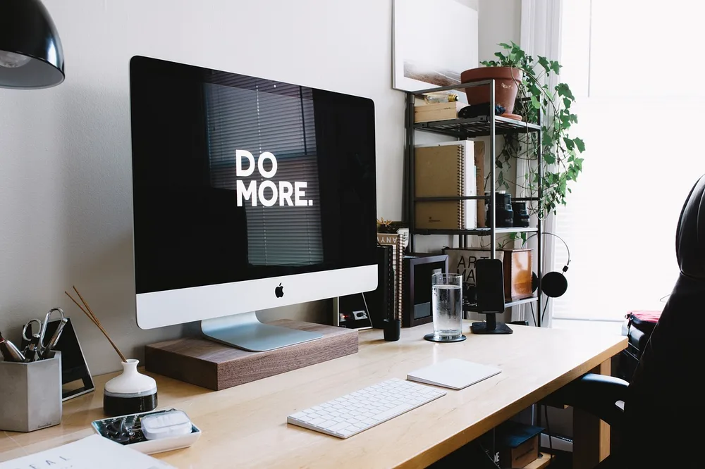
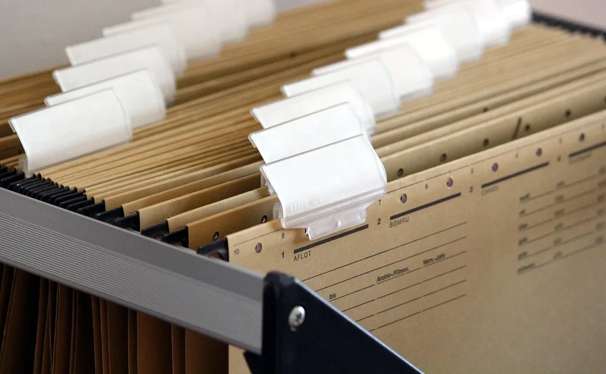
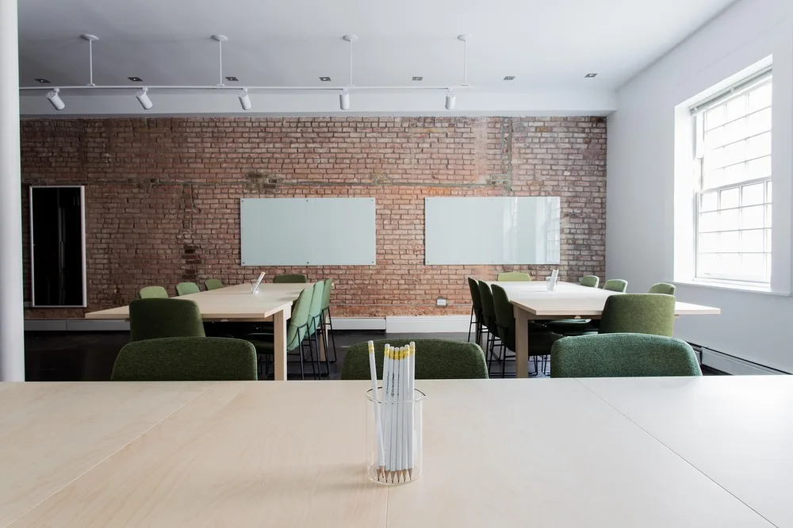
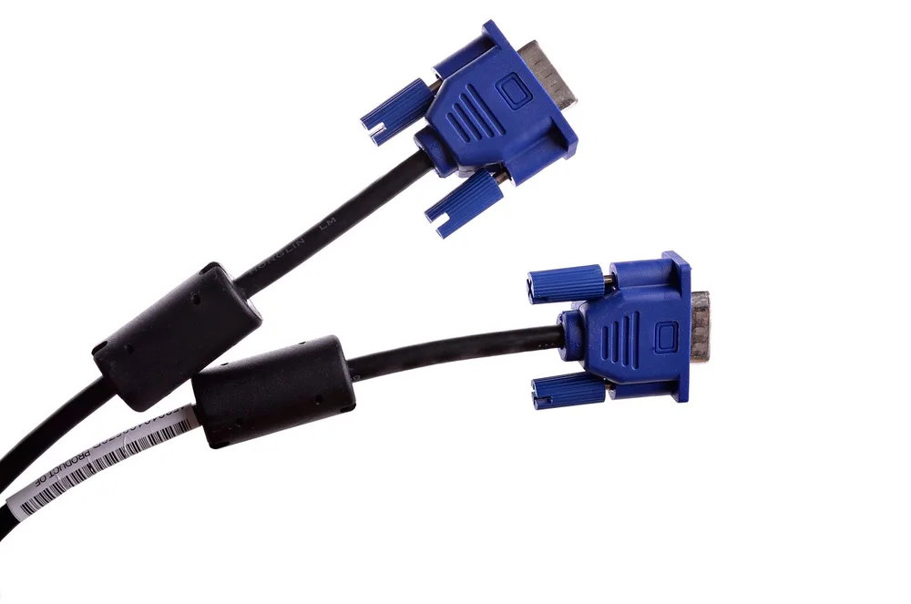

<figure class="pin-figure"><figcaption>Photo by <a href="https://pixabay.com/users/Pexels-2286921/" rel="nofollow noopener" target="_blank">Pexels</a> on <a href="https://pixabay.com/photos/apple-macbook-notebook-computer-1853259/" rel="nofollow noopener" target="_blank">Pixabay</a></figcaption></figure>

Sharing a home office with a partner or roommate can work well, but only if the room is planned for two. Without a plan, you end up fighting over desk space, outlets and quiet, and one video call can ruin the other person&#39;s concentration for the rest of the afternoon.

These home office for two ideas cover layouts, furniture, sound, lighting and storage, so each person has their own space inside a shared room. They work whether you have a dedicated office or a corner of the living room you need to divide between two workstations.

<h2>1. Share One Long Desk</h2>

<figure class="pin-figure"><figcaption>Photo by <a href="https://pixabay.com/users/jdpereiro-2378671/" rel="nofollow noopener" target="_blank">jdpereiro</a> on <a href="https://pixabay.com/photos/office-space-office-sunny-coworking-1744803/" rel="nofollow noopener" target="_blank">Pixabay</a></figcaption></figure>

A single long desk along one wall is the simplest way to fit two workstations. Each person gets their own section, and the continuous surface looks cleaner than two separate desks pushed together. Aim for at least four feet of width per person for a comfortable setup.

A long desk can be as simple as a countertop or a wide board on two sets of drawers. Place a shared lamp or a plant in the middle to mark the boundary between the two zones, so each half feels personal while the room still looks unified.

<h2>2. Place Desks Back to Back</h2>

<figure class="pin-figure"><figcaption>Photo by <a href="https://pixabay.com/users/BRRT-122519/" rel="nofollow noopener" target="_blank">BRRT</a> on <a href="https://pixabay.com/photos/hole-puncher-two-hole-hole-punch-2451466/" rel="nofollow noopener" target="_blank">Pixabay</a></figcaption></figure>

Setting two desks back to back, with each person facing a different wall, gives both of you more privacy and fewer distractions. You are not looking at each other all day, and each of you gets a calmer view in front of your own screen.

This layout works especially well when both people take lots of calls, since you are facing away from each other and your voices travel in opposite directions. Check that each desk still has access to an outlet and decent light from a window or a lamp.

<h2>3. Use an L-Shape to Split the Corner</h2>

<figure class="pin-figure"><figcaption>Photo by <a href="https://pixabay.com/users/reallywellmadedesks-22274515/" rel="nofollow noopener" target="_blank">reallywellmadedesks</a> on <a href="https://pixabay.com/photos/office-desk-workspace-coworkers-6952917/" rel="nofollow noopener" target="_blank">Pixabay</a></figcaption></figure>

Two desks forming an L in a corner give each person a separate wall while keeping the room open. You sit at right angles rather than side by side, which feels less cramped and makes it easier to stand up and move without bumping into each other.

This layout also uses corners well in smaller rooms. Give the person who takes more calls the side farthest from the door, and leave enough clearance behind both chairs so you can roll back at the same time without colliding.

<h2>4. Divide the Room With a Shelf</h2>

<figure class="pin-figure"><figcaption>Photo by <a href="https://pixabay.com/users/fancycrave1-1115284/" rel="nofollow noopener" target="_blank">fancycrave1</a> on <a href="https://pixabay.com/photos/home-office-workspace-desk-design-820389/" rel="nofollow noopener" target="_blank">Pixabay</a></figcaption></figure>

An open bookshelf placed between two workstations creates a light division without closing off the room. Each person gets visual privacy and extra storage on their own side, and the light from windows can still pass through the open shelves.

Choose a shelf that is open on both sides and anchored safely to the floor or wall. Low shelves keep the room airy, while taller ones give more privacy. Fill it with books, plants and baskets so both sides look good, not just one.

<h2>5. Plan for Sound and Calls</h2>

<figure class="pin-figure"><figcaption>Photo by <a href="https://pixabay.com/users/Eurologostoronto-55387353/" rel="nofollow noopener" target="_blank">Eurologostoronto</a> on <a href="https://pixabay.com/photos/travel-agency-travel-agent-woman-10219629/" rel="nofollow noopener" target="_blank">Pixabay</a></figcaption></figure>

Noise is the biggest challenge in a shared office. Rugs, curtains, upholstered chairs and full bookshelves absorb sound and reduce echo, which makes calls clearer and the room calmer. Even one large rug can make a noticeable difference in a room with hard floors.

Headsets with good microphones help both people, since they pick up less of the other person&#39;s voice. Agree on a simple signal, such as a small light or a sign on the desk, for when someone is on a call and needs the room to stay quiet.

<h2>6. Give Each Person Their Own Light</h2>

<figure class="pin-figure"><figcaption>Photo by <a href="https://pixabay.com/users/StockSnap-894430/" rel="nofollow noopener" target="_blank">StockSnap</a> on <a href="https://pixabay.com/photos/computer-keyboard-apple-electronics-2593921/" rel="nofollow noopener" target="_blank">Pixabay</a></figcaption></figure>

People often prefer different lighting, and one person&#39;s bright task light can bother the other. Giving each desk its own lamp lets both of you adjust brightness and warmth independently, and it creates a personal zone within the shared room.

Monitor light bars are a good option for shared rooms, because they light the desk without spreading glare across the room. Keep the overhead light soft and use desk lamps for detailed work, so each person controls their own corner.

<h2>7. Combine Shared and Personal Storage</h2>

<figure class="pin-figure"><figcaption>Photo by <a href="https://pixabay.com/users/Counselling-440107/" rel="nofollow noopener" target="_blank">Counselling</a> on <a href="https://pixabay.com/photos/hanging-files-file-cabinet-order-1920437/" rel="nofollow noopener" target="_blank">Pixabay</a></figcaption></figure>

Shared storage for printer paper, cables and office supplies saves space, while personal drawers or shelves keep each person&#39;s things separate. A tall cabinet or bookcase can hold the shared items, with a drawer unit under each desk for personal belongings.

Label shared bins so both of you know where things go, and agree on a quick tidy at the end of the week. When each person has a clear place for their own items, the shared surfaces stay much cleaner and there are fewer arguments about clutter.

<h2>8. Match the Chairs and Finishes</h2>

<figure class="pin-figure"><figcaption>Photo by <a href="https://pixabay.com/users/Pexels-2286921/" rel="nofollow noopener" target="_blank">Pexels</a> on <a href="https://pixabay.com/photos/bricks-chairs-classroom-empty-2181920/" rel="nofollow noopener" target="_blank">Pixabay</a></figcaption></figure>

Two different desks and chairs bought at different times can make a shared office look chaotic. Matching chairs, or at least chairs in the same color, instantly make the room feel planned. The same goes for lamps, desk mats and storage boxes.

Each person can still personalize their space with a plant, a print or a favorite mug. A shared color palette for the larger pieces keeps the room calm, while those small personal items let each workstation feel like it belongs to someone.

<h2>9. Organize Cables for Two Setups</h2>

<figure class="pin-figure"><figcaption>Photo by <a href="https://pixabay.com/users/ds_30-1795490/" rel="nofollow noopener" target="_blank">ds_30</a> on <a href="https://pixabay.com/photos/cable-computer-usb-technology-4875316/" rel="nofollow noopener" target="_blank">Pixabay</a></figcaption></figure>

Two workstations mean twice the cables, chargers and power strips. Give each desk its own power strip mounted underneath and its own cable tray, so neither person&#39;s cables tangle with the other&#39;s and you can each change your setup without disturbing the other.

Run cables along the back of the desks and down a single leg, and use cable clips on the desk edge for chargers. If the desks share a wall, a cable raceway along the baseboard keeps the floor clear and reduces the risk of tripping.

<h2>10. Agree on Simple Shared Rules</h2>

<figure class="pin-figure"><figcaption>Photo by <a href="https://pixabay.com/users/StartupStockPhotos-690514/" rel="nofollow noopener" target="_blank">StartupStockPhotos</a> on <a href="https://pixabay.com/photos/student-typing-keyboard-text-woman-849822/" rel="nofollow noopener" target="_blank">Pixabay</a></figcaption></figure>

The layout solves half the challenge; the other half is habits. A quick agreement about call times, music, breaks and tidying prevents most conflicts before they start. Sharing calendars helps you see when the other person has important meetings coming up later in the day.

Consider having a backup spot, such as the kitchen table or a bedroom, for long calls or noisy tasks. A shared office works best when both people feel they can focus. Revisit the rules after a few weeks and adjust anything that is not working.

<h2>Final Thoughts</h2>

A good home office for two gives each person their own zone inside a shared room. Choose a layout that suits how you both work, control sound and light for each desk and agree on a few simple habits, and the room can be productive for both of you at once.

