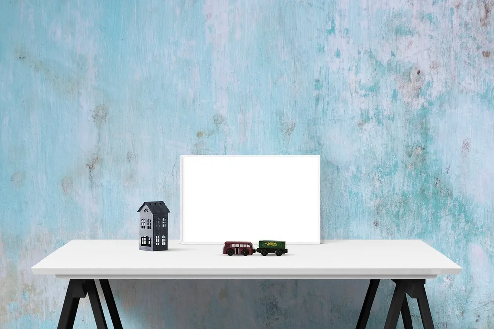
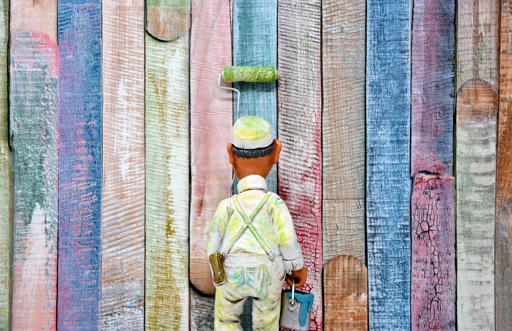
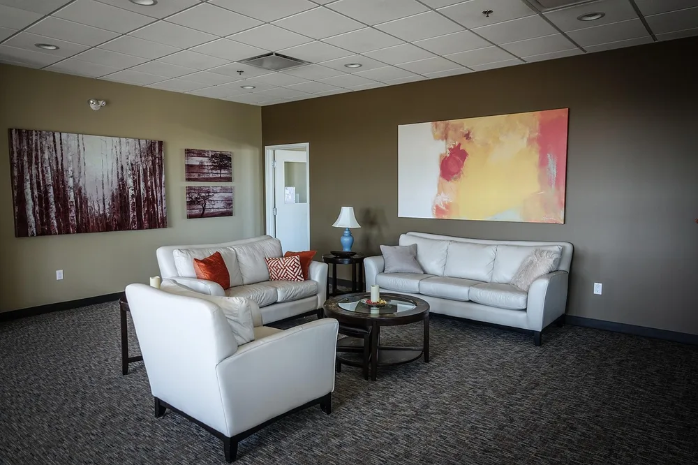

<figure class="pin-figure"><figcaption>Photo by <a href="https://pixabay.com/users/RaniRamli-731298/" rel="nofollow noopener" target="_blank">RaniRamli</a> on <a href="https://pixabay.com/photos/poster-frame-wall-desk-blue-wall-4110197/" rel="nofollow noopener" target="_blank">Pixabay</a></figcaption></figure>

Wall color shapes how a home office feels more than almost anything else in the room. The same desk and chair can feel bright and energizing, warm and cozy or calm and serious depending only on the paint, and you see those walls for hours every single workday.

These home office paint colors are popular for good reasons: they are easy to live with, flatter natural light and look good on camera. For each one you will find the mood it creates and how to pair it, so you can choose a color that fits both the room and the way you work.

<h2>1. Soft Warm White</h2>

<figure class="pin-figure"><figcaption>Photo by <a href="https://pixabay.com/users/JessBaileyDesign-7369896/" rel="nofollow noopener" target="_blank">JessBaileyDesign</a> on <a href="https://pixabay.com/photos/whitespace-desktop-business-office-3435350/" rel="nofollow noopener" target="_blank">Pixabay</a></figcaption></figure>

A soft white with a hint of warmth is the safest choice for a home office, especially a small one. It reflects as much light as possible, makes the room feel larger and lets your furniture, art and plants stand out without the cold, clinical look of a stark bright white.

Look for whites with a slightly creamy or beige undertone if the room faces north, since cool light can make pure white feel gray. In a sunny room almost any soft white works. Add wood and texture so the office feels warm rather than plain.

<h2>2. Warm Greige</h2>

<figure class="pin-figure"><figcaption>Photo by <a href="https://pixabay.com/users/rupixen-11154019/" rel="nofollow noopener" target="_blank">rupixen</a> on <a href="https://pixabay.com/photos/desk-laptop-computer-macbook-4334535/" rel="nofollow noopener" target="_blank">Pixabay</a></figcaption></figure>

Greige, a mix of gray and beige, sits between warm and cool and works with almost any furniture. It feels calmer and more grown up than white while staying light enough for small rooms, and it hides scuffs and fingerprints better than very pale colors do.

Pair greige with white trim, light wood and black accents for a clean, modern look, or with warm wood and linen for something cozier. It is also a flattering background on video calls, because it is neutral without making your skin look washed out.

<h2>3. Sage Green</h2>

<figure class="pin-figure"><figcaption>Photo by <a href="https://pixabay.com/users/Pexels-2286921/" rel="nofollow noopener" target="_blank">Pexels</a> on <a href="https://pixabay.com/photos/abstract-backdrop-background-1850416/" rel="nofollow noopener" target="_blank">Pixabay</a></figcaption></figure>

Sage green is one of the most popular office colors because it feels calm and natural without being dull. Soft, grayed greens are associated with nature, and many people find them restful to look at during a long day of screens, emails and meetings.

Sage pairs beautifully with natural wood, white shelves, brass hardware and plenty of plants. Use it on all walls for a soothing room, or only behind the desk as an accent. Lighter sages suit small rooms, while deeper versions add more character in a larger space.

<h2>4. Deep Navy Blue</h2>

<figure class="pin-figure"><figcaption>Photo by <a href="https://pixabay.com/users/Pexels-2286921/" rel="nofollow noopener" target="_blank">Pexels</a> on <a href="https://pixabay.com/photos/abstract-art-backdrop-background-1850417/" rel="nofollow noopener" target="_blank">Pixabay</a></figcaption></figure>

Navy feels focused, confident and classic, which makes it a strong choice for an office where you want to concentrate. In a room with good daylight it looks rich and elegant, and it makes white shelves, wood furniture and brass lamps stand out beautifully against it.

If the room is small or dark, try navy on a single accent wall or only on the lower half of the walls with a lighter color above. Plan for good lamps, since dark walls absorb light. It also creates a sharp, professional background on video calls.

<h2>5. Charcoal Gray</h2>

<figure class="pin-figure"><figcaption>Photo by <a href="https://pixabay.com/users/Pexels-2286921/" rel="nofollow noopener" target="_blank">Pexels</a> on <a href="https://pixabay.com/photos/blackboard-wall-black-dark-grunge-1846865/" rel="nofollow noopener" target="_blank">Pixabay</a></figcaption></figure>

Charcoal walls make a home office feel enclosed and cocooning, which some people find ideal for deep focus. Dark colors make corners recede, so a small room can even feel larger and more atmospheric, especially in the evening with warm lamps switched on.

Balance charcoal with warm wood, leather, textiles and plenty of light sources at different heights. A matte finish looks softer and hides wall imperfections. If a fully dark room feels heavy, keep the ceiling white or paint only the wall behind your monitor.

<h2>6. Terracotta and Warm Clay</h2>

<figure class="pin-figure"><figcaption>Photo by <a href="https://pixabay.com/users/RaniRamli-731298/" rel="nofollow noopener" target="_blank">RaniRamli</a> on <a href="https://pixabay.com/photos/poster-frame-wall-desk-sunflower-4110187/" rel="nofollow noopener" target="_blank">Pixabay</a></figcaption></figure>

Earthy terracotta and clay tones bring warmth and energy without the intensity of bright red or orange. They feel welcoming and creative, which suits offices used for design, writing or any work where you want a little more inspiration from your surroundings.

These colors look especially good with cream, natural linen, rattan and green plants. Because they are strong, many people use them on one wall or in a desk nook. In rooms with cool light, test a sample first, since some clay tones can look brown in the shade.

<h2>7. Dusty Blue</h2>

<figure class="pin-figure"><figcaption>Photo by <a href="https://pixabay.com/users/TranThanhDat-22137618/" rel="nofollow noopener" target="_blank">TranThanhDat</a> on <a href="https://pixabay.com/photos/light-power-source-interior-design-7827771/" rel="nofollow noopener" target="_blank">Pixabay</a></figcaption></figure>

Dusty blue is a softer, grayer cousin of navy that keeps a room light while still adding color. It feels calm and airy, and blue tones are often linked with clear thinking, which makes them a natural fit for a space where you need to concentrate.

Pair dusty blue with white furniture and light wood for a fresh look, or with warm wood and brass for something more traditional. Because it reads as a near neutral, it is easy to live with for years and works well on every wall rather than just one.

<h2>8. Soft Blush Pink</h2>

<figure class="pin-figure"><figcaption>Photo by <a href="https://pixabay.com/users/ShonEjai-1075665/" rel="nofollow noopener" target="_blank">ShonEjai</a> on <a href="https://pixabay.com/photos/background-texture-wall-brick-1511089/" rel="nofollow noopener" target="_blank">Pixabay</a></figcaption></figure>

A muted blush pink feels warm and gentle without being childish, especially when it leans toward beige. It reflects a flattering light onto your face, which many people appreciate on video calls, and it makes the room feel softer and more personal.

Keep it grown up by pairing blush with charcoal, black accents, natural wood and green plants. Choose a dusty, low saturation version rather than a bright pink. It works well in small rooms and in offices that double as guest rooms or creative studios.

<h2>9. Try a Two-Tone Wall</h2>

<figure class="pin-figure"><figcaption>Photo by <a href="https://pixabay.com/users/Ralphs_Fotos-1767157/" rel="nofollow noopener" target="_blank">Ralphs_Fotos</a> on <a href="https://pixabay.com/photos/painter-painting-business-card-3177366/" rel="nofollow noopener" target="_blank">Pixabay</a></figcaption></figure>

Painting the lower part of the wall a darker color and the upper part a lighter one gives you the depth of a bold color without making the room feel small. The line, usually around chair rail height, adds architecture to a plain room and feels custom.

Navy or green below with soft white above is a classic combination, and it also hides scuffs from chairs. Use painter&#39;s tape and a level to keep the line straight. A narrow wooden trim along the dividing line makes the finish look even more polished.

<h2>10. Do Not Forget the Ceiling</h2>

<figure class="pin-figure"><figcaption>Photo by <a href="https://pixabay.com/users/DokaRyan-9003441/" rel="nofollow noopener" target="_blank">DokaRyan</a> on <a href="https://pixabay.com/photos/waiting-room-couch-painting-waiting-3403182/" rel="nofollow noopener" target="_blank">Pixabay</a></figcaption></figure>

The ceiling is often called the fifth wall, and painting it is a simple way to make an office feel finished. A ceiling a shade lighter than the walls keeps the room airy, while painting it the same color as the walls creates a cozy, wrapped effect in a small space.

Whatever you choose, test samples on the wall and look at them at different times of day, because morning, afternoon and lamp light change colors dramatically. Large painted sample boards that you can move around are much easier to judge than small paper chips.

<h2>Final Thoughts</h2>

The right home office paint color depends on your light, the size of the room and how you want to feel while you work. Test two or three samples on the wall for a few days, check them in morning and evening light and pick the one you still like on the last day.

