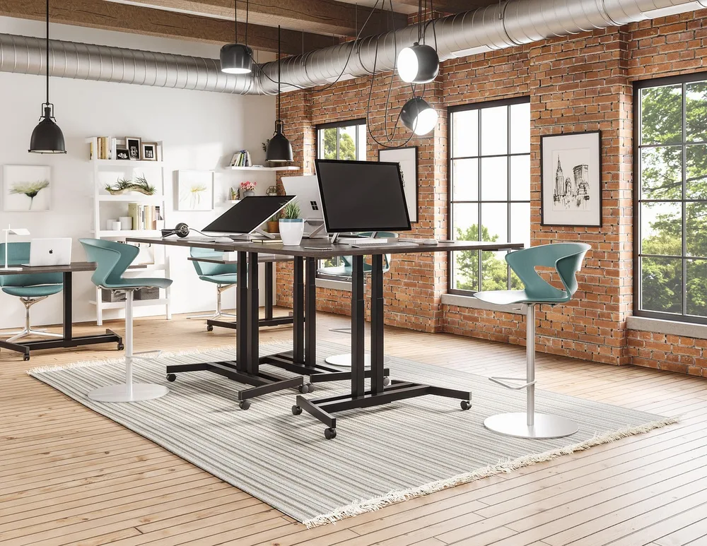
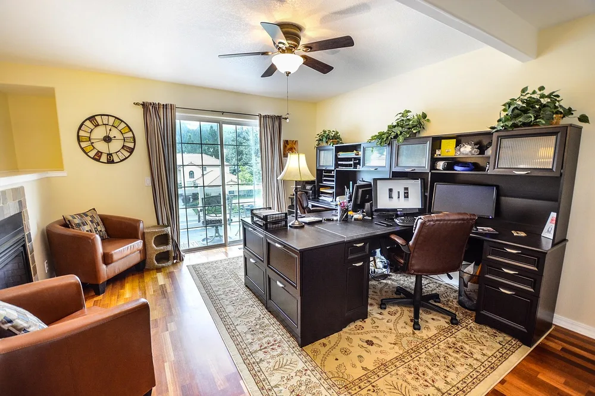
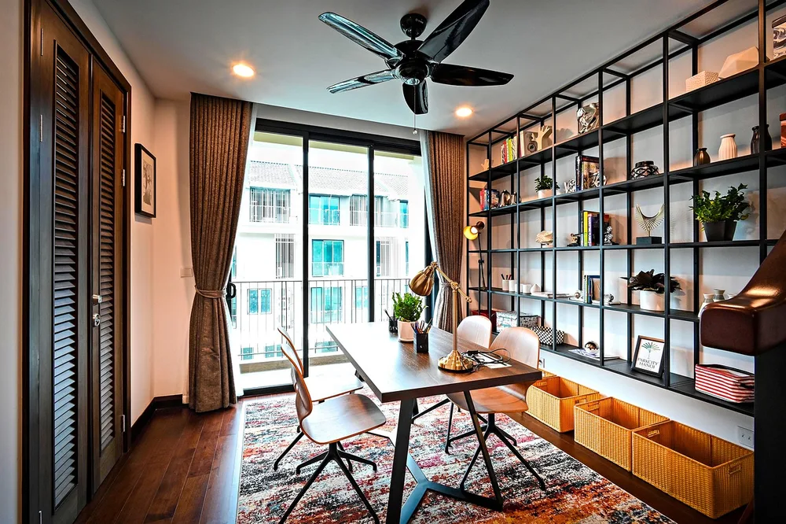
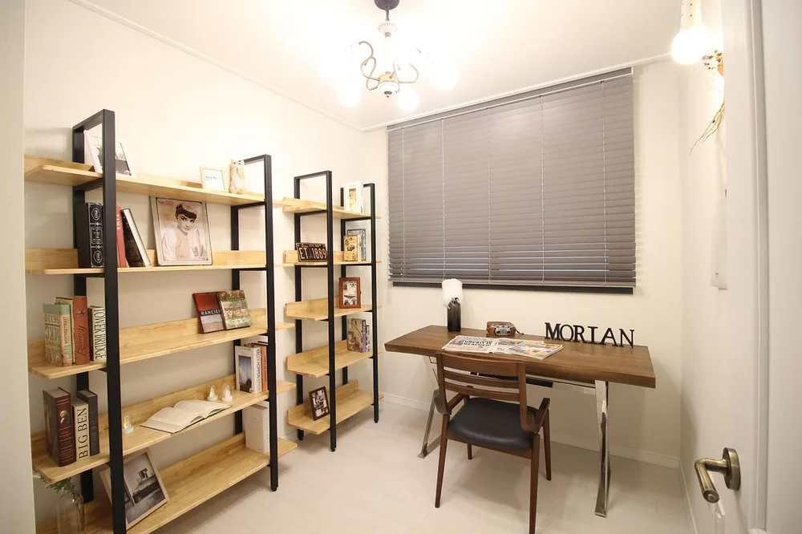
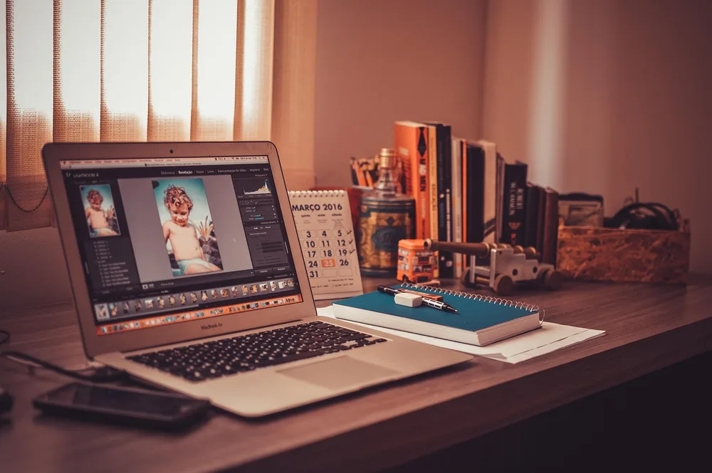
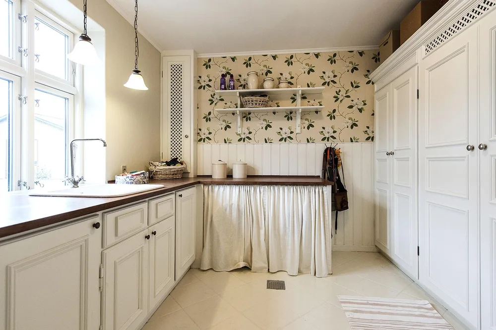
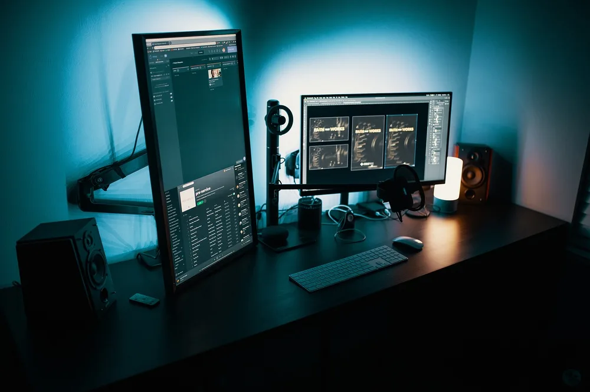
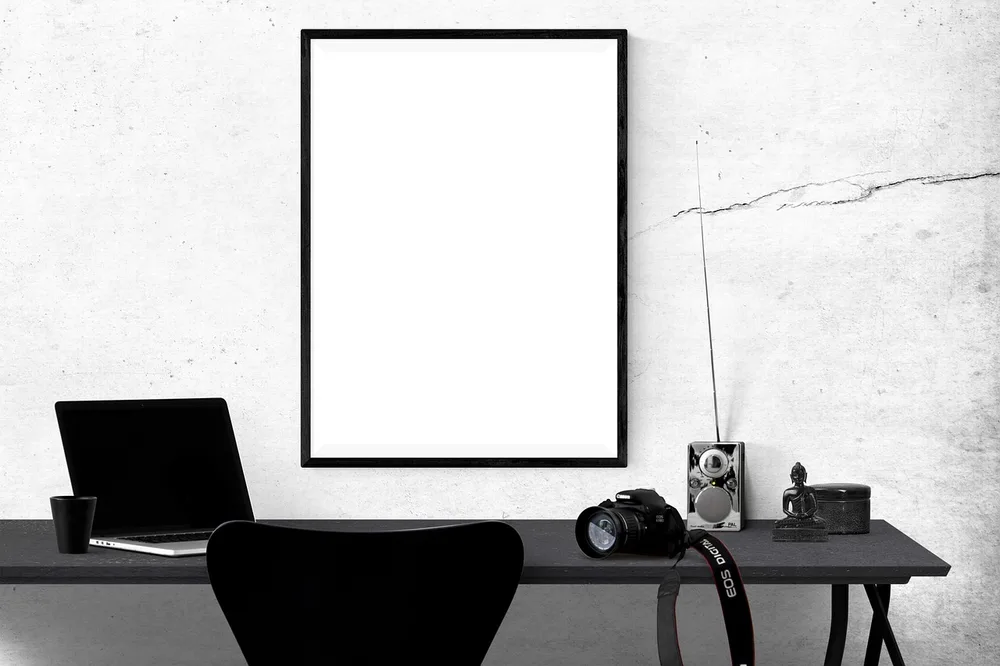

<figure class="pin-figure"><figcaption>Photo by <a href="https://pixabay.com/users/u_4mx5rfd1yn-57572066/" rel="nofollow noopener" target="_blank">u_4mx5rfd1yn</a> on <a href="https://pixabay.com/photos/books-library-education-reading-10544531/" rel="nofollow noopener" target="_blank">Pixabay</a></figcaption></figure>

Every home office collects things: books, notebooks, cables, chargers, printer paper and the small objects that make the space feel personal. Without proper shelving, all of it ends up on the desk, and a crowded desk makes it harder to concentrate on anything for long.

These home office shelving ideas add storage while keeping the room calm and organized. They range from a single floating shelf to a full wall of bookcases, and they include simple styling rules so your shelves look curated instead of looking like an overflowing storage closet.

<h2>1. Mount Floating Shelves Above the Desk</h2>

<figure class="pin-figure"><figcaption>Photo by <a href="https://pixabay.com/users/reallywellmadedesks-22274515/" rel="nofollow noopener" target="_blank">reallywellmadedesks</a> on <a href="https://pixabay.com/photos/standing-desk-home-office-office-7349890/" rel="nofollow noopener" target="_blank">Pixabay</a></figcaption></figure>

Floating shelves above the desk keep frequently used items within reach without taking up any work surface. Two shelves of different lengths, slightly offset, look more relaxed than a perfectly stacked pair and leave space for the top of the monitor and a lamp.

Mount them into wall studs or use proper heavy duty anchors, especially if you plan to store books, which are heavier than they look. Keep the lowest shelf high enough to clear your head when you stand up from the chair, usually around eighteen to twenty inches above the desk.

<h2>2. Use a Bookcase as a Video Call Backdrop</h2>

<figure class="pin-figure"><figcaption>Photo by <a href="https://pixabay.com/users/user32212-763448/" rel="nofollow noopener" target="_blank">user32212</a> on <a href="https://pixabay.com/photos/home-office-residence-residential-2014864/" rel="nofollow noopener" target="_blank">Pixabay</a></figcaption></figure>

A bookcase behind your chair gives you useful storage and a polished background for video calls at the same time. It adds depth to the frame and shows a bit of personality, which looks far more professional than a bare wall or an unmade bed behind you.

Keep the shelves visible on camera tidy and balanced, with books mixed with a few objects and some empty space. Check the view from your webcam before arranging anything, since only the middle shelves usually appear on screen, and put the least attractive storage on the lowest shelf.

<h2>3. Lean a Ladder Shelf in a Small Office</h2>

<figure class="pin-figure"><figcaption>Photo by <a href="https://pixabay.com/users/huynguyenlambao-18326523/" rel="nofollow noopener" target="_blank">huynguyenlambao</a> on <a href="https://pixabay.com/photos/interior-decoration-architecture-5969981/" rel="nofollow noopener" target="_blank">Pixabay</a></figcaption></figure>

A ladder shelf leans against the wall and narrows toward the top, which gives you storage without visually crowding a small room. The wider bottom shelves hold heavier items like binders and baskets, while the top shelves suit plants, small frames and light decor.

Because it does not need to be mounted, a ladder shelf is a good choice for renters. Still, attach it to the wall with the included strap so it cannot tip over. Place it beside the desk rather than behind the chair, so you can reach it without getting up.

<h2>4. Hide Clutter in Cube Shelving With Baskets</h2>

<figure class="pin-figure"><figcaption>Photo by <a href="https://pixabay.com/users/markusspiske-670330/" rel="nofollow noopener" target="_blank">markusspiske</a> on <a href="https://pixabay.com/photos/office-home-office-creative-apple-581131/" rel="nofollow noopener" target="_blank">Pixabay</a></figcaption></figure>

Cube shelving is affordable, sturdy and very flexible. Fill some cubes with fabric bins or woven baskets for cables, chargers and supplies, and leave others open for books and decor. The mix of closed and open cubes keeps the unit from looking either cluttered or boring.

Label the bins discreetly on the inside edge so you can find things quickly without spoiling the look. A low cube unit can also double as a side table next to the desk or even as a room divider if your office shares space with a living area.

<h2>5. Fit Shelves Into a Corner</h2>

<figure class="pin-figure"><figcaption>Photo by <a href="https://pixabay.com/users/EDDIE_LEE_KR-8272482/" rel="nofollow noopener" target="_blank">EDDIE_LEE_KR</a> on <a href="https://pixabay.com/photos/room-bookshelf-book-doodle-inside-4786779/" rel="nofollow noopener" target="_blank">Pixabay</a></figcaption></figure>

Corner shelves use space that would otherwise sit empty. A set of triangular shelves or a narrow corner bookcase holds a surprising amount, and it softens the hard angle of the room, which can make a small office feel a little larger and more finished.

Use corner shelves for items you do not need every hour, such as reference books, spare notebooks or decorative pieces. Add a small plant or a lamp on one of the shelves to bring light into the corner, which is often the darkest part of the room.

<h2>6. Style Shelves With Books, Objects and Space</h2>

<figure class="pin-figure"><figcaption>Photo by <a href="https://pixabay.com/users/2102033-2102033/" rel="nofollow noopener" target="_blank">2102033</a> on <a href="https://pixabay.com/photos/justice-law-case-hearing-old-skin-1509436/" rel="nofollow noopener" target="_blank">Pixabay</a></figcaption></figure>

Well styled shelves follow a simple pattern: a group of books, an object, some empty space, then repeat. Stack some books vertically and others horizontally, place a small plant or a bowl on top of a stack, and leave gaps so the eye has somewhere to rest.

Stick to a limited color palette for decor items, two or three colors at most, and repeat each color on more than one shelf. Turning a few book spines inward or covering them in plain paper is an easy trick for a calmer look if the covers are very colorful.

<h2>7. Create a Built-In Look Around the Desk</h2>

<figure class="pin-figure"><figcaption>Photo by <a href="https://pixabay.com/users/Pexels-2286921/" rel="nofollow noopener" target="_blank">Pexels</a> on <a href="https://pixabay.com/photos/desk-laptop-office-notebook-mac-1284085/" rel="nofollow noopener" target="_blank">Pixabay</a></figcaption></figure>

Placing tall bookcases on both sides of the desk and a shelf across the top creates the look of a built-in office without custom carpentry. The desk sits in a framed nook surrounded by storage, which feels organized, cozy and very intentional.

Choose bookcases of the same model and color so the result looks unified, and fill any small gaps against the wall with trim painted to match. Adding a lamp or an LED strip inside the nook makes the whole wall glow in the evening, like a proper library desk.

<h2>8. Mix Open Shelves With Closed Cabinets</h2>

<figure class="pin-figure"><figcaption>Photo by <a href="https://pixabay.com/users/u_jup1hbno-8566532/" rel="nofollow noopener" target="_blank">u_jup1hbno</a> on <a href="https://pixabay.com/photos/bookcase-kitchen-childrens-room-3532957/" rel="nofollow noopener" target="_blank">Pixabay</a></figcaption></figure>

Open shelves look beautiful but show everything, including the less attractive parts of office life like printer paper, cables and old notebooks. Combining open shelves on top with closed cabinets or drawers below gives you the best of both: display space and hidden storage.

Many sideboards and low cabinets work well under a wall of open shelving. Keep the closed storage for anything bulky, colorful or messy, and use the open shelves only for items that look calm together. The room will stay tidy even when the cabinets are full.

<h2>9. Give Your Tech Its Own Shelf</h2>

<figure class="pin-figure"><figcaption>Photo by <a href="https://pixabay.com/users/anonima2020-18620029/" rel="nofollow noopener" target="_blank">anonima2020</a> on <a href="https://pixabay.com/photos/desktop-computer-work-space-5636733/" rel="nofollow noopener" target="_blank">Pixabay</a></figcaption></figure>

Headphones, speakers, chargers, a router and external drives all compete for desk space. A dedicated tech shelf near an outlet keeps these devices organized in one place and makes cable management much simpler, since everything plugs into a single power strip behind it.

Use a headphone stand or hook so headphones stay off the desk, and a small charging station for your phone and earbuds. Drill a discreet cable hole or run cables along the back edge of the shelf, so the tech corner looks clean even with many devices connected.

<h2>10. Add a Narrow Shelf Ledge for Notes and Art</h2>

<figure class="pin-figure"><figcaption>Photo by <a href="https://pixabay.com/users/RaniRamli-731298/" rel="nofollow noopener" target="_blank">RaniRamli</a> on <a href="https://pixabay.com/photos/poster-mockup-mockup-poster-frame-2853837/" rel="nofollow noopener" target="_blank">Pixabay</a></figcaption></figure>

A picture ledge, a very narrow shelf with a small lip, lets you lean framed art, postcards and notes against the wall and change them whenever you like. It brings the flexibility of a pinboard with a cleaner look, and it takes almost no space above the desk.

Mount the ledge at eye level when you are seated, or just above the monitor. Overlapping frames of different sizes looks relaxed and gallery like. It is also a great spot for a current project sketch or a printed weekly plan you want to keep in sight.

<h2>Final Thoughts</h2>

The best home office shelving ideas give everything a place while keeping the desk clear and the room calm. Start with the storage you need most, whether that is a floating shelf or a full bookcase, then style it with books, objects and plenty of empty space.

