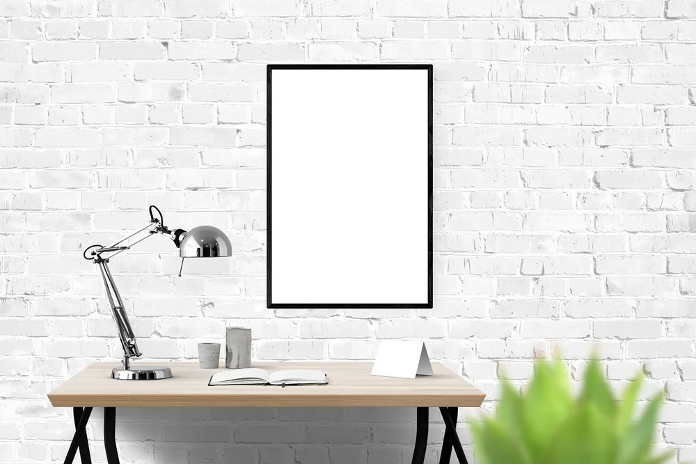
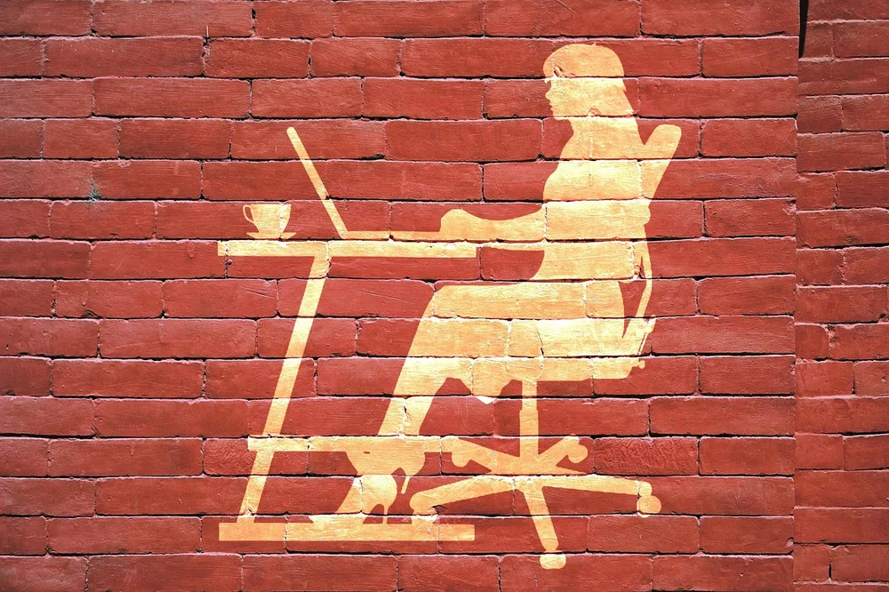
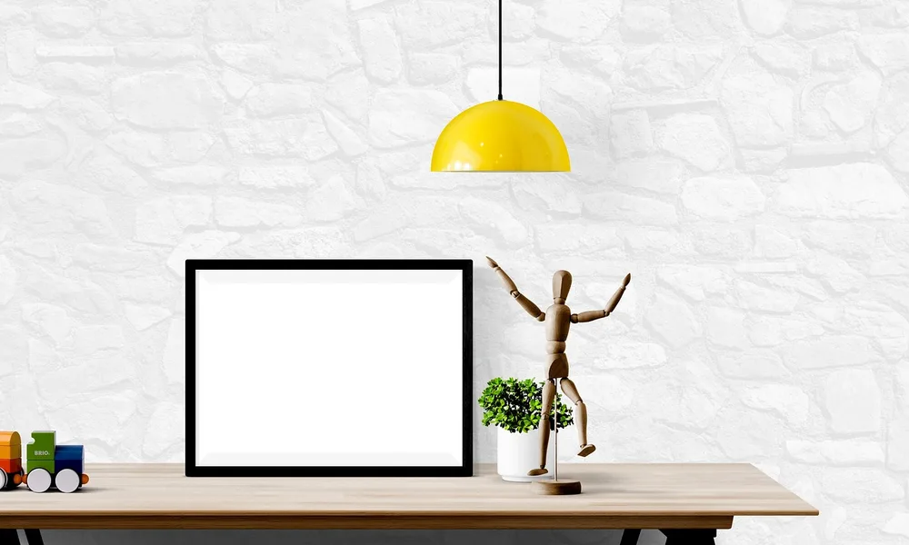
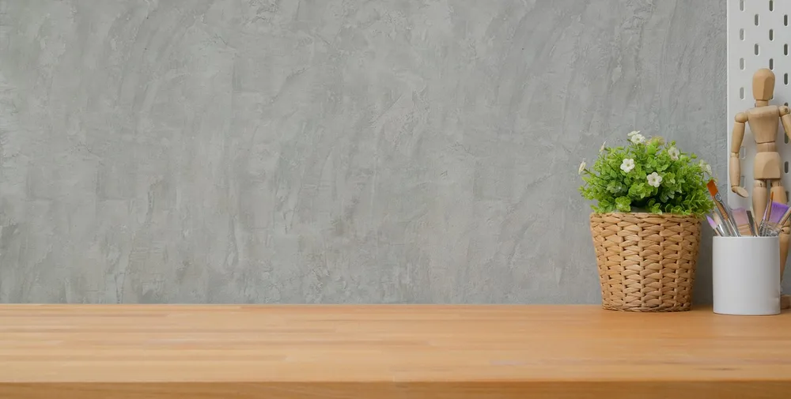
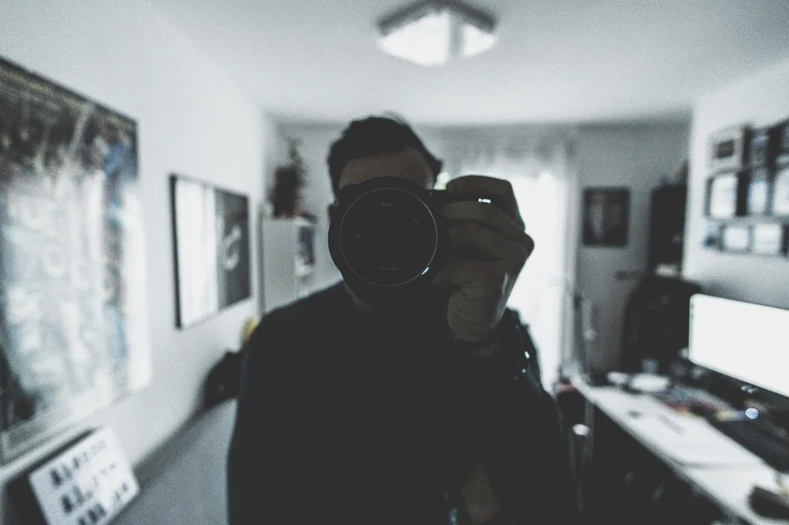
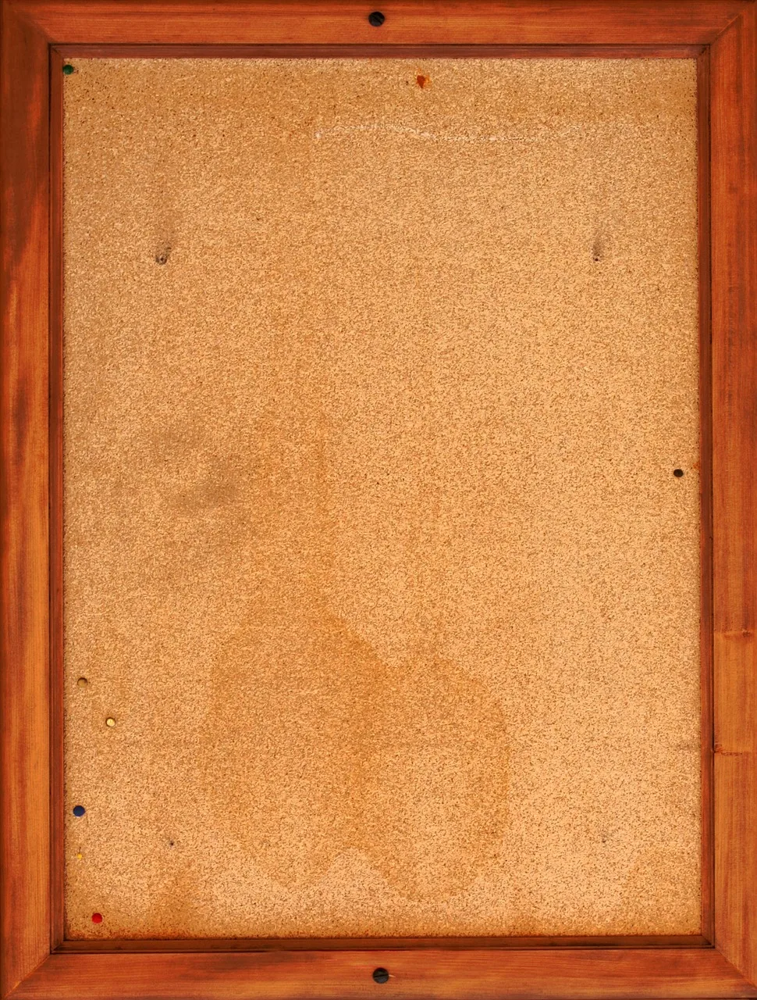
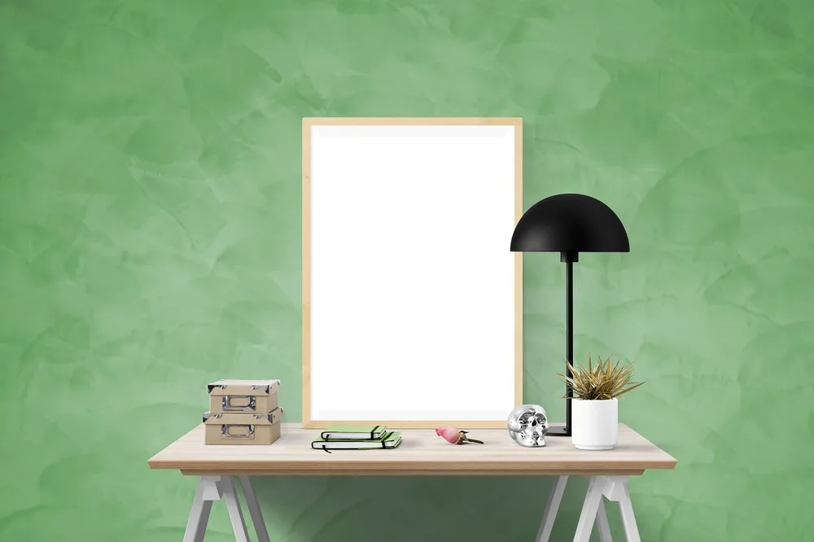
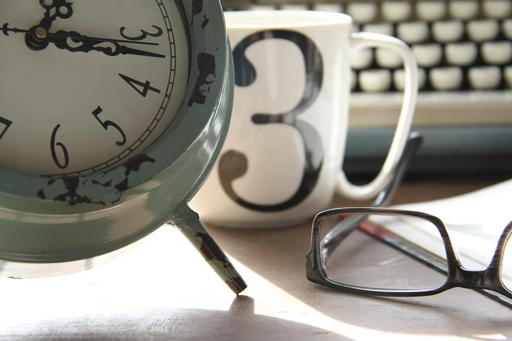
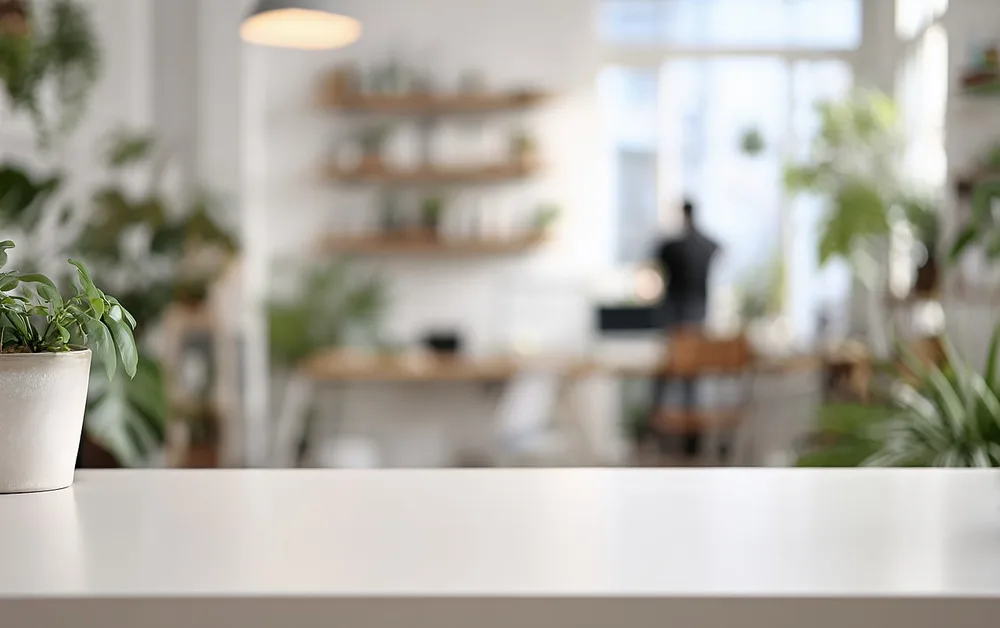
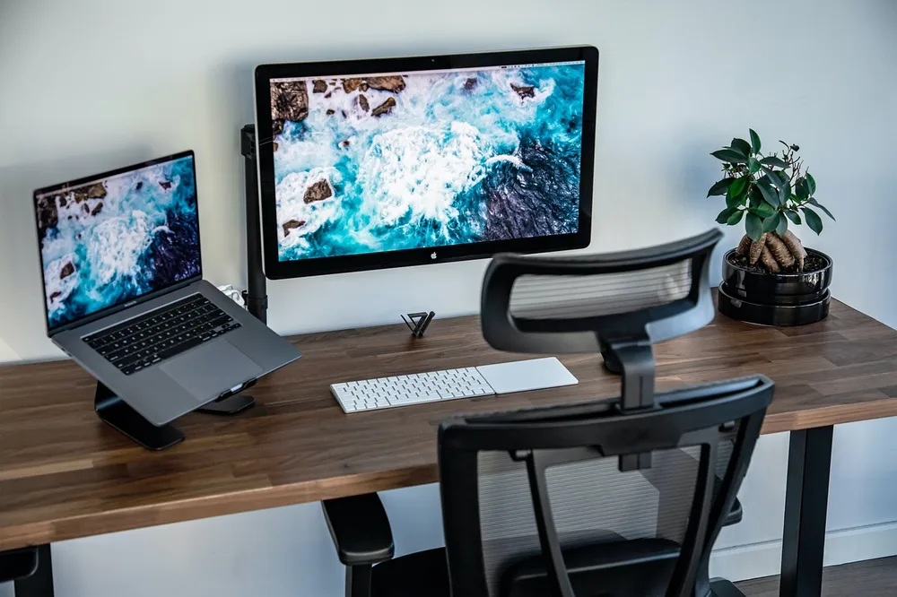

<figure class="pin-figure"><figcaption>Photo by <a href="https://pixabay.com/users/RaniRamli-731298/" rel="nofollow noopener" target="_blank">RaniRamli</a> on <a href="https://pixabay.com/photos/poster-mockup-decor-desk-interior-2867743/" rel="nofollow noopener" target="_blank">Pixabay</a></figcaption></figure>

The wall in front of your desk is the thing you look at most during the workday, yet in many home offices it stays completely blank. A bare wall makes the room feel unfinished and a little cold, even when the desk itself is well organized.

These home office wall decor ideas add personality, light and useful storage without crowding the space. Some take five minutes and a single nail, others take a weekend, and every one of them can be adjusted to a rental, a small room or a tight budget.

<h2>1. Hang One Large Statement Print Above the Desk</h2>

<figure class="pin-figure"><figcaption>Photo by <a href="https://pixabay.com/users/Mohamed_hassan-5229782/" rel="nofollow noopener" target="_blank">Mohamed_hassan</a> on <a href="https://pixabay.com/photos/art-wall-woman-laptop-business-2710242/" rel="nofollow noopener" target="_blank">Pixabay</a></figcaption></figure>

A single large print is the fastest way to make a home office wall feel intentional. Choose a piece that is roughly two thirds the width of your desk and hang it so the bottom edge sits about eight to ten inches above the monitor, which keeps it visible without competing with the screen.

Calm subjects work best for a workspace: landscapes, abstract shapes, botanical studies or simple line drawings. Pick colors that repeat something already in the room, such as the chair, the rug or a plant pot, so the art ties the whole office together instead of feeling like a random addition.

<h2>2. Build a Small Gallery Wall</h2>

<figure class="pin-figure"><figcaption>Photo by <a href="https://pixabay.com/users/RaniRamli-731298/" rel="nofollow noopener" target="_blank">RaniRamli</a> on <a href="https://pixabay.com/photos/poster-wall-mockup-interior-frame-3605595/" rel="nofollow noopener" target="_blank">Pixabay</a></figcaption></figure>

If one big piece feels too formal, group five to seven smaller frames into a loose gallery wall. Mix photos, prints, postcards and a small mirror, and keep the spacing between frames consistent, around two to three inches, so the arrangement reads as one unit rather than scattered pictures.

Lay the frames out on the floor first and take a photo before you put any nails in the wall. Paper templates taped to the wall also help you test the layout. Using the same frame color for every piece keeps a mixed collection looking calm instead of busy behind the desk.

<h2>3. Add Floating Shelves for Display</h2>

<figure class="pin-figure"><figcaption>Photo by <a href="https://pixabay.com/users/erwinbosman-50462252/" rel="nofollow noopener" target="_blank">erwinbosman</a> on <a href="https://pixabay.com/photos/man-home-office-remote-work-10371408/" rel="nofollow noopener" target="_blank">Pixabay</a></figcaption></figure>

Floating shelves turn the wall into both decor and storage. Mount one or two shelves above the desk, high enough that you will not hit your head when you stand up, and use them for a few books, a small plant, a framed photo and one or two objects you genuinely like looking at.

Leave some empty space on each shelf so it does not look like a storage closet. A good rule is to keep about a third of the surface clear. Wooden shelves add warmth to a white wall, while shelves painted the same color as the wall look minimal and almost disappear.

<h2>4. Use a Pegboard for Tools and Decor</h2>

<figure class="pin-figure"><figcaption>Photo by <a href="https://pixabay.com/users/bongkarngraphic-16126984/" rel="nofollow noopener" target="_blank">bongkarngraphic</a> on <a href="https://pixabay.com/photos/brick-business-creative-decoration-5066282/" rel="nofollow noopener" target="_blank">Pixabay</a></figcaption></figure>

A pegboard is a practical piece of wall decor that changes as your work changes. Hooks, small shelves and cups let you hang headphones, scissors, cables, notebooks and a small plant, which clears the desk while keeping everyday items within easy reach of your chair.

Paint the pegboard to match or contrast with the wall, and arrange the items with some breathing room between them. It works especially well in small offices and rentals, because one board mounted with a few screws replaces a whole set of drawers and can move with you later.

<h2>5. Hang a Mirror to Bounce Light Around</h2>

<figure class="pin-figure"><figcaption>Photo by <a href="https://pixabay.com/users/StockSnap-894430/" rel="nofollow noopener" target="_blank">StockSnap</a> on <a href="https://pixabay.com/photos/people-man-camera-room-office-2577750/" rel="nofollow noopener" target="_blank">Pixabay</a></figcaption></figure>

A mirror on the wall beside a window reflects daylight deeper into the room and makes a small home office feel noticeably larger. Round or arched mirrors soften a room full of straight lines from desks, shelves and monitors, and they add a little elegance without any extra clutter.

Avoid placing the mirror directly behind your monitor or where it reflects a bright window into your eyes, since glare quickly becomes tiring. A side wall is usually the safest spot. Check the reflection from your chair before hanging it, especially if you often join video calls from the desk.

<h2>6. Try a Cork or Fabric Pinboard</h2>

<figure class="pin-figure"><figcaption>Photo by <a href="https://pixabay.com/users/506967-506967/" rel="nofollow noopener" target="_blank">506967</a> on <a href="https://pixabay.com/photos/bulletin-board-note-write-down-519960/" rel="nofollow noopener" target="_blank">Pixabay</a></figcaption></figure>

A pinboard gives notes, reminders and inspiration a home that is not your monitor bezel or the edge of the desk. Cover a plain cork board with linen or felt in a muted color, frame it with thin wooden trim and it becomes a soft, textured piece of decor instead of a messy bulletin board.

Keep only current items on it, like the week&#39;s priorities, a calendar page and a couple of images that motivate you. Clear it every Friday. A pinboard that is updated often stays useful and attractive, while one covered in old receipts and expired notes quickly turns into visual noise.

<h2>7. Paint an Accent Wall Behind the Desk</h2>

<figure class="pin-figure"><figcaption>Photo by <a href="https://pixabay.com/users/RaniRamli-731298/" rel="nofollow noopener" target="_blank">RaniRamli</a> on <a href="https://pixabay.com/photos/poster-mockup-interior-wall-desk-2857424/" rel="nofollow noopener" target="_blank">Pixabay</a></figcaption></figure>

Paint is one of the cheapest ways to change how an office feels. A single accent wall behind the desk, in a soft green, warm clay or deep blue, frames your workspace and gives a much more polished background on video calls than a plain white wall ever could.

If a full wall feels like too much commitment, try a painted arch, a half wall or a simple color block behind the desk. Use painter&#39;s tape for clean edges, and test a large sample on the wall for a few days, because colors look very different in morning and evening light.

<h2>8. Mount a Wall Clock or Calendar</h2>

<figure class="pin-figure"><figcaption>Photo by <a href="https://pixabay.com/users/TaniaRose-3072581/" rel="nofollow noopener" target="_blank">TaniaRose</a> on <a href="https://pixabay.com/photos/time-work-clock-coffee-planning-5193038/" rel="nofollow noopener" target="_blank">Pixabay</a></figcaption></figure>

A clean wall clock is both decor and a quiet productivity tool. Seeing the time without checking your phone helps you keep track of meetings and breaks, and a simple round clock with a wooden or black frame suits almost any home office style, from minimalist to cozy.

A large wall calendar or a monthly planner board does a similar job for longer plans. Hang it where you can see it from the chair but not directly in front of the screen, so it stays useful without becoming a distraction while you are trying to focus on a task.

<h2>9. Bring Plants Onto the Wall</h2>

<figure class="pin-figure"><figcaption>Photo by <a href="https://pixabay.com/users/TyliJura-22072131/" rel="nofollow noopener" target="_blank">TyliJura</a> on <a href="https://pixabay.com/photos/blur-room-interior-design-plant-10343421/" rel="nofollow noopener" target="_blank">Pixabay</a></figcaption></figure>

Wall planters and hanging pots add greenery without taking any space on the desk. A trailing plant on a high shelf or in a wall mounted pot softens the hard lines of monitors and cables, and makes the workspace feel more alive, especially in rooms without much of a view.

Choose easy, low light plants and a planter with a drip tray so watering does not damage the wall. Group two or three plants at different heights for a natural look. If real plants are not practical in your space, a few good quality artificial trailing stems can still soften the wall.

<h2>10. Use Peel and Stick Wallpaper</h2>

<figure class="pin-figure"><figcaption>Photo by <a href="https://pixabay.com/users/salahTanger-16461281/" rel="nofollow noopener" target="_blank">salahTanger</a> on <a href="https://pixabay.com/photos/pc-computer-laptop-desk-5540950/" rel="nofollow noopener" target="_blank">Pixabay</a></figcaption></figure>

Removable wallpaper is ideal for renters or anyone who likes to change things often. A subtle pattern, such as a soft botanical print, thin stripes or a textured linen look, adds depth behind the desk and turns an ordinary corner into a space that feels designed.

Keep the pattern calm and low contrast, because a busy print right behind your monitor can be tiring to look at for eight hours. Covering just one wall, or even only the back of a desk nook, is usually enough to make a strong impression while keeping the rest of the room quiet.

<h2>Final Thoughts</h2>

Good home office wall decor makes the space feel finished without pulling your attention away from work. Start with one change, such as a large print, a shelf or an accent wall, live with it for a week and then add the next piece until the wall feels like yours.

