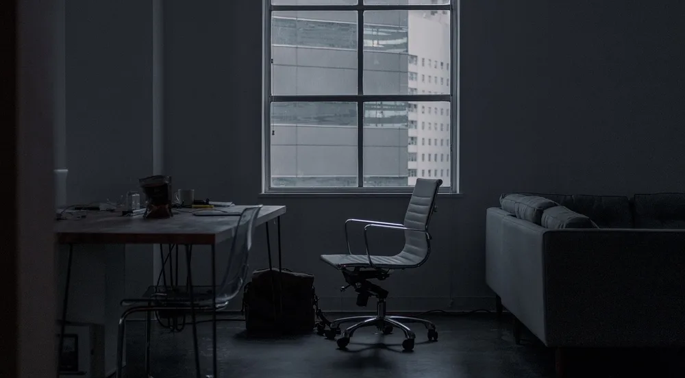
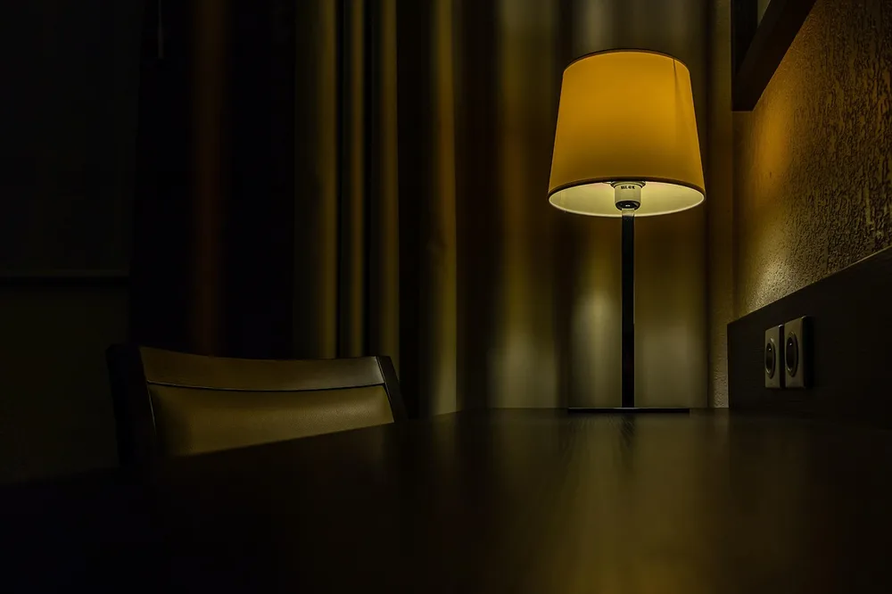
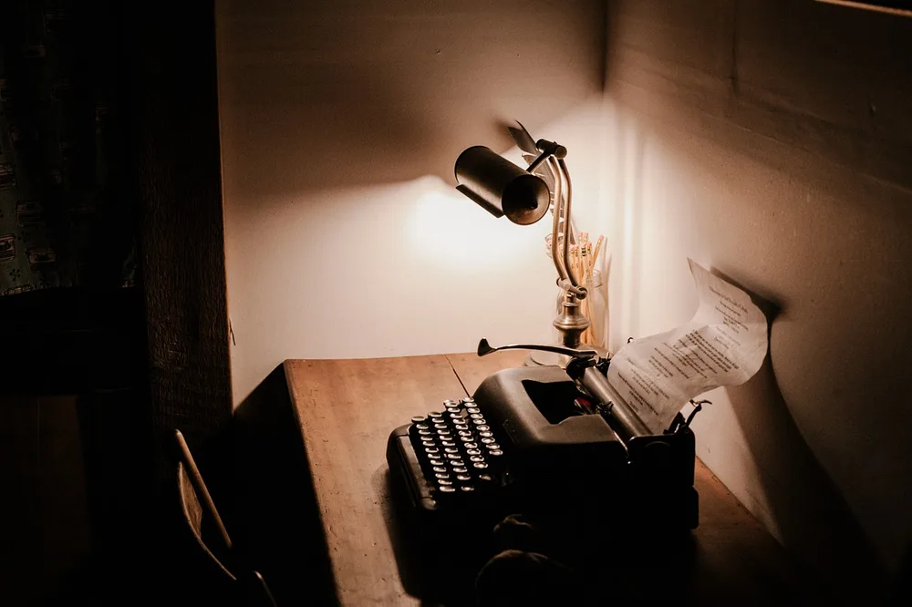
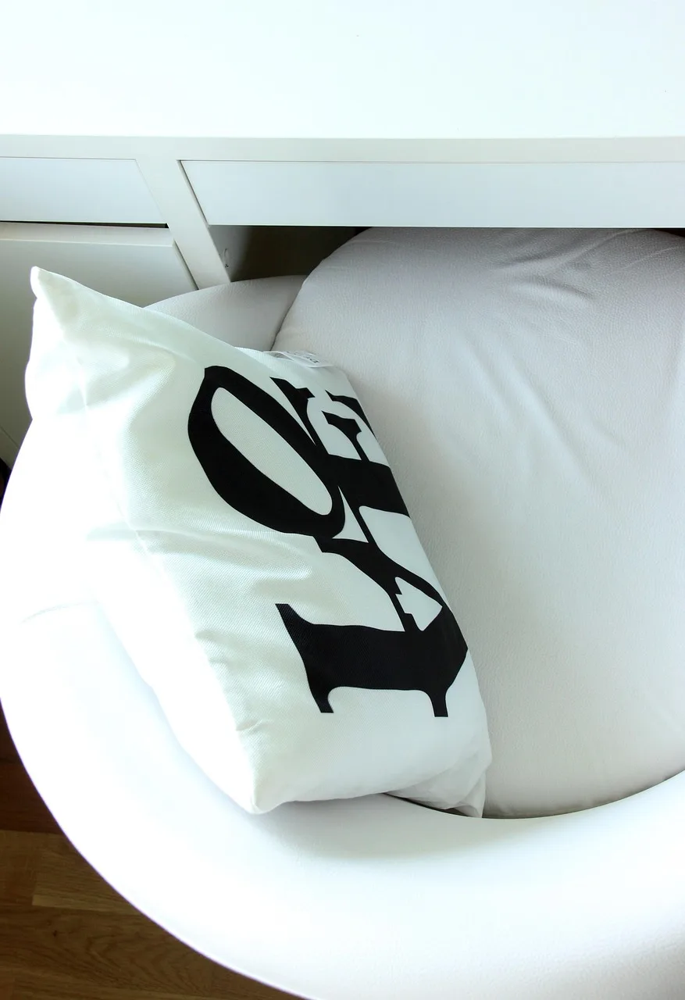

<figure class="pin-figure"><figcaption>Photo by <a href="https://pixabay.com/users/StockSnap-894430/" rel="nofollow noopener" target="_blank">StockSnap</a> on <a href="https://pixabay.com/photos/building-black-and-white-office-2596864/" rel="nofollow noopener" target="_blank">Pixabay</a></figcaption></figure>

Not every home office has to be bright and white. A moody office, with dark walls, warm light and rich materials, feels cozy, enclosed and calm, a little like a quiet library or an old study. Many people find that kind of room easier to settle into for deep, focused work.

These moody home office ideas show how to use darker colors and textures without making the room feel gloomy. The key is balance: deep walls with warm light, dark furniture with natural texture and enough lamps to keep the space comfortable for work all day long.

<h2>1. Paint the Walls a Deep Color</h2>

<figure class="pin-figure"><figcaption>Photo by <a href="https://pixabay.com/users/Pexels-2286921/" rel="nofollow noopener" target="_blank">Pexels</a> on <a href="https://pixabay.com/photos/wall-dark-wooden-green-grunge-1846965/" rel="nofollow noopener" target="_blank">Pixabay</a></figcaption></figure>

Dark walls are the foundation of a moody office. Deep green, charcoal, navy and warm chocolate brown all create a cocooning effect, making the corners recede and the room feel enclosed and intimate rather than small and cramped, even in a modest spare bedroom.

A matte or eggshell finish looks softer and richer than gloss. If you are nervous about committing, start with the wall behind your desk or the lower half of the walls. Dark colors also make a strong, professional background on video calls.

<h2>2. Layer Warm Lamps Everywhere</h2>

<figure class="pin-figure"><figcaption>Photo by <a href="https://pixabay.com/users/barskefranck-6433778/" rel="nofollow noopener" target="_blank">barskefranck</a> on <a href="https://pixabay.com/photos/desk-lamp-light-table-chair-dark-4077217/" rel="nofollow noopener" target="_blank">Pixabay</a></figcaption></figure>

Dark rooms need more light sources, not brighter ones. Combine a desk lamp for work, a floor lamp in a corner and a small lamp on a shelf, all with warm bulbs. The pools of light at different heights create that rich, glowing feel that defines a moody office.

Keep the overhead light for cleaning or searching for things, and rely on lamps the rest of the time. Dimmable bulbs let you adjust the mood from focused afternoon work to a calmer evening. A task light aimed at the desk keeps paperwork easy to read.

<h2>3. Choose Dark Wood Furniture</h2>

<figure class="pin-figure"><figcaption>Photo by <a href="https://pixabay.com/users/brenkee-2021352/" rel="nofollow noopener" target="_blank">brenkee</a> on <a href="https://pixabay.com/photos/macbook-laptop-dark-computer-1280687/" rel="nofollow noopener" target="_blank">Pixabay</a></figcaption></figure>

Walnut, dark oak and stained wood bring a warmth that pure black furniture lacks. A dark wooden desk with visible grain feels classic and grounded, and it ties in beautifully with deep wall colors, leather upholstery and small brass details around the room.

If your desk is light, a dark wood desk mat, monitor riser or set of shelves can shift the room toward a moodier look without replacing furniture. Mixing two or three wood tones adds depth, as long as they share a similar warm undertone.

<h2>4. Add a Leather Chair</h2>

<figure class="pin-figure"><figcaption>Photo by <a href="https://pixabay.com/users/StockSnap-894430/" rel="nofollow noopener" target="_blank">StockSnap</a> on <a href="https://pixabay.com/photos/dark-room-office-table-chair-lamp-2584166/" rel="nofollow noopener" target="_blank">Pixabay</a></figcaption></figure>

A leather or faux leather chair is one of the most recognizable pieces of a moody office. Cognac, brown and black leather look rich against dark walls and age well over time, gaining character and a soft patina rather than simply looking worn out.

For long workdays, choose an office chair with leather upholstery that still has proper adjustments for height and lumbar support. If your work chair must be mesh, add a leather reading chair in a corner for calls, reading and short breaks away from the screen.

<h2>5. Bring In Velvet and Soft Textures</h2>

<figure class="pin-figure"><figcaption>Photo by <a href="https://pixabay.com/users/Fotownetrza-1855042/" rel="nofollow noopener" target="_blank">Fotownetrza</a> on <a href="https://pixabay.com/photos/armchair-cushion-work-desk-love-1129435/" rel="nofollow noopener" target="_blank">Pixabay</a></figcaption></figure>

Dark rooms look their best when they are full of texture. A velvet cushion, a wool throw, heavy linen curtains and a thick rug catch the light differently and keep a moody office from feeling flat or cold, especially in the evening.

Stick to a palette of deep, muted colors such as forest green, rust, plum and charcoal, and repeat each color a couple of times across the room. Soft textures also absorb sound, which makes calls clearer and the room quieter for focused work.

<h2>6. Use Brass and Gold Accents</h2>

<figure class="pin-figure"><figcaption>Photo by <a href="https://pixabay.com/users/JessBaileyDesign-7369896/" rel="nofollow noopener" target="_blank">JessBaileyDesign</a> on <a href="https://pixabay.com/photos/desktop-stationary-pens-white-space-3146955/" rel="nofollow noopener" target="_blank">Pixabay</a></figcaption></figure>

Warm metal accents glow beautifully against dark walls. A brass desk lamp, gold picture frames, brass drawer pulls or a small metal tray add sparkle and catch the lamp light, which brightens a moody room in the evening without changing its character.

Use metal in small doses, three to five pieces spread around the room, so it feels elegant rather than flashy. Brushed or antique finishes look more relaxed than polished ones and suit the vintage, library-like mood of a dark office.

<h2>7. Fill Shelves With Books</h2>

<figure class="pin-figure"><figcaption>Photo by <a href="https://pixabay.com/users/StockSnap-894430/" rel="nofollow noopener" target="_blank">StockSnap</a> on <a href="https://pixabay.com/photos/wooden-table-dark-place-books-2560837/" rel="nofollow noopener" target="_blank">Pixabay</a></figcaption></figure>

Full bookshelves are part of the classic moody study look. Rows of books add color, texture and a sense of depth, and they make the room feel lived in and thoughtful. Dark painted shelves that match the walls look especially rich and built-in.

Mix upright and stacked books, add a few objects and a small plant, and place a picture light or LED strip above the shelves so they glow in the evening. Books also help absorb sound, which suits an office used for calls.

<h2>8. Let Plants Stand Out Against Dark Walls</h2>

<figure class="pin-figure"><figcaption>Photo by <a href="https://pixabay.com/users/donterase-1070369/" rel="nofollow noopener" target="_blank">donterase</a> on <a href="https://pixabay.com/photos/furniture-table-objects-tablet-pc-789629/" rel="nofollow noopener" target="_blank">Pixabay</a></figcaption></figure>

Green plants look especially vivid against dark walls, which makes them an easy way to add life to a moody office. A trailing plant on a shelf, a tall leafy plant in the corner and a small pot on the desk are usually enough to soften the whole room.

Because moody rooms often have heavier curtains, check that your plants still get enough light. Low light plants suit darker corners, or place them near the window and use the darker parts of the room for books and furniture instead.

<h2>9. Hang Art With Dark Frames</h2>

<figure class="pin-figure"><figcaption>Photo by <a href="https://pixabay.com/users/tamanna_rumee-19312839/" rel="nofollow noopener" target="_blank">tamanna_rumee</a> on <a href="https://pixabay.com/photos/frame-pattern-art-design-wallpaper-6833058/" rel="nofollow noopener" target="_blank">Pixabay</a></figcaption></figure>

Art adds personality to a dark office, and it looks most at home in black, dark wood or brass frames. Classic subjects such as landscapes, botanical studies and still life paintings suit the library mood, but moody abstract pieces work just as well.

Light at least one piece with a picture light or a nearby lamp so it stands out in the evening. A small group of frames above the desk or a single large painting across from it gives you something calm to look at when you rest your eyes from the screen.

<h2>10. Match the Tech to the Mood</h2>

<figure class="pin-figure"><figcaption>Photo by <a href="https://pixabay.com/users/sa_ba_sabrina-25590070/" rel="nofollow noopener" target="_blank">sa_ba_sabrina</a> on <a href="https://pixabay.com/photos/typewriter-vintage-keyboard-letter-7686633/" rel="nofollow noopener" target="_blank">Pixabay</a></figcaption></figure>

Bright white or colorful tech can break the mood of a dark office. A black or dark gray keyboard, mouse and desk mat blend into the setup, and a monitor with a dark wallpaper keeps the screen from looking like a bright rectangle when you are not working.

Hide cables carefully, since dark rooms make stray white cables very visible against the walls and furniture. Choose black cables where possible and route them behind the desk. Turning down screen brightness in the evening also helps the room keep its warm, calm atmosphere.

<h2>Final Thoughts</h2>

A moody home office trades bright white walls for depth, warmth and character. Start with a deep wall color and layered warm lamps, then add wood, leather, books and plants. With enough light where you work, a dark office can be one of the most focused rooms in your home.

