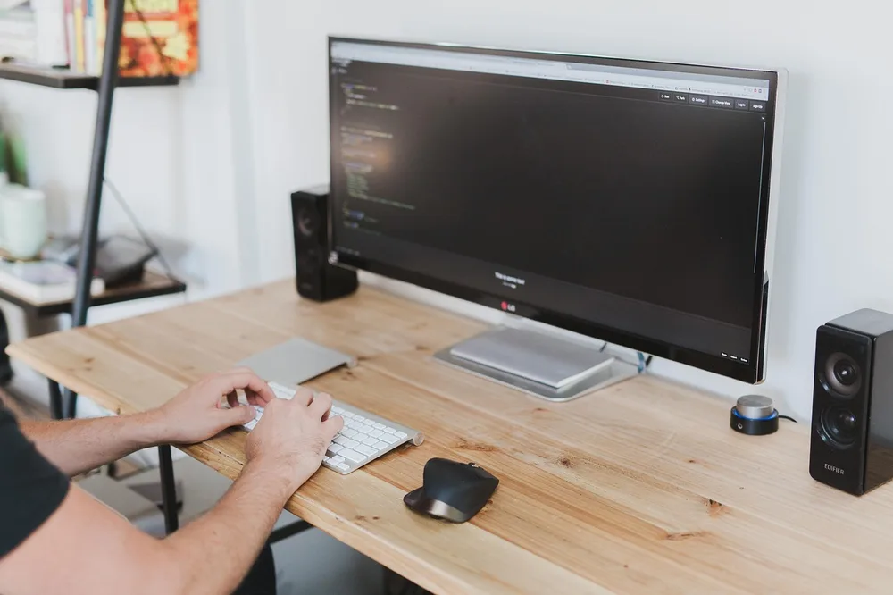
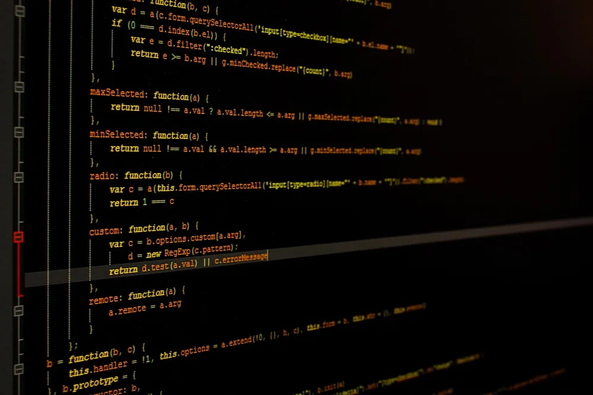
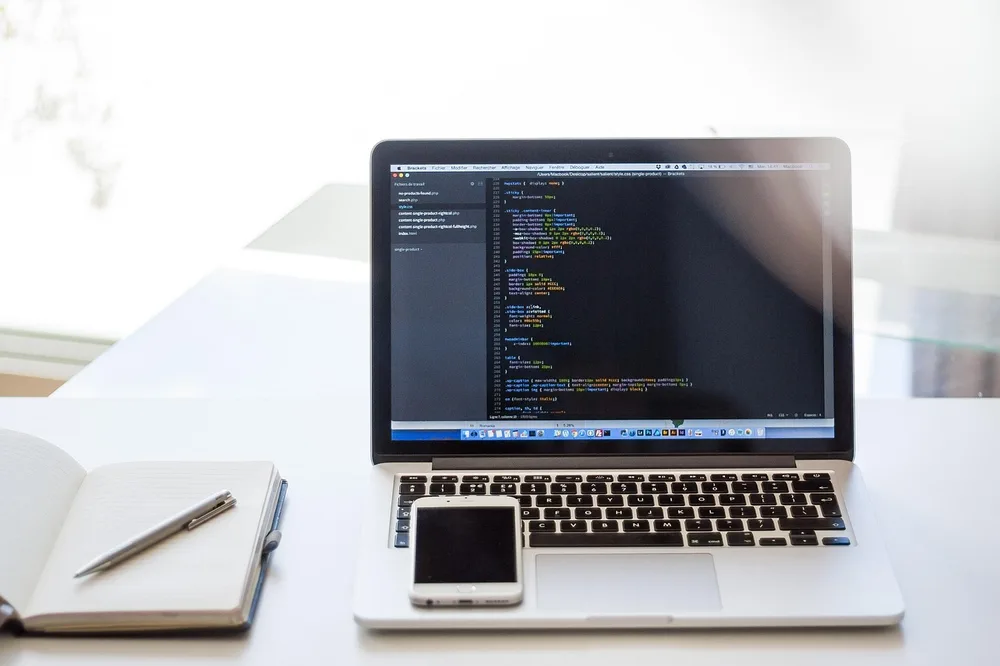
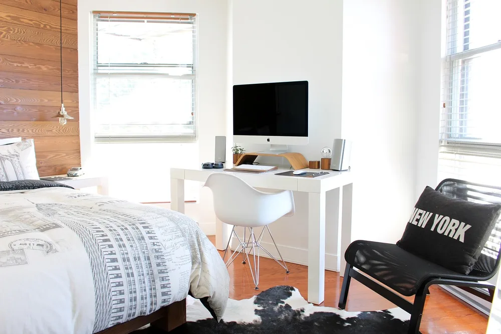
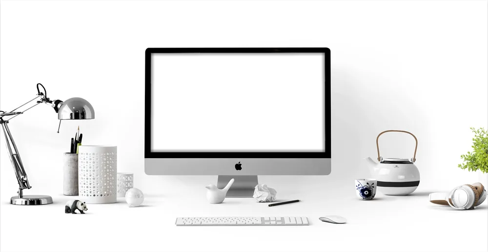
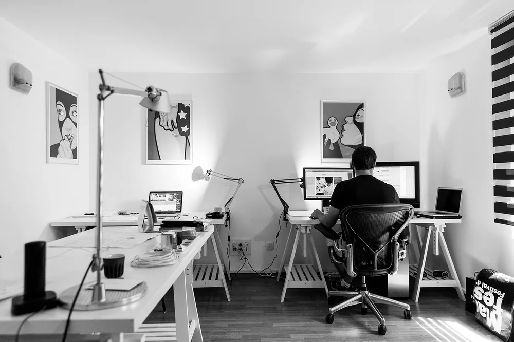

<figure class="pin-figure"><figcaption>Photo by <a href="https://pixabay.com/users/hitesh0141-2271740/" rel="nofollow noopener" target="_blank">hitesh0141</a> on <a href="https://pixabay.com/photos/programming-code-imac-computer-2115930/" rel="nofollow noopener" target="_blank">Pixabay</a></figcaption></figure>

Writing code is mostly reading, thinking and switching between windows, so a coding desk has different needs than a general office desk. Screen space matters more than decoration, your hands spend hours on the keyboard, and you often work late into the evening when the light in the room has changed.

These coding desk setup ideas focus on the parts that make a real difference over a full workday: how you arrange screens, what you type on, how you sit and how you keep your focus. Most of them work on a small desk and none of them require an expensive rebuild.

<h2>1. Use One Large Monitor as Your Main Screen</h2>

<figure class="pin-figure"><figcaption>Photo by <a href="https://pixabay.com/users/StockSnap-894430/" rel="nofollow noopener" target="_blank">StockSnap</a> on <a href="https://pixabay.com/photos/computer-desk-work-business-office-2557299/" rel="nofollow noopener" target="_blank">Pixabay</a></figcaption></figure>

A single large monitor gives you room for an editor and a terminal side by side without squinting. For most programmers a 27 inch screen with a sharp resolution is the sweet spot, because it shows long lines of code clearly while still fitting on a standard desk.

Place the monitor directly in front of you, about an arm&#39;s length away, with the top edge at or slightly below eye level. That position keeps your neck neutral during long reading sessions and makes it easy to scan a file from top to bottom without tilting your head.

<h2>2. Add a Second Screen for Docs and Output</h2>

<figure class="pin-figure"><figcaption>Photo by <a href="https://pixabay.com/users/tookapic-1386459/" rel="nofollow noopener" target="_blank">tookapic</a> on <a href="https://pixabay.com/photos/monitor-programming-933392/" rel="nofollow noopener" target="_blank">Pixabay</a></figcaption></figure>

A second screen is where documentation, logs, a browser preview or a video call can live without covering your code. Many developers turn the second monitor vertically, because a tall screen shows far more lines of a file or a long page of documentation at once.

Keep the main screen centered and place the second one to the side at the same height, angled slightly toward you. If both monitors are different sizes, match the height of their top edges so your eyes move across rather than up and down when you switch.

<h2>3. Choose a Keyboard You Enjoy Typing On</h2>

<figure class="pin-figure"><figcaption>Photo by <a href="https://pixabay.com/users/congerdesign-509903/" rel="nofollow noopener" target="_blank">congerdesign</a> on <a href="https://pixabay.com/photos/typewriter-mechanical-retro-write-3899300/" rel="nofollow noopener" target="_blank">Pixabay</a></figcaption></figure>

You type thousands of characters a day, so the keyboard is worth more attention than almost anything else on the desk. Mechanical keyboards are popular with programmers because each key press feels consistent, and the switches can be lighter or firmer depending on what your fingers prefer.

Layout matters as much as feel. A compact layout without the number pad brings the mouse closer to the keyboard and reduces shoulder strain. Whatever you choose, keep it close to the front edge of the desk so your wrists stay straight and your elbows rest near your sides.

<h2>4. Keep a Laptop Ready for Mobility</h2>

<figure class="pin-figure"><figcaption>Photo by <a href="https://pixabay.com/users/Pexels-2286921/" rel="nofollow noopener" target="_blank">Pexels</a> on <a href="https://pixabay.com/photos/laptop-notebook-cellphone-computer-1839876/" rel="nofollow noopener" target="_blank">Pixabay</a></figcaption></figure>

Even with a full desktop setup, a laptop is useful for pair programming, meetings and working from another room. Give it a defined place on the desk, either on a stand next to the main monitor or closed in a vertical holder, so it never ends up buried under papers.

If the laptop is your main machine, connect it to the monitor, keyboard and mouse with a single dock or hub. One cable in, one cable out means you can unplug and leave in seconds, and plugging back in brings your full setup back without rearranging windows.

<h2>5. Pick a Chair Built for Long Sessions</h2>

<figure class="pin-figure"><figcaption>Photo by <a href="https://pixabay.com/users/Pexels-2286921/" rel="nofollow noopener" target="_blank">Pexels</a> on <a href="https://pixabay.com/photos/bed-bedroom-chairs-computer-1834327/" rel="nofollow noopener" target="_blank">Pixabay</a></figcaption></figure>

Debugging sessions can keep you seated for hours, and a poor chair turns that into back and neck pain. Look for adjustable seat height, real lumbar support and armrests that can drop low enough to slide under the desk, so you can sit close to the keyboard.

Set the seat so your feet rest flat on the floor and your knees sit roughly level with your hips. Then adjust the desk or keyboard height until your forearms are parallel to the floor. Getting these two settings right does more than any accessory you can buy later.

<h2>6. Use Headphones to Protect Your Focus</h2>

<figure class="pin-figure"><figcaption>Photo by <a href="https://pixabay.com/users/Alexas_Fotos-686414/" rel="nofollow noopener" target="_blank">Alexas_Fotos</a> on <a href="https://pixabay.com/photos/apple-apple-devices-clean-computer-2831949/" rel="nofollow noopener" target="_blank">Pixabay</a></figcaption></figure>

Programming depends on holding a lot of context in your head, and a single interruption can cost several minutes of rebuilding it. Noise cancelling headphones block household sounds, traffic and conversations, which makes it much easier to stay in a long stretch of focused work.

Give the headphones a hook or stand on the side of the desk so they are always within reach and never tangled with cables. Many developers also use them as a signal to the people they live with: headphones on means deep work, headphones off means it is fine to talk.

<h2>7. Light the Desk for Late Night Work</h2>

<figure class="pin-figure"><figcaption>Photo by <a href="https://pixabay.com/users/tookapic-1386459/" rel="nofollow noopener" target="_blank">tookapic</a> on <a href="https://pixabay.com/photos/work-desk-computer-night-hacker-933061/" rel="nofollow noopener" target="_blank">Pixabay</a></figcaption></figure>

Coding late with only the glow of the screen strains your eyes, because the contrast between a bright monitor and a dark room is tiring. A desk lamp or a monitor light bar adds soft light to the desk and the wall behind the screen, which makes the screen feel less harsh.

Choose warm light in the evening and aim it away from the screen to avoid reflections. A small strip of indirect light behind the monitor also helps, because it lowers the contrast without lighting up the whole room or keeping anyone else in the house awake.

<h2>8. Keep a Paper Notebook for Planning</h2>

<figure class="pin-figure"><figcaption>Photo by <a href="https://pixabay.com/users/StockSnap-894430/" rel="nofollow noopener" target="_blank">StockSnap</a> on <a href="https://pixabay.com/photos/man-writing-laptop-computer-write-2562325/" rel="nofollow noopener" target="_blank">Pixabay</a></figcaption></figure>

Not every problem should be solved on the screen. A paper notebook next to the keyboard is the fastest way to sketch a data structure, list the steps of a refactor or draw how two services talk to each other before you write a single line.

Keep the notebook and a pen on the side of your writing hand so you can grab them without moving the keyboard. Writing down where you stopped at the end of the day also makes the next morning easier, because you know exactly which task to pick up first.

<h2>9. Give Coffee Its Own Safe Spot</h2>

<figure class="pin-figure"><figcaption>Photo by <a href="https://pixabay.com/users/freephotocc-2275370/" rel="nofollow noopener" target="_blank">freephotocc</a> on <a href="https://pixabay.com/photos/workspace-coffee-laptop-macbook-1280538/" rel="nofollow noopener" target="_blank">Pixabay</a></figcaption></figure>

Coffee and keyboards are a classic bad combination. Pick one fixed spot for your mug, ideally on the side opposite the mouse and a little behind the keyboard line, so you never reach across your devices with a full cup in your hand.

A coaster or a small tray makes that spot obvious and protects the desk surface. If you tend to forget drinks until they go cold, an insulated mug keeps coffee warm for longer and means fewer trips to the kitchen in the middle of a focused session.

<h2>10. Make the Setup Feel Like Yours</h2>

<figure class="pin-figure"><figcaption>Photo by <a href="https://pixabay.com/users/tookapic-1386459/" rel="nofollow noopener" target="_blank">tookapic</a> on <a href="https://pixabay.com/photos/office-work-desk-computer-932926/" rel="nofollow noopener" target="_blank">Pixabay</a></figcaption></figure>

A coding desk does not have to look like a server room. A small plant, a print you like or a shelf with a few favorite books makes the space more pleasant to return to every morning, which matters when you spend most of your day in the same chair.

Keep personal touches away from the main working area so they never compete with the screens. The goal is a desk that feels calm and familiar, with everything you need for work within reach and a few things that remind you why you enjoy building software.

<h2>Final Thoughts</h2>

A good coding desk setup removes small frictions so your attention can stay on the problem you are solving. Start with the monitor position and the chair, then add the keyboard, lighting and headphones that suit the way you work, and adjust one thing at a time until long sessions feel comfortable.

