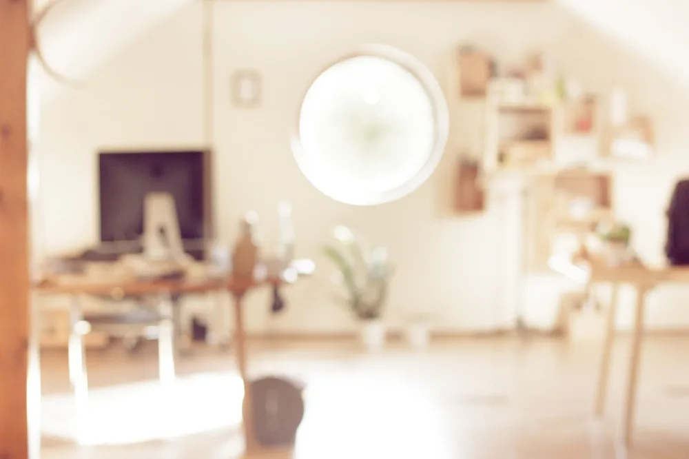
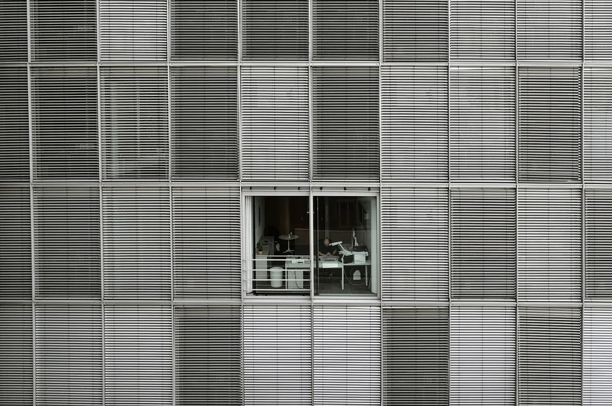
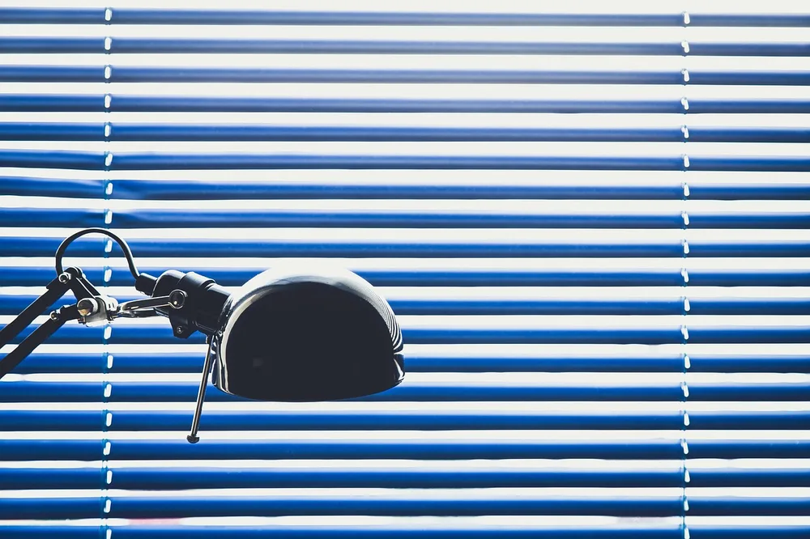
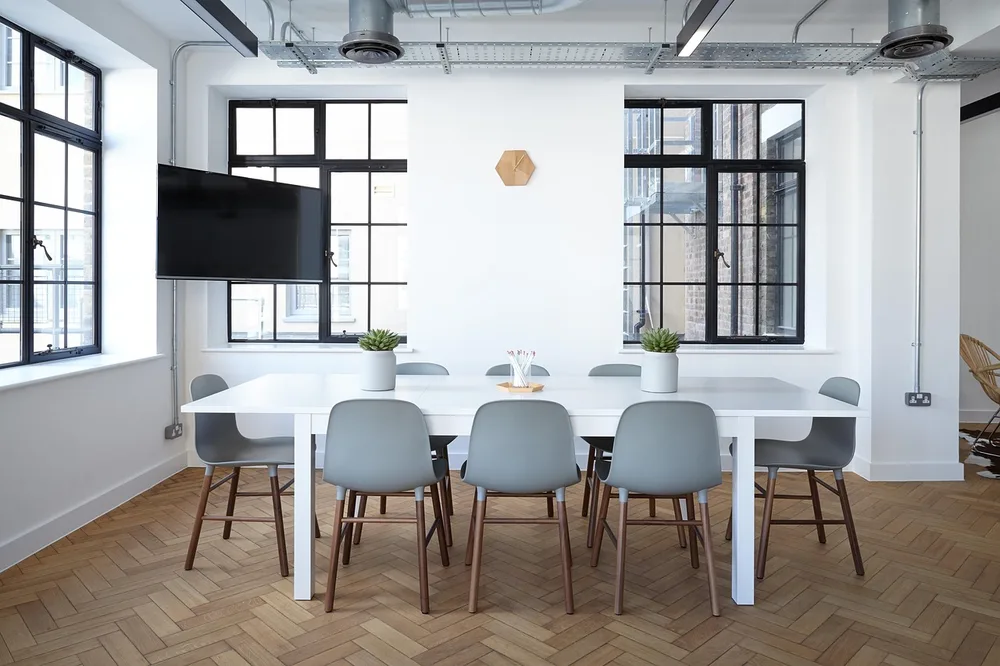
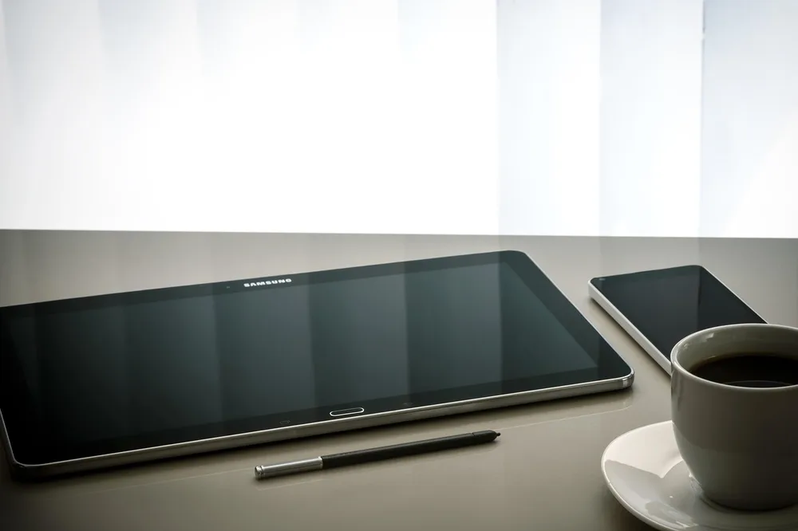
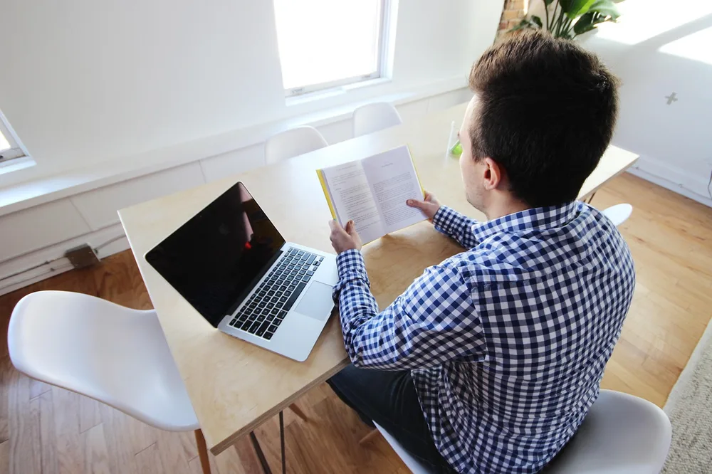
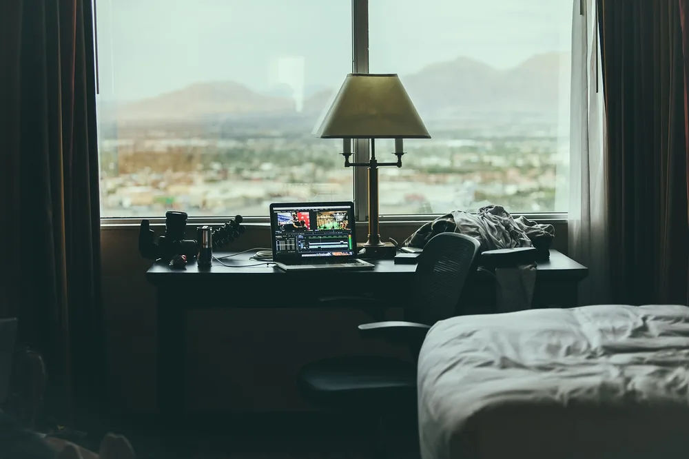

<figure class="pin-figure"><figcaption>Photo by <a href="https://pixabay.com/users/Goumbik-3752482/" rel="nofollow noopener" target="_blank">Goumbik</a> on <a href="https://pixabay.com/photos/busy-home-desk-paper-laptop-view-1972122/" rel="nofollow noopener" target="_blank">Pixabay</a></figcaption></figure>

Putting your desk by a window is one of the simplest ways to improve a home office. Natural light makes the room feel bigger, lifts your mood and gives your eyes a place to rest when you look away from the screen.

A window desk also brings a few challenges, such as glare on the monitor, heat in the afternoon and a view that can distract you. These desk by the window ideas help you enjoy the light and the view while keeping the setup comfortable all day.

<h2>1. Face the Window for the View</h2>

<figure class="pin-figure"><figcaption>Photo by <a href="https://pixabay.com/users/StockSnap-894430/" rel="nofollow noopener" target="_blank">StockSnap</a> on <a href="https://pixabay.com/photos/girl-woman-office-work-coffee-2583442/" rel="nofollow noopener" target="_blank">Pixabay</a></figcaption></figure>

Facing the window gives you a view every time you look up from the screen, which can make long workdays feel less closed in. It works best when the window is not too bright behind your monitor, such as a north facing window or one shaded by trees.

If you take many video calls, remember that the light will be in front of you, which is actually flattering for your face. Just keep the screen brightness high enough to match the daylight so your eyes do not have to adjust constantly.

<h2>2. Place the Desk Sideways to the Glass</h2>

<figure class="pin-figure"><figcaption>Photo by <a href="https://pixabay.com/users/ha11ok-1785462/" rel="nofollow noopener" target="_blank">ha11ok</a> on <a href="https://pixabay.com/photos/blur-office-background-blur-office-2926794/" rel="nofollow noopener" target="_blank">Pixabay</a></figcaption></figure>

For screen work, the most comfortable position is usually with the window to your side. Light falls across the desk instead of straight into your eyes or onto the monitor, which reduces glare and harsh shadows. Side light is also gentler on your eyes over a long workday.

Put the window on the side opposite your writing hand if you also take notes on paper. That way your hand never casts a shadow over the page, and you still get a view whenever you turn your head. It is also a good compromise when the window is very bright for part of the day.

<h2>3. Control Glare With Blinds</h2>

<figure class="pin-figure"><figcaption>Photo by <a href="https://pixabay.com/users/wal_172619-12138562/" rel="nofollow noopener" target="_blank">wal_172619</a> on <a href="https://pixabay.com/photos/office-building-window-structure-5309654/" rel="nofollow noopener" target="_blank">Pixabay</a></figcaption></figure>

Direct sun on a screen makes it hard to read and tires your eyes. Blinds let you adjust the light through the day, tilting the slats to bounce light toward the ceiling while keeping the room bright. Close them fully in the brightest hours and open them again as the light softens.

Light colored roller shades or sheer curtains are good alternatives if you prefer a softer look. Whatever you choose, it should be easy to adjust from your chair, so you actually change it as the sun moves. A simple pull cord or wand within reach is often enough to make that habit stick.

<h2>4. Add a Lamp for Gray Days and Evenings</h2>

<figure class="pin-figure"><figcaption>Photo by <a href="https://pixabay.com/users/StockSnap-894430/" rel="nofollow noopener" target="_blank">StockSnap</a> on <a href="https://pixabay.com/photos/blue-blinds-lamp-desk-window-2620133/" rel="nofollow noopener" target="_blank">Pixabay</a></figcaption></figure>

Daylight changes through the day and disappears early in winter. A desk lamp keeps the workspace usable on cloudy afternoons and in the evening, so you do not end up working in the dark next to a black window. Keep the lamp ready and switch it on as soon as the daylight starts to fade.

Pick a lamp with an adjustable color temperature if you can, cooler during the day to match daylight and warmer at night. Place it on the side away from the window so the light is balanced across the desk. A small lamp with a clamp base also saves space on a narrow window desk.

<h2>5. Put a Plant on the Sill or Desk</h2>

<figure class="pin-figure"><figcaption>Photo by <a href="https://pixabay.com/users/StockSnap-894430/" rel="nofollow noopener" target="_blank">StockSnap</a> on <a href="https://pixabay.com/photos/laptop-computer-electronic-2569306/" rel="nofollow noopener" target="_blank">Pixabay</a></figcaption></figure>

A window desk is the perfect place for plants, because they get the light they need right next to you. A few pots on the windowsill or a single plant on the corner of the desk add life to the view and soften the edge of the window.

Choose plants that suit the amount of sun your window gets. Succulents and herbs love bright light, while ferns and pothos prefer a softer spot, and checking them each morning becomes a pleasant start to the workday. Rotate the pots every week or two so the plants grow evenly toward the light.

<h2>6. Choose a Chair That Turns</h2>

<figure class="pin-figure"><figcaption>Photo by <a href="https://pixabay.com/users/Pexels-2286921/" rel="nofollow noopener" target="_blank">Pexels</a> on <a href="https://pixabay.com/photos/chairs-table-contemporary-furniture-2181960/" rel="nofollow noopener" target="_blank">Pixabay</a></figcaption></figure>

A swivel chair makes a window desk more flexible. You can turn toward the window to think, read on paper or take a break, then turn back to the screen without standing up or dragging the chair across the floor.

Make sure the chair still offers proper support for full workdays, with adjustable height and lumbar support. A cushion or throw adds comfort for the moments when you sit back and enjoy the view. Wheels that glide easily on your floor also make it simple to move between desk and window.

<h2>7. Keep a Morning Coffee Spot</h2>

<figure class="pin-figure"><figcaption>Photo by <a href="https://pixabay.com/users/AS_Photography-1546875/" rel="nofollow noopener" target="_blank">AS_Photography</a> on <a href="https://pixabay.com/photos/workplace-modern-tablet-screen-1949404/" rel="nofollow noopener" target="_blank">Pixabay</a></figcaption></figure>

A desk by the window is a lovely place to start the day slowly. Keep a coaster and a small tray at one end of the desk for your morning coffee or tea, and spend the first few minutes looking outside before opening your email.

This small ritual can make working from home feel calmer and more deliberate. It also gives the desk a clear spot for drinks, away from the laptop and any papers. A small plant or candle on the tray makes the spot feel even more inviting. Over time, these quiet minutes can become your favorite part of the workday.

<h2>8. Use the Ledge for Books and Objects</h2>

<figure class="pin-figure"><figcaption>Photo by <a href="https://pixabay.com/users/StockSnap-894430/" rel="nofollow noopener" target="_blank">StockSnap</a> on <a href="https://pixabay.com/photos/macbook-laptop-computer-technology-2617419/" rel="nofollow noopener" target="_blank">Pixabay</a></figcaption></figure>

A deep windowsill or ledge behind the desk is useful extra storage. Keep a short stack of books, a notebook or a few decorative objects there, so the desk surface stays clear for work. A ledge is also a good place for a small plant that enjoys the light.

Avoid blocking too much of the window, though. Keep items low and grouped at one end, and leave the rest of the ledge open so light can still pour into the room. A ledge that is cluttered from end to end makes the whole window look smaller and the desk feel cramped.

<h2>9. Work in the Best Light of the Day</h2>

<figure class="pin-figure"><figcaption>Photo by <a href="https://pixabay.com/users/AeroLeafStudio-53371939/" rel="nofollow noopener" target="_blank">AeroLeafStudio</a> on <a href="https://pixabay.com/photos/headphones-laptop-office-desk-9981943/" rel="nofollow noopener" target="_blank">Pixabay</a></figcaption></figure>

Each window has its best hours. East facing windows have soft morning light, west facing ones get warm afternoon sun and north facing windows offer even light all day. Notice when your window feels most comfortable and plan focused work for those hours.

If you have flexibility, schedule writing, reading or design work during the brightest, calmest light, and save calls or admin tasks for times when glare or heat is stronger. Working with the light makes the whole day feel easier. It also helps you notice when you need a lamp or a break.

<h2>10. Enjoy a City View Without Distraction</h2>

<figure class="pin-figure"><figcaption>Photo by <a href="https://pixabay.com/users/StockSnap-894430/" rel="nofollow noopener" target="_blank">StockSnap</a> on <a href="https://pixabay.com/photos/bed-room-lampshade-window-glass-2562110/" rel="nofollow noopener" target="_blank">Pixabay</a></figcaption></figure>

A city view can be inspiring, but busy streets and neighbors&#39; windows can also pull your attention. Sheer curtains or frosted window film on the lower half of the glass keep the light and the skyline while hiding most of the movement below.

Turn the desk slightly so the view is in your peripheral vision rather than straight ahead if you find it distracting. You will still feel connected to the city without looking up every time a bus goes by. At night, close the curtains to avoid reflections on your screen from the room lights.

<h2>Final Thoughts</h2>

A desk by the window gives you better light, a better mood and a place for your eyes to rest. Position it sideways to reduce glare, add blinds and a good lamp for changing light, and make the most of the view with plants and small rituals that make the workday feel brighter.

