<figure class="pin-figure">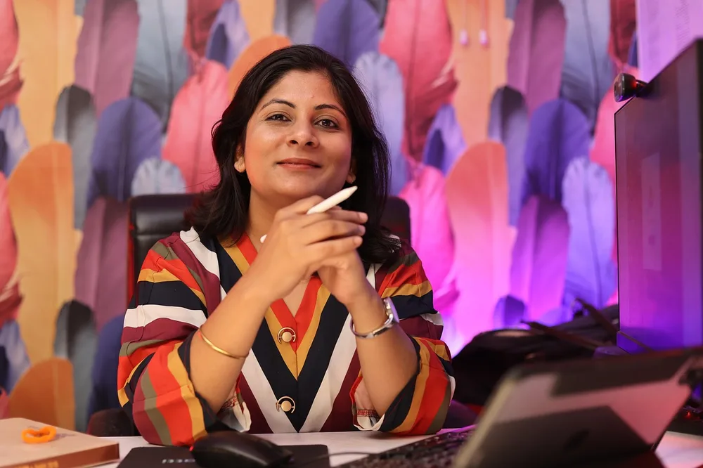<figcaption>Photo by <a href="https://pixabay.com/users/F1Digitals-1568321/" rel="nofollow noopener" target="_blank">F1Digitals</a> on <a href="https://pixabay.com/photos/woman-business-corporate-designer-7607337/" rel="nofollow noopener" target="_blank">Pixabay</a></figcaption></figure>

A graphic designer&#39;s desk has to support two very different kinds of work: precise, detailed tasks on the screen and loose, messy thinking on paper. The right setup makes it easy to move between the two without clearing space every time.

These graphic designer desk setup ideas cover the tools that matter most, such as a drawing tablet, a good monitor and the right lighting, along with small touches that keep a creative workspace inspiring. They work for freelancers, students and in-house designers working from home.

<h2>1. Use a Drawing Tablet for Precision</h2>

<figure class="pin-figure">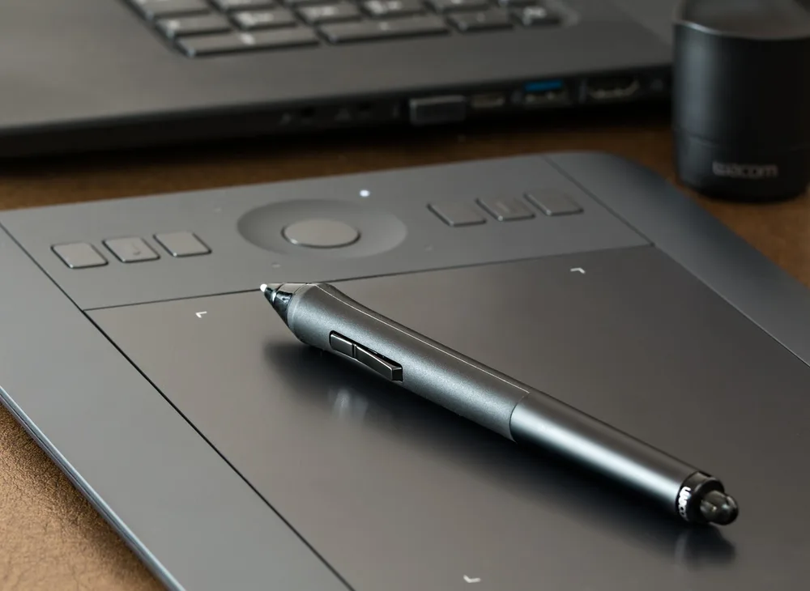<figcaption>Photo by <a href="https://pixabay.com/users/stevepb-282134/" rel="nofollow noopener" target="_blank">stevepb</a> on <a href="https://pixabay.com/photos/graphics-tablet-wacom-photoshop-1964816/" rel="nofollow noopener" target="_blank">Pixabay</a></figcaption></figure>

A drawing tablet makes illustration, retouching and lettering far more natural than a mouse. Pressure sensitivity lets you vary line weight just like a real pen, and many designers find it reduces wrist strain during long sessions. Start with a medium size tablet, which suits most desks and drawing styles.

Place the tablet directly in front of you, with the keyboard pushed back or off to the side, so your drawing hand moves freely. Keep keyboard shortcuts under your other hand to switch tools quickly without lifting the pen. Most tablets let you assign your favorite tools to buttons on the pen or the tablet itself.

<h2>2. Pair the Tablet With a Large Screen</h2>

<figure class="pin-figure">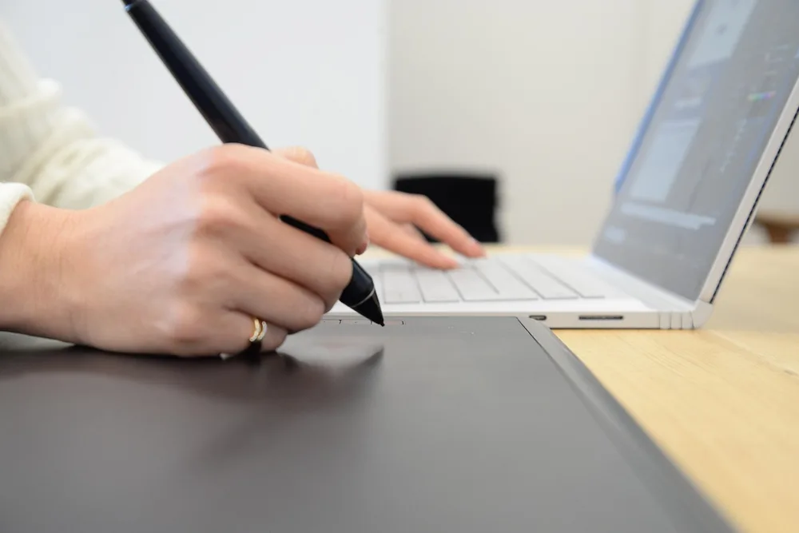<figcaption>Photo by <a href="https://pixabay.com/users/yatsusimnetcojp-14033705/" rel="nofollow noopener" target="_blank">yatsusimnetcojp</a> on <a href="https://pixabay.com/photos/graphics-tablet-drawing-laptop-4570796/" rel="nofollow noopener" target="_blank">Pixabay</a></figcaption></figure>

A tablet works best with a large screen, so you can see the whole design while you work on small details. A bigger display also leaves room for tool panels and layers without covering the canvas. A second smaller screen can hold references, palettes or client notes.

Match the tablet&#39;s working area to the screen&#39;s proportions in the driver settings. When the shapes line up, movements on the tablet feel natural, and you can reach every corner of the screen without awkward stretches. Take a few minutes to adjust pressure settings too, so your strokes feel just right.

<h2>3. Choose a Color Accurate Monitor</h2>

<figure class="pin-figure">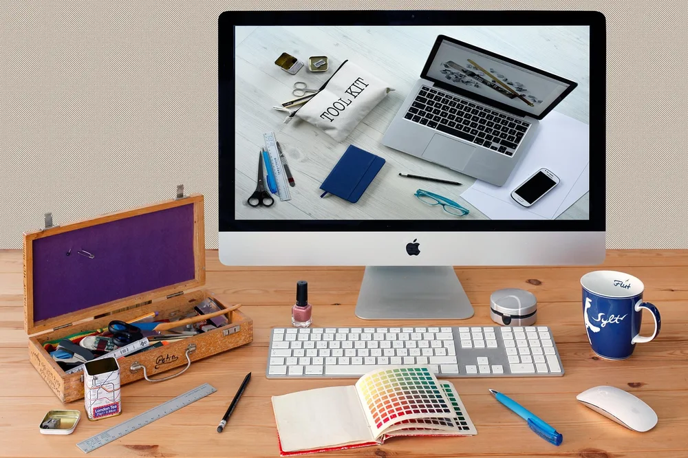<figcaption>Photo by <a href="https://pixabay.com/users/ptra-359668/" rel="nofollow noopener" target="_blank">ptra</a> on <a href="https://pixabay.com/photos/communication-workplace-imac-2805785/" rel="nofollow noopener" target="_blank">Pixabay</a></figcaption></figure>

For design work, color accuracy matters more than gaming features. Look for a monitor that covers a wide color range, such as most of the sRGB or DCI-P3 space, so your designs look the same on screen as they do in print or on clients&#39; devices.

Calibrate the monitor every few months with a hardware calibrator, and avoid placing it directly opposite a bright window. Consistent light in the room helps your eyes judge color correctly throughout the day. Neutral gray walls behind the monitor also help, because strong colors can affect how you see the screen and shift your judgment.

<h2>4. Keep a Sketchbook Within Reach</h2>

<figure class="pin-figure">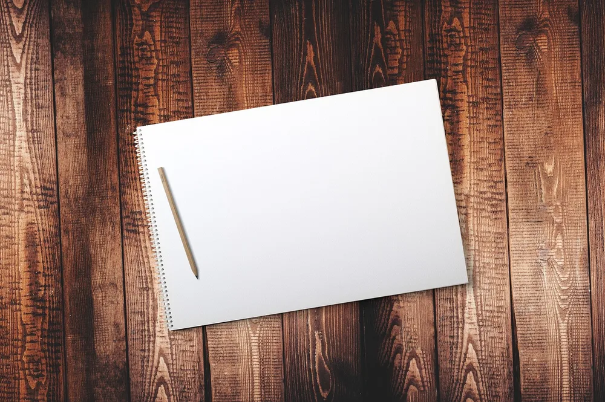<figcaption>Photo by <a href="https://pixabay.com/users/World-fly-856412/" rel="nofollow noopener" target="_blank">World-fly</a> on <a href="https://pixabay.com/photos/notepad-sketch-pad-sketchbook-empty-1558811/" rel="nofollow noopener" target="_blank">Pixabay</a></figcaption></figure>

Many good designs start as quick sketches. Keep a sketchbook open on the desk so you can explore layouts, logos and ideas on paper before committing to the screen, where it is easy to get stuck on details too early.

A spiral bound sketchbook that lies flat is easiest to use next to the keyboard. Date each page, and you will build a record of your ideas that is often useful when revisiting a project later. Use cheap paper for fast ideas and save nicer pages for presentations.

<h2>5. Make Room for Pencils and Markers</h2>

<figure class="pin-figure">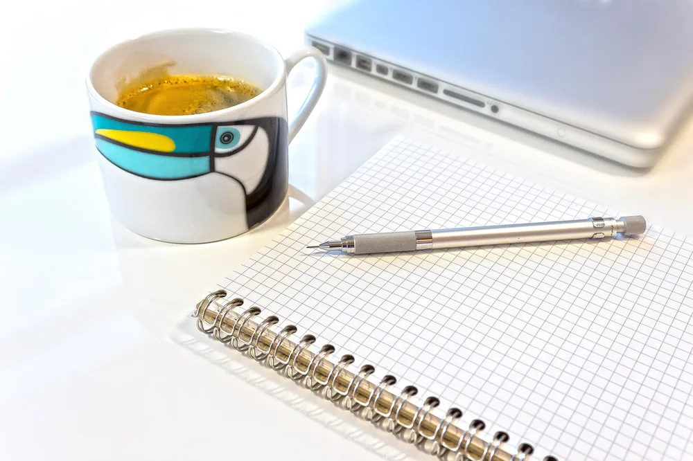<figcaption>Photo by <a href="https://pixabay.com/users/stux-12364/" rel="nofollow noopener" target="_blank">stux</a> on <a href="https://pixabay.com/photos/pencil-writing-or-drawing-device-4019739/" rel="nofollow noopener" target="_blank">Pixabay</a></figcaption></figure>

Designers use many small tools, from pencils and fine liners to markers and erasers. Keep them in a cup or tray within reach of your drawing hand, sorted by type, so you can grab the right one without breaking your flow.

Test markers regularly and throw away dried ones. A smaller, reliable set is more useful than a big jar full of pens that no longer work, and it keeps the desk easier to tidy. A rotating caddy or small drawer unit also keeps colors visible and easy to choose.

<h2>6. Use a Laptop for Client Meetings</h2>

<figure class="pin-figure">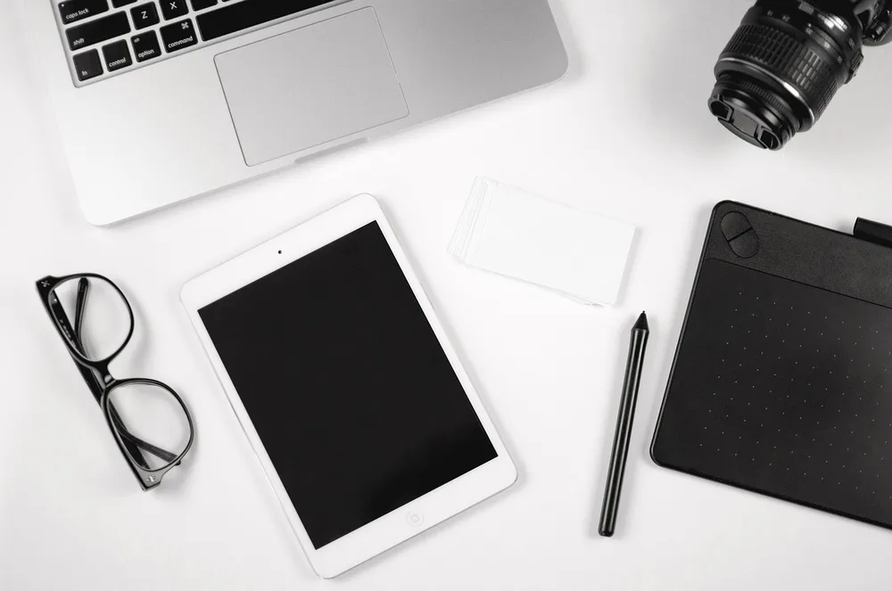<figcaption>Photo by <a href="https://pixabay.com/users/Veex-4342647/" rel="nofollow noopener" target="_blank">Veex</a> on <a href="https://pixabay.com/photos/laptop-technology-computer-business-3244483/" rel="nofollow noopener" target="_blank">Pixabay</a></figcaption></figure>

A laptop gives you flexibility to present work, meet clients or work from a different spot. Keep it synced with your main files so you can open the latest version of a project anywhere. A lightweight laptop with a good screen is also useful for checking designs on a different display.

When you are at the desk, connect the laptop to the main monitor and tablet with one hub. The setup becomes a full workstation in seconds, and unplugging for a meeting is just as quick. Keep a short cable for the hub so the desk stays tidy around the monitor and tablet.

<h2>7. Choose a Compact Keyboard</h2>

<figure class="pin-figure">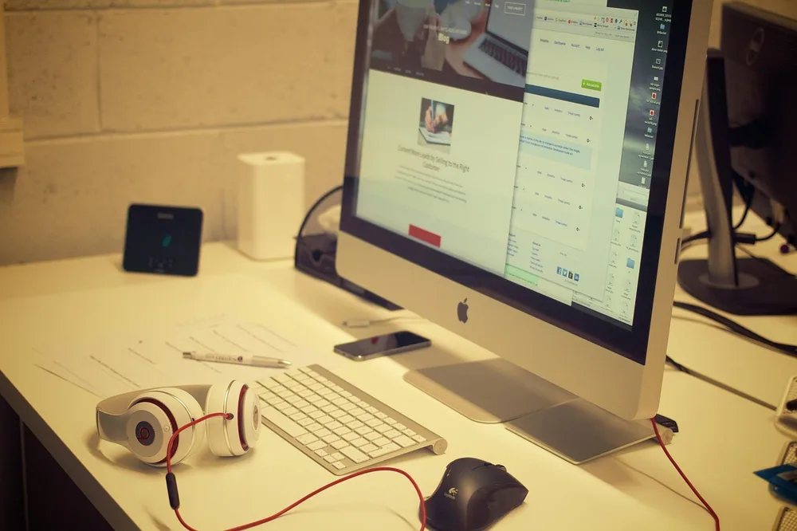<figcaption>Photo by <a href="https://pixabay.com/users/DaveMeier-361976/" rel="nofollow noopener" target="_blank">DaveMeier</a> on <a href="https://pixabay.com/photos/workstation-pc-mac-apple-inc-405747/" rel="nofollow noopener" target="_blank">Pixabay</a></figcaption></figure>

When a tablet takes the central spot on the desk, a full size keyboard can get in the way. A compact keyboard without a number pad leaves more space for the tablet and keeps your shoulders relaxed. It also leaves more space for a sketchbook or reference prints.

Learn the shortcuts you use most in your design software and keep the keyboard close to your non-drawing hand. Many designers rarely touch the mouse at all once their shortcuts become second nature. A small shortcut cheat sheet taped to the side of the monitor helps while you are learning new programs.

<h2>8. Add a Camera for Product Shots and Calls</h2>

<figure class="pin-figure">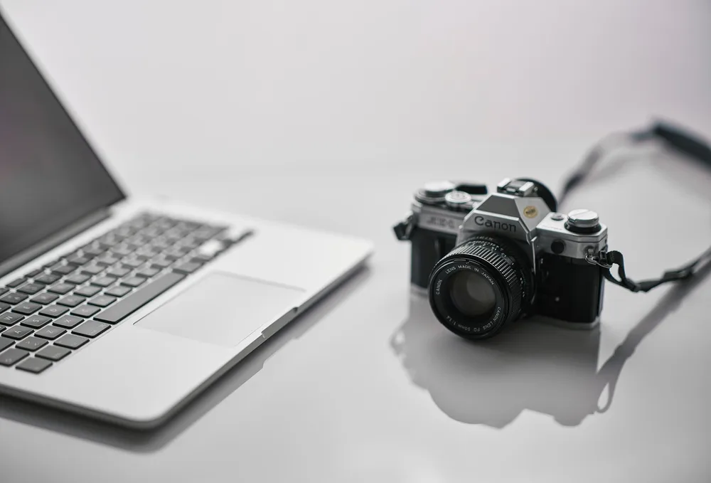<figcaption>Photo by <a href="https://pixabay.com/users/Engin_Akyurt-3656355/" rel="nofollow noopener" target="_blank">Engin_Akyurt</a> on <a href="https://pixabay.com/photos/laptop-camera-technology-computer-6966045/" rel="nofollow noopener" target="_blank">Pixabay</a></figcaption></figure>

Designers often need to photograph sketches, packaging prototypes or printed samples. A camera or a good smartphone on a small tripod near the desk makes it easy to capture work quickly and share it with clients. A neutral backdrop, such as a sheet of white card, makes product shots look clean and professional.

The same camera can double as a webcam for video calls with better image quality. Keep a small light nearby so photos and calls look clear even late in the afternoon. A soft, diffused light placed slightly to the side flatters faces and shows printed colors more accurately on camera.

<h2>9. Keep a Corner for Paint and Mixed Media</h2>

<figure class="pin-figure">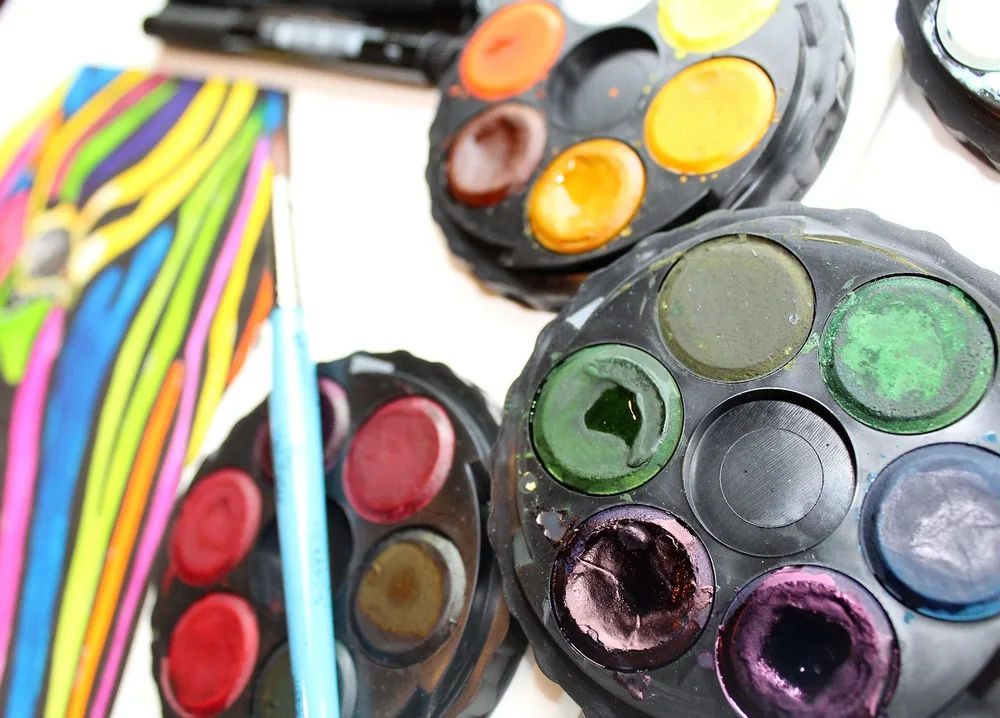<figcaption>Photo by <a href="https://pixabay.com/users/CallyL-4302697/" rel="nofollow noopener" target="_blank">CallyL</a> on <a href="https://pixabay.com/photos/art-work-desk-studio-paint-2670412/" rel="nofollow noopener" target="_blank">Pixabay</a></figcaption></figure>

If you work with watercolor, gouache or collage, set aside one corner of the desk or a small side table for wet media. A washable mat and a jar of water in a fixed spot keep paint away from your electronics.

Hand made textures and painted elements can be scanned or photographed and used in digital projects. Having a ready space for them encourages you to experiment beyond the screen more often. Keep a roll of paper towels and a small trash bin close by, so cleaning up after a session takes only a minute.

<h2>10. Leave Space to Think</h2>

<figure class="pin-figure">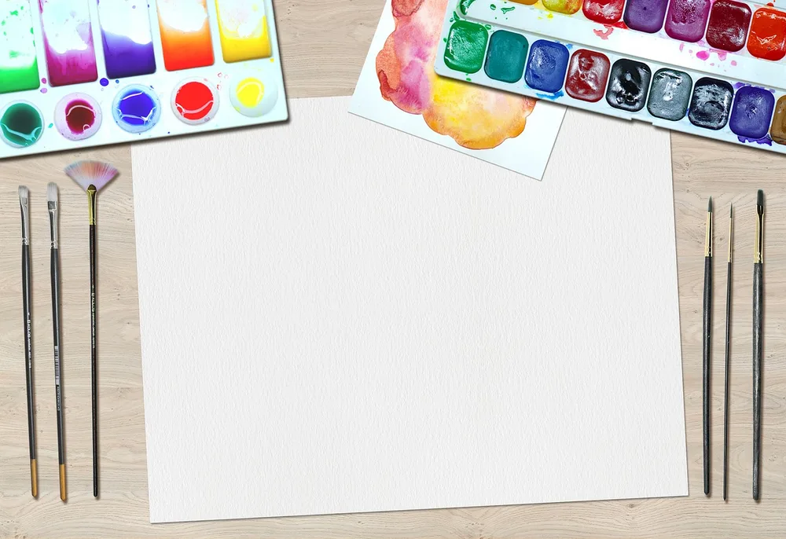<figcaption>Photo by <a href="https://pixabay.com/users/1681551-1681551/" rel="nofollow noopener" target="_blank">1681551</a> on <a href="https://pixabay.com/photos/art-paint-water-colors-desk-artist-1209519/" rel="nofollow noopener" target="_blank">Pixabay</a></figcaption></figure>

A creative desk does not need to be completely clear, but it should leave room to spread out. An empty area where you can lay out printed drafts, color swatches or sketches side by side helps you compare ideas and spot problems quickly.

Surround that space with a few things that inspire you, such as a favorite print, a mood board or a book from a designer you admire. A workspace that feels personal makes it easier to stay curious and creative. Change the inspiration board every few months so it stays fresh.

<h2>Final Thoughts</h2>

A great graphic designer desk setup balances precise digital tools with space for loose, hands-on thinking. Start with a drawing tablet and a color accurate monitor, keep sketchbooks and pencils within reach, and leave room to spread out ideas, so the desk supports every stage of the creative process.

