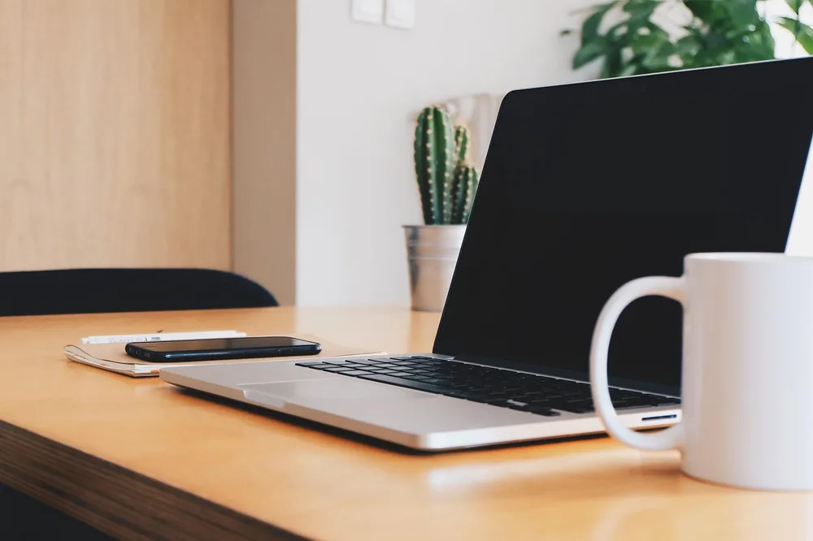
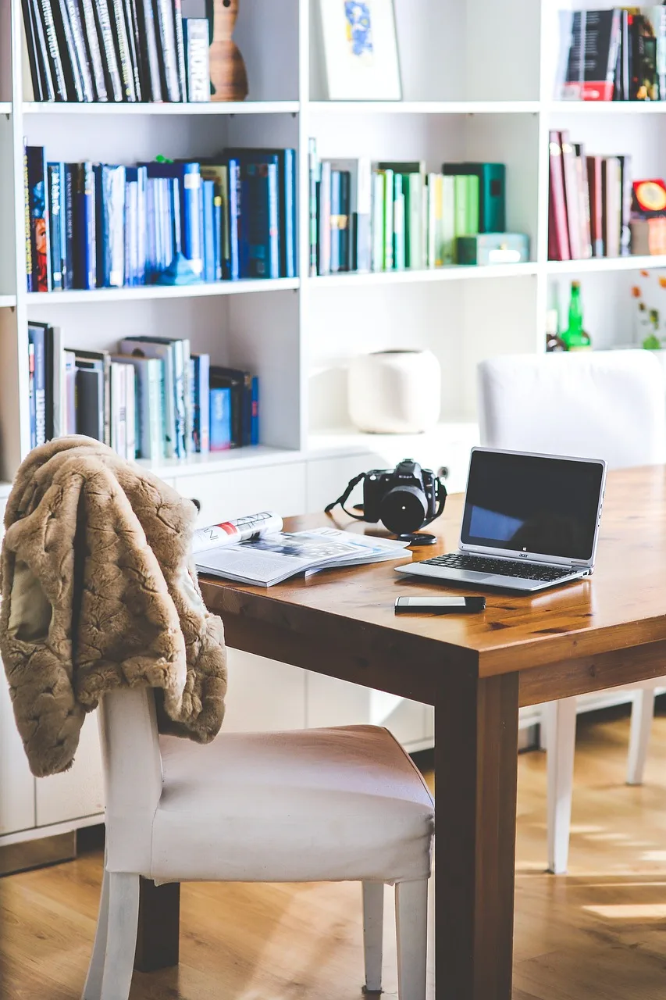
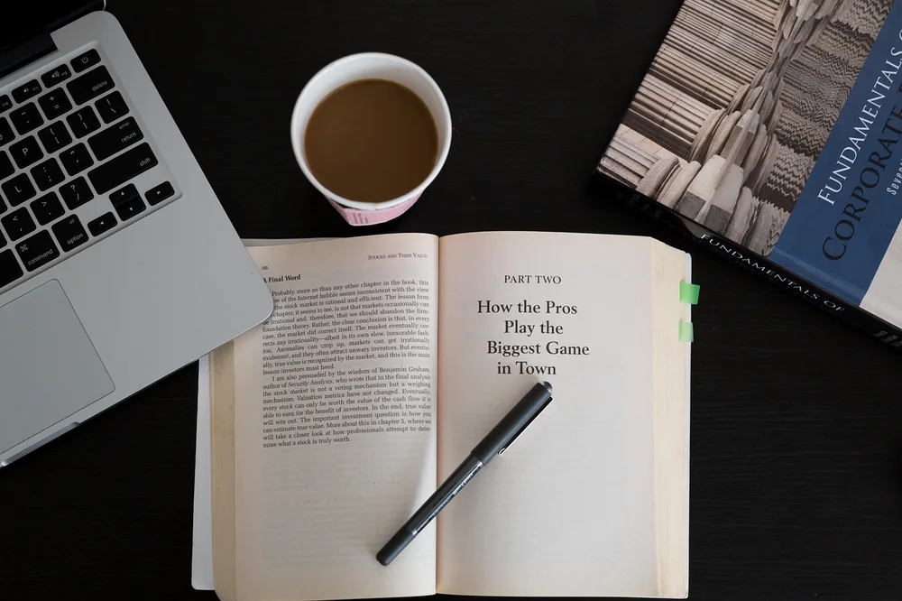
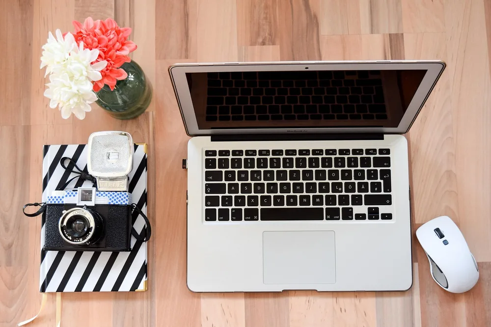
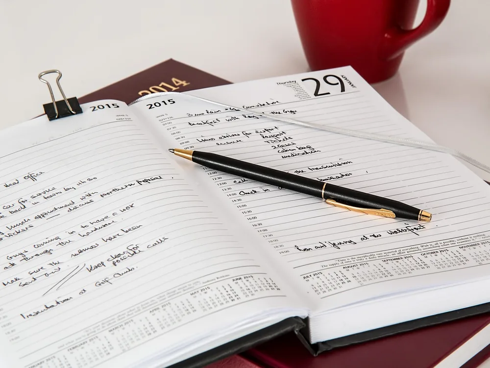
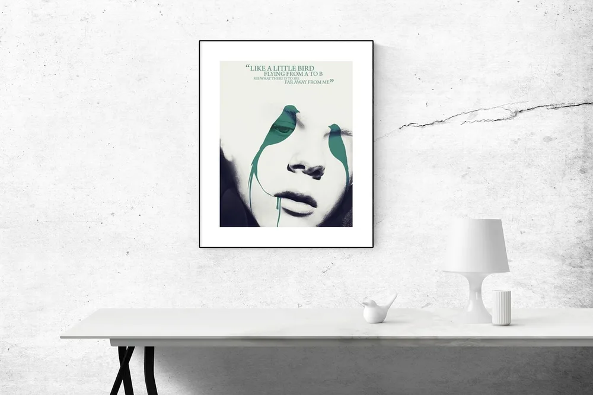
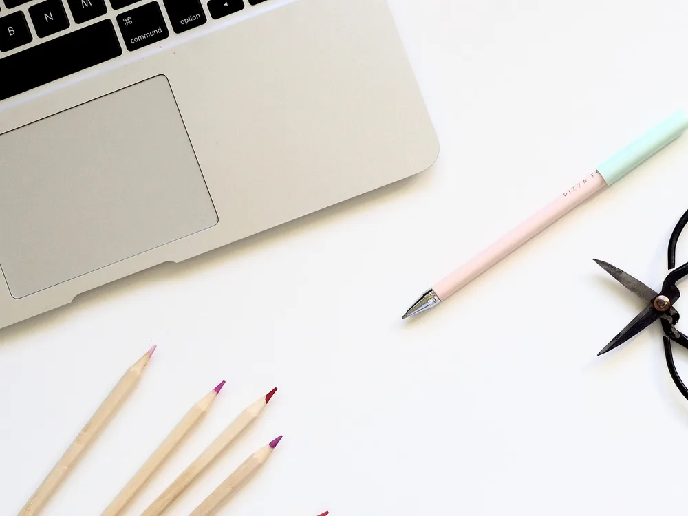
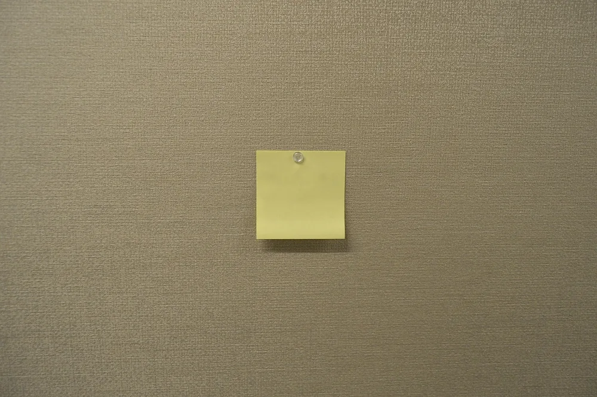
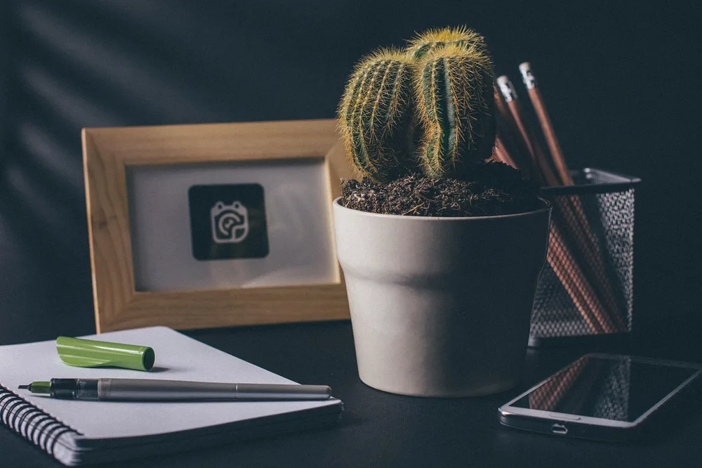

<figure class="pin-figure"><figcaption>Photo by <a href="https://pixabay.com/users/StockSnap-894430/" rel="nofollow noopener" target="_blank">StockSnap</a> on <a href="https://pixabay.com/photos/office-desk-business-working-925806/" rel="nofollow noopener" target="_blank">Pixabay</a></figcaption></figure>

A comfortable home office does not require a big shopping list. Most of what makes a workspace pleasant comes from a few smart choices, such as a good chair, decent light and an organized desk, rather than expensive furniture or matching accessories.

These budget home office ideas show where it is worth spending a little more and where you can save. Many of them reuse things you already own, so you can build a practical setup gradually and upgrade only when you really need to.

<h2>1. Start With a Small, Sturdy Desk</h2>

<figure class="pin-figure"><figcaption>Photo by <a href="https://pixabay.com/users/Pexels-2286921/" rel="nofollow noopener" target="_blank">Pexels</a> on <a href="https://pixabay.com/photos/woman-laptop-desk-workspace-1851464/" rel="nofollow noopener" target="_blank">Pixabay</a></figcaption></figure>

You do not need a large executive desk to work well. A small, sturdy desk or even a solid table you already own is enough for a laptop or a single monitor, and compact desks are usually the least expensive option in any store.

Check secondhand marketplaces and local listings as well. People often sell good desks when they move, and a quick wipe or a coat of paint can make a used desk look new for a fraction of the retail price. Look for solid wood or metal frames, which tend to last longer.

<h2>2. Spend Most of Your Budget on the Chair</h2>

<figure class="pin-figure"><figcaption>Photo by <a href="https://pixabay.com/users/kaboompics-1013994/" rel="nofollow noopener" target="_blank">kaboompics</a> on <a href="https://pixabay.com/photos/working-work-space-table-desk-791175/" rel="nofollow noopener" target="_blank">Pixabay</a></figcaption></figure>

If there is one place to spend more, it is the chair. You sit in it for hours every day, and a poor chair leads to back and neck pain that no accessory can fix. Look for height adjustment, lumbar support and a seat that does not dig into your legs.

Used office chairs from businesses that are closing or upgrading are often high quality and much cheaper than new ones. Test them in person if you can, and check that the gas lift and the tilt mechanism still work smoothly.

<h2>3. Raise the Laptop on Books</h2>

<figure class="pin-figure"><figcaption>Photo by <a href="https://pixabay.com/users/StockSnap-894430/" rel="nofollow noopener" target="_blank">StockSnap</a> on <a href="https://pixabay.com/photos/books-reading-learning-pen-macbook-924780/" rel="nofollow noopener" target="_blank">Pixabay</a></figcaption></figure>

Looking down at a laptop all day strains your neck. Before buying a stand, try a stack of sturdy hardcover books to lift the screen so the top edge sits close to eye level. It costs nothing and works surprisingly well.

Once the laptop is raised, you will need a separate keyboard and mouse to type comfortably. If you later decide to buy a stand, you will already know exactly what height suits you. Make sure the stack is stable and the books are wider than the laptop base.

<h2>4. Add an Inexpensive Keyboard and Mouse</h2>

<figure class="pin-figure"><figcaption>Photo by <a href="https://pixabay.com/users/annawaldl-3773640/" rel="nofollow noopener" target="_blank">annawaldl</a> on <a href="https://pixabay.com/photos/laptop-mouse-workplace-home-office-2234342/" rel="nofollow noopener" target="_blank">Pixabay</a></figcaption></figure>

A basic external keyboard and mouse are among the cheapest upgrades you can make, and they make a big difference in comfort. They let you raise the laptop screen while keeping your hands at a natural height on the desk.

You do not need premium models. A simple wired or wireless set is enough for most office work, and many people already have an old keyboard or mouse in a drawer that works perfectly well. Clean the keys and check the batteries, and an old set can feel almost like new.

<h2>5. Use a Paper Calendar to Plan the Week</h2>

<figure class="pin-figure"><figcaption>Photo by <a href="https://pixabay.com/users/stevepb-282134/" rel="nofollow noopener" target="_blank">stevepb</a> on <a href="https://pixabay.com/photos/diary-journal-pen-notebook-january-614149/" rel="nofollow noopener" target="_blank">Pixabay</a></figcaption></figure>

Planning tools do not have to come with a subscription. A simple paper calendar or a printable weekly planner on the desk helps you see deadlines, meetings and focus time at a glance, for almost no money. Keep it next to the keyboard so you see it every time you sit down.

Print a new page every week or buy an inexpensive desk calendar at the start of the year. Writing plans by hand also helps you remember them, which can make a small budget setup feel just as organized as an expensive one.

<h2>6. Make Your Own Wall Art</h2>

<figure class="pin-figure"><figcaption>Photo by <a href="https://pixabay.com/users/RaniRamli-731298/" rel="nofollow noopener" target="_blank">RaniRamli</a> on <a href="https://pixabay.com/photos/poster-mockup-mockup-poster-frame-2853847/" rel="nofollow noopener" target="_blank">Pixabay</a></figcaption></figure>

Decor does not need to be expensive to make a room feel finished. Print a favorite photo, a free public domain artwork or a simple quote and put it in an inexpensive frame above the desk. A few personal touches make the space feel like yours from the first day.

Thrift stores often sell frames for very little, and a quick coat of spray paint makes mismatched frames look like a set. One or two pieces are enough to make the office feel personal and less like a temporary corner.

<h2>7. Repurpose Jars and Mugs as Organizers</h2>

<figure class="pin-figure"><figcaption>Photo by <a href="https://pixabay.com/users/JessBaileyDesign-7369896/" rel="nofollow noopener" target="_blank">JessBaileyDesign</a> on <a href="https://pixabay.com/photos/paper-composition-pencil-writing-3318159/" rel="nofollow noopener" target="_blank">Pixabay</a></figcaption></figure>

Desk organizers are easy to replace with things you already have. Clean glass jars, old mugs and small boxes hold pens, scissors, cables and sticky notes just as well as anything you would buy. They also add a personal, slightly handmade feel to the workspace.

Group the containers on a tray or a cutting board to keep them together, and label boxes if you have many small items. The result looks intentional, keeps the desk tidy and costs nothing at all. Choose containers of similar colors or materials so the group looks cohesive.

<h2>8. Use Sticky Notes as a Free Planning Board</h2>

<figure class="pin-figure"><figcaption>Photo by <a href="https://pixabay.com/users/1139623-1139623/" rel="nofollow noopener" target="_blank">1139623</a> on <a href="https://pixabay.com/photos/sticky-note-sticky-note-message-2581479/" rel="nofollow noopener" target="_blank">Pixabay</a></figcaption></figure>

A corkboard or whiteboard is nice to have, but a section of wall and a pack of sticky notes works almost as well. Use one column for tasks to do, one for tasks in progress and one for finished work.

Moving a note from one column to the next is a simple, satisfying way to see progress. When you are ready to upgrade, you will know whether a board is worth buying for the way you actually work. It is a practical way to test a system before spending money on it.

<h2>9. Buy One Good Basic Lamp</h2>

<figure class="pin-figure"><figcaption>Photo by <a href="https://pixabay.com/users/tookapic-1386459/" rel="nofollow noopener" target="_blank">tookapic</a> on <a href="https://pixabay.com/photos/desk-lamp-light-desk-lamp-bulb-932210/" rel="nofollow noopener" target="_blank">Pixabay</a></figcaption></figure>

Good light makes long workdays easier, and a simple desk lamp is one of the most affordable upgrades available. Look for an adjustable arm and a standard LED bulb so you can direct light where you need it and replace the bulb cheaply.

Use daylight as much as possible by placing the desk near a window. Then the lamp only needs to cover early mornings, evenings and gray days, which also keeps your electricity bill low. Turn the lamp off when you leave the desk, and a single bulb will last for years.

<h2>10. Add One Easy Plant</h2>

<figure class="pin-figure"><figcaption>Photo by <a href="https://pixabay.com/users/StockSnap-894430/" rel="nofollow noopener" target="_blank">StockSnap</a> on <a href="https://pixabay.com/photos/cactus-office-desk-notebook-2617529/" rel="nofollow noopener" target="_blank">Pixabay</a></figcaption></figure>

A single plant makes a workspace feel more alive, and many hardy plants cost very little. Small cacti and succulents need water only every couple of weeks and are happy on a bright desk or windowsill. They are also forgiving if you forget to water them for a few days.

You can also grow a new plant for free from a cutting of a friend&#39;s plant, placed in a glass of water until it roots. A recycled jar or mug makes a perfectly good pot for a small desk plant.

<h2>Final Thoughts</h2>

A home office on a budget comes down to spending where it matters and getting creative everywhere else. Put your money into a good chair and decent light, reuse what you already own for storage and decor, and upgrade one piece at a time as your needs and budget grow.

