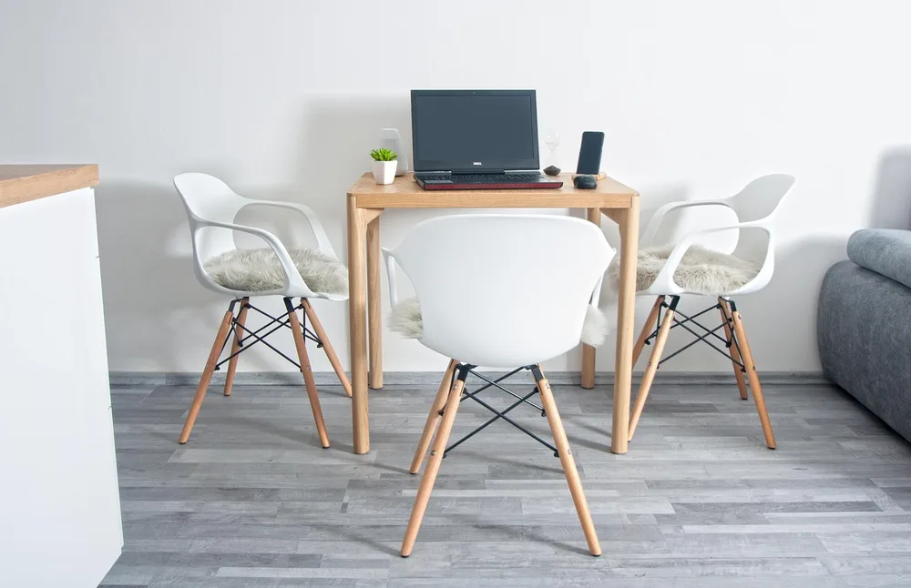
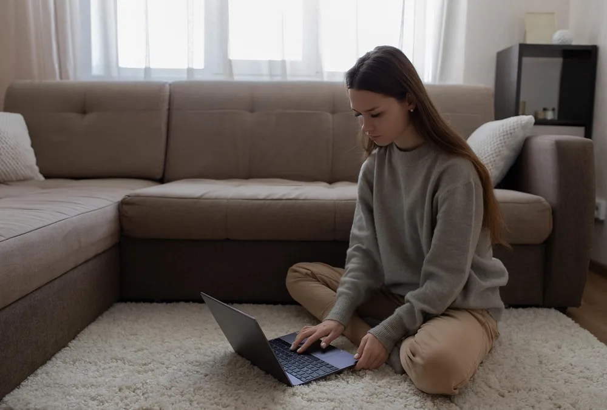
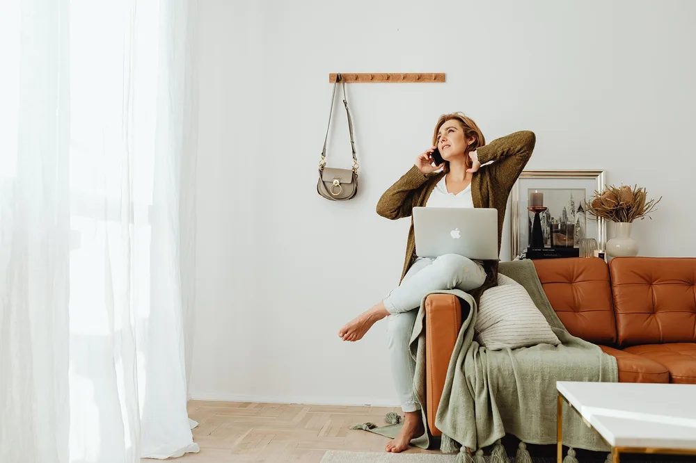
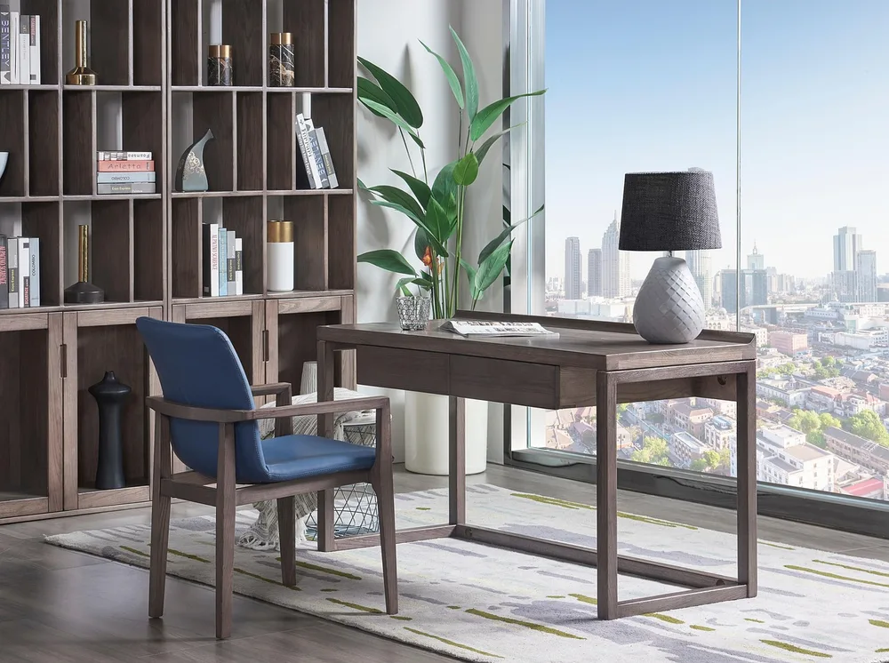
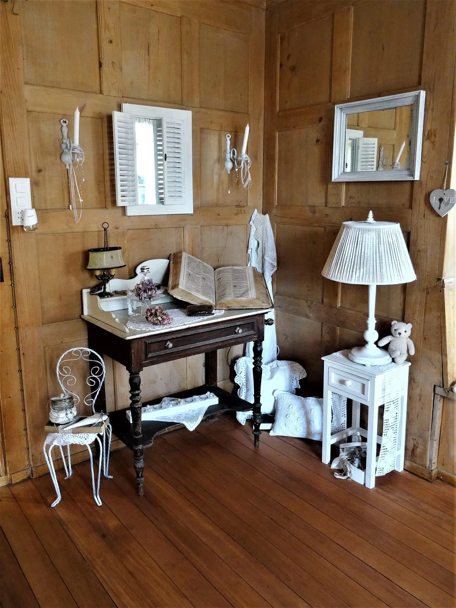
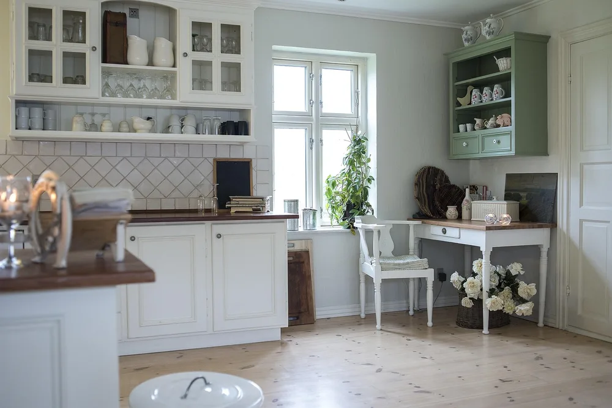
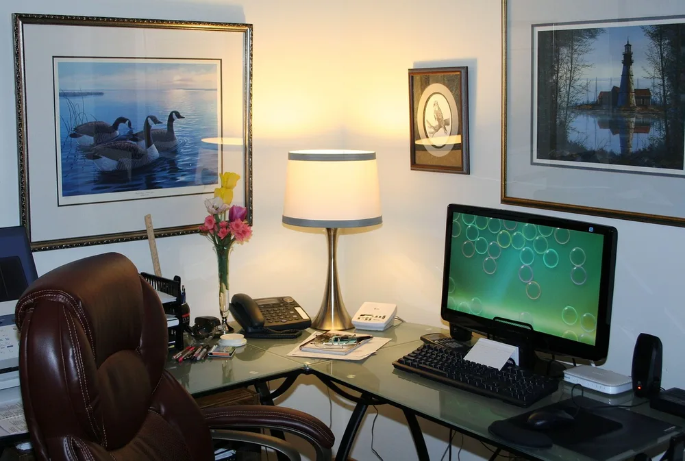
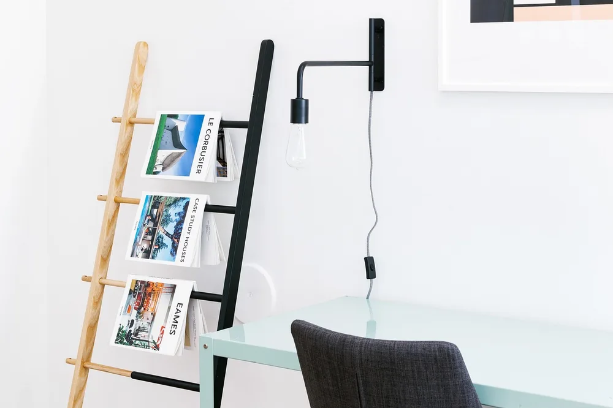

<figure class="pin-figure"><figcaption>Photo by <a href="https://pixabay.com/users/Skica911-11445571/" rel="nofollow noopener" target="_blank">Skica911</a> on <a href="https://pixabay.com/photos/table-chairs-furniture-5767484/" rel="nofollow noopener" target="_blank">Pixabay</a></figcaption></figure>

Not every home has a spare bedroom to turn into an office. For many people the living room is the only place with enough space and light for a desk, which means work and relaxing have to share the same room every day.

These living room office nook ideas help you carve out a workspace that is comfortable during the day and easy to put away in the evening. They work in apartments, small houses and open plan rooms, and most of them use furniture you may already own.

<h2>1. Claim One Corner for Work</h2>

<figure class="pin-figure"><figcaption>Photo by <a href="https://pixabay.com/users/Katya_Ershova-21042769/" rel="nofollow noopener" target="_blank">Katya_Ershova</a> on <a href="https://pixabay.com/photos/work-from-home-woman-laptop-6158202/" rel="nofollow noopener" target="_blank">Pixabay</a></figcaption></figure>

The easiest way to make a living room office work is to give it a clear boundary. Choose one corner, ideally near a window and away from the television, and treat it as the place where work happens and nowhere else.

A defined corner helps your brain switch modes. When you sit there you are working, and when you move to the sofa you are off for the day. Even in a small room, that simple separation makes it easier to focus and easier to relax afterward.

<h2>2. Choose a Compact Desk</h2>

<figure class="pin-figure"><figcaption>Photo by <a href="https://pixabay.com/users/StockSnap-894430/" rel="nofollow noopener" target="_blank">StockSnap</a> on <a href="https://pixabay.com/photos/laptop-apple-macbook-computer-2557571/" rel="nofollow noopener" target="_blank">Pixabay</a></figcaption></figure>

A living room desk should fit the room, not take it over. Look for a desk around 40 inches wide and 20 to 24 inches deep, which is enough for a laptop or a small monitor and still leaves space for people to walk around.

Pick a finish that matches the rest of your furniture, such as wood that echoes the coffee table or a color that blends with the walls. A desk that looks like it belongs in the living room feels far less like work is invading your home.

<h2>3. Turn a Console Table Into a Desk</h2>

<figure class="pin-figure"><figcaption>Photo by <a href="https://pixabay.com/users/StartupStockPhotos-690514/" rel="nofollow noopener" target="_blank">StartupStockPhotos</a> on <a href="https://pixabay.com/photos/startup-meeting-brainstorming-594090/" rel="nofollow noopener" target="_blank">Pixabay</a></figcaption></figure>

A console table is narrow, elegant and already designed for living spaces, which makes it a clever stand-in for a desk. Placed against a wall or behind the sofa, it can hold a laptop, a lamp and a notebook without looking like office furniture.

Check the height before you commit. Most desks are about 29 to 30 inches tall, while some console tables are higher. If yours is taller, pair it with a counter or adjustable chair so your arms still rest comfortably while you type.

<h2>4. Set Up a Sofa-Side Laptop Spot</h2>

<figure class="pin-figure"><figcaption>Photo by <a href="https://pixabay.com/users/mohmadnady-20342539/" rel="nofollow noopener" target="_blank">mohmadnady</a> on <a href="https://pixabay.com/photos/woman-indoors-laptop-macbook-6032751/" rel="nofollow noopener" target="_blank">Pixabay</a></figcaption></figure>

Some tasks, like reading emails or reviewing documents, do not need a full desk. A small side table next to the sofa with room for a laptop and a drink gives you a comfortable place for light work without moving to the desk.

Keep longer sessions at a real desk, though. Working on the sofa for hours puts the screen too low and rounds your back. Use the sofa spot for short tasks and calls, and return to the proper workstation for anything that takes real focus.

<h2>5. Use the Coffee Table for Short Sessions</h2>

<figure class="pin-figure"><figcaption>Photo by <a href="https://pixabay.com/users/StartupStockPhotos-690514/" rel="nofollow noopener" target="_blank">StartupStockPhotos</a> on <a href="https://pixabay.com/photos/entrepreneur-startup-woman-macbook-593357/" rel="nofollow noopener" target="_blank">Pixabay</a></figcaption></figure>

A lift-top coffee table raises its surface to a comfortable working height and drops back down when you are done. It is a good option if you only work from home a few hours a week and do not want a desk in the room at all.

Even a regular coffee table can work for quick tasks if you sit on a floor cushion or ottoman instead of the sofa. Keep a basket underneath for the laptop and charger, so the table returns to normal living room use in seconds.

<h2>6. Divide the Space With a Bookcase</h2>

<figure class="pin-figure"><figcaption>Photo by <a href="https://pixabay.com/users/we-o_rd35qlqp7yqyp0thf-21199638/" rel="nofollow noopener" target="_blank">we-o_rd35qlqp7yqyp0thf</a> on <a href="https://pixabay.com/photos/desk-chair-interior-design-nordic-6185023/" rel="nofollow noopener" target="_blank">Pixabay</a></figcaption></figure>

An open bookcase placed at a right angle to the wall creates a soft divider between the office nook and the rest of the room. It blocks some of the view of your desk from the sofa while still letting light pass through.

Use the side facing the desk for work items such as binders, a printer or supply boxes, and the side facing the living room for books, plants and decor. You get storage and separation from one piece of furniture. Choose a sturdy model and anchor it to the floor or wall if it is tall.

<h2>7. Add Dedicated Task Lighting</h2>

<figure class="pin-figure"><figcaption>Photo by <a href="https://pixabay.com/users/fotoerich-4176355/" rel="nofollow noopener" target="_blank">fotoerich</a> on <a href="https://pixabay.com/photos/living-room-vintage-old-furniture-1984789/" rel="nofollow noopener" target="_blank">Pixabay</a></figcaption></figure>

Living rooms are usually lit for relaxing, with soft lamps and dim corners that are not great for work. A dedicated desk lamp gives you bright, focused light on your workspace without changing the mood of the rest of the room.

Choose a lamp that also looks good when it is off, in a finish that matches your other lighting. In the evening, turning off the desk lamp becomes a small ritual that marks the end of the workday. It also keeps the desk usable on dark winter afternoons.

<h2>8. Hide Work Gear at Night</h2>

<figure class="pin-figure"><figcaption>Photo by <a href="https://pixabay.com/users/u_jup1hbno-8566532/" rel="nofollow noopener" target="_blank">u_jup1hbno</a> on <a href="https://pixabay.com/photos/bookcase-kitchen-surface-furniture-3532950/" rel="nofollow noopener" target="_blank">Pixabay</a></figcaption></figure>

Seeing your laptop and paperwork from the sofa makes it hard to stop thinking about work. A cabinet with doors, a lidded box or a closed drawer lets you put everything away at the end of the day, so the living room goes back to being a living room.

Make putting things away fast and easy. If the laptop, charger and notebook all fit in one place, you will actually do it every evening, and the room will feel calmer for the rest of the household as well. Choose storage that matches your other furniture so it blends into the room.

<h2>9. Pick a Chair That Fits the Room</h2>

<figure class="pin-figure"><figcaption>Photo by <a href="https://pixabay.com/users/JamesDeMers-3416/" rel="nofollow noopener" target="_blank">JamesDeMers</a> on <a href="https://pixabay.com/photos/home-office-work-space-computer-54583/" rel="nofollow noopener" target="_blank">Pixabay</a></figcaption></figure>

A bulky office chair can look out of place next to a sofa and armchairs. Look for a task chair with a fabric seat, wooden details or a simple shape that matches your living room, while still offering height adjustment and some back support.

If you work only a few hours a day, an upholstered dining chair with a lumbar cushion can be enough. For full workdays, prioritize comfort first and choose a color that blends into the room so the chair does not dominate it.

<h2>10. Mount a Wall Lamp to Save Desk Space</h2>

<figure class="pin-figure"><figcaption>Photo by <a href="https://pixabay.com/users/StockSnap-894430/" rel="nofollow noopener" target="_blank">StockSnap</a> on <a href="https://pixabay.com/photos/magazines-newspaper-rack-interior-2591354/" rel="nofollow noopener" target="_blank">Pixabay</a></figcaption></figure>

On a small desk every inch counts. A wall mounted lamp or a plug-in sconce frees the surface completely and adds light at the right height, which makes a narrow desk or console table far more practical to work at.

Plug-in sconces need no electrician; the cord can run down the wall inside a paintable cover. Pair the lamp with a small shelf above the desk and you get light and storage without taking up any of your working area.

<h2>Final Thoughts</h2>

A living room office nook works best when it has clear boundaries during the day and disappears in the evening. Choose a corner, keep the furniture compact and in harmony with the room, and make it easy to put work away, so one room can comfortably serve both purposes.

