<figure class="pin-figure">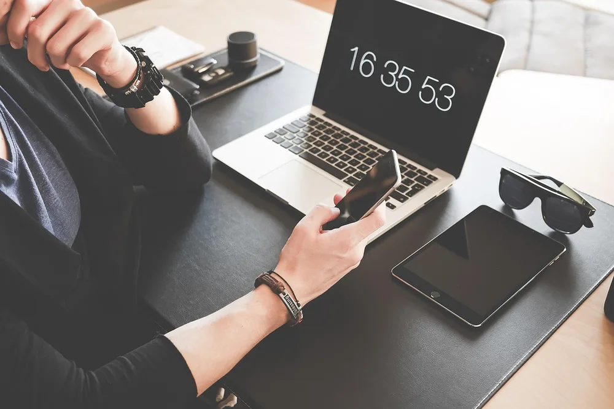<figcaption>Photo by <a href="https://pixabay.com/users/Pexels-2286921/" rel="nofollow noopener" target="_blank">Pexels</a> on <a href="https://pixabay.com/photos/home-office-computer-desk-display-1867759/" rel="nofollow noopener" target="_blank">Pixabay</a></figcaption></figure>

A productive desk is not about owning more gadgets. It is about removing the small decisions and distractions that eat into your day, such as searching for a pen, checking your phone or wondering what to work on next. Each of these small leaks seems harmless on its own, but together they add up.

These productive desk setup ideas combine simple tools with a few habits that keep you on track. They work for remote workers, freelancers and students, and you can try them one at a time to see which ones make the biggest difference for you.

<h2>1. Start the Day With a Written To Do List</h2>

<figure class="pin-figure">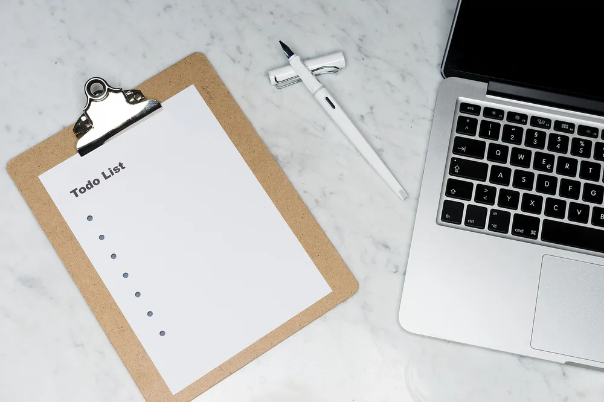<figcaption>Photo by <a href="https://pixabay.com/users/viarami-13458823/" rel="nofollow noopener" target="_blank">viarami</a> on <a href="https://pixabay.com/photos/todo-lists-tasks-tasks-list-list-5238324/" rel="nofollow noopener" target="_blank">Pixabay</a></figcaption></figure>

Writing a short to do list before you open your email gives the day a clear direction. Keep a notepad on the desk and write down the three tasks that would make today a success, then start with the most important one.

A short list is easier to finish than a long one, and finishing it feels good. Move anything you did not complete to the next day&#39;s list, and you will always know where to begin when you sit down in the morning.

<h2>2. Keep a Calendar in View</h2>

<figure class="pin-figure">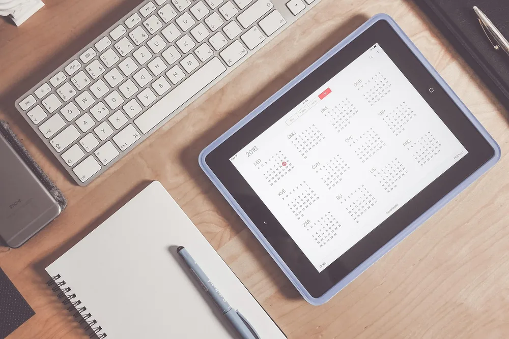<figcaption>Photo by <a href="https://pixabay.com/users/Pexels-2286921/" rel="nofollow noopener" target="_blank">Pexels</a> on <a href="https://pixabay.com/photos/apple-calendar-desk-ipad-tablet-1867752/" rel="nofollow noopener" target="_blank">Pixabay</a></figcaption></figure>

When meetings and deadlines live only inside an app, it is easy to lose track of how full the week really is. A desk calendar or a wall planner shows the whole month at a glance, which helps you plan ahead and protect time for focused work.

Block out deep work sessions the same way you would schedule a meeting. Seeing those blocks on paper makes them feel real, and it becomes easier to say no to requests that would break up your most productive hours. Review the calendar every Monday morning to plan the week ahead.

<h2>3. Put a Clock Where You Can See It</h2>

<figure class="pin-figure">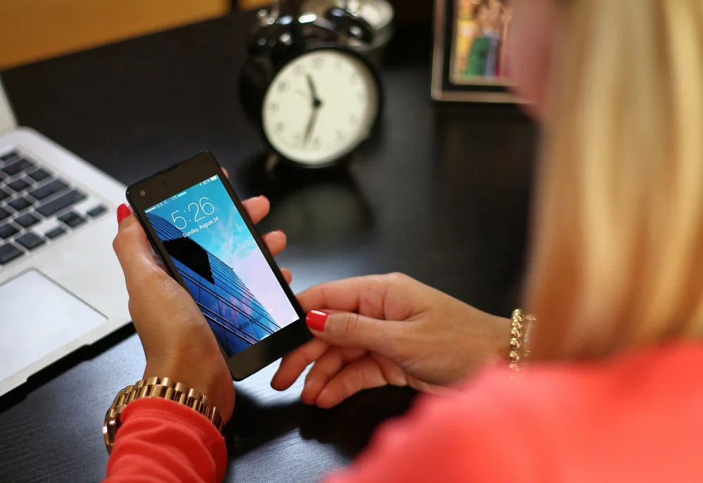<figcaption>Photo by <a href="https://pixabay.com/users/27707-27707/" rel="nofollow noopener" target="_blank">27707</a> on <a href="https://pixabay.com/photos/work-desk-smart-phone-laptop-phone-1205159/" rel="nofollow noopener" target="_blank">Pixabay</a></figcaption></figure>

Checking the time on your phone often ends with a scroll through notifications. A simple desk or wall clock lets you keep track of time without picking up the phone at all, which removes one of the most common distractions of the day.

A visible clock also helps with time blocks. Decide to work on one task until a specific time, glance at the clock instead of a screen, and take a proper break when you reach it. Short, regular breaks help you stay sharp for the whole afternoon instead of fading after lunch.

<h2>4. Separate Notes From the Screen</h2>

<figure class="pin-figure">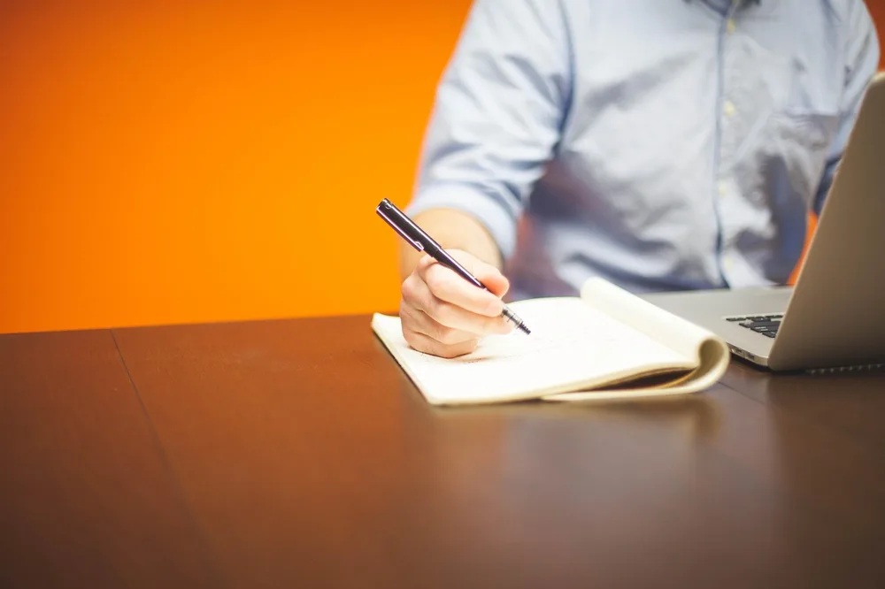<figcaption>Photo by <a href="https://pixabay.com/users/StartupStockPhotos-690514/" rel="nofollow noopener" target="_blank">StartupStockPhotos</a> on <a href="https://pixabay.com/photos/entrepreneur-startup-start-up-man-593378/" rel="nofollow noopener" target="_blank">Pixabay</a></figcaption></figure>

Taking notes in the same window where messages and tabs keep popping up makes it hard to think. A paper notebook beside the laptop gives you a distraction free place for meeting notes, ideas and quick sketches. Paper also helps you remember what you wrote, because handwriting slows you down just enough.

Review your notebook at the end of the day and turn anything important into a task on tomorrow&#39;s list. Keeping thinking on paper and doing on the screen is a simple split that many people find makes work feel more organized.

<h2>5. Keep Only Today&#39;s Work on the Desk</h2>

<figure class="pin-figure">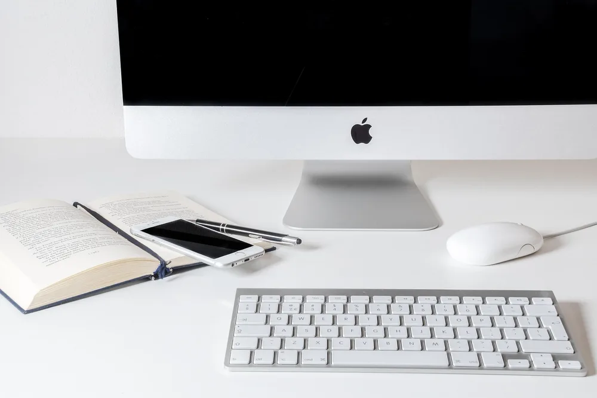<figcaption>Photo by <a href="https://pixabay.com/users/Ylanite-2218222/" rel="nofollow noopener" target="_blank">Ylanite</a> on <a href="https://pixabay.com/photos/work-computer-apple-business-3938876/" rel="nofollow noopener" target="_blank">Pixabay</a></figcaption></figure>

Piles of papers from old projects quietly pull your attention every time you look at them. Clear the desk of anything that is not part of today&#39;s work, and file or store the rest in a drawer, tray or box.

A clean surface makes it easier to start, because there is nothing to tidy first. Take two minutes at the end of each day to reset the desk, and you will begin every morning with a clear space and a clear head.

<h2>6. Park Your Phone Away From the Keyboard</h2>

<figure class="pin-figure">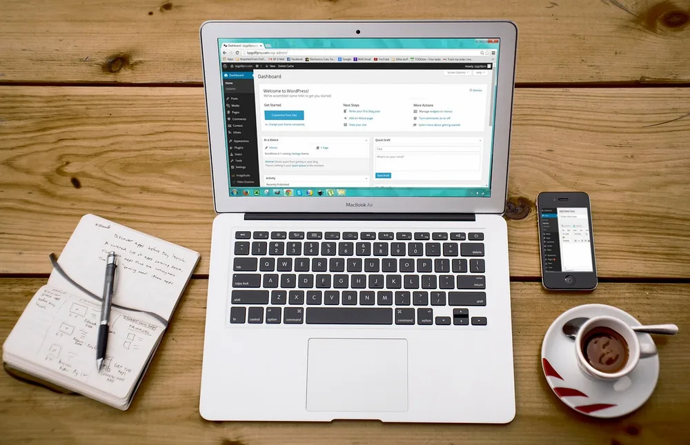<figcaption>Photo by <a href="https://pixabay.com/users/27707-27707/" rel="nofollow noopener" target="_blank">27707</a> on <a href="https://pixabay.com/photos/laptop-wordpress-wordpress-design-593673/" rel="nofollow noopener" target="_blank">Pixabay</a></figcaption></figure>

A phone lying face up next to the keyboard is a constant invitation to check it. Give it a fixed spot at the edge of the desk, face down or in a stand turned away from you, or move it to another room during deep work sessions.

Turn off non-essential notifications and keep only calls from important contacts. You will still be reachable, but the steady stream of small alerts will no longer break your concentration every few minutes. Set specific times to check messages, such as before lunch and at the end of the day, and keep the phone out of reach in between.

<h2>7. Use Sticky Notes for Quick Tasks</h2>

<figure class="pin-figure">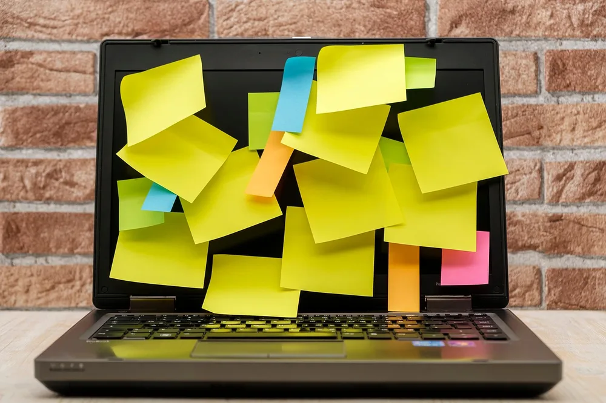<figcaption>Photo by <a href="https://pixabay.com/users/Bru-nO-1161770/" rel="nofollow noopener" target="_blank">Bru-nO</a> on <a href="https://pixabay.com/photos/sticky-notes-stickies-note-office-7705489/" rel="nofollow noopener" target="_blank">Pixabay</a></figcaption></figure>

Small tasks that pop up during the day can derail whatever you are working on. Instead of switching right away, write the task on a sticky note and put it on the edge of the monitor or desk, then deal with it later in one batch.

Limit yourself to a few notes at a time so they stay useful instead of turning into clutter. When a note is done, throw it away, and enjoy the small satisfaction of watching the pile shrink. Sort the remaining notes by urgency so the most important ones stay at the top.

<h2>8. Block Distractions With Headphones</h2>

<figure class="pin-figure">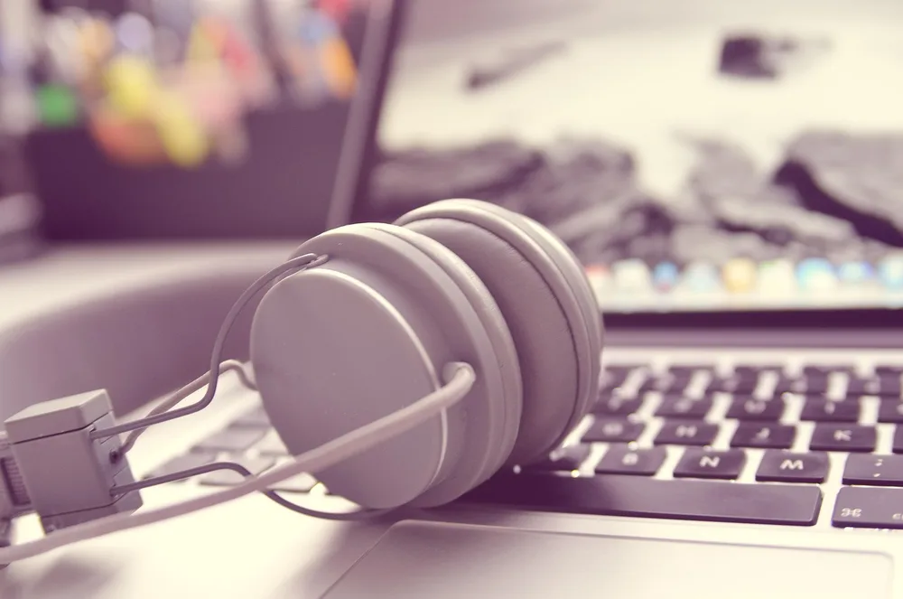<figcaption>Photo by <a href="https://pixabay.com/users/TheAngryTeddy-123386/" rel="nofollow noopener" target="_blank">TheAngryTeddy</a> on <a href="https://pixabay.com/photos/headphones-keyboard-apple-input-338492/" rel="nofollow noopener" target="_blank">Pixabay</a></figcaption></figure>

Noise is one of the biggest productivity killers when you work from home or in a shared office. Noise cancelling headphones help you block conversations, television and street sounds so you can focus on one task at a time. They are especially useful in open plan homes and shared offices.

Pair the headphones with a consistent focus playlist or simple background noise. Over time, putting them on becomes a cue for your brain that it is time to concentrate, which makes it easier to get into a productive rhythm. Keep them charged and within reach so they are ready whenever you need to focus.

<h2>9. Keep a Drink Within Reach</h2>

<figure class="pin-figure">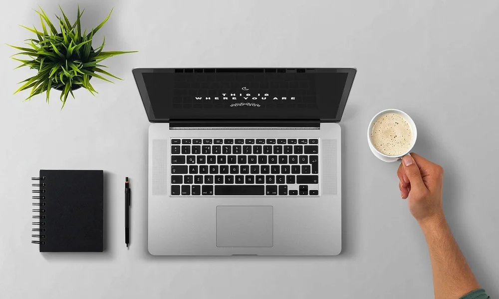<figcaption>Photo by <a href="https://pixabay.com/users/27707-27707/" rel="nofollow noopener" target="_blank">27707</a> on <a href="https://pixabay.com/photos/laptop-coffee-arm-desktop-notebook-1205256/" rel="nofollow noopener" target="_blank">Pixabay</a></figcaption></figure>

Getting up for a drink every half hour feels harmless, but each trip can turn into a longer break. Keep a large water bottle or a mug of coffee on the desk so you stay hydrated and keep working through your planned focus blocks.

Put the drink on the side opposite your mouse and slightly behind the keyboard. That position keeps it within reach while making spills over your laptop or notes far less likely. An insulated bottle or mug also keeps your drink at the right temperature for hours, so you are not tempted to get up and refill it.

<h2>10. Review the Day Before Logging Off</h2>

<figure class="pin-figure">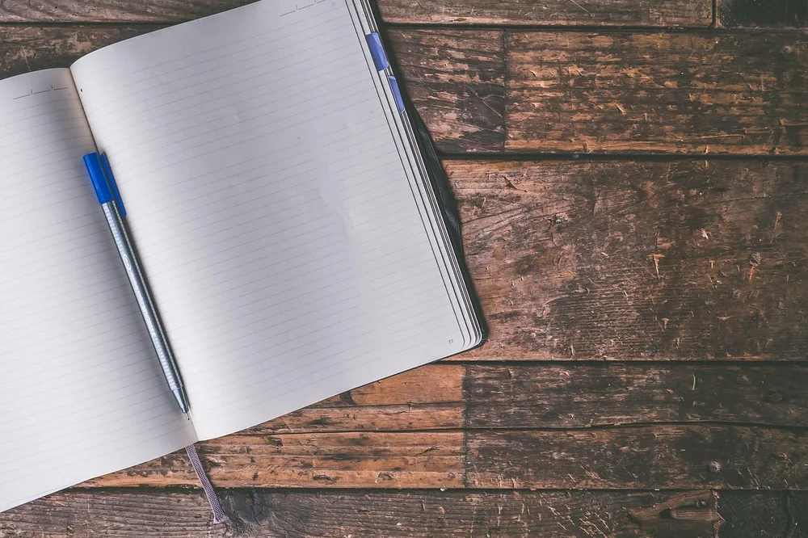<figcaption>Photo by <a href="https://pixabay.com/users/6689062-6689062/" rel="nofollow noopener" target="_blank">6689062</a> on <a href="https://pixabay.com/photos/journal-write-blank-pages-notes-2850091/" rel="nofollow noopener" target="_blank">Pixabay</a></figcaption></figure>

Ending the day with a five minute review makes the next morning far easier. Look at what you finished, write down where you stopped and list the first task for tomorrow, so you never start the day wondering what to do.

This small ritual also helps you mentally leave work behind. Once your notes are written and the desk is clear, close the laptop, turn off the lamp and let the workday really end. Over time, this short review also shows you how much you actually get done each week.

<h2>Final Thoughts</h2>

A productive desk setup is built from small, simple choices: a written plan, a visible calendar, fewer distractions and a clean surface. Pick two or three ideas from this list, try them for a week and keep the ones that help you finish more of the work that matters.

