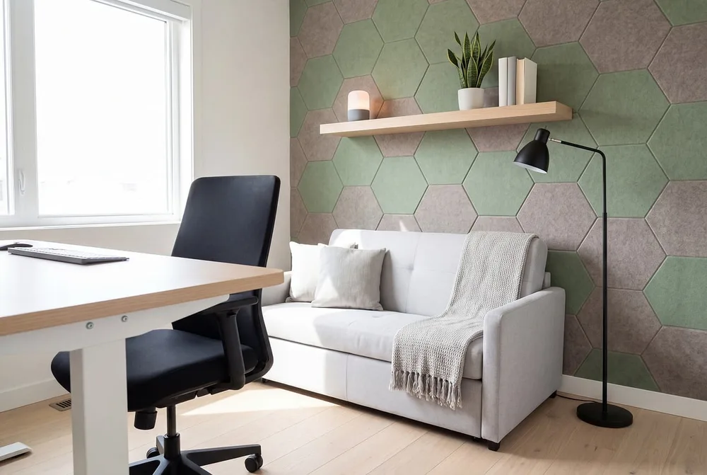
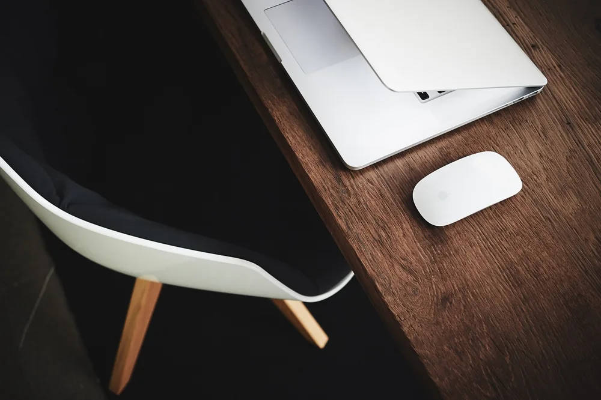
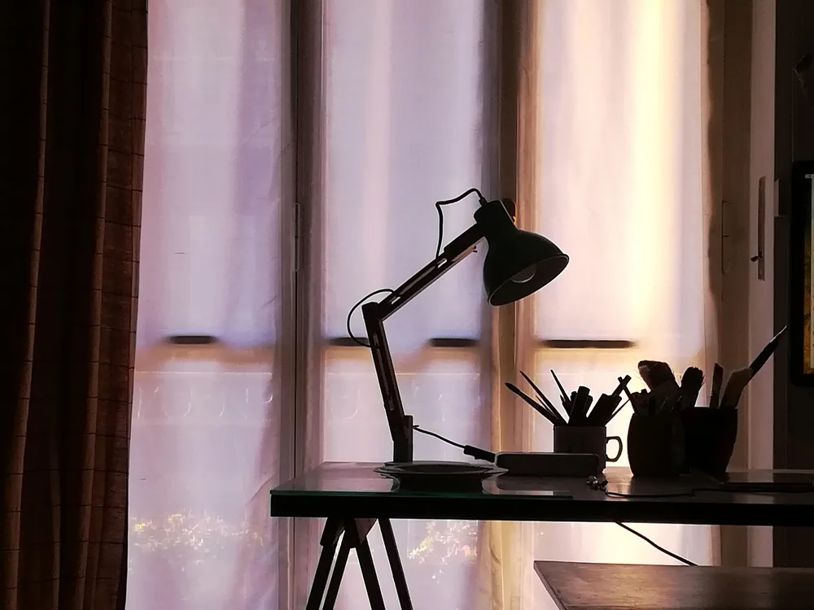
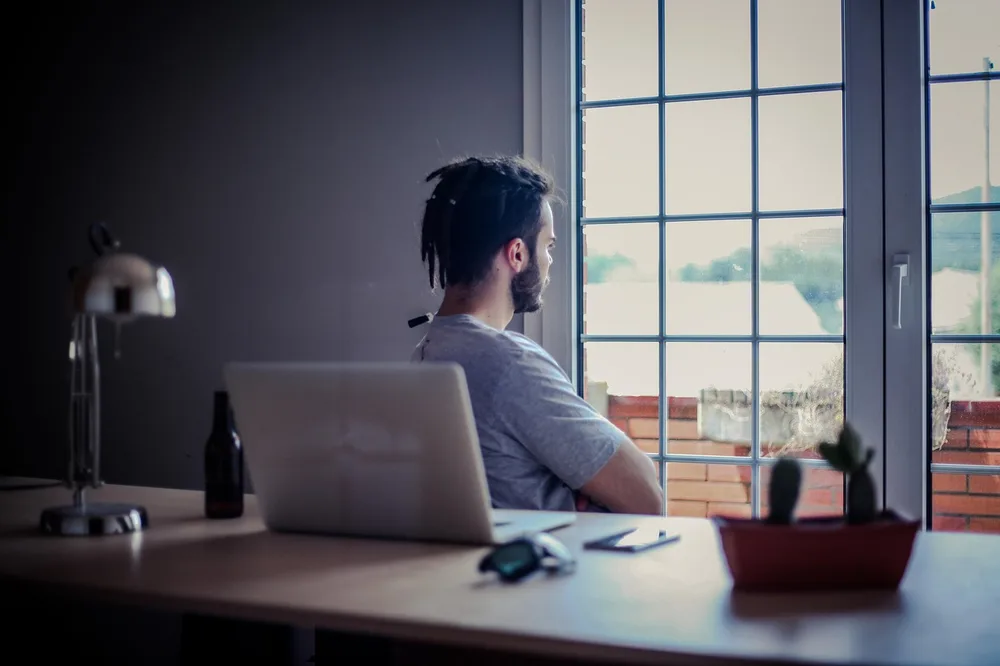
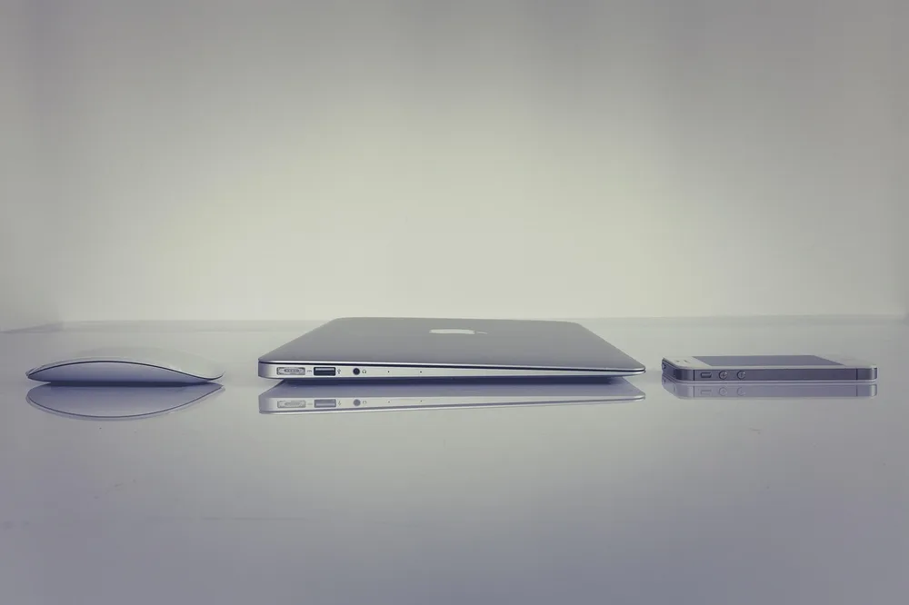
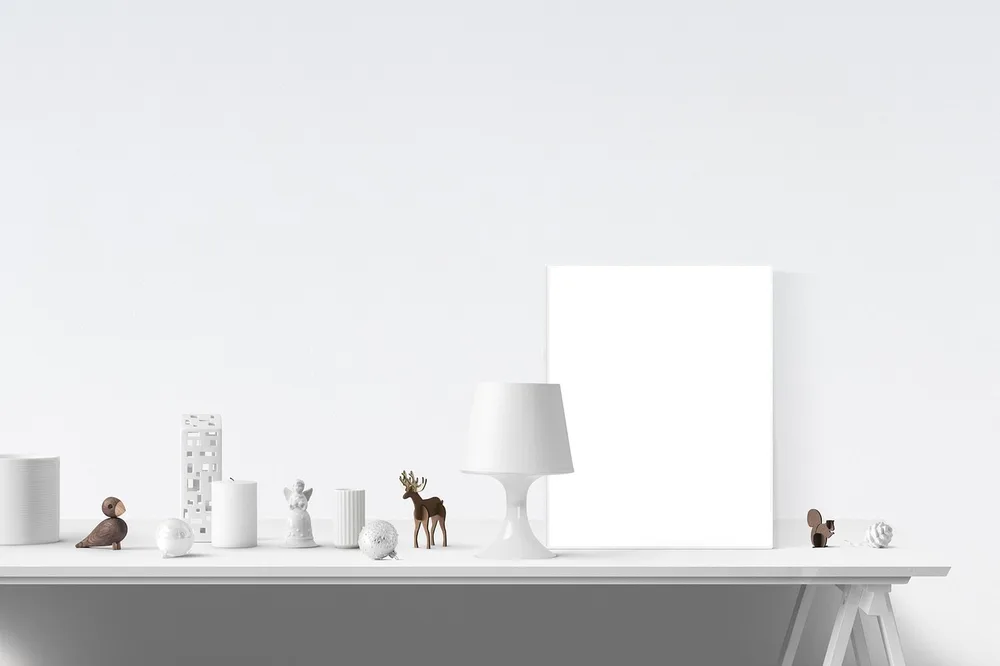
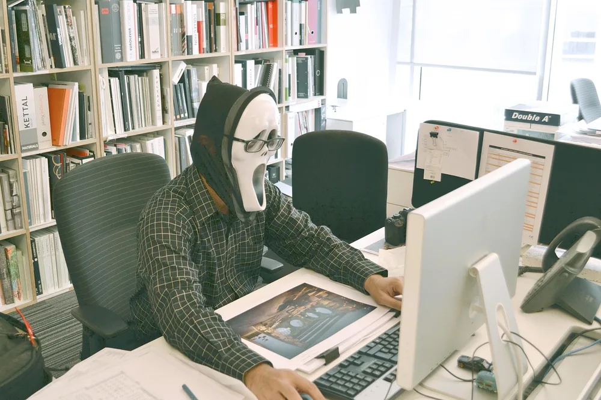

<figure class="pin-figure"><figcaption>Photo by <a href="https://pixabay.com/users/FernandoZ-50101426/" rel="nofollow noopener" target="_blank">FernandoZ</a> on <a href="https://pixabay.com/photos/home-office-modern-design-10509765/" rel="nofollow noopener" target="_blank">Pixabay</a></figcaption></figure>

Scandinavian design grew up in places with long, dark winters, so it is built around light, simple shapes and natural materials. Those same qualities make it a great fit for a home office, where a calm room helps you focus and a bright one makes the workday feel shorter.

These Scandinavian home office ideas show how to get the look without starting from scratch. Most of them are about choosing fewer, better pieces and arranging them well, so they work in a spare bedroom, a corner of the living room or a small apartment.

<h2>1. Start With White Walls and Light Wood</h2>

<figure class="pin-figure"><figcaption>Photo by <a href="https://pixabay.com/users/StockSnap-894430/" rel="nofollow noopener" target="_blank">StockSnap</a> on <a href="https://pixabay.com/photos/laptop-apple-keyboard-technology-2588074/" rel="nofollow noopener" target="_blank">Pixabay</a></figcaption></figure>

The base of a Scandinavian office is a light, neutral backdrop. White or soft gray walls reflect daylight around the room, and light wood in oak, birch or ash adds warmth so the space never feels cold or clinical. It is a simple palette that also makes a small room look larger.

You do not need to replace everything to get there. A light wood desktop, a white chair or a pale rug is often enough to shift the whole room. Keep strong colors for small accents, such as a cushion or a print, so the overall feeling stays quiet and open.

<h2>2. Choose a Simple Wooden Desk</h2>

<figure class="pin-figure"><figcaption>Photo by <a href="https://pixabay.com/users/freephotocc-2275370/" rel="nofollow noopener" target="_blank">freephotocc</a> on <a href="https://pixabay.com/photos/cup-of-coffee-laptop-office-macbook-1280537/" rel="nofollow noopener" target="_blank">Pixabay</a></figcaption></figure>

Scandinavian furniture is known for clean lines and visible natural grain. A simple wooden desk with slim legs looks light even in a small room, because you can see the floor underneath it, and it ages well instead of going out of style.

Look for a desk deep enough to hold a monitor at a comfortable distance, usually around 24 inches, with a smooth top that is easy to keep clear. A single shallow drawer is plenty for pens and chargers and keeps the clean silhouette intact.

<h2>3. Let Natural Light Lead</h2>

<figure class="pin-figure"><figcaption>Photo by <a href="https://pixabay.com/users/Massariello-5369855/" rel="nofollow noopener" target="_blank">Massariello</a> on <a href="https://pixabay.com/photos/writing-desk-tents-lamp-backlight-5970376/" rel="nofollow noopener" target="_blank">Pixabay</a></figcaption></figure>

Daylight is the most important feature of a Scandinavian room. Place the desk near a window, ideally with the light coming from the side, so the room stays bright without glare on your screen or harsh shadows across your hands.

Swap heavy curtains for sheer linen or simple roller blinds that soften the light instead of blocking it. On gray days the white walls and light wood will bounce whatever light comes in around the room, which keeps the office feeling open even in winter.

<h2>4. Add a Slim Task Lamp</h2>

<figure class="pin-figure"><figcaption>Photo by <a href="https://pixabay.com/users/StockSnap-894430/" rel="nofollow noopener" target="_blank">StockSnap</a> on <a href="https://pixabay.com/photos/people-man-guy-beard-laptop-2605980/" rel="nofollow noopener" target="_blank">Pixabay</a></figcaption></figure>

When the daylight fades, a simple task lamp keeps the room usable without breaking the calm look. Classic Scandinavian lamps have thin arms, matte finishes and shades in white, black or natural wood, and they direct light exactly where you need it.

Place the lamp on the side opposite your writing hand so your arm never casts a shadow on the page. A warm bulb in the evening keeps the room cozy, which is a big part of the Scandinavian idea of comfort during long, dark months.

<h2>5. Keep the Desktop Almost Empty</h2>

<figure class="pin-figure"><figcaption>Photo by <a href="https://pixabay.com/users/markusspiske-670330/" rel="nofollow noopener" target="_blank">markusspiske</a> on <a href="https://pixabay.com/photos/office-macbook-iphone-apple-laptop-1730939/" rel="nofollow noopener" target="_blank">Pixabay</a></figcaption></figure>

Scandinavian rooms feel calm because there is very little competing for attention. Apply the same rule to the desk: keep only the screen, keyboard, mouse and one or two daily items on top, and give everything else a home in a drawer or on a shelf.

A clear desk is also faster to work at, because you never have to move things around before you start. Spend two minutes at the end of each day putting things back, and the desk will be ready and peaceful every morning.

<h2>6. Hang One Calm Poster</h2>

<figure class="pin-figure"><figcaption>Photo by <a href="https://pixabay.com/users/RaniRamli-731298/" rel="nofollow noopener" target="_blank">RaniRamli</a> on <a href="https://pixabay.com/photos/poster-mockup-mockup-poster-frame-2853828/" rel="nofollow noopener" target="_blank">Pixabay</a></figcaption></figure>

Instead of filling the wall, choose one framed print with simple shapes, a soft landscape or a black and white photograph. A single piece gives the eye somewhere to rest and adds personality without making the room feel busy. It also gives video call backgrounds a tidy, finished look.

Thin black, white or natural wood frames suit the style best. You can lean the frame on the desk against the wall instead of drilling, which also makes it easy to swap prints with the seasons when you want a small change.

<h2>7. Use a Light, Comfortable Chair</h2>

<figure class="pin-figure"><figcaption>Photo by <a href="https://pixabay.com/users/Syaibatulhamdi-13452116/" rel="nofollow noopener" target="_blank">Syaibatulhamdi</a> on <a href="https://pixabay.com/photos/ghost-office-abandoned-horror-5265642/" rel="nofollow noopener" target="_blank">Pixabay</a></figcaption></figure>

Bulky black office chairs can dominate a small Scandinavian room. Look for a chair in white, gray or light wood tones, with a slim frame and enough adjustment to support you through a full workday, so comfort and style do not have to compete.

If you work at the desk for many hours, prioritize real lumbar support and height adjustment over looks. A sheepskin or wool throw over the back of the chair adds texture and warmth, and it is one of the easiest ways to bring in the cozy side of the style.

<h2>8. Pick Pale Tech Accessories</h2>

<figure class="pin-figure"><figcaption>Photo by <a href="https://pixabay.com/users/kaboompics-1013994/" rel="nofollow noopener" target="_blank">kaboompics</a> on <a href="https://pixabay.com/photos/workspace-place-of-work-work-766045/" rel="nofollow noopener" target="_blank">Pixabay</a></figcaption></figure>

Technology is often the darkest thing in a light room. A white or light gray keyboard and mouse blend into the desk instead of standing out, and they make the setup look calmer in photos and in person. It is a small change that you notice every time you sit down.

Choose accessories with simple shapes and matte finishes to match the rest of the room. If you already own dark gear, a light felt or wool desk mat underneath softens the contrast, so you can get closer to the look without replacing everything at once.

<h2>9. Add a Few Natural Objects</h2>

<figure class="pin-figure"><figcaption>Photo by <a href="https://pixabay.com/users/freephotocc-2275370/" rel="nofollow noopener" target="_blank">freephotocc</a> on <a href="https://pixabay.com/photos/coffee-notebook-wooden-orange-work-1276784/" rel="nofollow noopener" target="_blank">Pixabay</a></figcaption></figure>

Scandinavian interiors often bring the outdoors in with small natural objects. A ceramic cup for pens, a wooden tray, a smooth stone paperweight or a small vase with a single green branch adds texture without adding clutter. They also make the desk feel more personal without much effort.

Group these pieces together in one corner of the desk instead of spreading them around. Three objects of different heights usually look better than many small ones, and keeping them together leaves the rest of the desk free for work.

<h2>10. Display Books on One Open Shelf</h2>

<figure class="pin-figure"><figcaption>Photo by <a href="https://pixabay.com/users/StockSnap-894430/" rel="nofollow noopener" target="_blank">StockSnap</a> on <a href="https://pixabay.com/photos/computer-keyboard-study-business-2598321/" rel="nofollow noopener" target="_blank">Pixabay</a></figcaption></figure>

Open shelving is a staple of Scandinavian homes, but it works best when it is edited. Use one shelf or a narrow bookcase for the books you actually reference, a plant and a box for small items, and leave some empty space so it does not look crowded.

Sort books by color or lay a few horizontally to break up the rows. White or light wood shelves disappear against the wall, so the room still feels open while you keep the things you need close to your desk.

<h2>Final Thoughts</h2>

A Scandinavian home office is less about buying a specific look and more about light, simplicity and natural materials. Start by clearing the desk and making the most of your window, then bring in light wood, a calm print and a few natural objects until the room feels bright and quiet.

