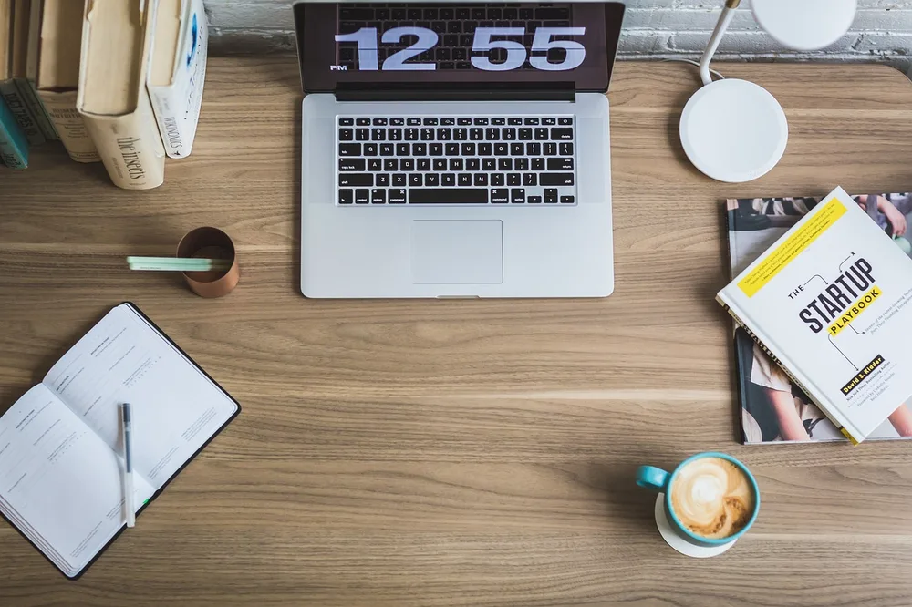
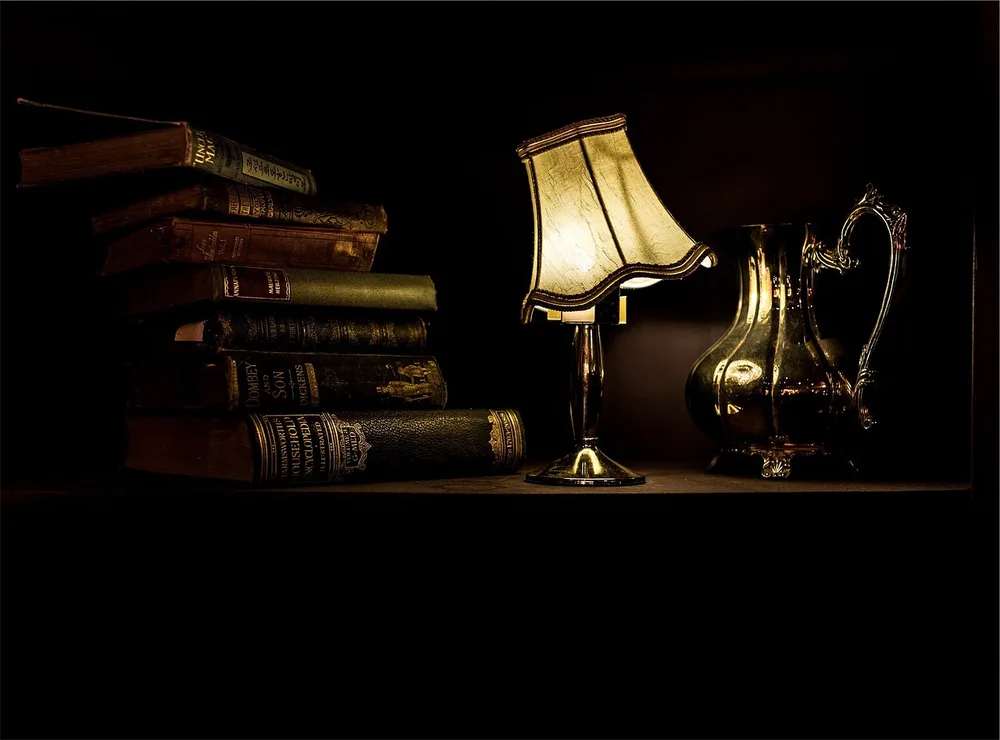
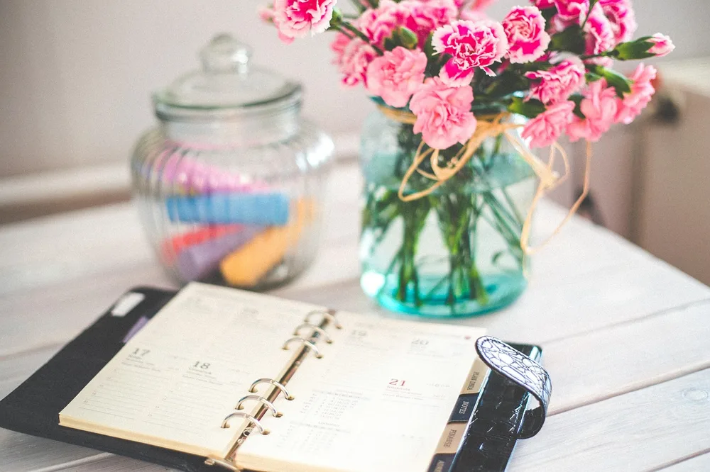
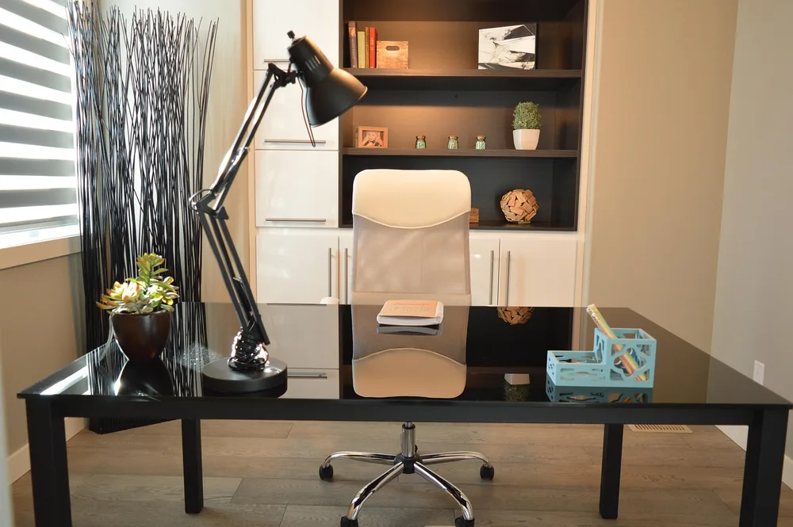
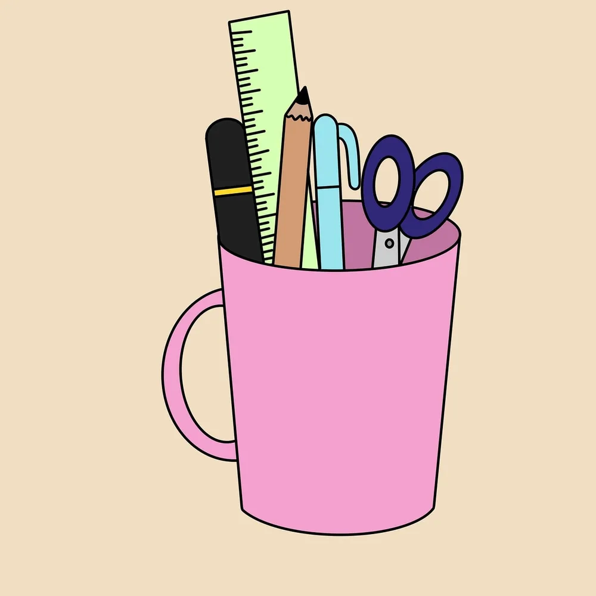
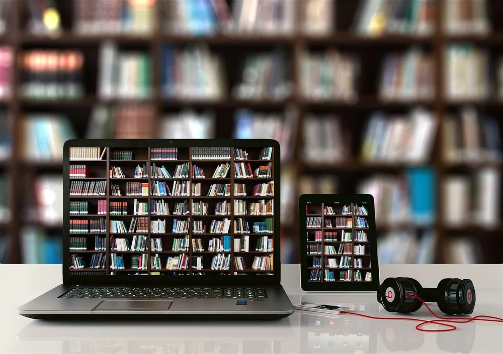
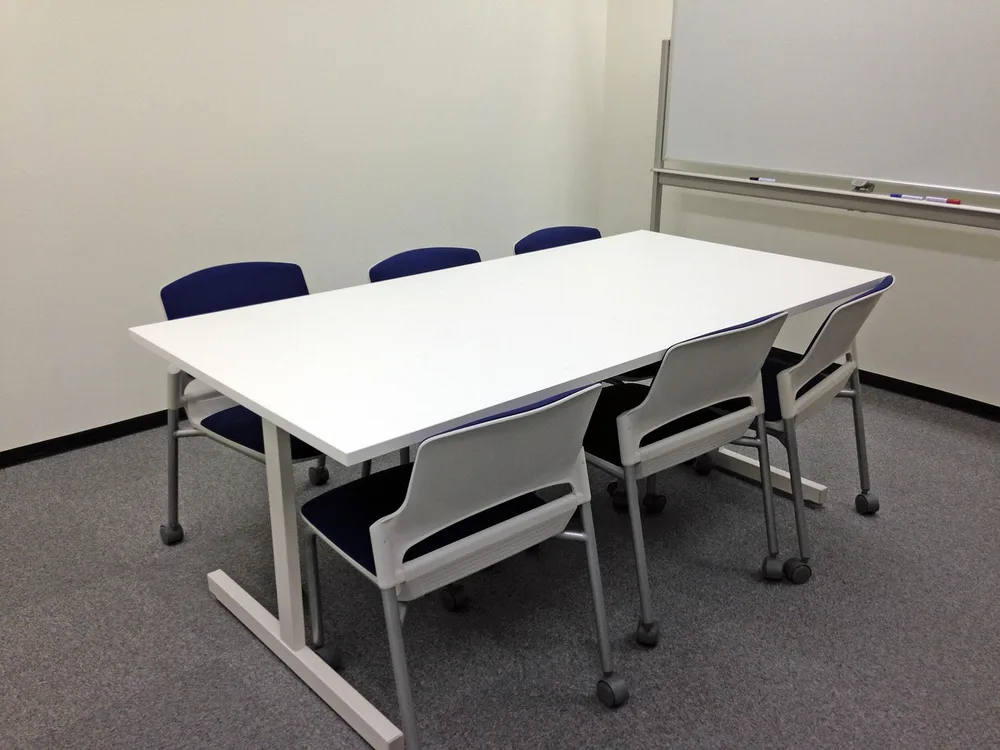

<figure class="pin-figure"><figcaption>Photo by <a href="https://pixabay.com/users/StockSnap-894430/" rel="nofollow noopener" target="_blank">StockSnap</a> on <a href="https://pixabay.com/photos/laptop-mac-computer-browser-2557574/" rel="nofollow noopener" target="_blank">Pixabay</a></figcaption></figure>

A study desk has one main job: to make it easy to sit down and start. When books are scattered, the lamp is too dim and your phone is buzzing next to the keyboard, even a short assignment feels harder than it should.

These study desk setup ideas work for high school, college and anyone learning at home. They focus on placement, light and simple organization, so you can set up a productive desk in a dorm room, a shared bedroom or a quiet corner of the house.

<h2>1. Face the Desk Toward a Calm View</h2>

<figure class="pin-figure"><figcaption>Photo by <a href="https://pixabay.com/users/StockSnap-894430/" rel="nofollow noopener" target="_blank">StockSnap</a> on <a href="https://pixabay.com/photos/computer-technology-electronics-2561518/" rel="nofollow noopener" target="_blank">Pixabay</a></figcaption></figure>

Where you point the desk changes how easily you get distracted. Facing a busy room, a television or a door where people walk by pulls your attention away every few minutes, while a wall or a window with a quiet view keeps your eyes on the page.

If you can, set the desk next to a window with light coming from the side. You get daylight and a place to rest your eyes during breaks, without glare on the screen or the temptation to watch everything happening outside.

<h2>2. Keep Textbooks Within Arm&#39;s Reach</h2>

<figure class="pin-figure"><figcaption>Photo by <a href="https://pixabay.com/users/garten-gg-201217/" rel="nofollow noopener" target="_blank">garten-gg</a> on <a href="https://pixabay.com/photos/books-read-to-learn-literature-3322275/" rel="nofollow noopener" target="_blank">Pixabay</a></figcaption></figure>

Getting up to find a book is a small interruption that easily turns into a long break. Keep the books and binders for your current classes on a shelf or a set of bookends right next to the desk, so you can grab what you need without standing up.

Store finished courses and reference books somewhere else. A short, current stack is easier to keep in order, and seeing only what you are working on this semester makes the desk feel lighter and less overwhelming. It also makes cleaning up at the end of the term much faster.

<h2>3. Light the Desk Properly</h2>

<figure class="pin-figure"><figcaption>Photo by <a href="https://pixabay.com/users/StockSnap-894430/" rel="nofollow noopener" target="_blank">StockSnap</a> on <a href="https://pixabay.com/photos/desk-lamp-light-wood-books-2626344/" rel="nofollow noopener" target="_blank">Pixabay</a></figcaption></figure>

Reading for hours under dim light tires your eyes and makes you sleepy. A desk lamp with an adjustable arm lets you put bright, even light right on your notes, which keeps text sharp and makes long study sessions more comfortable.

Choose a lamp with a neutral or slightly cool light for studying, and place it on the side opposite your writing hand to avoid shadows. Keep the room lights on as well, because a bright desk in a completely dark room creates tiring contrast.

<h2>4. Use a Paper Planner for Deadlines</h2>

<figure class="pin-figure"><figcaption>Photo by <a href="https://pixabay.com/users/kaboompics-1013994/" rel="nofollow noopener" target="_blank">kaboompics</a> on <a href="https://pixabay.com/photos/new-year-background-organizer-791939/" rel="nofollow noopener" target="_blank">Pixabay</a></figcaption></figure>

Apps are useful, but a paper planner that stays open on the desk is harder to ignore. Write every exam, assignment and project deadline in one place, and look at the week ahead each time you sit down to study.

Break big tasks into small steps and give each step its own day, such as outline, research, first draft and review. Crossing off a small task feels good and keeps you moving, while a single huge deadline tends to wait until the last night.

<h2>5. Choose a Chair That Supports You</h2>

<figure class="pin-figure"><figcaption>Photo by <a href="https://pixabay.com/users/ErikaWittlieb-427626/" rel="nofollow noopener" target="_blank">ErikaWittlieb</a> on <a href="https://pixabay.com/photos/office-home-house-desk-chair-lamp-1078869/" rel="nofollow noopener" target="_blank">Pixabay</a></figcaption></figure>

Students often sit on whatever chair is available, but a few hours of studying on a hard kitchen chair leaves your back sore. A chair with height adjustment and some lumbar support helps you sit upright without thinking about it.

Adjust the seat so your feet rest flat on the floor and your elbows are level with the desk. If the chair is not adjustable, a firm cushion and a small footrest or a stack of books can get you surprisingly close to the right position.

<h2>6. Keep Pens and Pencils Organized</h2>

<figure class="pin-figure"><figcaption>Photo by <a href="https://pixabay.com/users/u_4mx5rfd1yn-57572066/" rel="nofollow noopener" target="_blank">u_4mx5rfd1yn</a> on <a href="https://pixabay.com/photos/mug-ruler-pencil-scissors-pen-10544550/" rel="nofollow noopener" target="_blank">Pixabay</a></figcaption></figure>

Hunting for a working pen or a highlighter breaks your concentration more than you might expect. Keep a small cup or tray with only the tools you actually use: a few pens, pencils, highlighters in two or three colors, an eraser and sticky notes.

Throw out pens that no longer write and keep extras in a drawer instead of on the desk. A small, edited set of supplies is faster to use, and it leaves more room for books, notes and your laptop. A tidy supply kit also makes it easier to start studying right away.

<h2>7. Use Headphones to Block Out Noise</h2>

<figure class="pin-figure"><figcaption>Photo by <a href="https://pixabay.com/users/geralt-9301/" rel="nofollow noopener" target="_blank">geralt</a> on <a href="https://pixabay.com/photos/to-learn-training-books-a-book-4226965/" rel="nofollow noopener" target="_blank">Pixabay</a></figcaption></figure>

Shared rooms, roommates and busy households make silence hard to find. A pair of noise cancelling or closed headphones creates a quiet space wherever your desk is, and it also tells other people that you are busy. Choose a pair that is comfortable enough to wear for a full study session.

Many students focus better with soft background sound, such as instrumental music, rain sounds or white noise, instead of complete silence. Keep the volume low and avoid songs with lyrics while reading, because words compete with the text you are trying to learn.

<h2>8. Add a Whiteboard for Big Topics</h2>

<figure class="pin-figure"><figcaption>Photo by <a href="https://pixabay.com/users/tsukioka-1846961/" rel="nofollow noopener" target="_blank">tsukioka</a> on <a href="https://pixabay.com/photos/conference-room-meeting-space-chair-1122058/" rel="nofollow noopener" target="_blank">Pixabay</a></figcaption></figure>

A small whiteboard on the wall or leaning against it gives you space to work through problems that do not fit on a page. Use it to map out an essay, solve math step by step or list the main ideas of a chapter before an exam.

Writing information out by hand and explaining it in your own words is one of the most reliable ways to remember it. Keep markers and an eraser next to the board, and take a photo of anything useful before you wipe it clean.

<h2>9. Keep a Drink on the Desk</h2>

<figure class="pin-figure"><figcaption>Photo by <a href="https://pixabay.com/users/Deeezy-15467098/" rel="nofollow noopener" target="_blank">Deeezy</a> on <a href="https://pixabay.com/photos/laptop-workstaion-office-work-4906312/" rel="nofollow noopener" target="_blank">Pixabay</a></figcaption></figure>

Trips to the kitchen are one of the easiest ways to drift away from studying. Keep a water bottle or a cup of coffee or tea on the desk so you stay hydrated without getting up every half hour. It is a small habit that adds up to many more focused minutes each day.

Give the drink a fixed spot away from the laptop and your notes, ideally on a coaster in the back corner of the desk. That small habit protects your devices and keeps the main study area clear for books and paper.

<h2>10. Separate Paper Work From Screen Work</h2>

<figure class="pin-figure"><figcaption>Photo by <a href="https://pixabay.com/users/Engin_Akyurt-3656355/" rel="nofollow noopener" target="_blank">Engin_Akyurt</a> on <a href="https://pixabay.com/photos/coffee-workspace-cafe-drink-2242213/" rel="nofollow noopener" target="_blank">Pixabay</a></figcaption></figure>

When the laptop sits in the middle of the desk, notifications and open tabs are always one glance away. Try giving paper and screen their own zones: notes and books in front of you, laptop pushed to the side until you actually need it.

During reading or practice problems, close the laptop or switch it to a single full screen window. You will notice how much longer you can concentrate when the screen is not constantly asking for your attention. Open it again only when you need to type, search or check a source.

<h2>Final Thoughts</h2>

A good study desk setup makes starting easy and staying focused feel natural. Begin with the desk position and the light, then add a planner, a few organized supplies and a quiet sound setup, and keep adjusting until sitting down to study feels like a habit rather than a fight.

