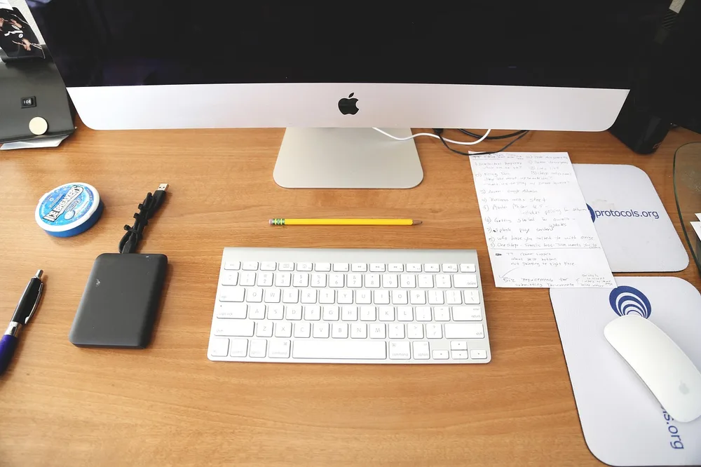
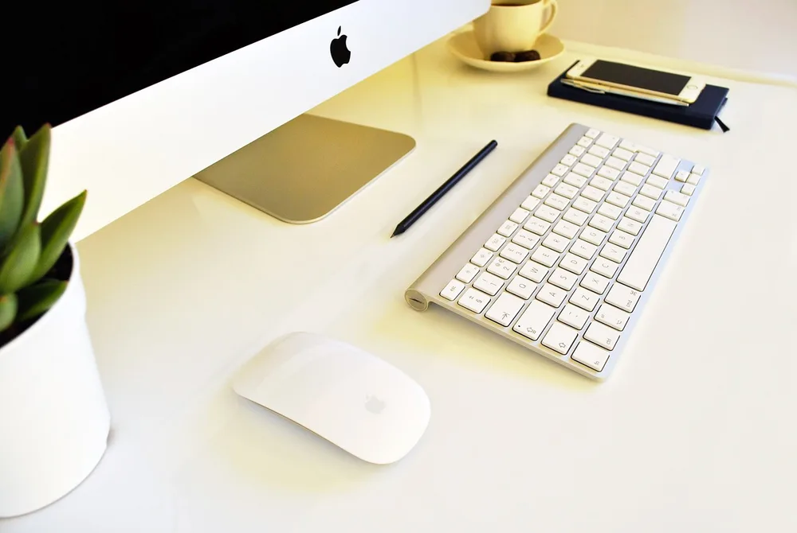
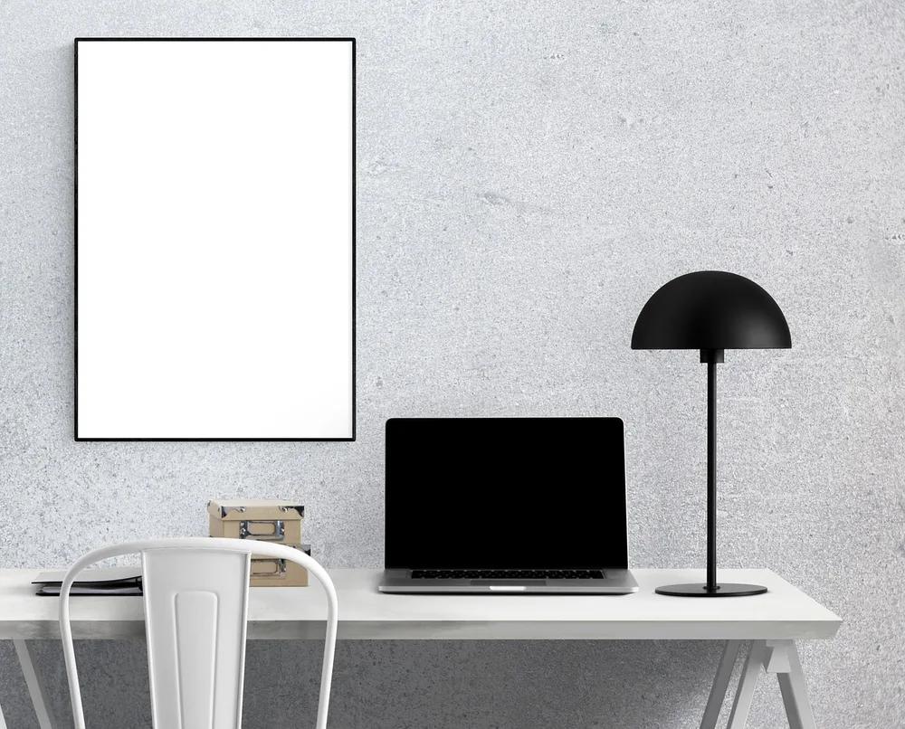
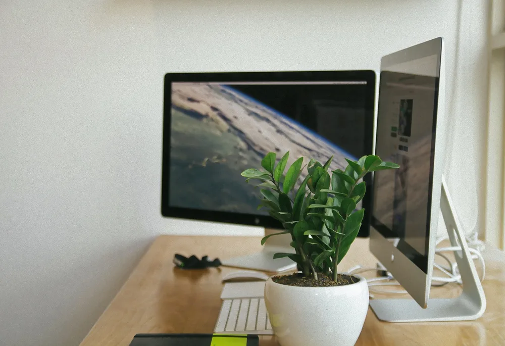

<figure class="pin-figure"><figcaption>Photo by <a href="https://pixabay.com/users/kaboompics-1013994/" rel="nofollow noopener" target="_blank">kaboompics</a> on <a href="https://pixabay.com/photos/blank-paper-pen-coffee-work-792125/" rel="nofollow noopener" target="_blank">Pixabay</a></figcaption></figure>

A white desk setup looks clean, bright and calm, and it makes even a small room feel more open. White surfaces reflect light, hide less dust than black ones and work with almost any wall color or decor style. A white desk also gives photos and video calls a crisp, professional background.

The challenge is keeping a white setup from feeling cold or sterile. These white desk setup ideas show how to match your tech, add warmth with wood and plants and keep the desk tidy, so it looks as good on a busy Tuesday as it does in photos.

<h2>1. Start With a White Desktop</h2>

<figure class="pin-figure"><figcaption>Photo by <a href="https://pixabay.com/users/kaboompics-1013994/" rel="nofollow noopener" target="_blank">kaboompics</a> on <a href="https://pixabay.com/photos/acer-chromebook-laptop-notebook-791027/" rel="nofollow noopener" target="_blank">Pixabay</a></figcaption></figure>

The desk itself sets the tone for the whole setup. A white desktop with a matte finish reflects light without glare and makes everything on top of it stand out clearly, which is why so many minimal setups start here.

Choose a surface that is easy to clean, such as laminate or a sealed finish, because white shows coffee rings and ink marks quickly. A wipe at the end of each day keeps it looking bright and new for years.

<h2>2. Match a White Keyboard and Mouse</h2>

<figure class="pin-figure"><figcaption>Photo by <a href="https://pixabay.com/users/StartupStockPhotos-690514/" rel="nofollow noopener" target="_blank">StartupStockPhotos</a> on <a href="https://pixabay.com/photos/computer-startup-start-up-mac-593314/" rel="nofollow noopener" target="_blank">Pixabay</a></figcaption></figure>

Dark peripherals are often the first thing you notice on a white desk. Switching to a white keyboard and mouse makes the setup look unified and calm, because nothing interrupts the light surface. Even small items like a phone stand or a charging pad look better in white.

Look for keycaps that resist yellowing and a finish that is easy to wipe. Many keyboards and mice come in white versions at the same price as black ones, so the switch does not have to cost more. Wireless models also mean fewer cables crossing the clean surface of the desk.

<h2>3. Pick a Monitor With a Light Frame</h2>

<figure class="pin-figure"><figcaption>Photo by <a href="https://pixabay.com/users/ThemeDirect-1706225/" rel="nofollow noopener" target="_blank">ThemeDirect</a> on <a href="https://pixabay.com/photos/imac-iphone-computer-mobile-white-3431416/" rel="nofollow noopener" target="_blank">Pixabay</a></figcaption></figure>

A monitor with a white or silver back and a slim stand blends into a white setup far better than a bulky black screen. Because the screen sits at the center of the desk, it has a big influence on how calm the whole space feels.

If you already own a dark monitor, a white monitor arm or riser can soften the look. Mounting the screen on an arm also frees the space under it, which makes the desk look even cleaner. Choose an arm with a white or silver finish so it matches the rest of the setup.

<h2>4. Add a White Desk Lamp</h2>

<figure class="pin-figure"><figcaption>Photo by <a href="https://pixabay.com/users/RaniRamli-731298/" rel="nofollow noopener" target="_blank">RaniRamli</a> on <a href="https://pixabay.com/photos/laptop-lamp-poster-frame-table-4099368/" rel="nofollow noopener" target="_blank">Pixabay</a></figcaption></figure>

A white desk lamp completes the look and gives you focused light for evening work. Slim lamps with simple shapes keep the desk feeling light, while a lamp with an adjustable arm lets you aim light exactly where you need it.

Choose a warm or adjustable bulb so the white desk does not feel clinical at night. A soft, warm glow on a white surface makes the space feel cozy rather than harsh. A lamp with a weighted base also stays stable without needing to be clamped to the edge of the desk.

<h2>5. Add a Plant for Contrast</h2>

<figure class="pin-figure"><figcaption>Photo by <a href="https://pixabay.com/users/27707-27707/" rel="nofollow noopener" target="_blank">27707</a> on <a href="https://pixabay.com/photos/computers-monitors-technology-desk-1211406/" rel="nofollow noopener" target="_blank">Pixabay</a></figcaption></figure>

Green looks especially vivid against white, which makes a plant one of the most effective accents in a white setup. A small potted plant beside the monitor adds life and color without making the desk look busy. The contrast also draws attention to the plant, so choose a healthy one with a nice shape.

Choose an easy plant such as a pothos, a snake plant or a small succulent, in a white or terracotta pot. One plant is usually enough on the desk itself; add more on a shelf or windowsill if you want a stronger effect.

<h2>6. Use White Organizers to Hide Clutter</h2>

<figure class="pin-figure"><figcaption>Photo by <a href="https://pixabay.com/users/kaboompics-1013994/" rel="nofollow noopener" target="_blank">kaboompics</a> on <a href="https://pixabay.com/photos/mobile-phone-smartphone-cell-phone-791071/" rel="nofollow noopener" target="_blank">Pixabay</a></figcaption></figure>

Loose pens, chargers and notes quickly spoil the clean look of a white desk. White organizers, trays and boxes give these items a home while blending into the surface, so the desk still looks open. Matching organizers also make it easier to find things, because everything has its own clear place.

Stick to one or two organizers in the same material and finish. A single tray for daily items and a lidded box for everything else is usually enough to keep the desk looking calm. Empty them once a week so they do not slowly fill with things you no longer need.

<h2>7. Warm It Up With Wood Accents</h2>

<figure class="pin-figure"><figcaption>Photo by <a href="https://pixabay.com/users/kaboompics-1013994/" rel="nofollow noopener" target="_blank">kaboompics</a> on <a href="https://pixabay.com/photos/apple-imac-mac-computer-keyboard-791323/" rel="nofollow noopener" target="_blank">Pixabay</a></figcaption></figure>

An all white desk can feel a little cold. Light wood accents, such as a monitor riser, a desk shelf, a pen holder or a wooden chair, add warmth and texture while keeping the setup bright. Wood also hides small scratches and fingerprints better than white surfaces.

Choose one wood tone and repeat it two or three times so it looks intentional. Oak and birch work especially well with white, giving the desk a soft, natural feel similar to Scandinavian interiors. A wooden chair or stool is an easy way to add warmth to the floor level as well.

<h2>8. Keep the Room Bright</h2>

<figure class="pin-figure"><figcaption>Photo by <a href="https://pixabay.com/users/Simon-3/" rel="nofollow noopener" target="_blank">Simon</a> on <a href="https://pixabay.com/photos/keyboard-computer-keys-white-886462/" rel="nofollow noopener" target="_blank">Pixabay</a></figcaption></figure>

A white desk shines in a bright room. Place it near a window if you can and keep window coverings light, so daylight reaches the desk and reflects off the white surfaces around you. White walls and a pale rug amplify the effect and make the whole office feel brighter and more open.

On darker days, combine the desk lamp with a soft ceiling or floor lamp. Even light across the room keeps a white setup looking crisp, while a single bright spot in a dark room makes the white feel harsh. Aim for soft, even light from more than one source.

<h2>9. Keep Only Daily Items on the Desk</h2>

<figure class="pin-figure"><figcaption>Photo by <a href="https://pixabay.com/users/Pexels-2286921/" rel="nofollow noopener" target="_blank">Pexels</a> on <a href="https://pixabay.com/photos/apple-smartphone-desk-laptop-1282241/" rel="nofollow noopener" target="_blank">Pixabay</a></figcaption></figure>

White setups look best when the surface is mostly clear. Limit the desk to the items you use every day, such as the monitor, keyboard, mouse, lamp and one personal object, and store everything else out of sight. A drawer organizer or a small cabinet next to the desk makes this easy to maintain.

This habit also makes cleaning quick, because there is very little to move. A clear white desk feels peaceful to sit down at, and that calm is a big part of why people choose this style in the first place.

<h2>10. Choose Neutral Mugs and Accessories</h2>

<figure class="pin-figure"><figcaption>Photo by <a href="https://pixabay.com/users/Engin_Akyurt-3656355/" rel="nofollow noopener" target="_blank">Engin_Akyurt</a> on <a href="https://pixabay.com/photos/coffee-drink-caffeine-beverage-cup-6371149/" rel="nofollow noopener" target="_blank">Pixabay</a></figcaption></figure>

Small accessories have a big effect on a minimal desk. A white, cream or light gray mug, coaster and notebook keep the palette consistent, while brightly colored items can make a white setup look scattered. Neutral accessories also make it easier to replace items without worrying about matching colors.

If you want a pop of color, choose one accent and repeat it, such as a soft green in the plant pot and notebook. Limiting color this way keeps the desk interesting without losing its clean character. Natural textures, like a linen notebook cover or a ceramic cup, also add warmth.

<h2>Final Thoughts</h2>

A white desk setup is simple to start and easy to personalize. Begin with a white surface and matching peripherals, add warmth with wood and a plant, and keep the desk clear of clutter, so your workspace stays bright, calm and inviting every day.

