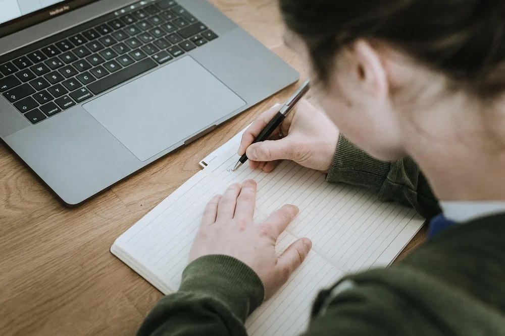
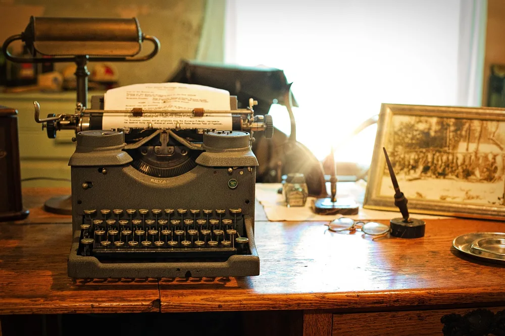
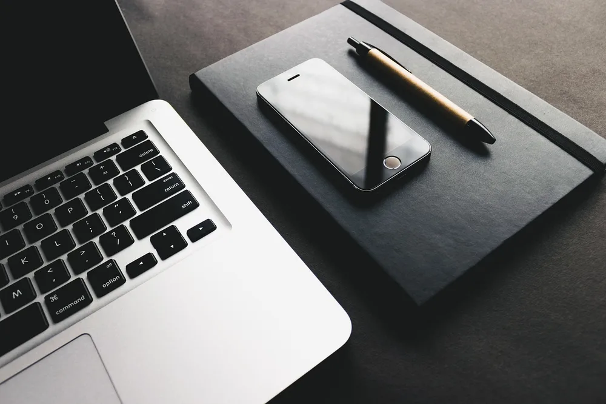
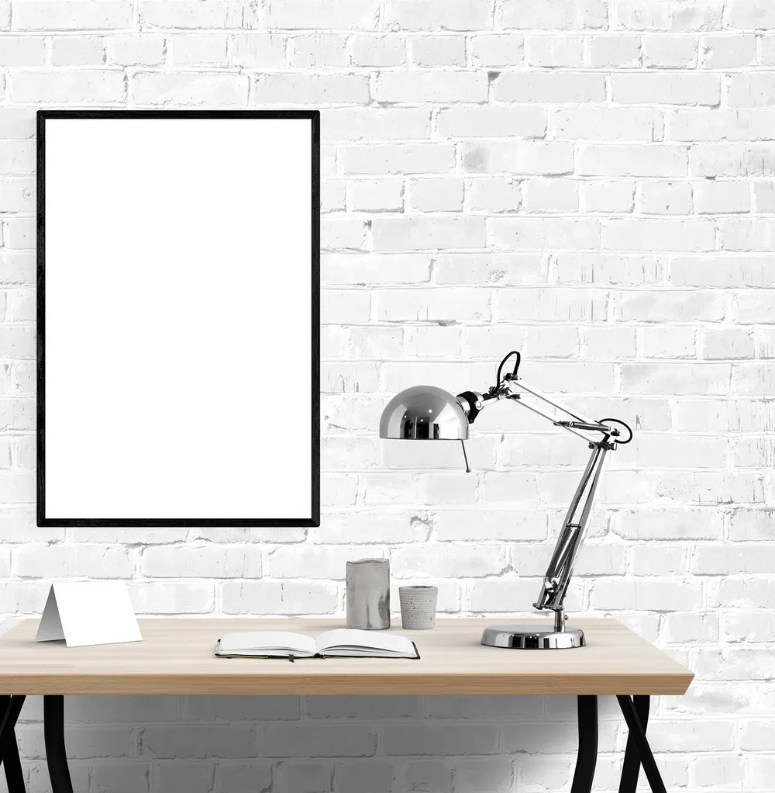
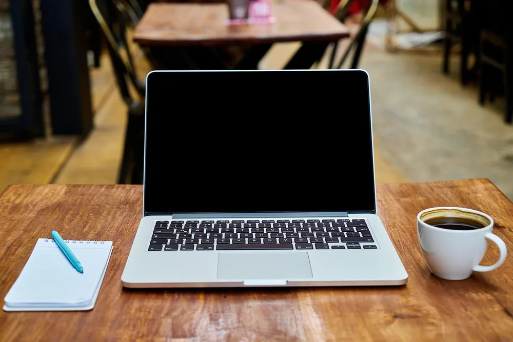
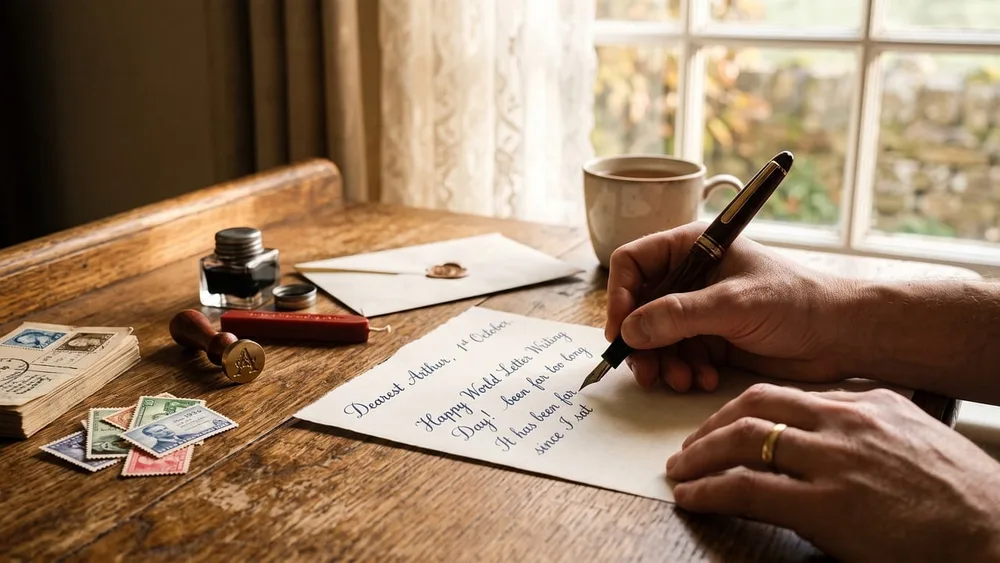
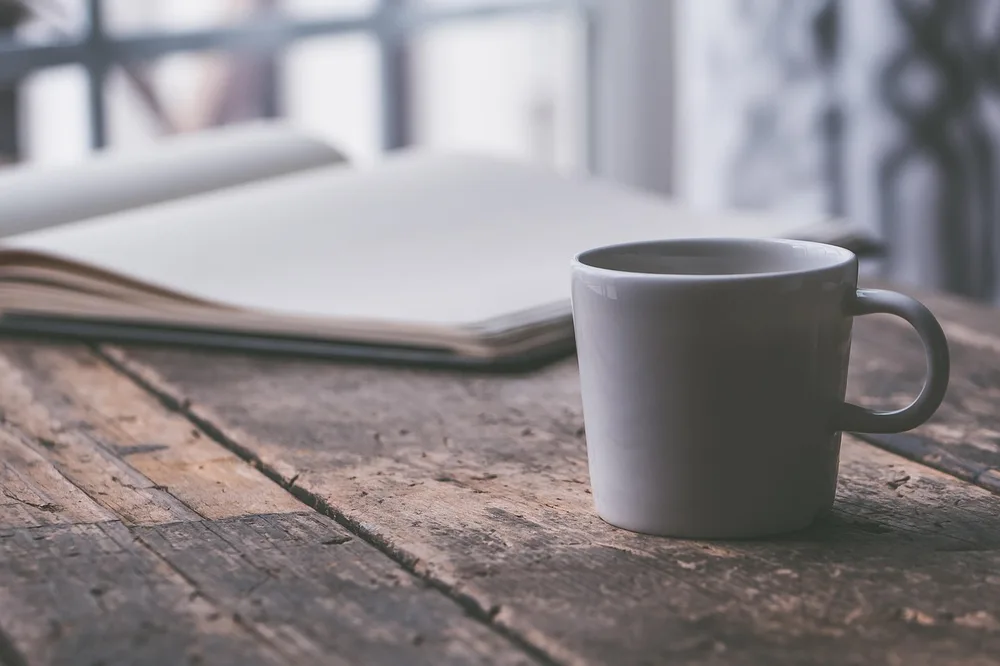

<figure class="pin-figure"><figcaption>Photo by <a href="https://pixabay.com/users/Studio32-2077661/" rel="nofollow noopener" target="_blank">Studio32</a> on <a href="https://pixabay.com/photos/adult-laptop-computer-people-paper-3052244/" rel="nofollow noopener" target="_blank">Pixabay</a></figcaption></figure>

Writing is quiet, slow work, and the space around you shapes how easily the words come. A writer&#39;s desk needs fewer gadgets than most workspaces, but it benefits from good light, a comfortable place to think and a few objects that make sitting down feel like the start of a ritual.

These writer desk setup ideas are for novelists, bloggers, students and anyone who writes regularly. They mix practical tools with small habits, so you can build a desk that helps you focus on the page instead of everything else competing for your attention.

<h2>1. Keep a Typewriter or Analog Tool for Inspiration</h2>

<figure class="pin-figure"><figcaption>Photo by <a href="https://pixabay.com/users/JillWellington-334088/" rel="nofollow noopener" target="_blank">JillWellington</a> on <a href="https://pixabay.com/photos/typewriter-desk-vintage-retro-old-2095754/" rel="nofollow noopener" target="_blank">Pixabay</a></figcaption></figure>

Many writers keep a typewriter, a fountain pen or another analog tool on the desk, even if most of their work happens on a computer. Using it for first lines, letters or brainstorming slows you down in a good way and makes it harder to edit before you have finished a thought.

Even as decoration, an analog tool sets the tone of the desk. It reminds you that this is a place for writing, not for email or scrolling, and that small signal can make it easier to get started on difficult days.

<h2>2. Draft by Hand in a Notebook</h2>

<figure class="pin-figure"><figcaption>Photo by <a href="https://pixabay.com/users/rupixen-11154019/" rel="nofollow noopener" target="_blank">rupixen</a> on <a href="https://pixabay.com/photos/pen-notebook-notepad-diary-4337524/" rel="nofollow noopener" target="_blank">Pixabay</a></figcaption></figure>

Writing by hand is slower than typing, and that is often the point. A notebook gives you a place to outline chapters, sketch scenes or work through a tricky paragraph without the temptation to check messages or search the internet.

Keep one notebook for each project so ideas do not get lost between pages. A pen you enjoy using makes a surprising difference, because writing by hand should feel comfortable enough to do for an hour without your hand getting tired.

<h2>3. Light the Page With a Warm Lamp</h2>

<figure class="pin-figure"><figcaption>Photo by <a href="https://pixabay.com/users/RaniRamli-731298/" rel="nofollow noopener" target="_blank">RaniRamli</a> on <a href="https://pixabay.com/photos/poster-frame-desk-lamp-book-4103332/" rel="nofollow noopener" target="_blank">Pixabay</a></figcaption></figure>

Many writers do their best work early in the morning or late at night, when the house is quiet. A desk lamp with a warm, focused light creates a small pool of brightness around the page and makes the rest of the room fade away.

Choose a lamp with an adjustable arm or a shade that directs light downward, and place it so it lights both your notebook and keyboard. A warm bulb is easier on the eyes than a harsh cool light during long evening sessions.

<h2>4. Make Coffee or Tea Part of the Ritual</h2>

<figure class="pin-figure"><figcaption>Photo by <a href="https://pixabay.com/users/Engin_Akyurt-3656355/" rel="nofollow noopener" target="_blank">Engin_Akyurt</a> on <a href="https://pixabay.com/photos/coffee-caffeine-beverage-table-2425303/" rel="nofollow noopener" target="_blank">Pixabay</a></figcaption></figure>

A writing routine is easier to keep when it starts the same way every day. For many writers that means making a cup of coffee or tea, sitting down at the desk and opening the current project before doing anything else.

Give the cup its own spot on a coaster, away from the notebook and laptop. The simple act of reaching for it while you think becomes part of the rhythm of writing, and it keeps you at the desk instead of wandering to the kitchen.

<h2>5. Place the Desk by a Window</h2>

<figure class="pin-figure"><figcaption>Photo by <a href="https://pixabay.com/users/mahmudul4480-44194522/" rel="nofollow noopener" target="_blank">mahmudul4480</a> on <a href="https://pixabay.com/photos/handwriting-writing-letter-pen-10424950/" rel="nofollow noopener" target="_blank">Pixabay</a></figcaption></figure>

Writers spend a lot of time looking up from the page to think. A window gives your eyes somewhere to rest and your mind a little space to wander, which often helps the next sentence arrive on its own. Watching clouds or trees for a moment is often more useful than staring at a blank page.

Position the desk so the light comes from the side and the view is calm, such as trees, sky or a quiet street. A busy view can be distracting, so a sheer curtain is useful when you need to concentrate on a demanding chapter.

<h2>6. Keep a Journal Next to the Keyboard</h2>

<figure class="pin-figure"><figcaption>Photo by <a href="https://pixabay.com/users/6689062-6689062/" rel="nofollow noopener" target="_blank">6689062</a> on <a href="https://pixabay.com/photos/coffee-cup-table-drink-beverage-2847957/" rel="nofollow noopener" target="_blank">Pixabay</a></figcaption></figure>

Ideas tend to arrive while you are working on something else. A small journal next to the keyboard lets you capture a line of dialogue, a title or a new plot point immediately, without opening another document or losing your place.

Review the journal once a week and move the best ideas into your main project notes. Over time it becomes a valuable collection of fragments that you can return to whenever you feel stuck. Some of the best lines in a finished draft start as a quick note scribbled between other tasks.

<h2>7. Use a Laptop Dedicated to Writing</h2>

<figure class="pin-figure"><figcaption>Photo by <a href="https://pixabay.com/users/StartupStockPhotos-690514/" rel="nofollow noopener" target="_blank">StartupStockPhotos</a> on <a href="https://pixabay.com/photos/startup-start-up-people-593341/" rel="nofollow noopener" target="_blank">Pixabay</a></figcaption></figure>

When the same computer holds your email, social media and games, writing time competes with everything else. If you can, use an older laptop only for writing, with your word processor installed and little else. Turn off notifications and remove games and social media apps from it.

If a second device is not an option, create a separate user account or use full screen mode with notifications turned off. The fewer things that can interrupt you, the easier it is to build a steady daily word count.

<h2>8. Surround Yourself With Books</h2>

<figure class="pin-figure"><figcaption>Photo by <a href="https://pixabay.com/users/geralt-9301/" rel="nofollow noopener" target="_blank">geralt</a> on <a href="https://pixabay.com/photos/never-stop-learning-3653430/" rel="nofollow noopener" target="_blank">Pixabay</a></figcaption></figure>

A shelf of books near the desk is both practical and inspiring. Keep dictionaries, style guides and research books within reach, along with a few favorite authors whose work reminds you what good writing looks like. A comfortable reading chair next to the shelf is a good place to think through problems away from the screen.

Rotate the books on the closest shelf to match the project you are working on. Having the right references and influences in view makes it easier to stay in the world of the story or topic you are writing about.

<h2>9. Use Headphones for Deep Focus</h2>

<figure class="pin-figure"><figcaption>Photo by <a href="https://pixabay.com/users/StockSnap-894430/" rel="nofollow noopener" target="_blank">StockSnap</a> on <a href="https://pixabay.com/photos/headphones-notepad-notebook-audio-925799/" rel="nofollow noopener" target="_blank">Pixabay</a></figcaption></figure>

Household noise and conversations can make it hard to stay with a difficult scene. Headphones with soft instrumental music, ambient sounds or simple white noise help you block distractions and settle into a longer writing session. Pick headphones that are comfortable enough to wear for a couple of hours at a time.

Some writers keep a different playlist for each project, so pressing play becomes a quick way to return to the right mood. Keep the music free of lyrics when you are drafting, because words in a song compete with the words on the page.

<h2>10. Track Writing Time With a Clock</h2>

<figure class="pin-figure"><figcaption>Photo by <a href="https://pixabay.com/users/Bru-nO-1161770/" rel="nofollow noopener" target="_blank">Bru-nO</a> on <a href="https://pixabay.com/photos/ink-pen-fountain-pen-3180608/" rel="nofollow noopener" target="_blank">Pixabay</a></figcaption></figure>

Committing to a fixed block of time is often easier than committing to a word count. A simple clock on the desk lets you set a session, such as 45 minutes, and write without checking your phone to see how long is left.

When the time is up, take a short break before starting the next block. Over a week, these sessions add up, and you will have a clear sense of how much you can write in the time you actually have.

<h2>Final Thoughts</h2>

A good writer&#39;s desk is simple, quiet and built around your daily routine. Start with good light, a notebook and a calm view, then add the books, tools and small rituals that make it easier to sit down and write, one session at a time.

