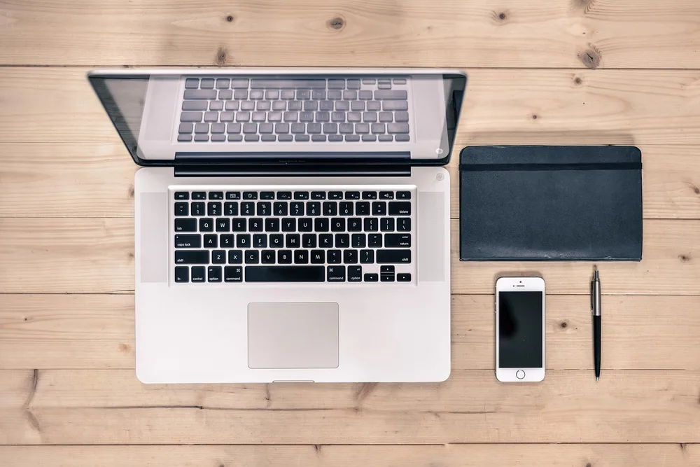
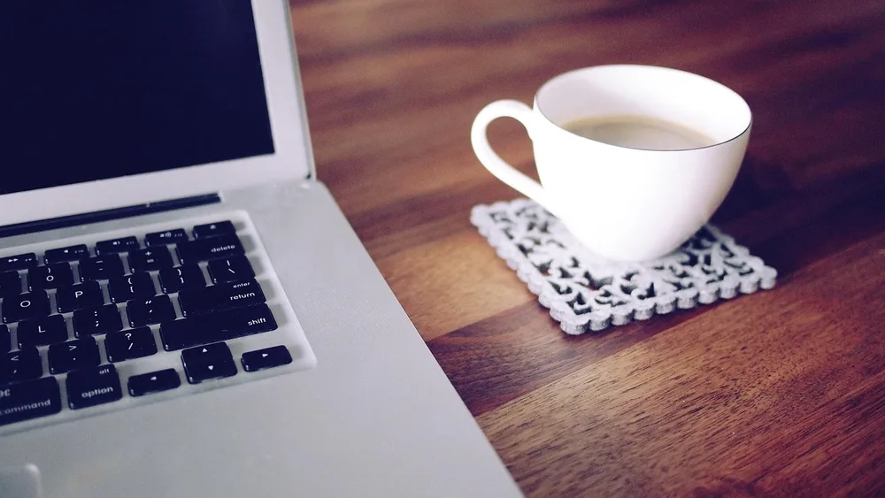
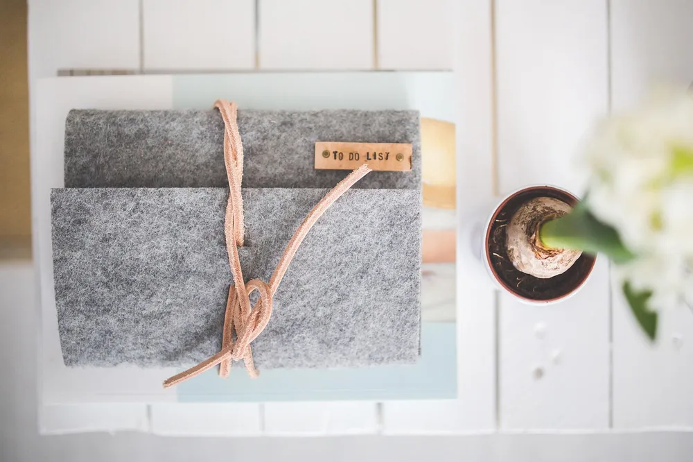
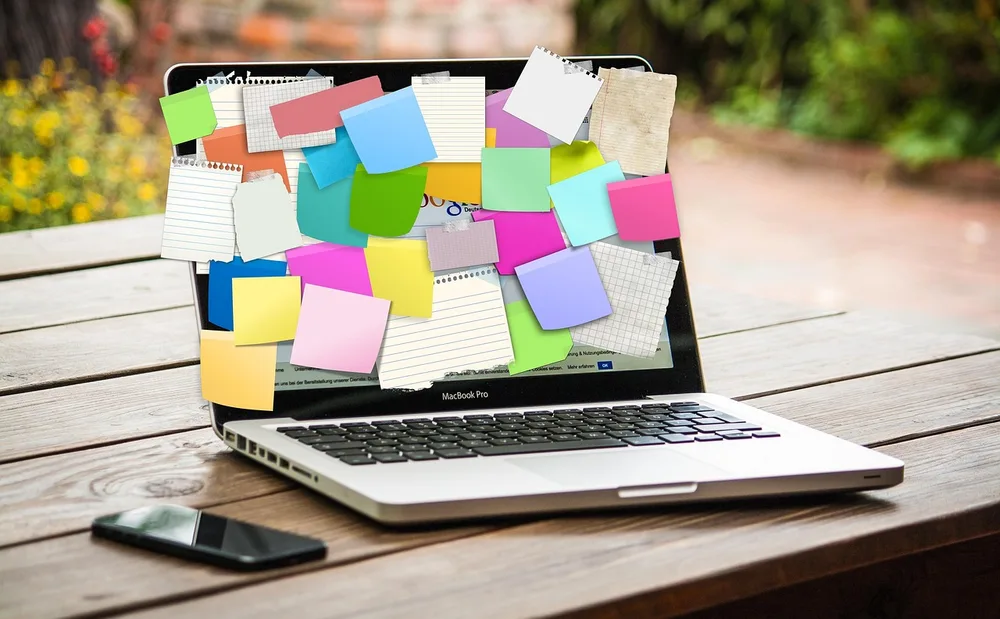
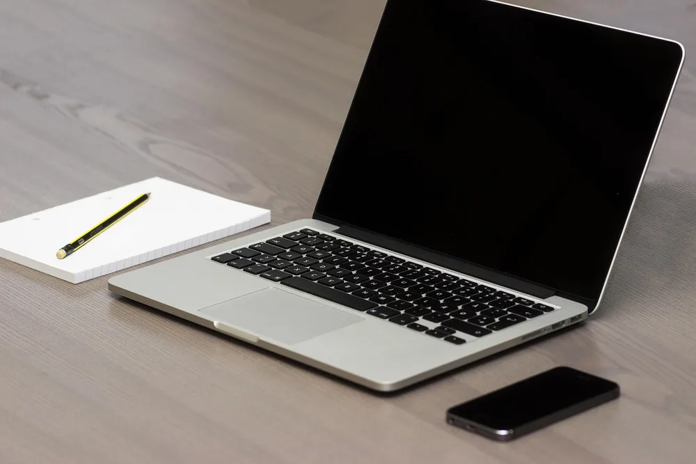
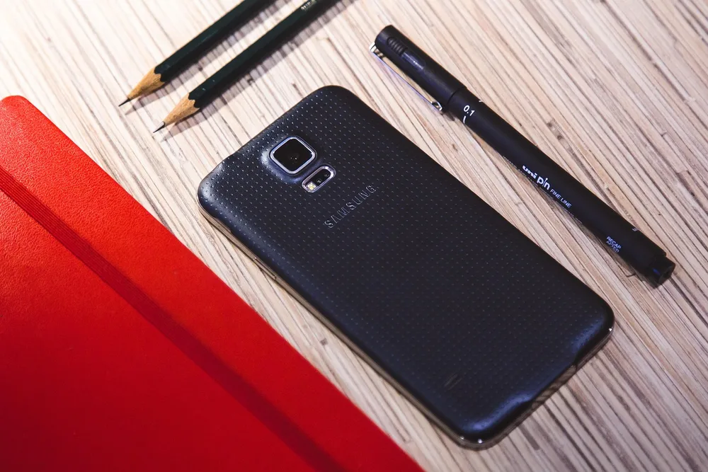
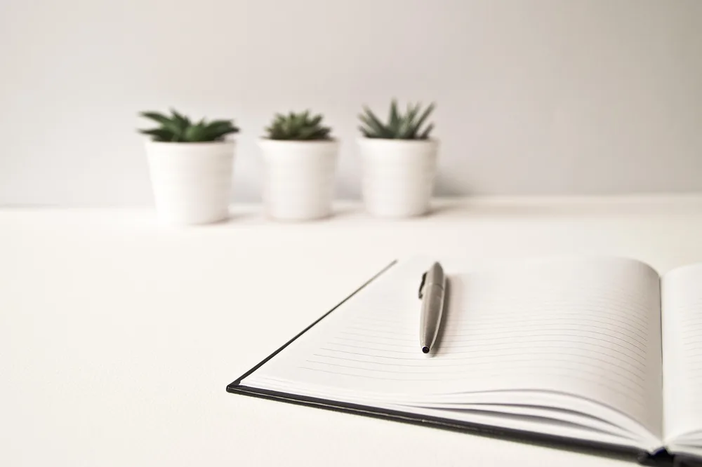
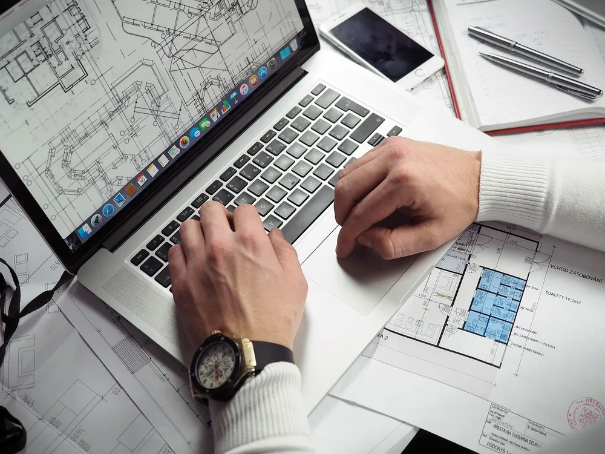
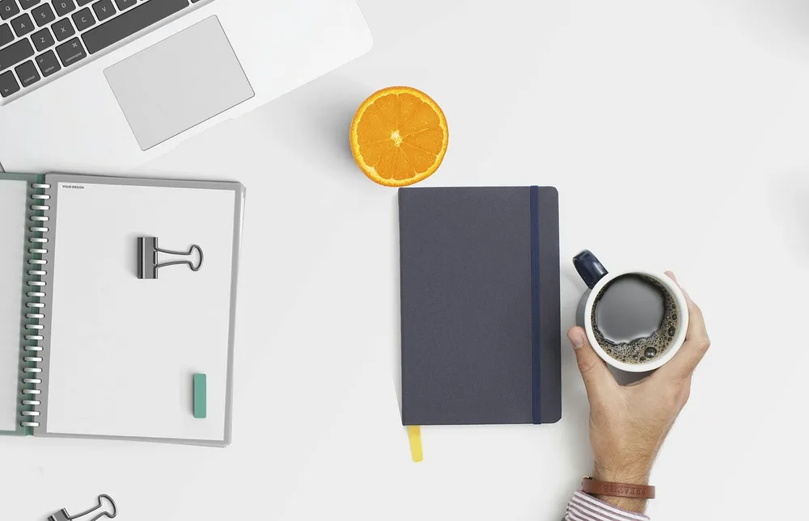
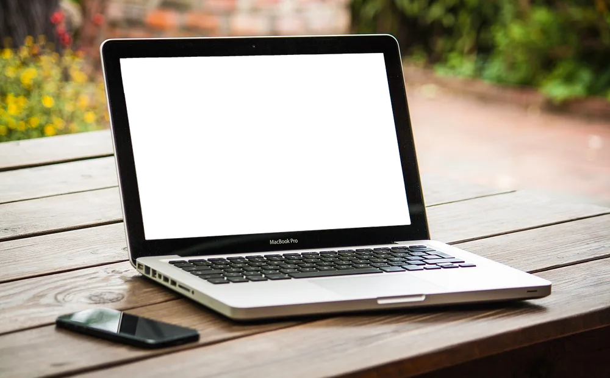

<figure class="pin-figure"><figcaption>Photo by <a href="https://pixabay.com/users/stokpic-692575/" rel="nofollow noopener" target="_blank">stokpic</a> on <a href="https://pixabay.com/photos/desk-laptop-computer-notebook-602975/" rel="nofollow noopener" target="_blank">Pixabay</a></figcaption></figure>

Most desks do not get messy all at once. A cup stays out overnight, a few notes get left beside the keyboard, and within a week you are working in a small clearing surrounded by things you meant to put away. A big clean-up fixes it, but only for a while.

A clean desk routine works differently, because it replaces the occasional big effort with small habits that only take a minute or two. These ideas fit around a normal workday. Pick one or two to start with, and the desk will stay usable without much thought.

<h2>1. Start the Morning With a Clear Surface</h2>

<figure class="pin-figure"><figcaption>Photo by <a href="https://pixabay.com/users/epicantus-168198/" rel="nofollow noopener" target="_blank">epicantus</a> on <a href="https://pixabay.com/photos/workplace-lapetop-notebook-480222/" rel="nofollow noopener" target="_blank">Pixabay</a></figcaption></figure>

Take one minute before you begin work to clear the surface of anything left over from yesterday. Move cups to the kitchen, put away stray items and leave only what you need for your first task. It is a small action, but it sets the tone for the morning.

Doing this before you open your email matters, because once messages start coming in, tidying up tends to be forgotten. Over time, it becomes something you do automatically, like making coffee. Starting with a clear desk also makes it much easier to notice when things begin piling up again.

<h2>2. Bring Only One Drink to the Desk</h2>

<figure class="pin-figure"><figcaption>Photo by <a href="https://pixabay.com/users/Foundry-923783/" rel="nofollow noopener" target="_blank">Foundry</a> on <a href="https://pixabay.com/photos/coffee-glasses-workplace-mug-839234/" rel="nofollow noopener" target="_blank">Pixabay</a></figcaption></figure>

Cups and glasses are among the most common sources of desk clutter, and they carry a risk of spills as well. Limit yourself to one drink at a time, and carry the old cup back to the kitchen whenever you get up for a refill.

Give that drink a fixed spot away from your keyboard and papers, ideally on a coaster. This also gives you a natural reason to stand up and move around during the day. By the end of the afternoon, you will not have to carry a whole collection of mugs out.

<h2>3. Write Your Three Tasks Before You Start</h2>

<figure class="pin-figure"><figcaption>Photo by <a href="https://pixabay.com/users/kaboompics-1013994/" rel="nofollow noopener" target="_blank">kaboompics</a> on <a href="https://pixabay.com/photos/journal-notebook-note-felt-791286/" rel="nofollow noopener" target="_blank">Pixabay</a></figcaption></figure>

A lot of desk clutter comes from reminders, with items left out so that you will not forget them. Write down your three main tasks on one piece of paper each morning, and much of that clutter loses its purpose. The list does the remembering so your desk does not have to.

Keep the list in one obvious spot, then throw it away and start a new one the following morning. Anything you did not finish simply moves over to the next list. One short page is also easier to follow than a dozen scattered notes around the edge of your monitor.

<h2>4. Collect Sticky Notes at Lunch</h2>

<figure class="pin-figure"><figcaption>Photo by <a href="https://pixabay.com/users/geralt-9301/" rel="nofollow noopener" target="_blank">geralt</a> on <a href="https://pixabay.com/photos/laptop-reminders-busy-stickies-3233653/" rel="nofollow noopener" target="_blank">Pixabay</a></figcaption></figure>

Sticky notes are useful for a few hours, but after that they fade into the background and become clutter you no longer notice. At lunchtime, take a moment to gather all of them from your monitor, laptop and desk, then decide what happens to each one.

Copy anything that still matters into your main list or calendar, and throw away the rest. Removing them in the middle of the day means the afternoon starts fresh. If you want to keep a note on your screen, keep it to a single one and replace it when it is done.

<h2>5. Keep Fewer Things on the Surface</h2>

<figure class="pin-figure"><figcaption>Photo by <a href="https://pixabay.com/users/Pexels-2286921/" rel="nofollow noopener" target="_blank">Pexels</a> on <a href="https://pixabay.com/photos/apple-smartphone-desk-laptop-1282240/" rel="nofollow noopener" target="_blank">Pixabay</a></figcaption></figure>

A routine gets easier when there is less to look after. Look at your desk and ask which items you touched in the past week. Things you did not use can go in a drawer or a box, and you will probably not even notice that they are gone.

Try to keep just the essentials out, such as a laptop or keyboard, one notebook and one pen. A desk with few objects takes only seconds to tidy, and wiping it clean takes little effort. Removing things is often the most effective cleaning habit there is.

<h2>6. Follow the Two-Minute Rule for Stray Items</h2>

<figure class="pin-figure"><figcaption>Photo by <a href="https://pixabay.com/users/tookapic-1386459/" rel="nofollow noopener" target="_blank">tookapic</a> on <a href="https://pixabay.com/photos/workplace-desk-mobile-pencil-933425/" rel="nofollow noopener" target="_blank">Pixabay</a></figcaption></figure>

If something on your desk can be put away in under two minutes, do it right now rather than adding it to your list. That means filing a letter, returning a pair of scissors or throwing away an envelope. These small actions stop tiny tasks from growing into a larger mess.

This rule works best with a clear home for everything, because you do not need to stop and think about where each thing belongs. When you find that you are holding an item with nowhere to put it, that is your cue to either give it a spot or let it go.

<h2>7. Wipe the Desk Once a Week</h2>

<figure class="pin-figure"><figcaption>Photo by <a href="https://pixabay.com/users/Ylanite-2218222/" rel="nofollow noopener" target="_blank">Ylanite</a> on <a href="https://pixabay.com/photos/laptop-paper-to-write-business-3076957/" rel="nofollow noopener" target="_blank">Pixabay</a></figcaption></figure>

Dust and crumbs build up quickly around keyboards and screens, even on a tidy desk. Choose one day each week to do a quick wipe with a soft, slightly damp cloth. Lift things as you go, so that you clean the surface underneath them instead of just around them.

Add a quick pass over the keyboard and mouse, and use a dry microfiber cloth for your screen. Turn your devices off first and avoid spraying anything directly onto them. Altogether this takes about three minutes, and a clean surface makes the whole workspace feel fresher and more inviting at the start of the week.

<h2>8. Plan Tomorrow Before You Log Off</h2>

<figure class="pin-figure"><figcaption>Photo by <a href="https://pixabay.com/users/Pexels-2286921/" rel="nofollow noopener" target="_blank">Pexels</a> on <a href="https://pixabay.com/photos/blueprints-entrepreneur-hands-1837238/" rel="nofollow noopener" target="_blank">Pixabay</a></figcaption></figure>

Spend the last few minutes of your workday writing down what you will start with tomorrow. This helps close the day in your mind, and it also means you do not have to leave papers and open notebooks out on the desk as reminders of where you stopped.

Leave the list in one fixed spot, such as on top of a closed notebook. The next morning you can sit down and start right away, with nothing to clear and nothing to figure out. This small step tends to make the morning feel far less rushed.

<h2>9. Do a Five-Minute Reset at the End of the Day</h2>

<figure class="pin-figure"><figcaption>Photo by <a href="https://pixabay.com/users/Mohamed_hassan-5229782/" rel="nofollow noopener" target="_blank">Mohamed_hassan</a> on <a href="https://pixabay.com/photos/workspace-desktop-coffee-3524009/" rel="nofollow noopener" target="_blank">Pixabay</a></figcaption></figure>

A short reset at the end of the day stops today&#39;s clutter from becoming tomorrow&#39;s problem. Set a timer for five minutes, then put away supplies, stack your notes and take out any cups. Setting a limit helps, as you know it will not eat into your evening.

Tie the reset to something you already do, like shutting your laptop, so that one naturally leads to the other. Consistency matters more than perfection here. Even on busy days, a rushed two-minute version still leaves you with a far better starting point for tomorrow.

<h2>10. Clear Your Screen as Well as Your Desk</h2>

<figure class="pin-figure"><figcaption>Photo by <a href="https://pixabay.com/users/Tumisu-148124/" rel="nofollow noopener" target="_blank">Tumisu</a> on <a href="https://pixabay.com/photos/computer-screen-empty-blank-laptop-3542771/" rel="nofollow noopener" target="_blank">Pixabay</a></figcaption></figure>

A cluttered computer desktop can feel just as distracting as a messy desk. Once a week, close the tabs you no longer need, move loose files into their folders and empty the downloads folder. A clean screen fits with a clean desk and makes it easier to start working.

Use a single temporary folder for the things you are not sure about and go through it at the end of the month. A plain wallpaper can also make your icons less overwhelming. When you sit down on Monday, both your desk and your screen are ready for work.

<h2>Final Thoughts</h2>

A clean desk routine does not call for discipline so much as for a few habits tied to moments you already have. Start with a five-minute reset at the end of the day, then add a morning check and a weekly wipe. Within a few weeks, staying tidy will take almost no effort.

