<figure class="pin-figure">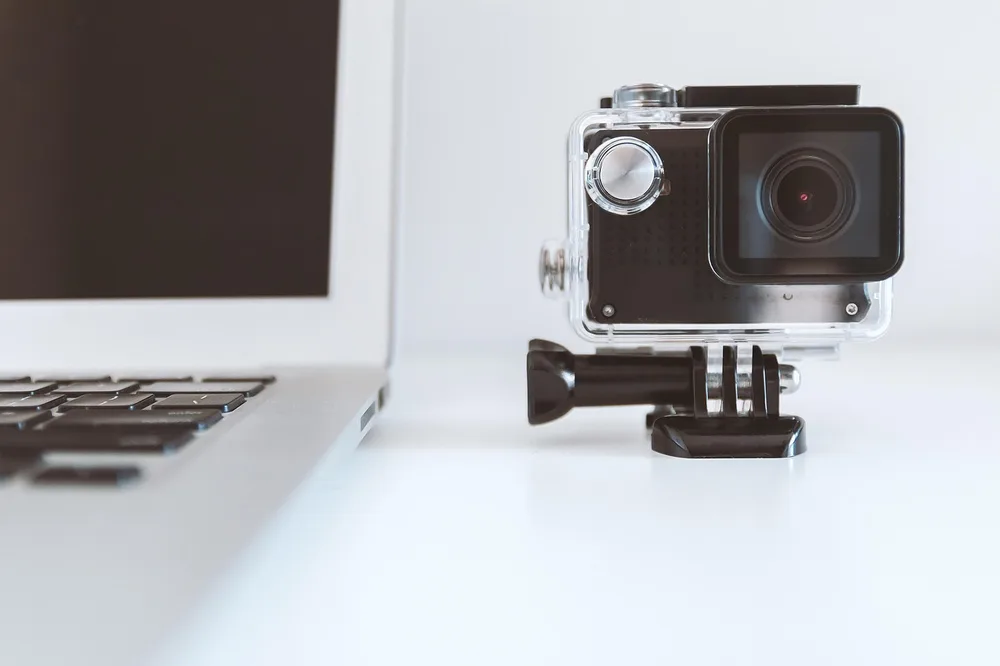<figcaption>Photo by <a href="https://pixabay.com/users/JESHOOTS-com-264599/" rel="nofollow noopener" target="_blank">JESHOOTS-com</a> on <a href="https://pixabay.com/photos/technology-camera-sport-laptop-2125547/" rel="nofollow noopener" target="_blank">Pixabay</a></figcaption></figure>

A content creator&#39;s desk has to do several jobs at once. In one hour it is an editing suite, in the next it is a place to shoot a product close-up, and later on it is where you plan next week&#39;s posts. A regular office setup rarely handles all of this well.

These content creator desk setup ideas help a single desk switch quickly between creating, editing and planning. They suit people making videos, photos, podcasts or social posts from home, and you can build up the setup slowly, starting with what you already own and adding only what your work needs.

<h2>1. Get a Screen That Is Good for Editing</h2>

<figure class="pin-figure">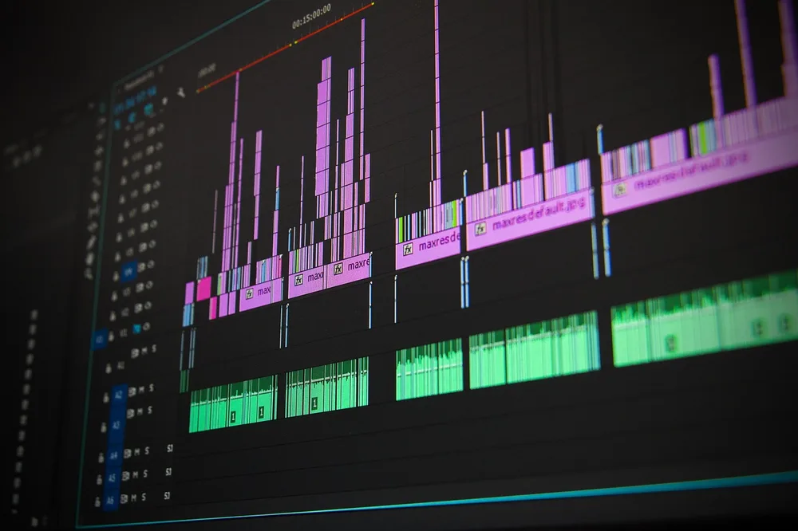<figcaption>Photo by <a href="https://pixabay.com/users/Recklessstudios-1884442/" rel="nofollow noopener" target="_blank">Recklessstudios</a> on <a href="https://pixabay.com/photos/editing-video-computer-1141505/" rel="nofollow noopener" target="_blank">Pixabay</a></figcaption></figure>

Video timelines need a lot of horizontal space, and a small laptop screen makes every edit slower. A larger external monitor gives you room for your preview, your timeline and your tools all at once. You will spend far less time zooming and scrolling, which adds up across every project.

Place the monitor directly in front of you, with the top edge close to eye level. If you edit for hours at a time, a matte screen will help cut down on reflections from windows and lamps. Your laptop can sit beside it and hold your files or your music.

<h2>2. Pay Attention to Color if You Edit Photos</h2>

<figure class="pin-figure">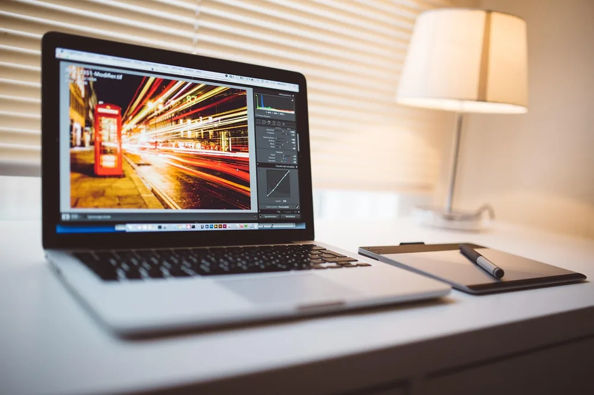<figcaption>Photo by <a href="https://pixabay.com/users/Lalmch-1026205/" rel="nofollow noopener" target="_blank">Lalmch</a> on <a href="https://pixabay.com/photos/computer-macbook-tablet-editing-767781/" rel="nofollow noopener" target="_blank">Pixabay</a></figcaption></figure>

If you edit photos, how accurately your screen shows color matters more than how large it is. A monitor that covers a wide color range helps your images look the same on other people&#39;s devices. Check its settings first, as many screens come out of the box looking too bright and too blue.

Keep the light around your desk steady while you work, because colors can seem different in morning sun and in evening lamplight. Neutral walls and a plain desktop background help your eyes judge colors better. Compare your finished work on your phone too, since many people will see it there.

<h2>3. Keep the Camera Ready to Pick Up</h2>

<figure class="pin-figure">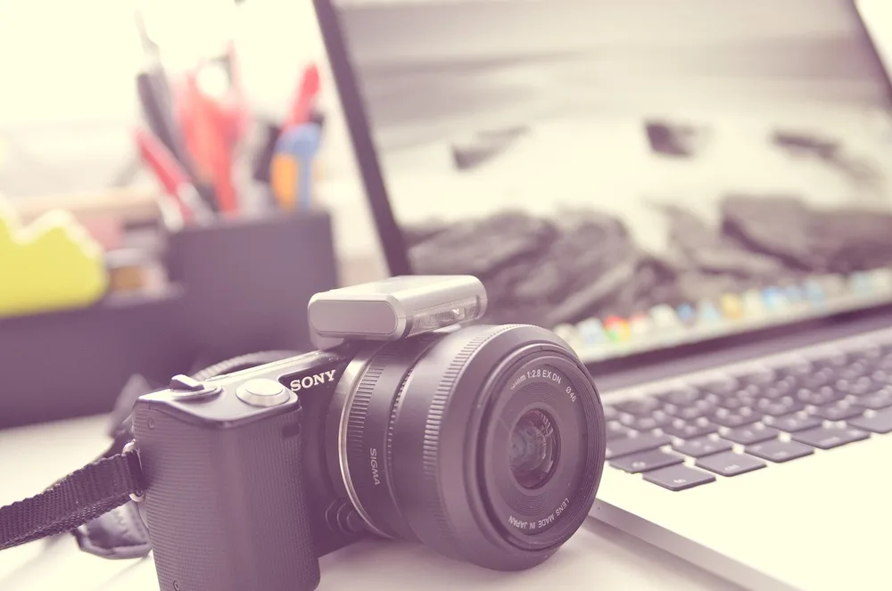<figcaption>Photo by <a href="https://pixabay.com/users/TheAngryTeddy-123386/" rel="nofollow noopener" target="_blank">TheAngryTeddy</a> on <a href="https://pixabay.com/photos/keyboard-keys-hardware-pc-computer-338505/" rel="nofollow noopener" target="_blank">Pixabay</a></figcaption></figure>

A camera stored away in a bag gets used less often than one you can reach from your chair. Give it a fixed spot on a shelf or at the side of your desk, with a spare battery close by, so that shooting a quick clip does not feel like a big production.

Keep your memory cards in a small case, and use a simple rule for separating the empty ones from the full ones. Choose a spot away from direct sun and where the camera will not get knocked. With a ready spot, it is also simple to check for dust or a dirty lens.

<h2>4. Set Up a Phone Spot for Quick Clips</h2>

<figure class="pin-figure">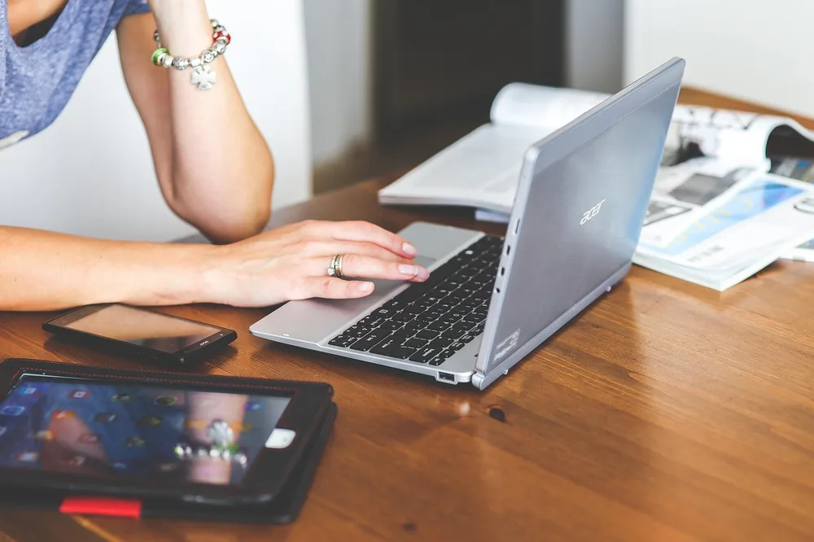<figcaption>Photo by <a href="https://pixabay.com/users/kaboompics-1013994/" rel="nofollow noopener" target="_blank">kaboompics</a> on <a href="https://pixabay.com/photos/technology-laptop-keyboard-computer-791029/" rel="nofollow noopener" target="_blank">Pixabay</a></figcaption></figure>

Many short videos are filmed on a phone, so it helps to keep one spot ready for this. A small stand on the desk means you can record a tip, a reaction or a behind-the-scenes clip whenever an idea comes, without having to find a good angle every time.

Find a position with good light and a tidy background, and mark it on the desk with a small piece of tape. Keep a charging cable within reach too, since recording quickly drains the battery. A familiar frame gives your clips a consistent look that viewers begin to recognize.

<h2>5. Use a Small Tripod for Steady Shots</h2>

<figure class="pin-figure">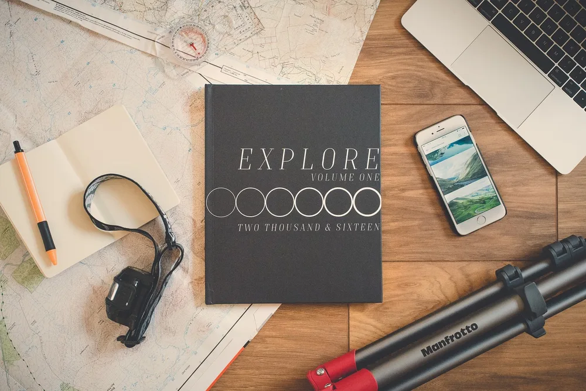<figcaption>Photo by <a href="https://pixabay.com/users/StockSnap-894430/" rel="nofollow noopener" target="_blank">StockSnap</a> on <a href="https://pixabay.com/photos/table-office-photography-tripod-2589083/" rel="nofollow noopener" target="_blank">Pixabay</a></figcaption></figure>

A small tripod holds your camera or phone steady for overhead and table-level shots, and it packs away easily when you are done. Flexible versions can even grip the edge of a shelf or monitor arm. This gives you more options than a large floor tripod in a small room.

If you often shoot from above, consider an arm that clamps to your desk and reaches over the surface. Check that everything is stable before you press record, as even small shakes are very noticeable. Keep the tripod folded in a drawer, so that it does not take up your working space.

<h2>6. Give Your Voice a Good Microphone</h2>

<figure class="pin-figure">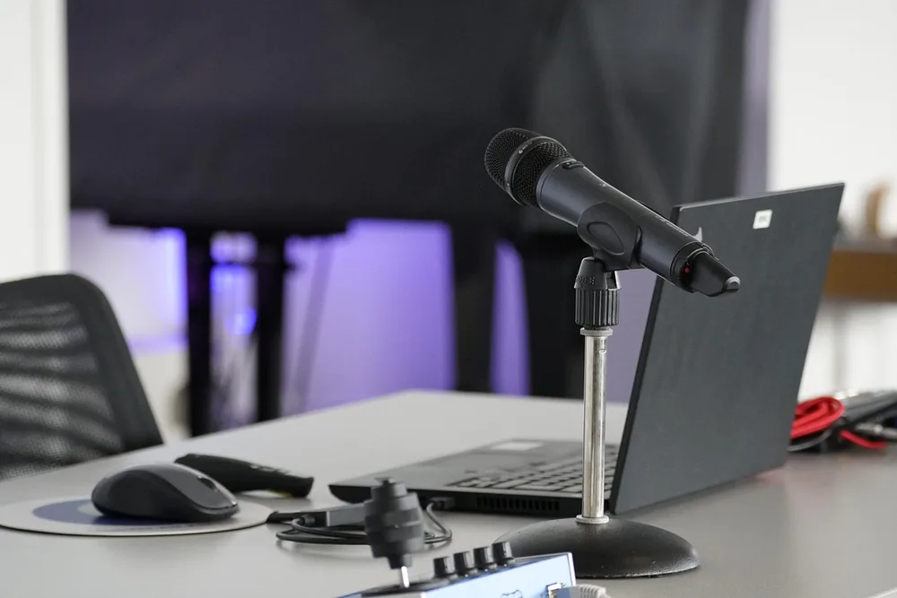<figcaption>Photo by <a href="https://pixabay.com/users/jhenning-8658480/" rel="nofollow noopener" target="_blank">jhenning</a> on <a href="https://pixabay.com/photos/laptop-conference-table-mouse-work-7978588/" rel="nofollow noopener" target="_blank">Pixabay</a></figcaption></figure>

Viewers are often willing to watch an average picture, but they usually leave when the sound is bad. A USB microphone on a desk arm is an easy first upgrade for voiceovers, podcasts and talking clips. It stays out of frame and swings out of the way when you are finished.

Speak about a hand&#39;s width from the microphone and use a pop filter to soften hard sounds. Record in the quietest part of the day if you can, and turn off fans and air conditioning. Soft furnishings such as curtains and rugs will reduce echo better than most software.

<h2>7. Make a Clean Surface for Flat Lays</h2>

<figure class="pin-figure">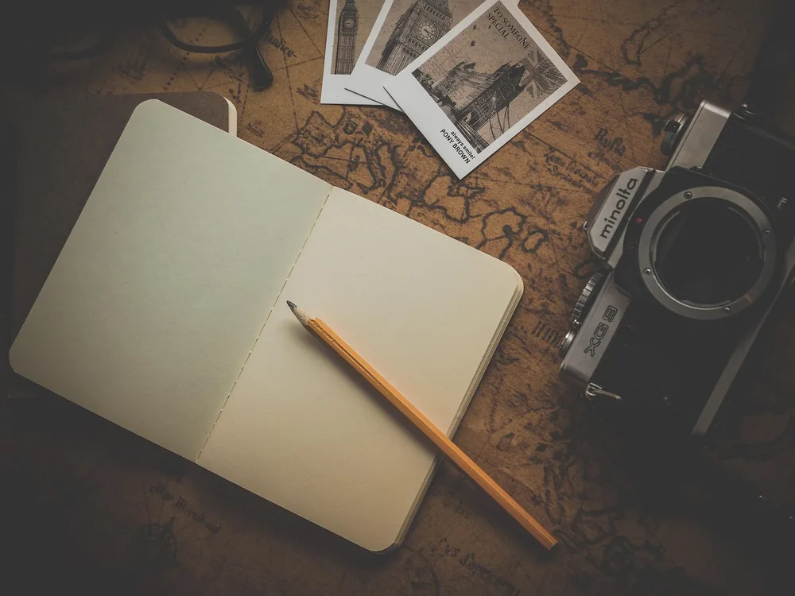<figcaption>Photo by <a href="https://pixabay.com/users/DariuszSankowski-1441456/" rel="nofollow noopener" target="_blank">DariuszSankowski</a> on <a href="https://pixabay.com/photos/notebook-camera-map-pencil-travel-1130742/" rel="nofollow noopener" target="_blank">Pixabay</a></figcaption></figure>

Overhead photos and product shots need a clear, attractive surface, and your desk may be the best one you have. Keep a sheet of colored board or a plain wooden panel behind the desk. You can lay it on top of your work area in seconds and put it away afterwards.

Shoot near a window for soft side light and use a white card opposite the window to fill in the shadows. Keep a small box of props, such as notebooks and a mug, nearby. When your background is easy to set up, you are more likely to create fresh images.

<h2>8. Add Light You Can Control</h2>

<figure class="pin-figure">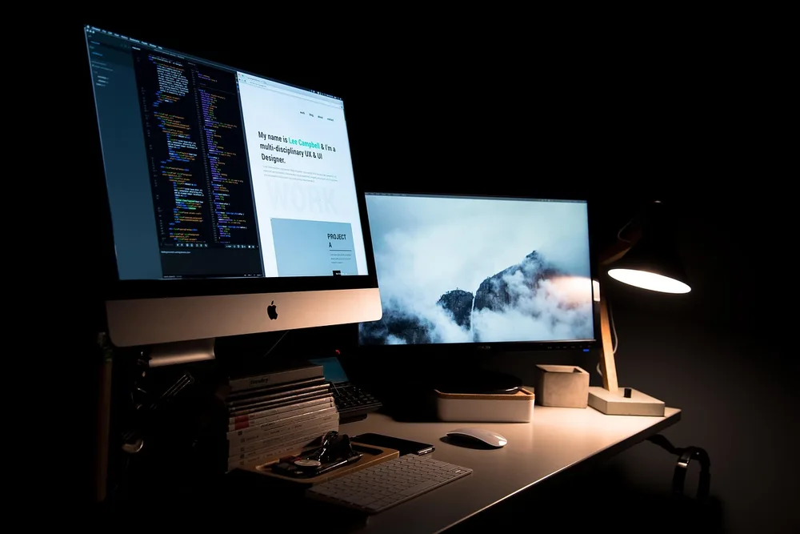<figcaption>Photo by <a href="https://pixabay.com/users/Pexels-2286921/" rel="nofollow noopener" target="_blank">Pexels</a> on <a href="https://pixabay.com/photos/apple-books-computers-desk-desktop-1839046/" rel="nofollow noopener" target="_blank">Pixabay</a></figcaption></figure>

Daylight is lovely, but it changes by the minute, which causes problems when one clip has to match the next. A soft LED panel or a desk lamp with an adjustable brightness setting gives you the same look at any hour, which is especially useful for evening recording sessions.

Place your main light in front of you and slightly to one side, and raise it a little above eye level. Turn off any other lamps that have a different color tone. Mixing warm and cool light can make your skin look odd on camera and will be hard to fix later.

<h2>9. Keep Your Content Calendar in Sight</h2>

<figure class="pin-figure">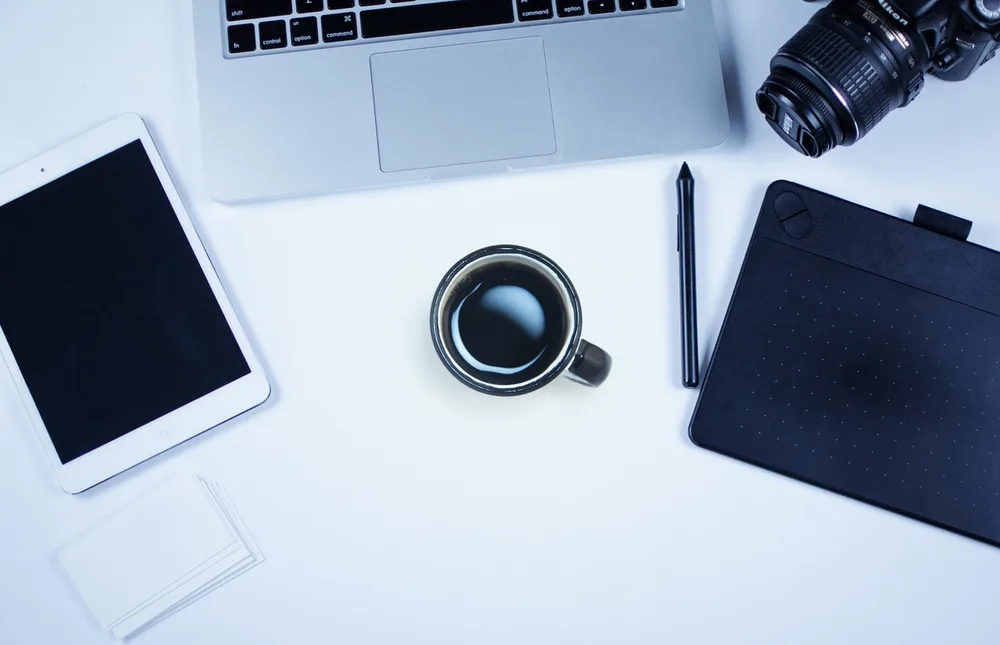<figcaption>Photo by <a href="https://pixabay.com/users/Mohamed_hassan-5229782/" rel="nofollow noopener" target="_blank">Mohamed_hassan</a> on <a href="https://pixabay.com/photos/work-coffee-camera-cup-coffee-cup-3523738/" rel="nofollow noopener" target="_blank">Pixabay</a></figcaption></figure>

Ideas are easy to lose when your work is spread across several apps. Keep a simple content calendar where you can see it, whether that is a whiteboard above the desk or a dedicated page on your second screen. Knowing what comes next also makes it much easier to sit down and start.

Plan the week on one set day, then batch similar work together, like filming on one day and editing on another. Moving from one type of task to another uses up energy. Keep a small notebook on the desk for sudden ideas, so they do not interrupt whatever you are working on.

<h2>10. Separate Posting From Creating</h2>

<figure class="pin-figure">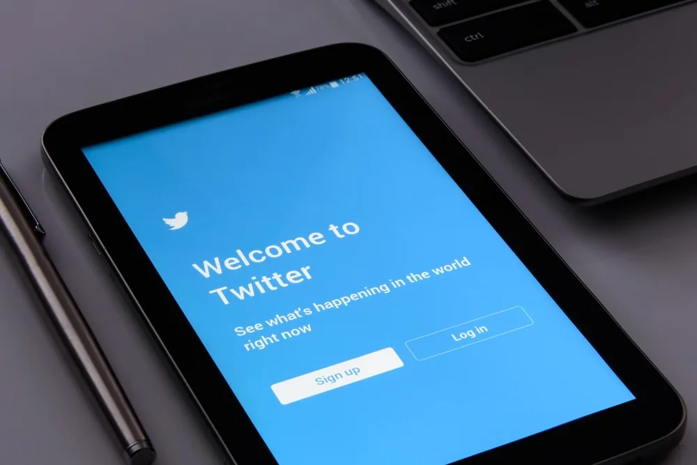<figcaption>Photo by <a href="https://pixabay.com/users/AS_Photography-1546875/" rel="nofollow noopener" target="_blank">AS_Photography</a> on <a href="https://pixabay.com/photos/twitter-screen-social-telephone-1795652/" rel="nofollow noopener" target="_blank">Pixabay</a></figcaption></figure>

Social media apps are designed to keep you scrolling, which makes them a risky place to be when you should be creating. Set aside specific times for posting and replying, and keep those apps closed or on a separate device while you are filming or editing at your desk.

Use a scheduling tool, if you can, so you can post at the best time without having to be online. A phone stand placed out of reach also helps with this. You will find it easier to finish work when your attention is not being pulled toward comments and numbers.

<h2>Final Thoughts</h2>

A good content creator desk setup makes it easy to move from an idea to a finished post. Start with a larger screen and clear sound, then add a tripod, controlled light and a simple calendar as your work grows. Keep the desk ready to shoot, and you will create more often.

