<figure class="pin-figure">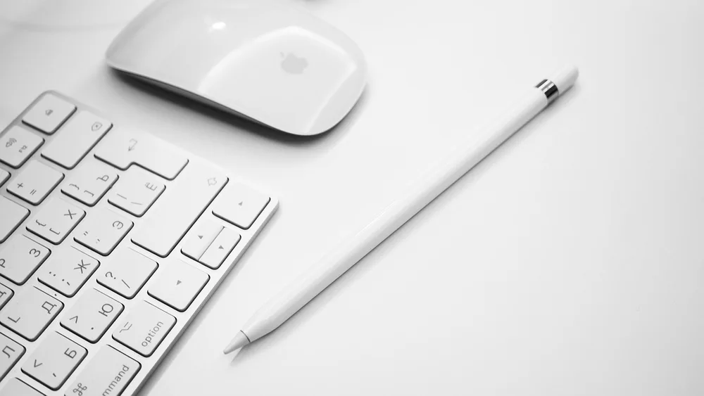<figcaption>Photo by <a href="https://pixabay.com/users/MaxxGirr-3565425/" rel="nofollow noopener" target="_blank">MaxxGirr</a> on <a href="https://pixabay.com/photos/keyboard-office-business-computer-4532320/" rel="nofollow noopener" target="_blank">Pixabay</a></figcaption></figure>

Modern desks are full of small devices, and each one seems to bring its own cable. A hub here, a charger there, headphones on the keyboard and a hard drive balanced on a stack of notes can make even a large desk feel crowded and hard to work at.

These desk accessories organization ideas are about the tech you use every day, including the cables that connect it all. They do not require a full desk rebuild. Each idea gives one group of gadgets a clear place, so that you can find it quickly and put it back.

<h2>1. Plug Everything Into a Single Hub</h2>

<figure class="pin-figure">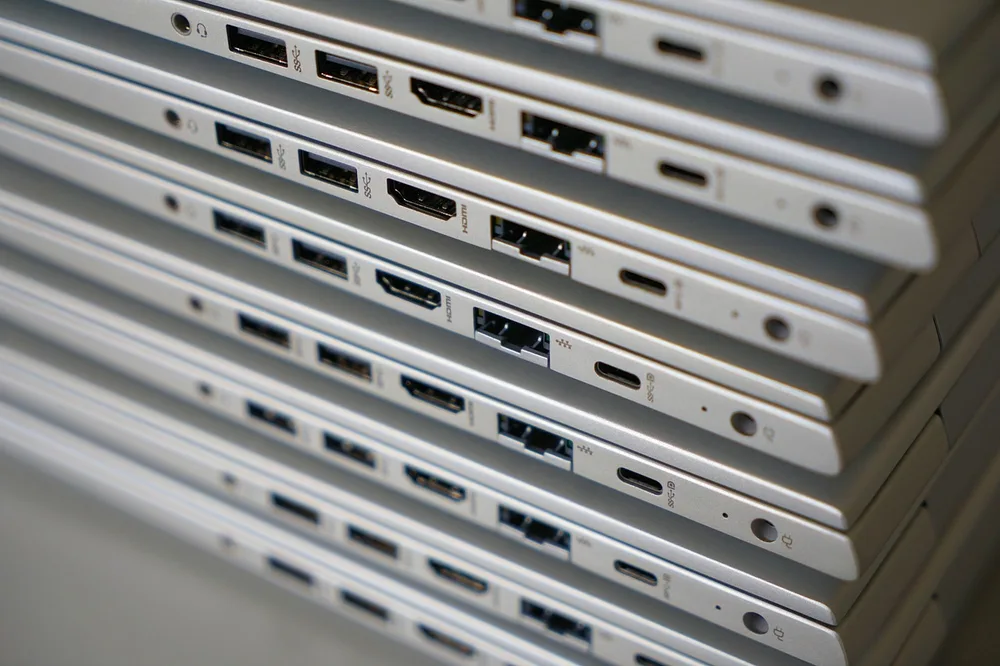<figcaption>Photo by <a href="https://pixabay.com/users/webandi-1460261/" rel="nofollow noopener" target="_blank">webandi</a> on <a href="https://pixabay.com/photos/laptop-computer-pile-hdmi-usb-6090255/" rel="nofollow noopener" target="_blank">Pixabay</a></figcaption></figure>

Each device plugged directly into your laptop adds another cable running across the desk. A small USB hub gathers those connections in one place, so a single cable can link your computer to the keyboard, mouse, drive and monitor. Unplugging to leave the desk then takes just one quick motion.

Place the hub toward the back of the desk, or attach it underneath with an adhesive strip, so that it stays out of sight. Check that it has the ports you actually need and enough power for the devices you connect. A tidy hub removes the most visible clutter on most desks.

<h2>2. Bundle and Label Every Spare Cable</h2>

<figure class="pin-figure">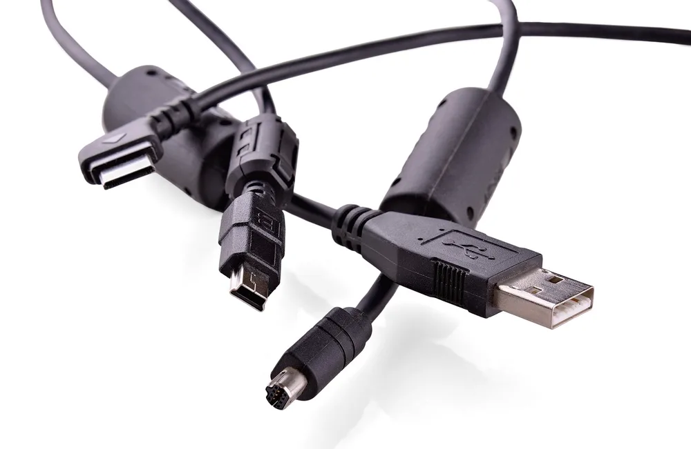<figcaption>Photo by <a href="https://pixabay.com/users/ds_30-1795490/" rel="nofollow noopener" target="_blank">ds_30</a> on <a href="https://pixabay.com/photos/cable-computer-usb-technology-4875319/" rel="nofollow noopener" target="_blank">Pixabay</a></figcaption></figure>

Spare cables quickly turn into a knot that nobody wants to sort through. Coil each one loosely, fasten it with a reusable strap and add a small label that says what it is for. You will be able to pick the correct cable right away, even after months without using it.

While you are sorting them, get rid of old cables for devices you no longer own. Most homes have a pile of these, and keeping them only makes it harder to find the useful ones. Store the rest in a small box or a pouch, grouped by type.

<h2>3. Set Up One Charging Spot</h2>

<figure class="pin-figure">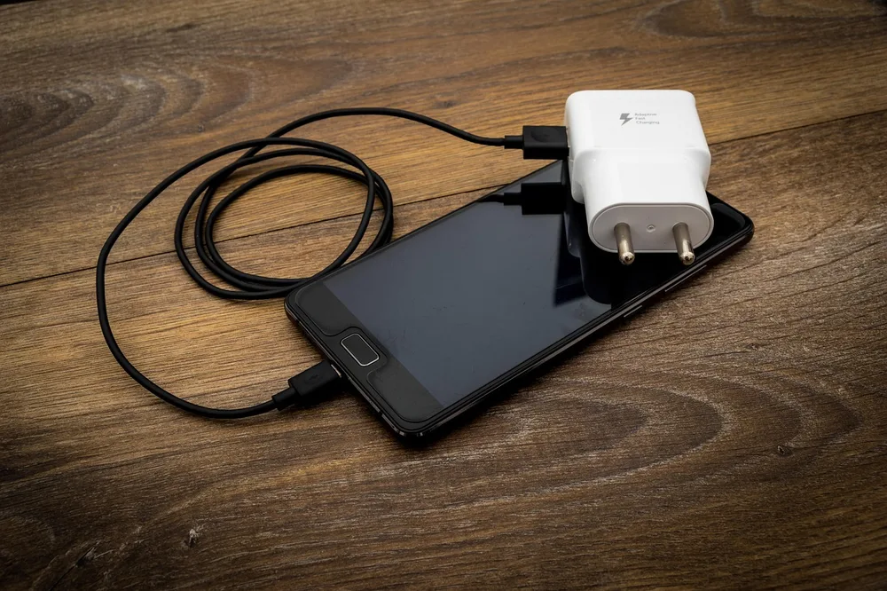<figcaption>Photo by <a href="https://pixabay.com/users/ReadyElements-8569947/" rel="nofollow noopener" target="_blank">ReadyElements</a> on <a href="https://pixabay.com/photos/two-pin-two-pin-plug-accessories-3509490/" rel="nofollow noopener" target="_blank">Pixabay</a></figcaption></figure>

When your phone, earbuds and watch all charge in different corners of the room, you end up with several cables lying around and no idea which one is free. Pick one spot on the desk and make it the only charging place, using a multi-port charger or a compact power strip.

A charging spot works best at the back or on the side of the desk, away from the area where you write and type. Devices that return to the same place every evening are also far less likely to be lost, and the surface stays clear of stray cords.

<h2>4. Give Headphones a Hook or Stand</h2>

<figure class="pin-figure">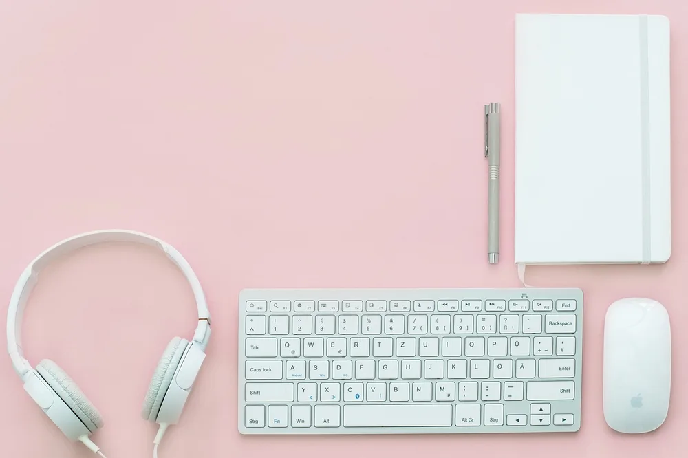<figcaption>Photo by <a href="https://pixabay.com/users/StockSnap-894430/" rel="nofollow noopener" target="_blank">StockSnap</a> on <a href="https://pixabay.com/photos/pink-lifestyle-headphones-keyboard-2569355/" rel="nofollow noopener" target="_blank">Pixabay</a></figcaption></figure>

Large headphones take up a surprising amount of space when they are lying on the desk, and the cable or ear cups always seem to get in the way. A simple stand or a hook under the edge of the desk gets them up off the surface and keeps them in good shape.

An under-desk hook is the better choice when you have very little space, as it uses no surface at all. Put it on the side of your dominant hand so that you can reach it without looking. Your headphones will be easier to grab, and your desk will look clearer.

<h2>5. Keep Earbuds in One Small Dish</h2>

<figure class="pin-figure">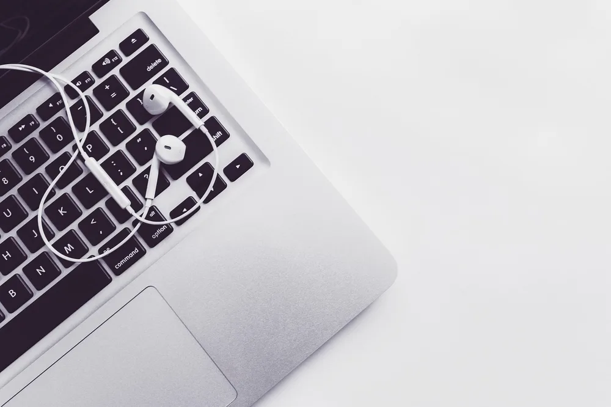<figcaption>Photo by <a href="https://pixabay.com/users/rupixen-11154019/" rel="nofollow noopener" target="_blank">rupixen</a> on <a href="https://pixabay.com/photos/desk-laptop-computer-macbook-4337478/" rel="nofollow noopener" target="_blank">Pixabay</a></figcaption></figure>

Earbuds are small enough to disappear under papers, and the charging case can easily slide off the desk. Keep a small dish or a tiny tray on the desk just for them. The moment you take them out of your ears, they go back in that one familiar place.

Put the dish near your charging spot so that the case gets topped up without any extra thought. The same dish can hold your watch or a small flash drive, as long as it stays small. Keeping it tiny stops it from turning into another pile on the desk.

<h2>6. Store a Tablet and Stylus Upright</h2>

<figure class="pin-figure">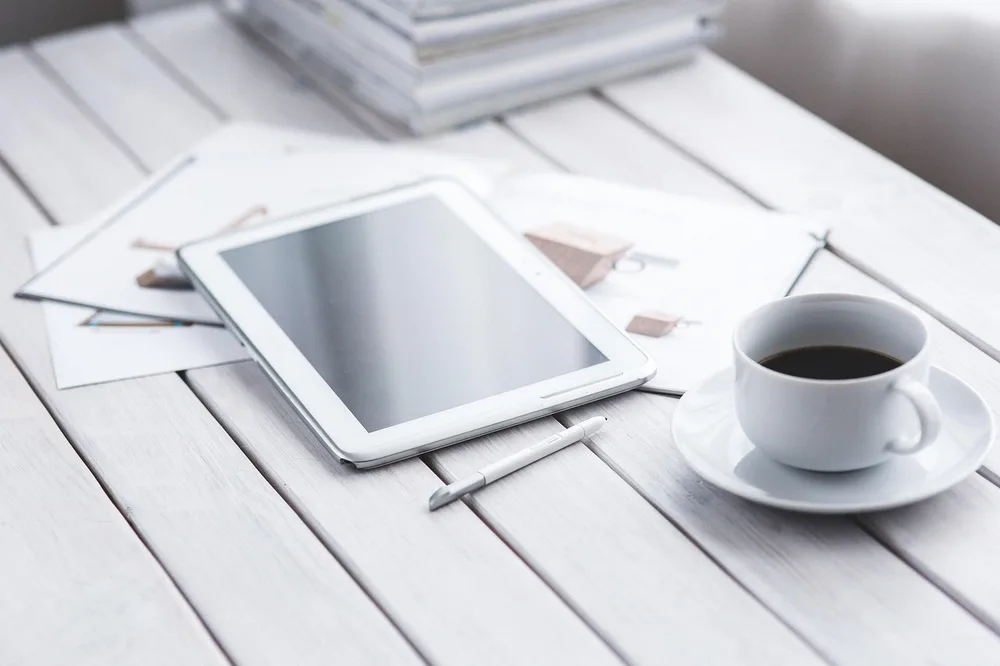<figcaption>Photo by <a href="https://pixabay.com/users/kaboompics-1013994/" rel="nofollow noopener" target="_blank">kaboompics</a> on <a href="https://pixabay.com/photos/tablet-digital-technology-coffee-791051/" rel="nofollow noopener" target="_blank">Pixabay</a></figcaption></figure>

A tablet lying flat takes up about the same surface as a large notebook, even when you are not using it. A small upright stand or a slot in a desktop organizer keeps it in view and off the surface, and it can also work as a second screen while you are at work.

Stylus pens are easy to lose, so give yours a fixed place, such as a magnetic edge on the tablet or a separate spot in your pen cup. Keep the tablet&#39;s charger close to its stand, so that it is always ready when you want to use it.

<h2>7. Find a Home for External Drives</h2>

<figure class="pin-figure">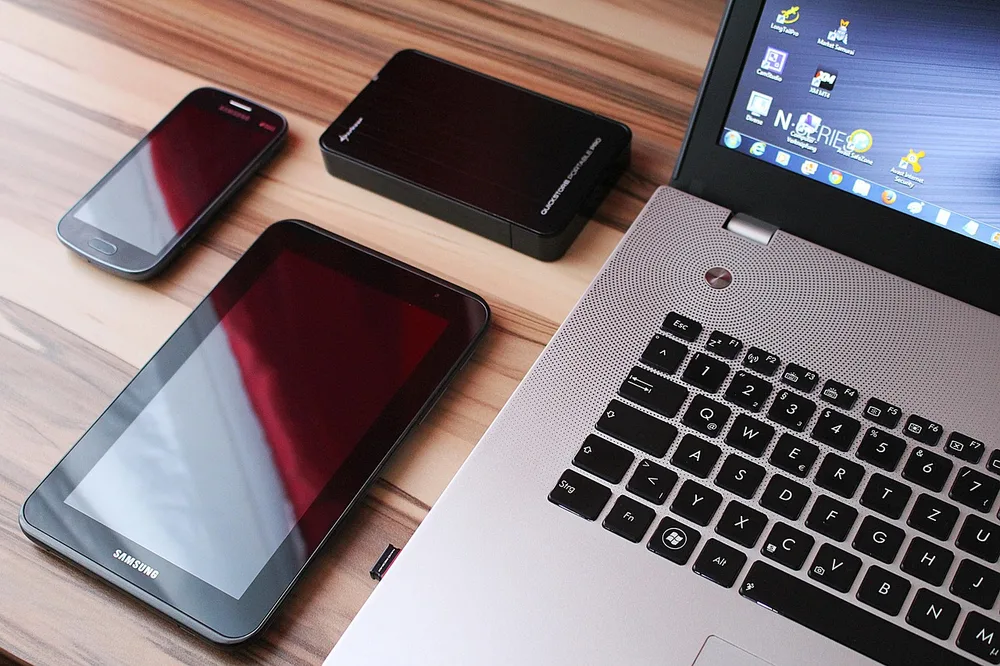<figcaption>Photo by <a href="https://pixabay.com/users/PIX1861-468748/" rel="nofollow noopener" target="_blank">PIX1861</a> on <a href="https://pixabay.com/photos/tablet-smartphone-laptop-hard-drive-626090/" rel="nofollow noopener" target="_blank">Pixabay</a></figcaption></figure>

External drives are often left dangling from their cables or balanced on top of something else, which is risky for the data they hold. Give each one a stable spot on a shelf or in a small tray, where it cannot get knocked off the desk by accident.

If you only use a drive for backups, keep it in a drawer along with its cable and connect it once a week on a regular schedule. Label each drive with what it stores. This takes a few seconds and saves time when you are trying to find an old file.

<h2>8. Mount the Webcam and Keep It Off the Desk</h2>

<figure class="pin-figure">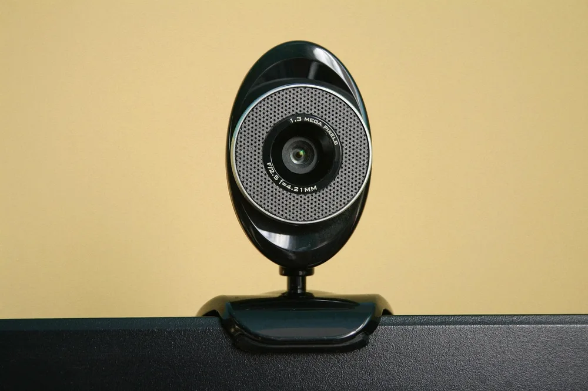<figcaption>Photo by <a href="https://pixabay.com/users/Aksa2011-2081324/" rel="nofollow noopener" target="_blank">Aksa2011</a> on <a href="https://pixabay.com/photos/camera-webcam-computer-internet-1219748/" rel="nofollow noopener" target="_blank">Pixabay</a></figcaption></figure>

A separate webcam only needs a spot on top of your monitor, yet many of them end up sitting on the desk with a loose cable. Clip it to the top of the screen and run the cable behind the monitor stand, where it will be out of the way.

If you only use the webcam sometimes, unplug it and keep it in a small labeled pouch with its cable. A privacy cover is also worth adding, and it takes up no space at all. With fewer things in your line of sight, the whole setup looks calmer.

<h2>9. Route Keyboard and Mouse Cables Out of Sight</h2>

<figure class="pin-figure">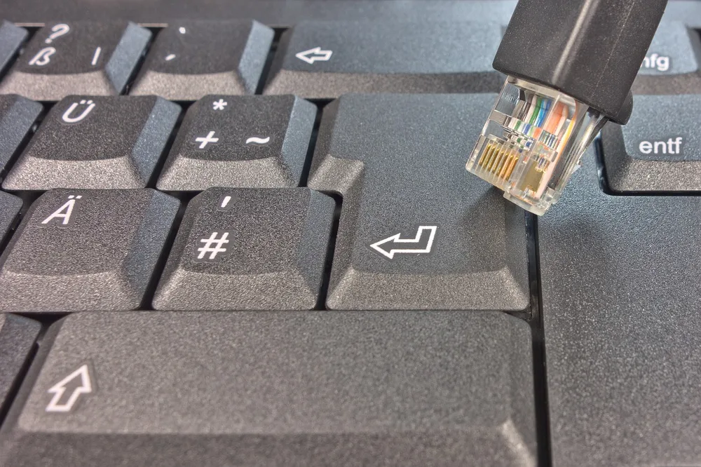<figcaption>Photo by <a href="https://pixabay.com/users/blickpixel-52945/" rel="nofollow noopener" target="_blank">blickpixel</a> on <a href="https://pixabay.com/photos/patch-cord-network-keyboard-lan-453763/" rel="nofollow noopener" target="_blank">Pixabay</a></figcaption></figure>

Wired keyboards and mice are reliable, but their cables often drape across the desk and get caught on things. Run them to the back of the desk and hold them in place with small adhesive clips, leaving only enough slack for you to move the keyboard a little.

If you want a cleaner look, wireless versions remove these cables altogether, though they do need charging or new batteries from time to time. Either option works well, as long as the cables are not crossing the area where you write. Once they are gone, the desk looks much tidier.

<h2>10. Pack Adapters in a Small Pouch</h2>

<figure class="pin-figure">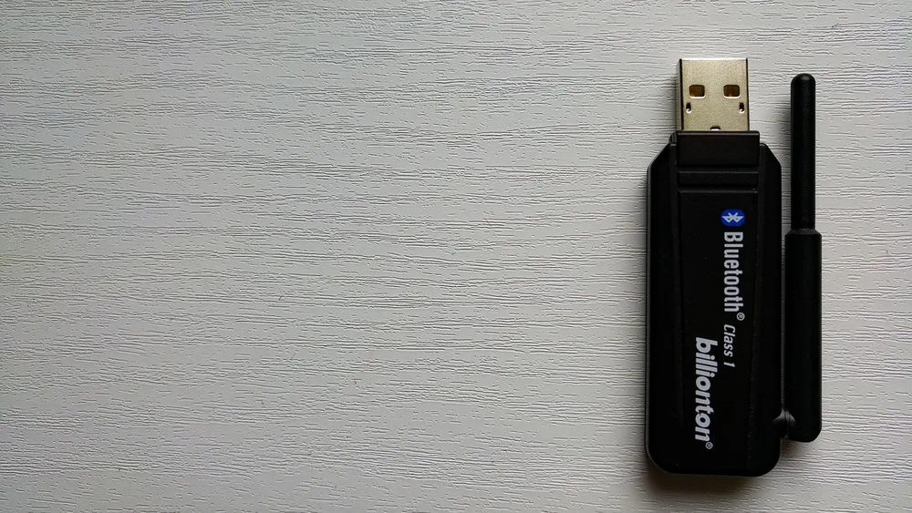<figcaption>Photo by <a href="https://pixabay.com/users/EsaRiutta-1582392/" rel="nofollow noopener" target="_blank">EsaRiutta</a> on <a href="https://pixabay.com/photos/bluetooth-wireless-dongle-usb-1726772/" rel="nofollow noopener" target="_blank">Pixabay</a></figcaption></figure>

Adapters and dongles are small, easy to lose and always needed at the worst possible moment. Keep them together in one small zip pouch in a drawer or your work bag, along with a short spare cable. When you need one, you will know exactly where to look.

Look through the pouch once in a while and remove anything that no longer fits your current devices. A clear or mesh pouch lets you see what is inside without having to open it. It also makes packing for a trip or a meeting much quicker and much less stressful.

<h2>Final Thoughts</h2>

Good desk accessories organization comes down to giving each device one home and hiding the cables that connect them. Start with a hub and a single charging spot, since those clear the most clutter, then add hooks, dishes and pouches for the rest. Small changes add up to a much calmer desk.

