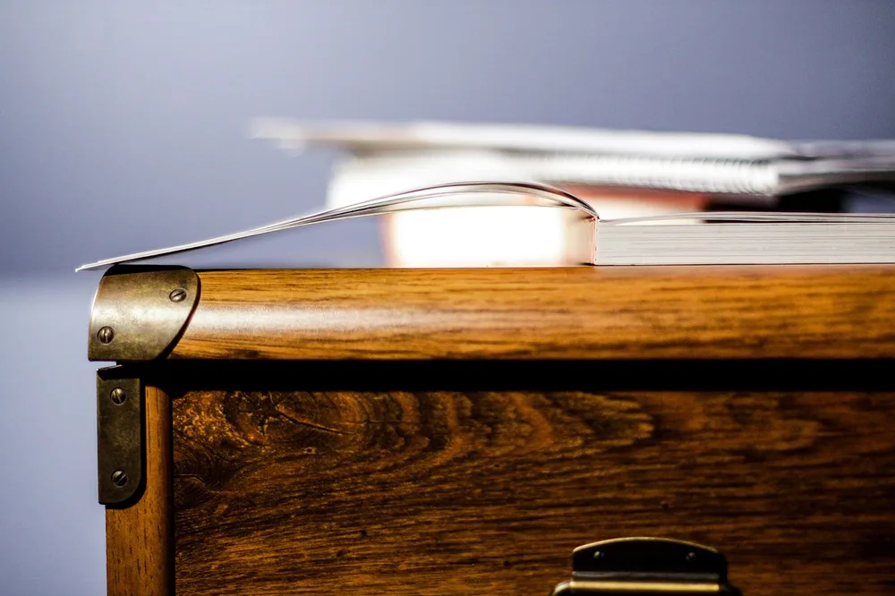
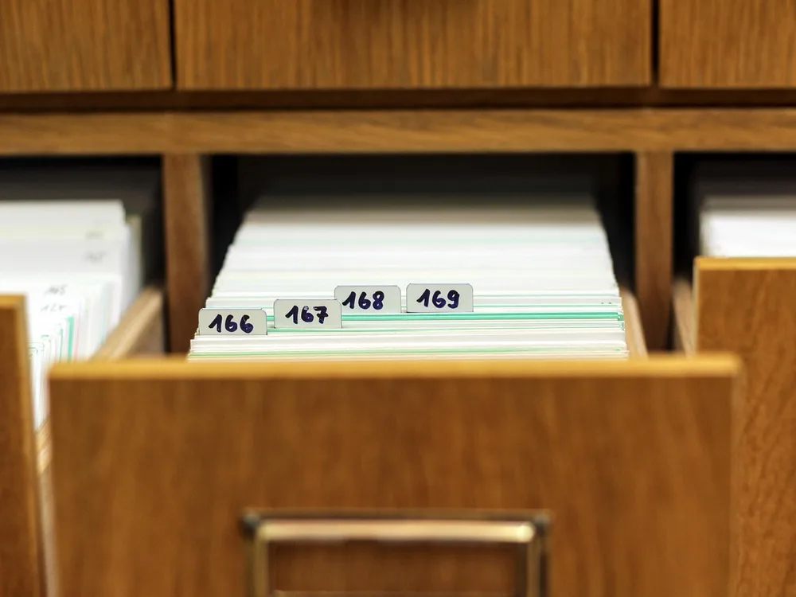
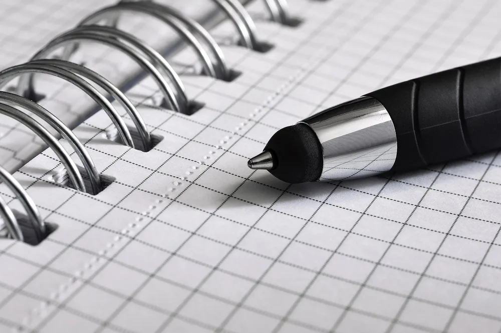
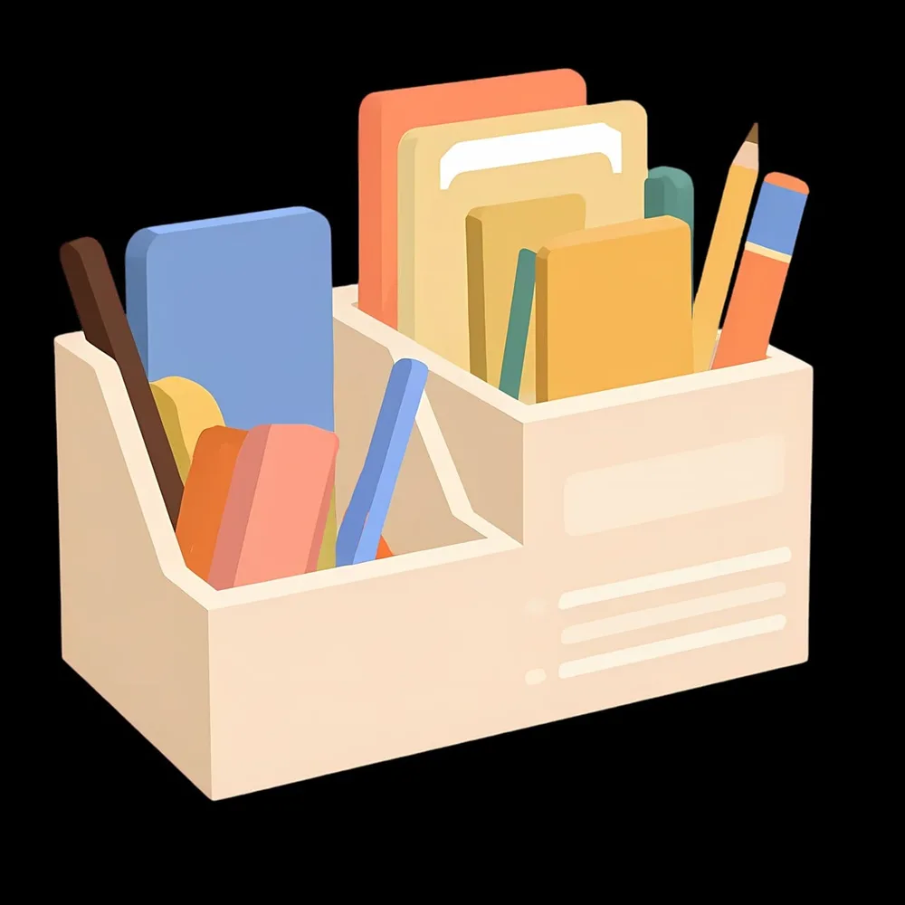
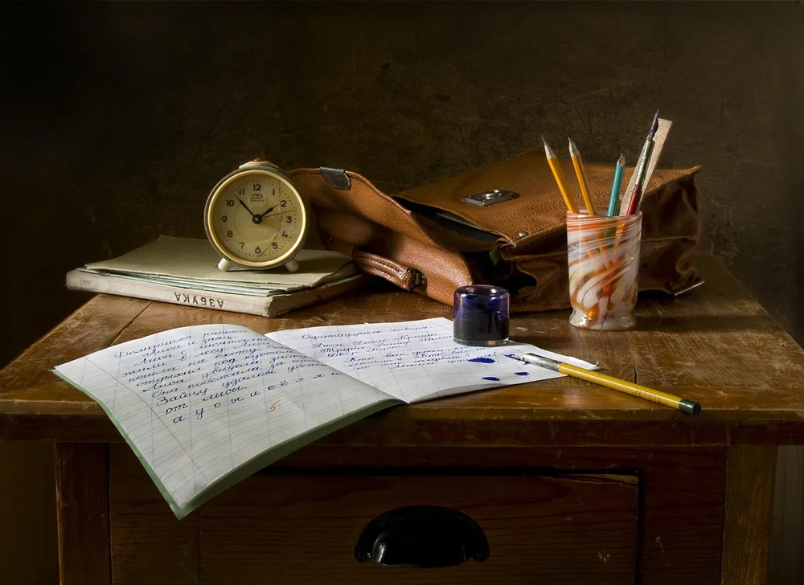
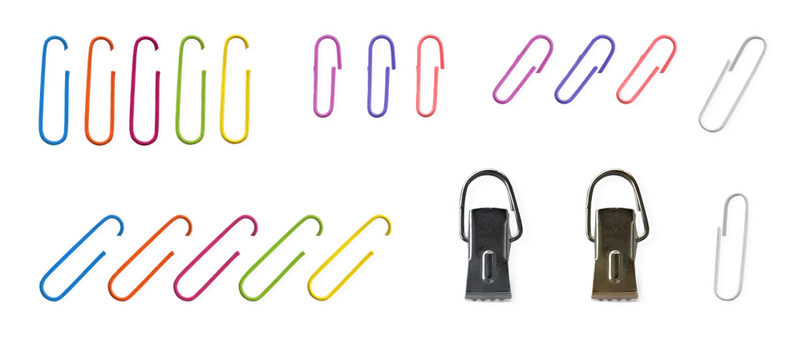
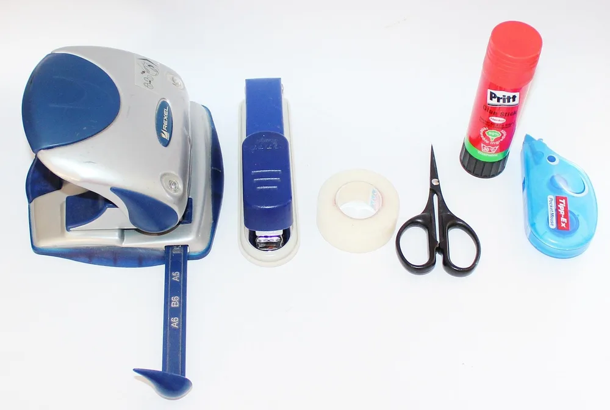
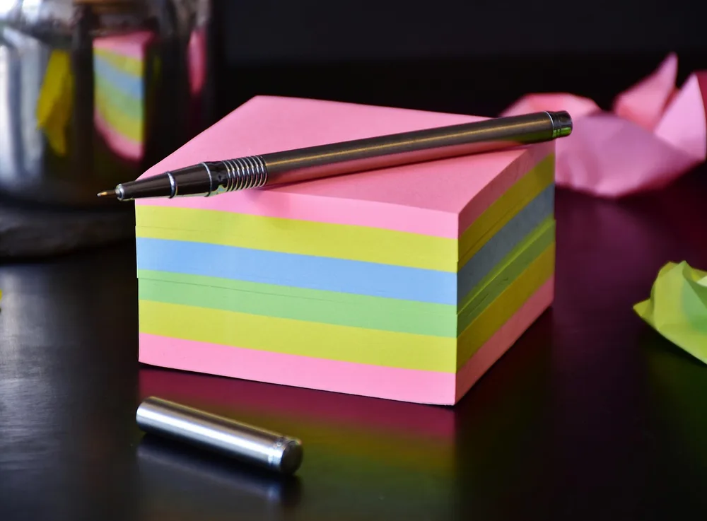
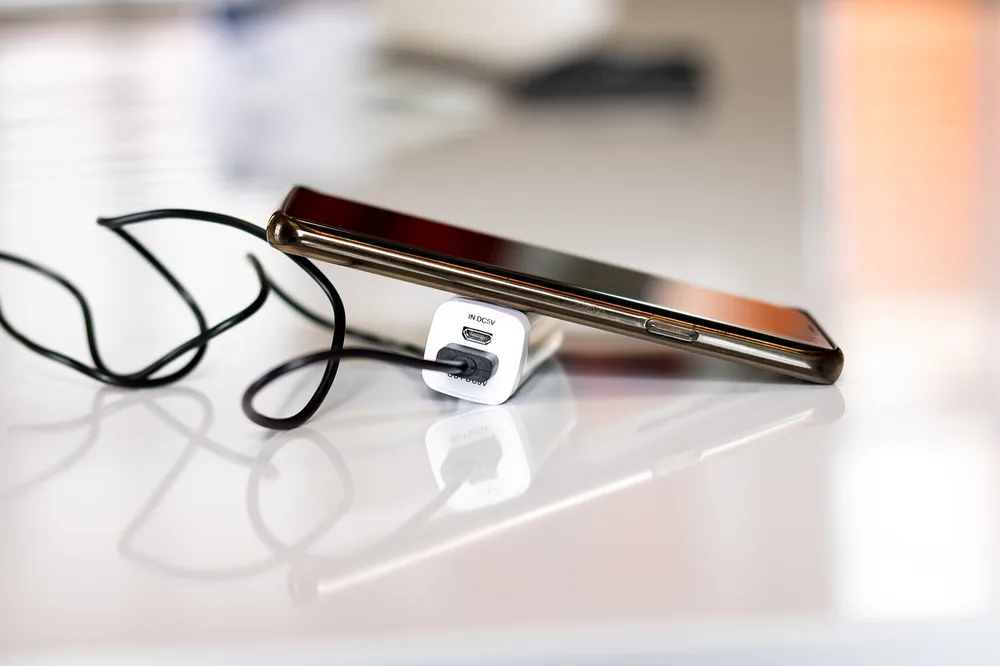
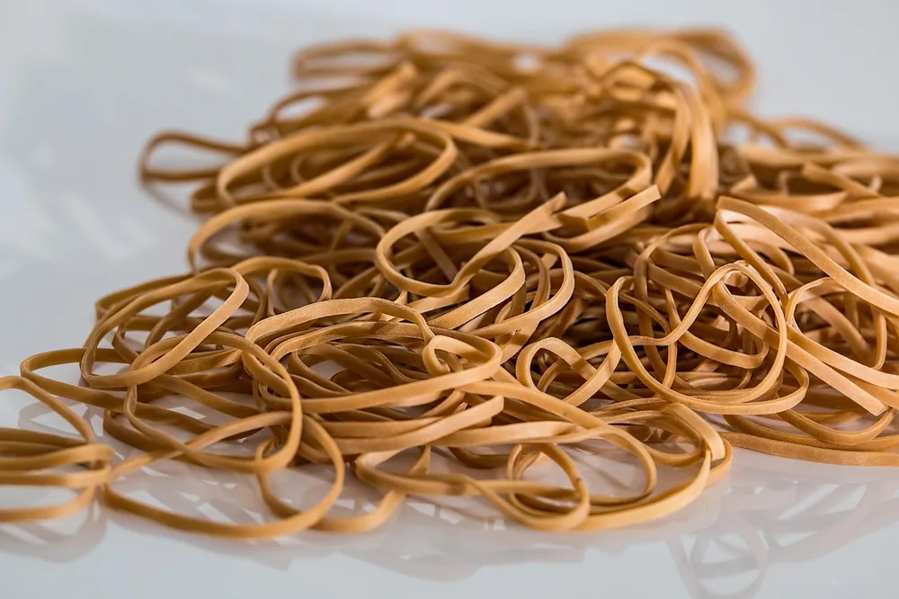

<figure class="pin-figure"><figcaption>Photo by <a href="https://pixabay.com/users/tookapic-1386459/" rel="nofollow noopener" target="_blank">tookapic</a> on <a href="https://pixabay.com/photos/desk-cabinet-furniture-surface-932474/" rel="nofollow noopener" target="_blank">Pixabay</a></figcaption></figure>

A desk drawer is usually the first place clutter goes to hide. Pens, chargers, loose clips and old receipts all land there because it only takes a second, and a few weeks later you are digging through a pile just to find a pair of scissors.

These desk drawer organization ideas work with the drawers you already have, whether that means one shallow tray or a full stack beside your legs. The goal is simple: every item gets a home you can remember, so opening the drawer takes a moment instead of a search.

<h2>1. Empty the Whole Drawer Before You Buy Anything</h2>

<figure class="pin-figure"><figcaption>Photo by <a href="https://pixabay.com/users/danieltibi-39444874/" rel="nofollow noopener" target="_blank">danieltibi</a> on <a href="https://pixabay.com/photos/note-box-index-box-index-8907986/" rel="nofollow noopener" target="_blank">Pixabay</a></figcaption></figure>

Organizers cannot fix a drawer full of things you never use, so start by taking everything out. Put it all on the desk and wipe the inside of the drawer while it is empty. Seeing the full pile usually makes the real problem obvious within a minute or two.

Sort the pile into three groups: use weekly, use rarely and throw away. Dried pens, mystery cables and expired coupons can go right now. Only after this step should you measure the drawer and decide what kind of divider or tray you actually need for what is left.

<h2>2. Sort Supplies by How Often You Reach for Them</h2>

<figure class="pin-figure"><figcaption>Photo by <a href="https://pixabay.com/users/fotoblend-87167/" rel="nofollow noopener" target="_blank">fotoblend</a> on <a href="https://pixabay.com/photos/notebook-pen-paper-office-3006462/" rel="nofollow noopener" target="_blank">Pixabay</a></figcaption></figure>

The best spot in any drawer is the front, because you can reach it without pulling the drawer all the way out. Give that space to what you use every day, such as a favorite pen, sticky notes and a small notepad, and leave everything else further back.

Items you need once a month belong at the back, and anything you use only a few times a year can move to a box on a shelf. Arranging by frequency instead of category means your most common reach is always the shortest one, which saves more time than perfect labels do.

<h2>3. Add Dividers So Items Stop Sliding Around</h2>

<figure class="pin-figure"><figcaption>Photo by <a href="https://pixabay.com/users/u_4mx5rfd1yn-57572066/" rel="nofollow noopener" target="_blank">u_4mx5rfd1yn</a> on <a href="https://pixabay.com/photos/stationery-box-dividers-pencils-10544542/" rel="nofollow noopener" target="_blank">Pixabay</a></figcaption></figure>

Every time you open and close a drawer, loose items slide and mix together, which is why tidy drawers rarely stay tidy. Dividers solve that by giving each group its own walls. Adjustable ones are the easiest choice because they can fit almost any drawer width without cutting.

If you would rather not buy anything yet, small cardboard boxes do the same job for free. Cut them to the height of the drawer, test the layout for a week and change whatever feels awkward. Once the layout works, you will know exactly what size of tray is worth buying.

<h2>4. Keep Pens and Pencils to a Short List</h2>

<figure class="pin-figure"><figcaption>Photo by <a href="https://pixabay.com/users/mozlase__-1218014/" rel="nofollow noopener" target="_blank">mozlase__</a> on <a href="https://pixabay.com/photos/school-work-write-still-life-851328/" rel="nofollow noopener" target="_blank">Pixabay</a></figcaption></figure>

Most drawers hold far more pens than anyone could use, and half of them no longer write. Test each one on scrap paper and throw out the failures. Then keep only three or four pens and a couple of pencils in the drawer, and store any spares in a box elsewhere.

Lay them in a narrow tray running from front to back, so you can see every tip and grab one without looking. A short list also makes it easy to notice when something is missing. When the tray is full, you know it is time to stop bringing more pens home.

<h2>5. Contain the Tiny Things in Small Cups</h2>

<figure class="pin-figure"><figcaption>Photo by <a href="https://pixabay.com/users/ha11ok-1785462/" rel="nofollow noopener" target="_blank">ha11ok</a> on <a href="https://pixabay.com/photos/clips-office-fixing-note-1235868/" rel="nofollow noopener" target="_blank">Pixabay</a></figcaption></figure>

Paper clips, binder clips, pushpins and spare keys cause most of the mess in a drawer because they scatter so easily. Give each type its own small container. Shallow tins, old mint boxes and silicone baking cups all work well, and they keep tiny items from collecting in the corners.

Keep these containers low enough that you can see inside when the drawer is only half open. A small piece of removable putty under each cup stops it from sliding when you close the drawer. Pick one container for each type and resist the urge to mix them together.

<h2>6. Give Scissors and Tape a Fixed Place</h2>

<figure class="pin-figure"><figcaption>Photo by <a href="https://pixabay.com/users/Counselling-440107/" rel="nofollow noopener" target="_blank">Counselling</a> on <a href="https://pixabay.com/photos/office-office-accessories-574012/" rel="nofollow noopener" target="_blank">Pixabay</a></figcaption></figure>

Scissors, tape and a stapler are the tools people borrow, move and then lose. Because they are bulky and oddly shaped, they also take up more space than you would expect. Set aside one long compartment for them, along the side of the drawer, where they will not block anything else.

Lay the scissors flat with the blades pointing toward the back so you never reach in and catch a sharp edge. If other people in your home borrow them, a simple label inside the drawer helps them come back. A fixed spot makes it obvious right away when something has wandered off.

<h2>7. Store Sticky Notes Where You Write</h2>

<figure class="pin-figure"><figcaption>Photo by <a href="https://pixabay.com/users/RitaE-19628/" rel="nofollow noopener" target="_blank">RitaE</a> on <a href="https://pixabay.com/photos/paper-block-write-note-pen-3406864/" rel="nofollow noopener" target="_blank">Pixabay</a></figcaption></figure>

Sticky notes get used most when they are within reach of your writing hand. Keep one open pad at the front of the drawer on that side and move the rest of the stack to the back. Having a single active pad stops half-used pads from piling up everywhere.

A small stack of index cards can sit right beside the pad if you like to jot down longer notes or to-do items. Both stay flat and clean inside a shallow tray, and they are much easier to find than notes buried under other supplies or stuck to the bottom of the drawer.

<h2>8. File Notebooks on Their Edge in Deep Drawers</h2>

<figure class="pin-figure"><figcaption>Photo by <a href="https://pixabay.com/users/Pexels-2286921/" rel="nofollow noopener" target="_blank">Pexels</a> on <a href="https://pixabay.com/photos/coffee-computer-cup-desk-drink-1869820/" rel="nofollow noopener" target="_blank">Pixabay</a></figcaption></figure>

Notebooks stacked flat in a deep drawer turn into a pile where only the top one ever gets used. Stand them on their edge instead, spines facing up, the way you would file folders. You can read every label at a glance and pull one out without lifting the others.

A small bookend or a sturdy box keeps the row from flopping over as you remove notebooks. Put the one you are using now at the front and retire finished ones to a shelf. This simple change often frees up enough room in a deep drawer for a whole extra category.

<h2>9. Make One Section Just for Chargers</h2>

<figure class="pin-figure"><figcaption>Photo by <a href="https://pixabay.com/users/C10Maj-14964495/" rel="nofollow noopener" target="_blank">C10Maj</a> on <a href="https://pixabay.com/photos/charging-phone-power-bank-charger-4874592/" rel="nofollow noopener" target="_blank">Pixabay</a></figcaption></figure>

Cables tangle faster than anything else in a drawer, and a charger you cannot find is about as useful as no charger at all. Set aside one section for them, coil each cable loosely and fasten it with a reusable strap, so you can lift out one without pulling up the others.

Label each cable near the plug with a small tag if you own several that look alike. Keep only the ones that match devices you still use, and donate or recycle the rest. One tidy section for power means you stop buying duplicates just because the first one went missing.

<h2>10. Reset the Drawer Once a Month</h2>

<figure class="pin-figure"><figcaption>Photo by <a href="https://pixabay.com/users/stevepb-282134/" rel="nofollow noopener" target="_blank">stevepb</a> on <a href="https://pixabay.com/photos/rubber-bands-elastic-bands-503028/" rel="nofollow noopener" target="_blank">Pixabay</a></figcaption></figure>

Even a well organized drawer slowly fills up with things that do not belong there. Put a short reset on your calendar once a month and take five minutes to return strays, throw away scraps and restock whatever has run out. It is much faster than a full clear-out later.

If you keep having to move the same item back to its place, the layout may be wrong rather than your habits. Move that item to wherever you naturally put it down. A drawer that follows the way you already work is the only kind that stays organized over time.

<h2>Final Thoughts</h2>

A useful drawer does not need expensive organizers, only fewer things and a clear place for each one. Start by emptying a single drawer, keep what you use, add simple dividers and give it a quick monthly reset. Once one drawer works, the same approach makes every other drawer easier to handle.

