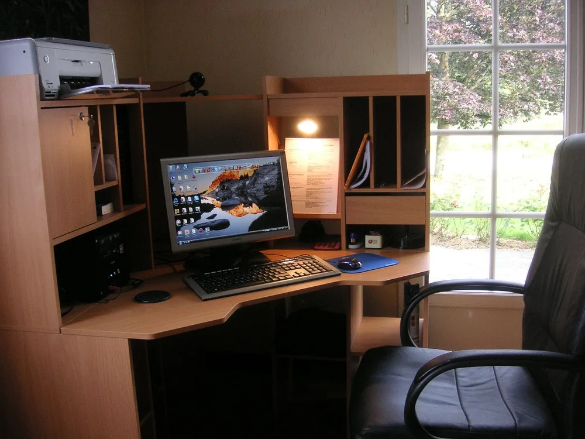
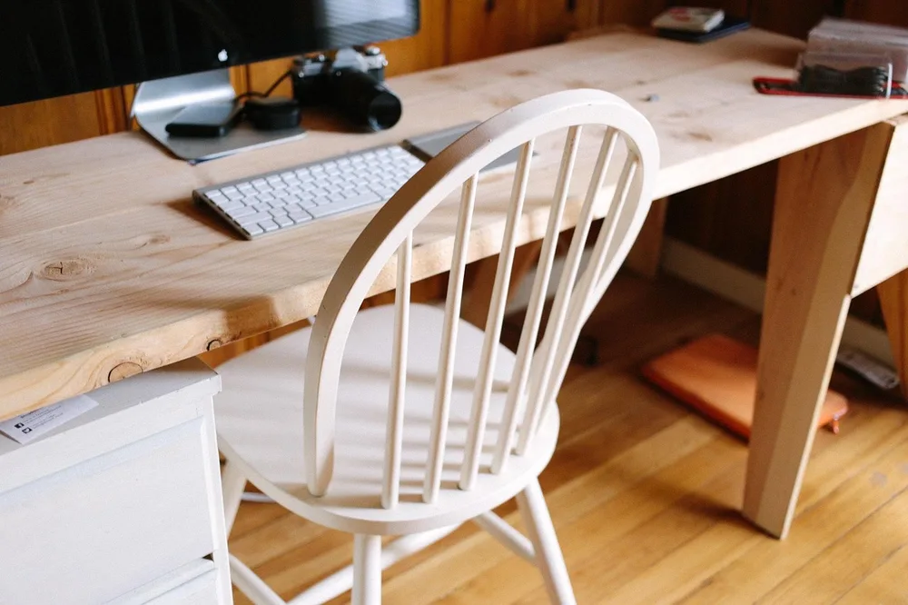
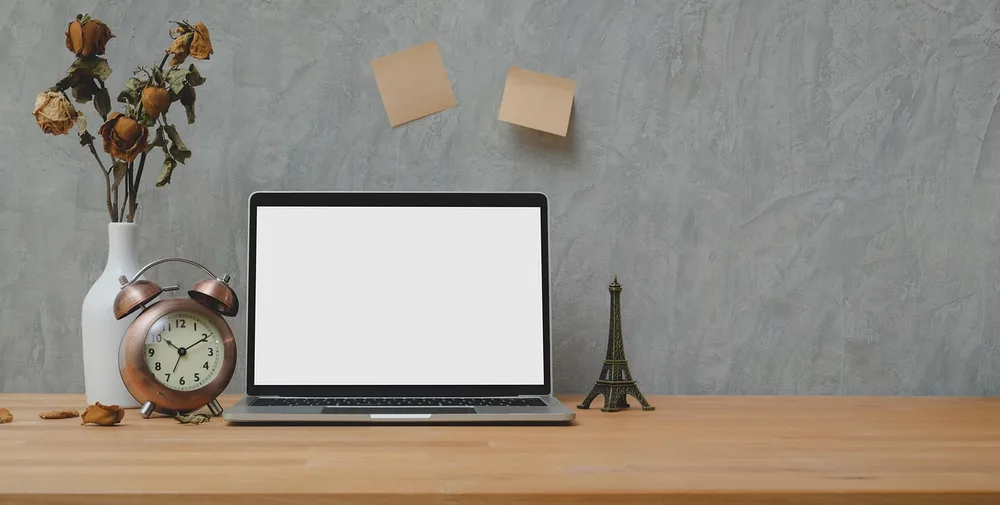
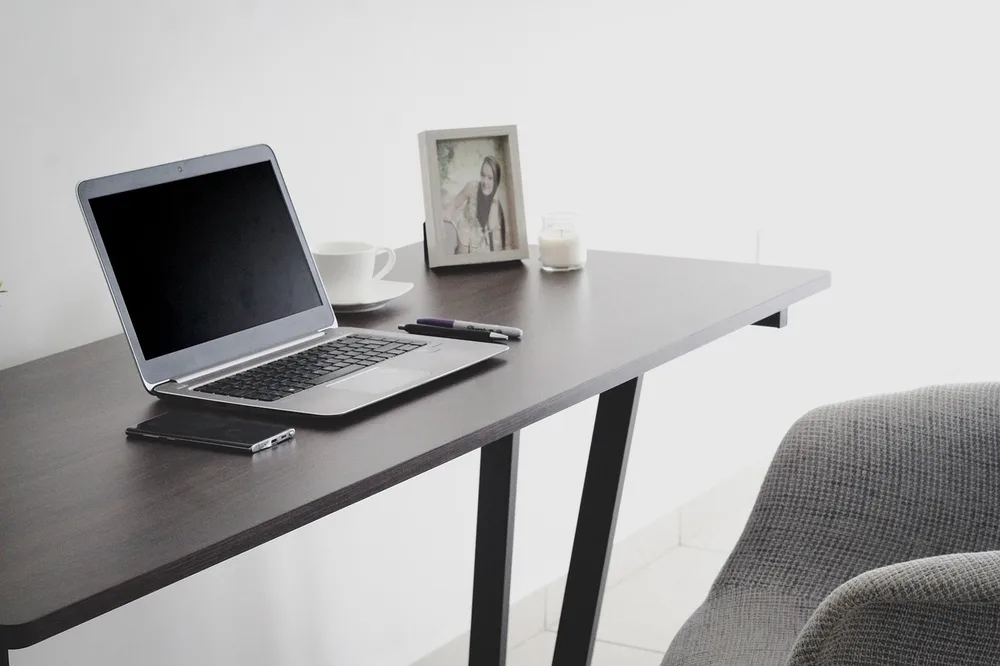
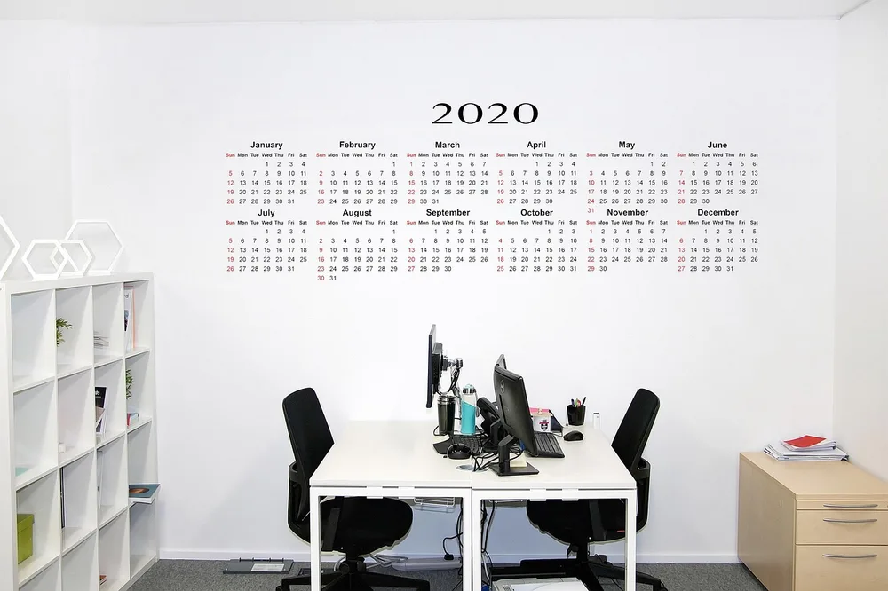
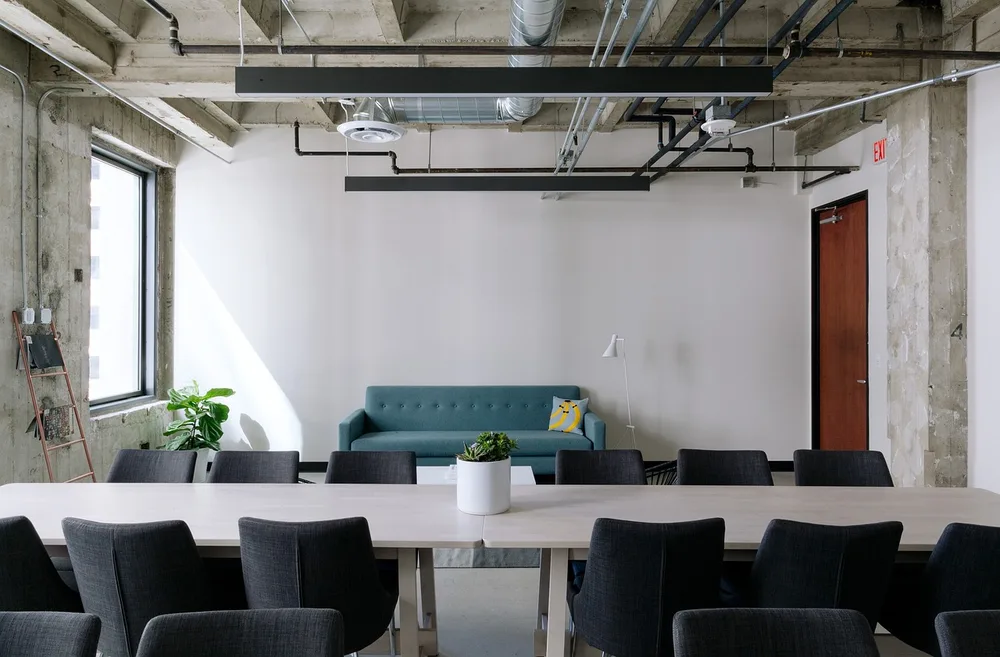
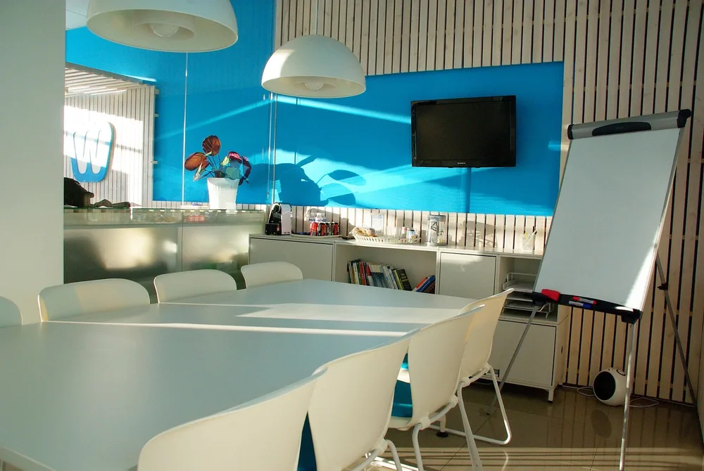
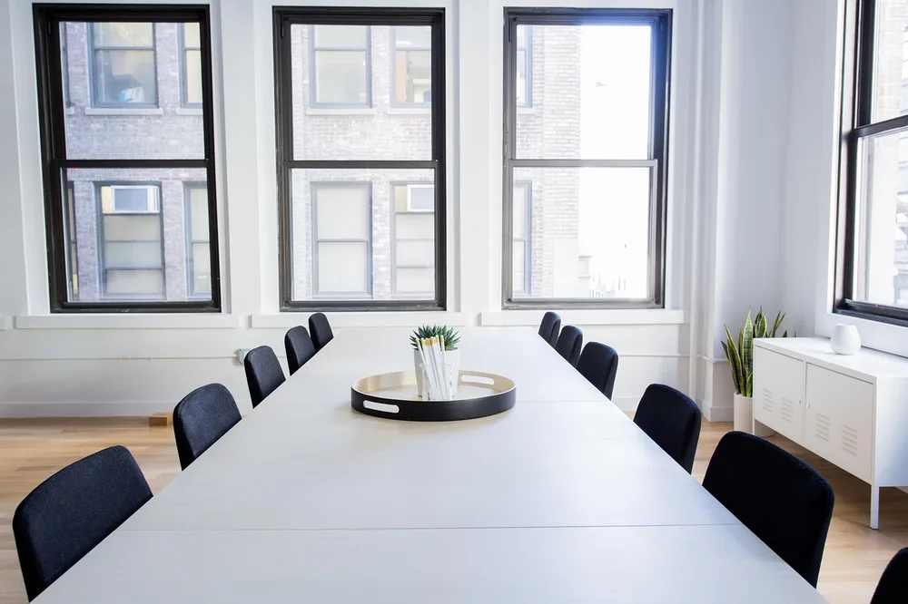

<figure class="pin-figure"><figcaption>Photo by <a href="https://pixabay.com/users/inkflo-9230/" rel="nofollow noopener" target="_blank">inkflo</a> on <a href="https://pixabay.com/photos/work-space-home-office-office-space-232985/" rel="nofollow noopener" target="_blank">Pixabay</a></figcaption></figure>

The position of your desk affects your workday more than almost any piece of furniture you could buy. It decides how much daylight you get, what you look at for eight hours and whether the room feels open or cramped. Yet most desks simply get pushed against the nearest wall.

Before you buy anything new, it is worth trying a few different layouts in the room you already have. These home office layout ideas look at windows, walls, chair space and storage zones, and they work in a spare room as well as in a shared corner of the house.

<h2>1. Measure the Room Before You Move Anything</h2>

<figure class="pin-figure"><figcaption>Photo by <a href="https://pixabay.com/users/lukasbieri-4664461/" rel="nofollow noopener" target="_blank">lukasbieri</a> on <a href="https://pixabay.com/photos/blogger-screenwriter-desperate-2838945/" rel="nofollow noopener" target="_blank">Pixabay</a></figcaption></figure>

Heavy furniture is tiring to move more than once, so begin with a simple sketch. Measure the walls and mark the windows, doors, radiators and power outlets. Note which way the door swings. These fixed points will rule out some layouts straight away and save you from a lot of pointless lifting.

Cut out paper shapes of your desk and shelves at the same scale and move them around on the sketch. Painter&#39;s tape on the floor can also show you the real size of each piece. Spending ten minutes on this usually reveals a layout that you had not thought of.

<h2>2. Put the Desk Beside a Window</h2>

<figure class="pin-figure"><figcaption>Photo by <a href="https://pixabay.com/users/Sohidullah007-57409005/" rel="nofollow noopener" target="_blank">Sohidullah007</a> on <a href="https://pixabay.com/photos/office-worker-office-employee-10562967/" rel="nofollow noopener" target="_blank">Pixabay</a></figcaption></figure>

Placing the desk so that the window is to your side is often the best option for most rooms. You get plenty of daylight on the work surface, a view when you need to rest your eyes and much less glare on your screen than you would have with the window behind it.

If you are right-handed, place the window on your left when possible, so your hand does not cast a shadow over your notes. A light curtain or blind can help during the brightest hours. Keep the desk close enough to the window to enjoy the light, but clear of any heaters.

<h2>3. Float the Desk and Face the Room</h2>

<figure class="pin-figure"><figcaption>Photo by <a href="https://pixabay.com/users/StockSnap-894430/" rel="nofollow noopener" target="_blank">StockSnap</a> on <a href="https://pixabay.com/photos/wood-chair-desk-office-business-926606/" rel="nofollow noopener" target="_blank">Pixabay</a></figcaption></figure>

In a larger room, pulling the desk away from the wall can change the whole feel of the space. Facing into the room with a wall behind you gives you a more open view, so the room feels less like a corridor, and you can see the door at the same time.

A floating desk does need more care with cables, since there is no wall to hide them against. Use a floor cord cover, or run the power along one of the desk legs. Choose a desk that looks tidy from all sides, because you and any visitors will now see the back.

<h2>4. Use the Longest Wall in a Narrow Room</h2>

<figure class="pin-figure"><figcaption>Photo by <a href="https://pixabay.com/users/bongkarngraphic-16126984/" rel="nofollow noopener" target="_blank">bongkarngraphic</a> on <a href="https://pixabay.com/photos/brick-business-creative-decoration-5066285/" rel="nofollow noopener" target="_blank">Pixabay</a></figcaption></figure>

Narrow rooms tend to work best when you line up the furniture along one long wall and leave the other side free to walk through. A long desk or a shelf running along the same wall looks like a single unit, and this makes the room seem calmer and more planned.

Avoid putting furniture on both sides of a narrow room if you can, since this creates a tunnel. Hang a mirror or a light picture on the opposite wall to make the space seem larger. Keep at least enough room to walk past while the chair is pulled out.

<h2>5. Leave Enough Space for the Chair</h2>

<figure class="pin-figure"><figcaption>Photo by <a href="https://pixabay.com/users/ricardorv30-2418232/" rel="nofollow noopener" target="_blank">ricardorv30</a> on <a href="https://pixabay.com/photos/workplace-workspace-home-office-5517762/" rel="nofollow noopener" target="_blank">Pixabay</a></figcaption></figure>

The most common layout mistake is forgetting how much room a chair needs when it is in use. Aim for about three feet between the edge of the desk and the nearest wall or piece of furniture. That gives you enough space to push back and stand without any awkward shuffling.

If you are short on room, a chair without arms slides further under the desk and takes up less space when it is not in use. Check that any drawers or cabinet doors can still open fully with the chair in place. A rug should be big enough for all four chair positions.

<h2>6. Keep Storage Behind or Beside You</h2>

<figure class="pin-figure"><figcaption>Photo by <a href="https://pixabay.com/users/ALEXNEWWORLD-13981350/" rel="nofollow noopener" target="_blank">ALEXNEWWORLD</a> on <a href="https://pixabay.com/photos/office-wall-armchair-desk-calendar-4827467/" rel="nofollow noopener" target="_blank">Pixabay</a></figcaption></figure>

Storage that you use daily should be reachable from your chair with just a short turn. A bookcase beside the desk or a low cabinet directly behind you gives you easy access while keeping the area in front of you clear. It helps you stay focused on your screen and your work.

Place rarely used items on higher or more distant shelves. Try sitting in your chair and reaching for what you use most. If you have to stand up every time, the layout needs adjusting. A second zone across the room also gives you a good reason to get up occasionally.

<h2>7. Add a Soft Corner for Reading</h2>

<figure class="pin-figure"><figcaption>Photo by <a href="https://pixabay.com/users/StockSnap-894430/" rel="nofollow noopener" target="_blank">StockSnap</a> on <a href="https://pixabay.com/photos/white-room-office-table-chairs-2591371/" rel="nofollow noopener" target="_blank">Pixabay</a></figcaption></figure>

If there is room, a small chair or a sofa on the opposite side gives you a second place to think, read or take calls. Changing your position during the day is good for your body, and having a place away from the screen can make long reports easier to get through.

It does not need to be large. A single armchair, a small side table and a lamp can fit in the corner of most rooms. Place it where you cannot see your screen, so that it feels like a true break, and try to keep this corner free of cables.

<h2>8. Create a Second Work Surface</h2>

<figure class="pin-figure"><figcaption>Photo by <a href="https://pixabay.com/users/jdpereiro-2378671/" rel="nofollow noopener" target="_blank">jdpereiro</a> on <a href="https://pixabay.com/photos/office-space-office-sunny-coworking-1744805/" rel="nofollow noopener" target="_blank">Pixabay</a></figcaption></figure>

A second surface can make a home office much more useful, especially if you work with paper or do hands-on projects. Set up a table at a right angle to your desk to form an L shape. You can spin your chair between a computer area and a clear writing area.

An L shape also works well in corners, where it makes good use of space that would otherwise be empty. If you do not have space for it all the time, a folding table or a wall-mounted drop-leaf desk gives you the extra area for an hour and then disappears.

<h2>9. Plan Your Lighting With the Layout</h2>

<figure class="pin-figure"><figcaption>Photo by <a href="https://pixabay.com/users/51581-51581/" rel="nofollow noopener" target="_blank">51581</a> on <a href="https://pixabay.com/photos/work-workaholic-writer-programmer-1627703/" rel="nofollow noopener" target="_blank">Pixabay</a></figcaption></figure>

Layouts often fail because the light was an afterthought. Once you have chosen a position for the desk, stand there and look at where the shadows fall throughout the day. A ceiling light directly behind you will throw your shadow on the desk, so it may need help from a lamp.

Check the location of power outlets as well, since you will want to keep your lamps and computer close to them. Aim to mix a general room light with a task light right where you work. Moving a desk even a small distance can sometimes solve a screen reflection problem.

<h2>10. Test the Layout for a Full Week</h2>

<figure class="pin-figure"><figcaption>Photo by <a href="https://pixabay.com/users/Pexels-2286921/" rel="nofollow noopener" target="_blank">Pexels</a> on <a href="https://pixabay.com/photos/chairs-empty-office-room-table-2181916/" rel="nofollow noopener" target="_blank">Pixabay</a></figcaption></figure>

A layout that looks perfect on the first day can still have problems you only notice later, such as a glare at three in the afternoon or a draft by your feet. Work in the new setup for a full week before you buy new furniture or mount any shelves.

Keep notes on anything that annoys you, then make one change at a time. Small adjustments, like moving the desk by a foot or swapping the shelves around, often make a large difference. After a week you will know whether you have the layout that works for you and the room.

<h2>Final Thoughts</h2>

The right home office layout makes good use of daylight, gives you room to move and keeps your daily items close. Start by sketching the room and testing where the desk feels best, then plan your storage and lighting around that decision. Live with it for a week before you make any purchases.

