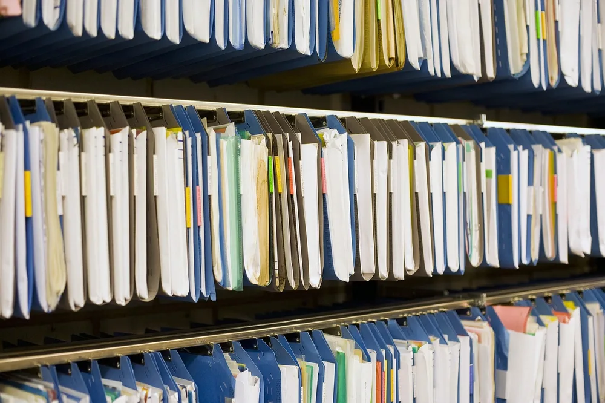
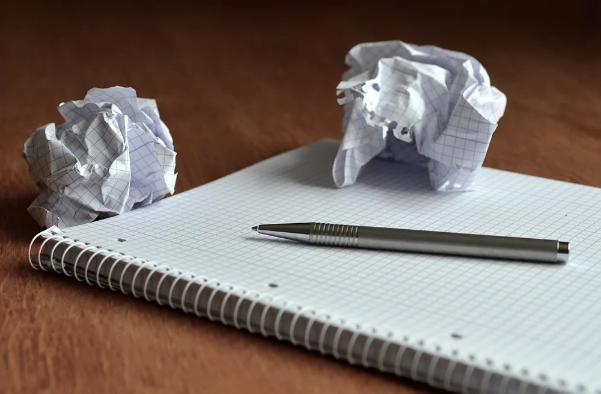
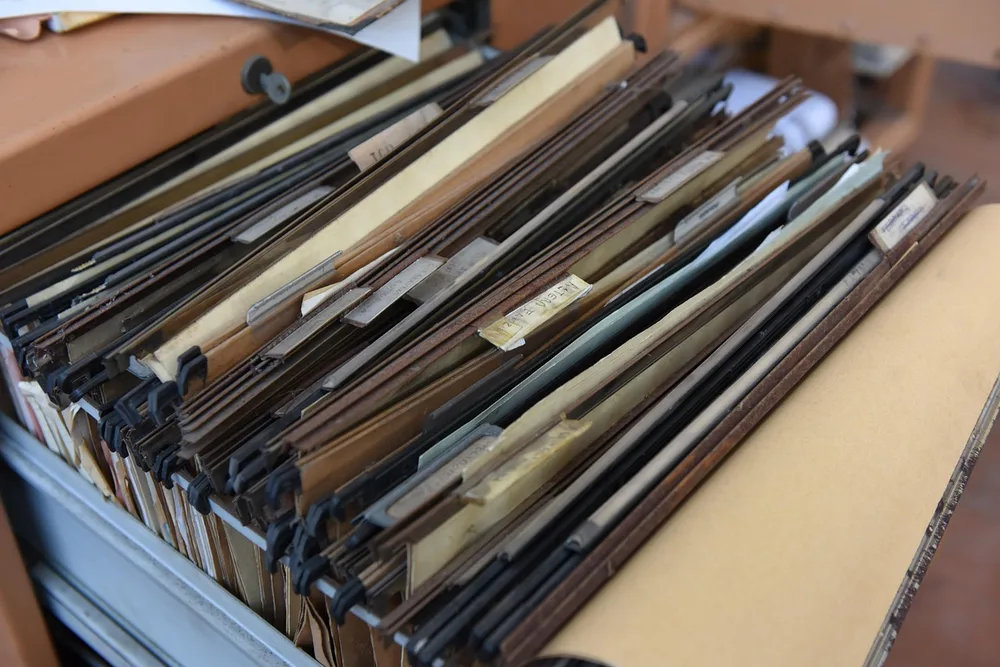
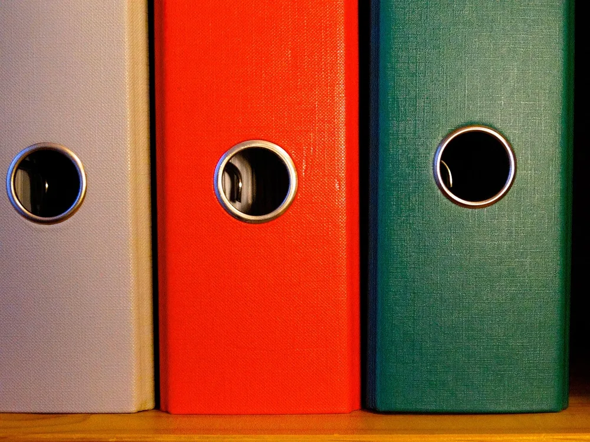
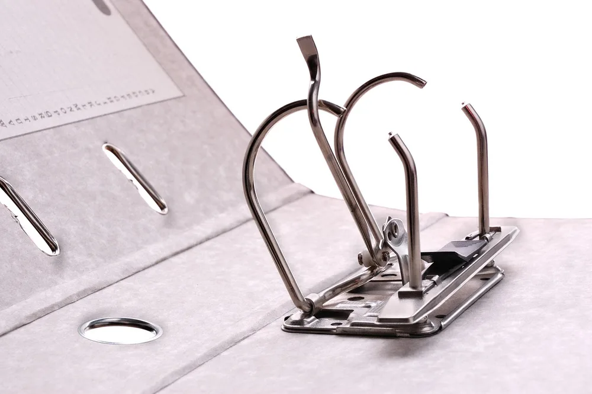
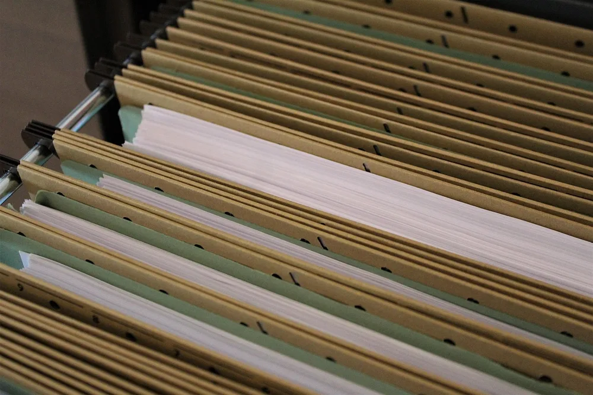
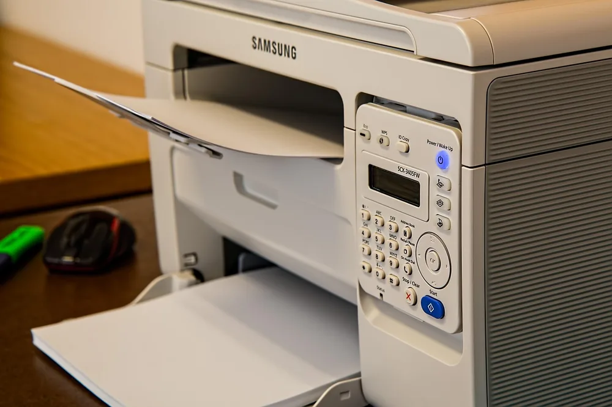
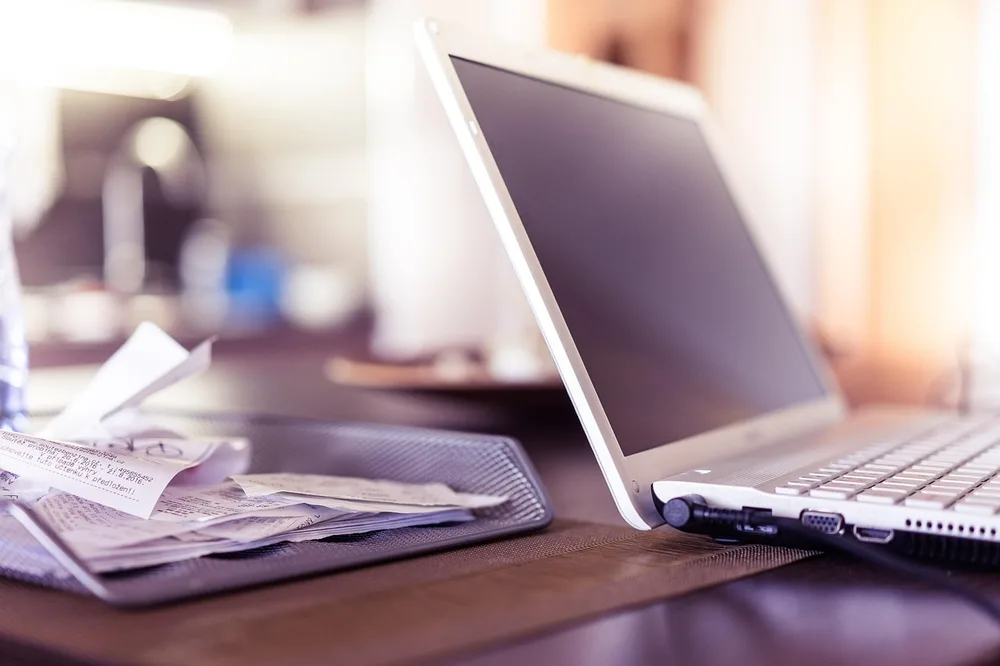
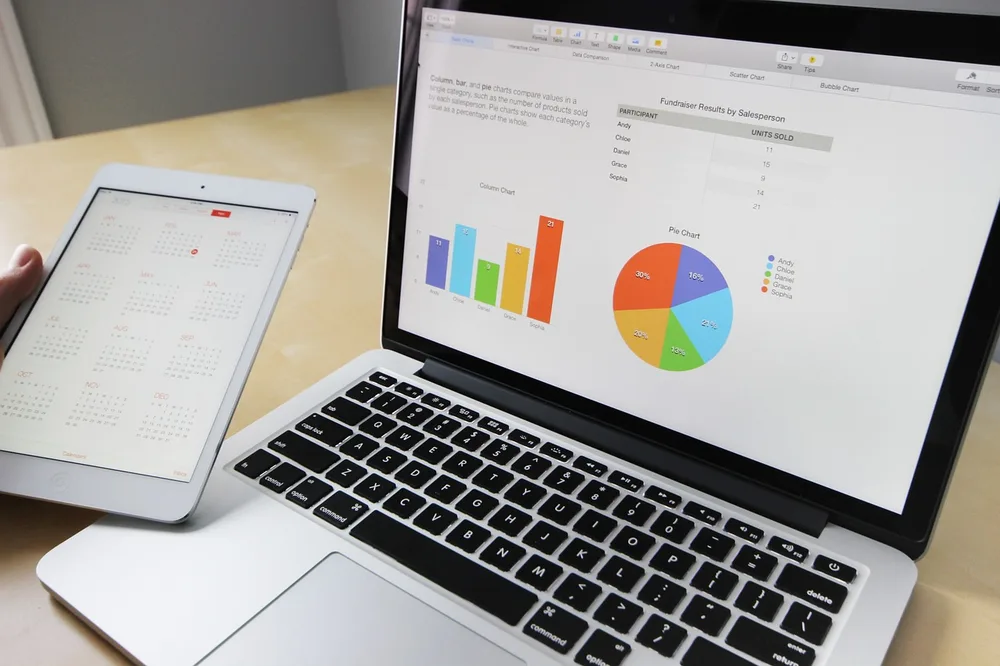
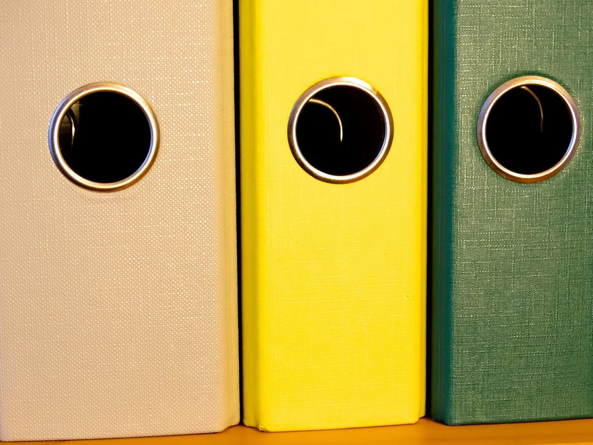

<figure class="pin-figure"><figcaption>Photo by <a href="https://pixabay.com/users/roma1880-2180741/" rel="nofollow noopener" target="_blank">roma1880</a> on <a href="https://pixabay.com/photos/archive-files-register-office-3859388/" rel="nofollow noopener" target="_blank">Pixabay</a></figcaption></figure>

Paper has a way of multiplying on a home office desk. A bill arrives, a form needs signing, a note gets printed for a meeting, and before long there is a stack you are slightly afraid to touch because something important might be buried inside it.

These home office paper organization ideas give every sheet a clear path: where it lands, where it waits and where it ends up. None of them requires a complicated system. Once you decide what happens to each type of paper, the piles stop forming on their own.

<h2>1. Sort the Pile Into Act, File and Recycle</h2>

<figure class="pin-figure"><figcaption>Photo by <a href="https://pixabay.com/users/congerdesign-509903/" rel="nofollow noopener" target="_blank">congerdesign</a> on <a href="https://pixabay.com/photos/notes-paper-ball-of-paper-memo-514998/" rel="nofollow noopener" target="_blank">Pixabay</a></figcaption></figure>

Start by gathering every loose paper in the room into one stack, then go through it once using three groups only: needs action, needs keeping and can go. Try not to read everything closely at this stage, because the goal is to sort quickly and not get lost in old details.

You will probably find that a large part of the stack belongs in the recycling bin. Shred anything with personal or account details before it leaves the house. Clearing the backlog first matters, since no filing system can hold up under a pile that was never sorted in the first place.

<h2>2. Give Incoming Paper a Single Landing Spot</h2>

<figure class="pin-figure"><figcaption>Photo by <a href="https://pixabay.com/users/geralt-9301/" rel="nofollow noopener" target="_blank">geralt</a> on <a href="https://pixabay.com/photos/office-desk-phone-smartphone-3962379/" rel="nofollow noopener" target="_blank">Pixabay</a></figcaption></figure>

Most paper clutter starts with mail and printouts being set down wherever you happen to be standing. Choose one spot for everything that comes in, such as a tray or a shallow box at the corner of the desk. Then make it a rule that new paper only ever goes there.

Having one landing spot means you always know where a letter went, and it keeps the rest of the desk clear. Empty it on a regular day each week. When the tray starts overflowing before that day comes, take it as a sign to process it a little sooner.

<h2>3. Keep an Action Folder Within Arm&#39;s Reach</h2>

<figure class="pin-figure"><figcaption>Photo by <a href="https://pixabay.com/users/Angelo_Giordano-753934/" rel="nofollow noopener" target="_blank">Angelo_Giordano</a> on <a href="https://pixabay.com/photos/collector-documents-office-folder-3930337/" rel="nofollow noopener" target="_blank">Pixabay</a></figcaption></figure>

Papers that need something from you, such as a form to sign or a bill to check, should never go into long-term files where you might forget them. Put them in one brightly colored action folder and keep it upright on the desk, within reach of your chair.

Look through the folder at the same time each week and deal with whatever is due. Because everything in it has a job waiting, the folder works like a to-do list you can hold. If it gets too thick, that tells you to schedule an hour and clear it.

<h2>4. Use Broad Categories for Your Reference Files</h2>

<figure class="pin-figure"><figcaption>Photo by <a href="https://pixabay.com/users/422737-422737/" rel="nofollow noopener" target="_blank">422737</a> on <a href="https://pixabay.com/photos/folder-federal-folder-filing-626334/" rel="nofollow noopener" target="_blank">Pixabay</a></figcaption></figure>

Filing systems often fail because they have too many narrow categories, which makes every paper a small decision. Use a handful of broad folders instead, such as home, money, health, work and car. A simple system with only a few choices is one you will actually keep using.

Write the labels clearly in large letters and keep the folders in alphabetical order. When a category gets too crowded, split it then and not before. Finding a document in a slightly fuller folder takes only seconds, while remembering which of forty folders you used can take much longer.

<h2>5. Use Binders for Things You Read Again</h2>

<figure class="pin-figure"><figcaption>Photo by <a href="https://pixabay.com/users/ds_30-1795490/" rel="nofollow noopener" target="_blank">ds_30</a> on <a href="https://pixabay.com/photos/binder-folder-filing-5501653/" rel="nofollow noopener" target="_blank">Pixabay</a></figcaption></figure>

Some papers are references you come back to, such as manuals, course notes and project records. These work better in a binder than a folder because the pages stay in order and you can flip through them like a book. Tabbed dividers make it easy to jump to the right section.

Keep one binder per topic and label the spine so you can read it from your chair. Store them upright on a nearby shelf, where they look tidy and take up very little room. When a project ends, take out what you no longer need before you shelve it.

<h2>6. Choose a File Cabinet Only if You Need One</h2>

<figure class="pin-figure"><figcaption>Photo by <a href="https://pixabay.com/users/BunteAufnahmen-6345617/" rel="nofollow noopener" target="_blank">BunteAufnahmen</a> on <a href="https://pixabay.com/photos/attorney-act-files-office-filing-2743547/" rel="nofollow noopener" target="_blank">Pixabay</a></figcaption></figure>

A filing cabinet is useful when you run a business from home or need to hold on to years of records. A low two-drawer unit can slide under the desk and also doubles as a surface for a printer, which saves floor space in a small room.

If your paperwork fits in a single box, you do not need a cabinet at all, and a sturdy file box on a shelf will do the job. Be honest about how much you actually keep. Extra storage tends to fill up, so choose the smallest option that fits what you own.

<h2>7. Scan What You Do Not Need on Paper</h2>

<figure class="pin-figure"><figcaption>Photo by <a href="https://pixabay.com/users/stevepb-282134/" rel="nofollow noopener" target="_blank">stevepb</a> on <a href="https://pixabay.com/photos/printer-desk-office-fax-scanner-790396/" rel="nofollow noopener" target="_blank">Pixabay</a></figcaption></figure>

Many documents are only kept in case you need to look at them again, and those do not have to stay on paper. A desktop scanner or a printer with a scanner turns them into searchable files, which you can then find in seconds by typing a single word.

Name each file with the date and a short description, and save everything in folders matching your paper categories. Back the files up in at least two places. Keep the originals of legal documents and anything official, since a scan does not always replace them, and recycle the rest.

<h2>8. Stop Receipts From Taking Over the Desk</h2>

<figure class="pin-figure"><figcaption>Photo by <a href="https://pixabay.com/users/Pexels-2286921/" rel="nofollow noopener" target="_blank">Pexels</a> on <a href="https://pixabay.com/photos/computer-desk-electronics-keyboard-1867741/" rel="nofollow noopener" target="_blank">Pixabay</a></figcaption></figure>

Receipts are small and easy to shove anywhere, which makes them one of the most common sources of desk clutter. Keep a single envelope or small box for them, and drop each receipt in as soon as it comes out of your pocket or bag. That habit alone removes most of the mess.

At the end of each month, take out the ones you need for taxes, expenses or returns and file or scan them. The ink on many receipts fades over time, so a quick photo is worth taking for anything you may need later. Throw away everything else.

<h2>9. Move Deadlines Onto a Calendar</h2>

<figure class="pin-figure"><figcaption>Photo by <a href="https://pixabay.com/users/StockSnap-894430/" rel="nofollow noopener" target="_blank">StockSnap</a> on <a href="https://pixabay.com/photos/business-working-laptop-macbook-925900/" rel="nofollow noopener" target="_blank">Pixabay</a></figcaption></figure>

Many people leave papers out on the desk because they are afraid of forgetting a deadline, and that is how the stacks begin. Write each due date on a calendar, whether on the wall or on your phone, and the paper itself can go into its proper folder right away.

Add a short note saying where the document is stored, so you do not have to search for it when the date comes up. Once your calendar is doing the remembering, the desk no longer needs to serve as a visual reminder system, and the surface can stay clear.

<h2>10. Clear Out Your Files Once a Year</h2>

<figure class="pin-figure"><figcaption>Photo by <a href="https://pixabay.com/users/422737-422737/" rel="nofollow noopener" target="_blank">422737</a> on <a href="https://pixabay.com/photos/folder-federal-folder-filing-626332/" rel="nofollow noopener" target="_blank">Pixabay</a></figcaption></figure>

Files only stay useful if old papers leave as new ones arrive. Choose a day once a year, such as after you finish your taxes, and go through each folder quickly. Most things that felt important at the time can now be shredded or recycled without any second thoughts.

Move the records you must keep long term into a labeled archive box and store it out of the way. Check the rules where you live for how long tax and legal records need to be kept. Your everyday folders then stay thin and quick to use all year.

<h2>Final Thoughts</h2>

Paper stops being a problem once each sheet has somewhere to go. Clear the backlog, set up one landing spot, an action folder and a few broad files, then scan what you can. A short weekly check and a yearly clear-out are enough to keep your desk free of piles for good.

