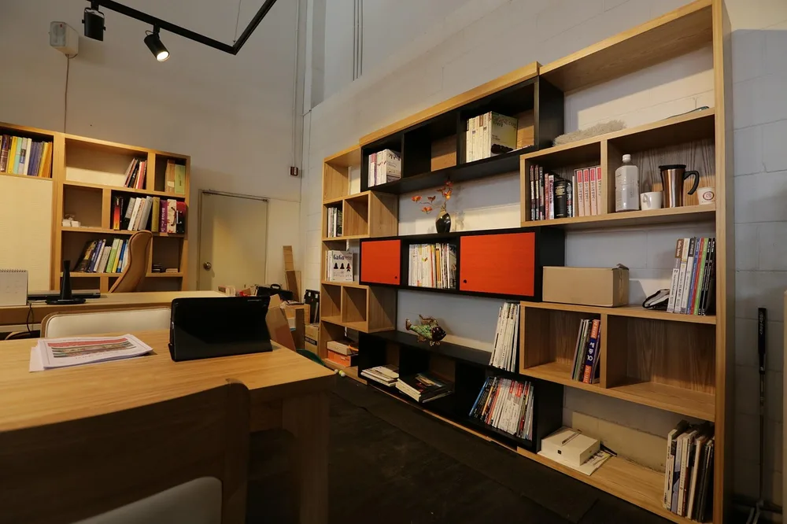
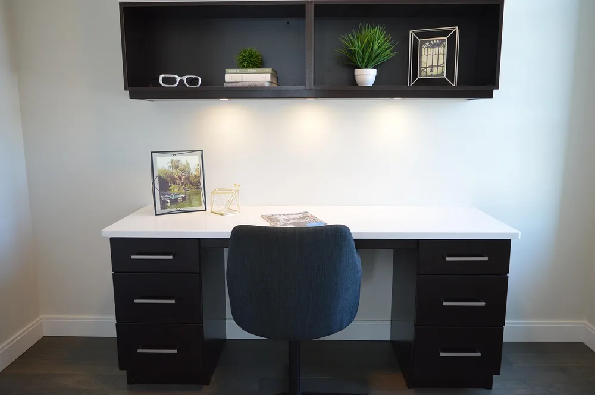
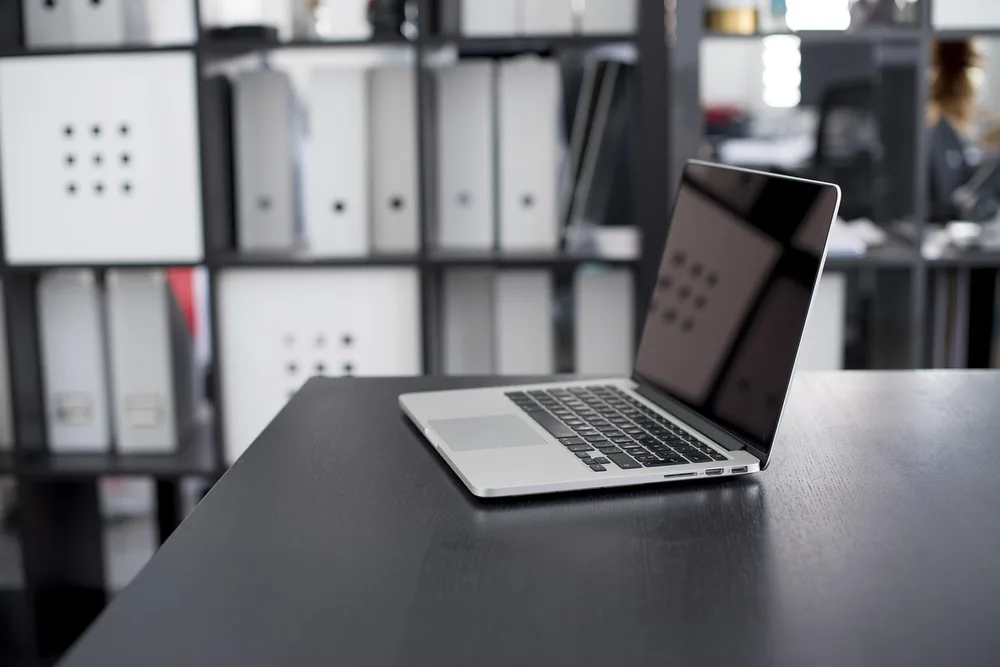
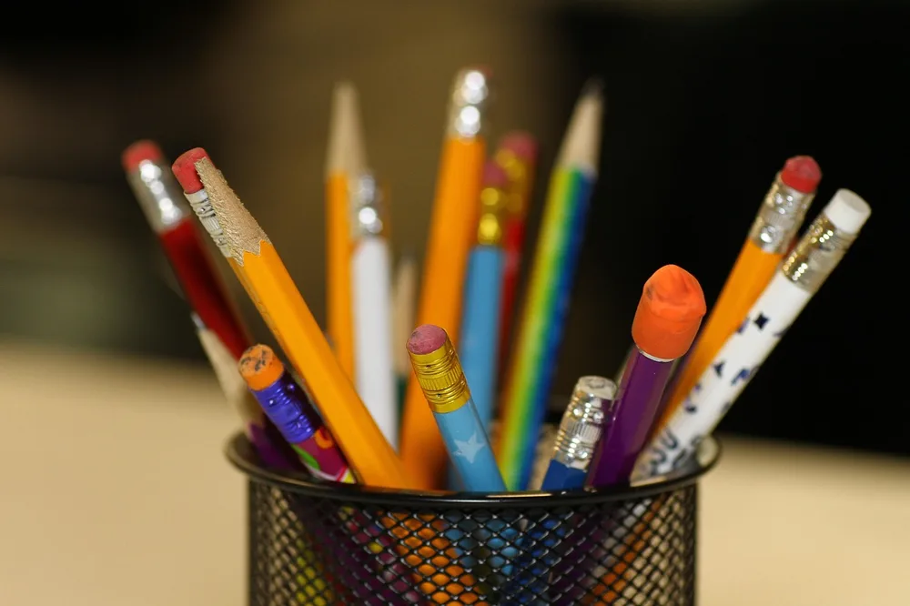
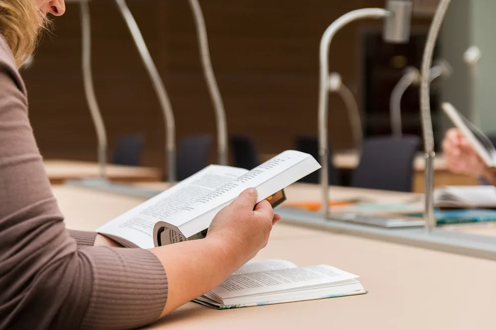
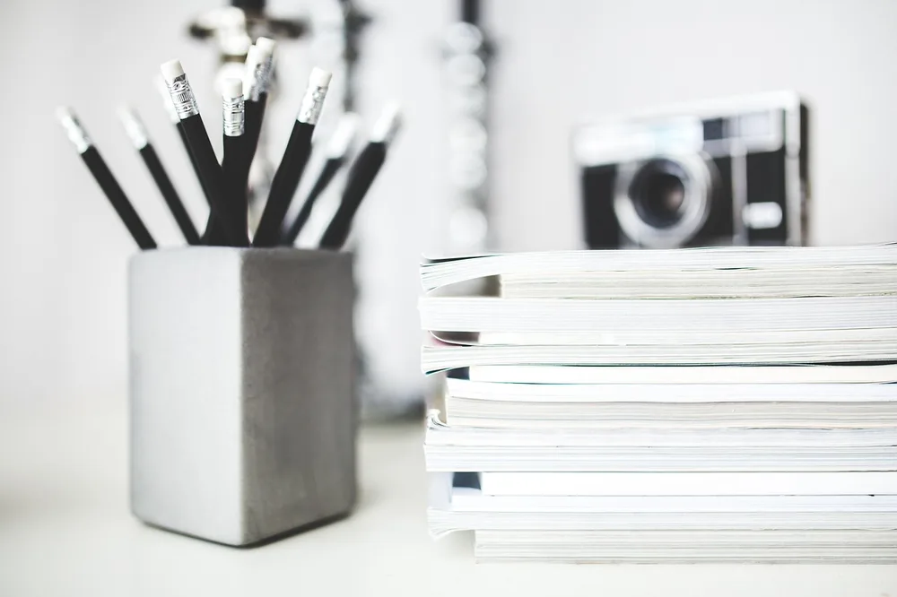
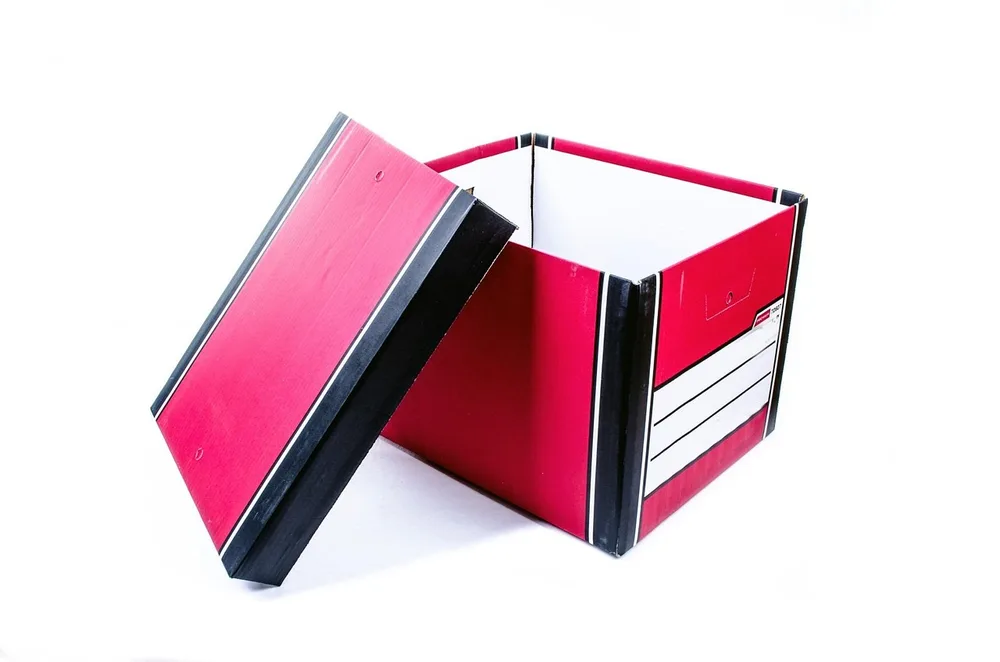
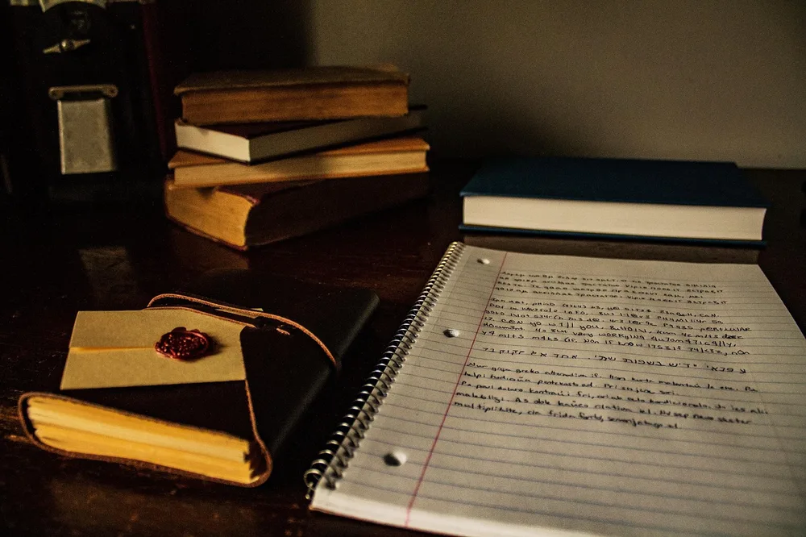
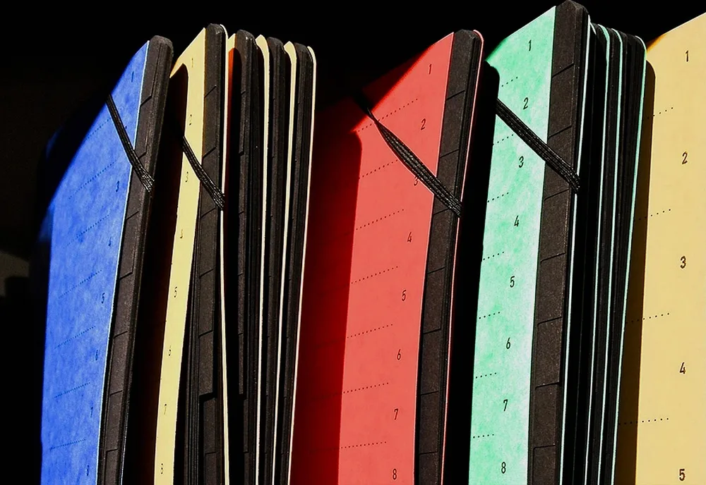
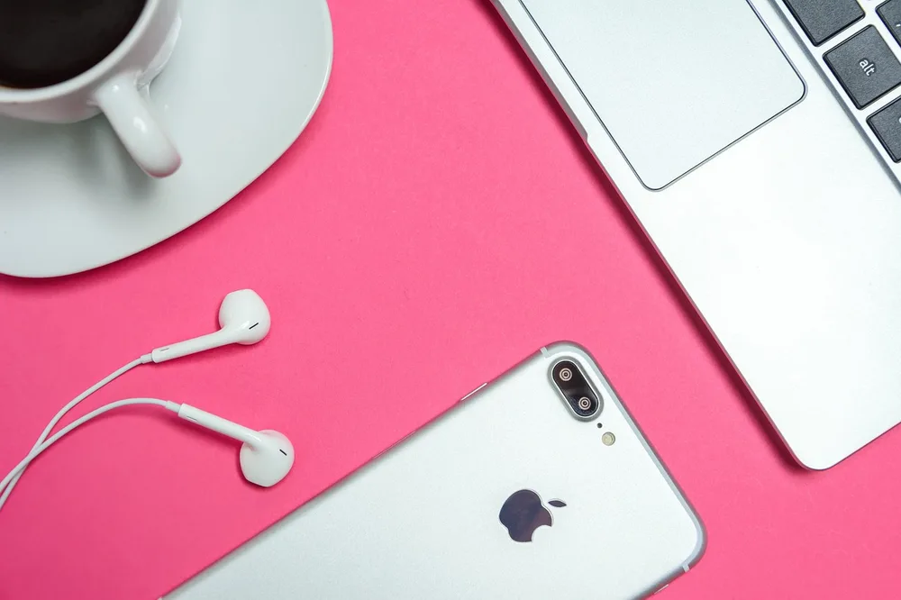

<figure class="pin-figure"><figcaption>Photo by <a href="https://pixabay.com/users/kjhmicro-235462/" rel="nofollow noopener" target="_blank">kjhmicro</a> on <a href="https://pixabay.com/photos/office-shelf-desk-interior-design-332211/" rel="nofollow noopener" target="_blank">Pixabay</a></figcaption></figure>

A small desk runs out of room quickly. Add a laptop, a notebook and a cup of coffee and there is barely any space left for the things you need during the day, so supplies end up in piles at the edges or on the floor beside your chair.

The trick with a small desk is to stop thinking about the surface alone and use the space above and around it. These small desk storage ideas keep what you use close at hand while leaving enough clear room to work, without filling the desk with bulky organizers.

<h2>1. Use the Wall Above the Desk First</h2>

<figure class="pin-figure"><figcaption>Photo by <a href="https://pixabay.com/users/ErikaWittlieb-427626/" rel="nofollow noopener" target="_blank">ErikaWittlieb</a> on <a href="https://pixabay.com/photos/home-office-chair-desk-workspace-1575464/" rel="nofollow noopener" target="_blank">Pixabay</a></figcaption></figure>

The wall above a small desk is usually empty, and it is the easiest storage space you can add. A single shelf about an arm&#39;s reach above the work surface can hold books, folders and boxes, leaving the desk itself free for your laptop and whatever you are working on.

Keep the shelf high enough that you will not bump your head when you stand up, and put the heaviest things near the brackets. If you are renting and cannot drill, a freestanding narrow bookcase placed right beside the desk gives you the same vertical storage without any holes in the wall.

<h2>2. Add a Small Riser to Double the Surface</h2>

<figure class="pin-figure"><figcaption>Photo by <a href="https://pixabay.com/users/Pexels-2286921/" rel="nofollow noopener" target="_blank">Pexels</a> on <a href="https://pixabay.com/photos/laptop-apple-computer-desk-macbook-1846277/" rel="nofollow noopener" target="_blank">Pixabay</a></figcaption></figure>

A low shelf that sits on top of the desk creates a second level in the same footprint. Your monitor or a few small items can go on top, while the space underneath holds notebooks, a keyboard you are not using or the small things that usually spread across the surface.

Measure the depth of your desk before choosing one, since a riser that is too deep takes away the room you need for your arms. Even a slim wooden shelf can make a real difference, and raising the screen a little also brings it closer to a comfortable eye level.

<h2>3. Choose One Cup for Pens and Pencils</h2>

<figure class="pin-figure"><figcaption>Photo by <a href="https://pixabay.com/users/vishwats-5412780/" rel="nofollow noopener" target="_blank">vishwats</a> on <a href="https://pixabay.com/photos/pencils-holder-education-school-2409975/" rel="nofollow noopener" target="_blank">Pixabay</a></figcaption></figure>

Loose pens take up more surface than you might think, and they roll off at the worst moments. One small cup at the back corner of the desk holds everything upright and takes up only a tiny circle of space. Choose one that is heavy enough not to tip over.

Keep only the pens and pencils that you actually use in there, because a cup stuffed full makes it hard to grab one. A wide cup can also hold scissors and a ruler. Once it starts to overflow, sort it out and put the extras away in a drawer.

<h2>4. Let a Holder With Character Do Double Duty</h2>

<figure class="pin-figure"><figcaption>Photo by <a href="https://pixabay.com/users/Alexas_Fotos-686414/" rel="nofollow noopener" target="_blank">Alexas_Fotos</a> on <a href="https://pixabay.com/photos/frog-holder-ballpoint-pen-keep-1446237/" rel="nofollow noopener" target="_blank">Pixabay</a></figcaption></figure>

On a small desk, every object has to earn its place, so storage might as well look nice too. A pen holder with some personality acts as decoration and storage at the same time, which means you do not need a separate ornament competing for the little surface you have.

Look for something with a few compartments so that pens, a highlighter and your phone can each have a spot. Pick a color or material that matches the rest of the desk. When your storage looks good, you are much less likely to hide it behind other things or forget about it.

<h2>5. Store Books Upright at the Edge</h2>

<figure class="pin-figure"><figcaption>Photo by <a href="https://pixabay.com/users/jarmoluk-143740/" rel="nofollow noopener" target="_blank">jarmoluk</a> on <a href="https://pixabay.com/photos/to-read-the-book-library-2784895/" rel="nofollow noopener" target="_blank">Pixabay</a></figcaption></figure>

A few reference books can sit upright at the back edge of the desk, held in place with a pair of slim bookends. This takes up a narrow strip of space you were not using anyway and keeps your most useful books within reach without having to stand up.

Limit the row to what you truly use each week and move the others to a shelf. Books lying flat in a stack take up far more room and make it hard to pull out the one at the bottom. Standing them up also makes the desk look calmer and more settled.

<h2>6. Keep Notebooks in One Neat Stack</h2>

<figure class="pin-figure"><figcaption>Photo by <a href="https://pixabay.com/users/kaboompics-1013994/" rel="nofollow noopener" target="_blank">kaboompics</a> on <a href="https://pixabay.com/photos/pencils-notebooks-stack-762555/" rel="nofollow noopener" target="_blank">Pixabay</a></figcaption></figure>

If you use several notebooks, group them into a single stack instead of leaving each one wherever you last wrote in it. A shallow tray beneath them defines the space and lets you lift the whole stack out of the way whenever you need the surface for something else.

Put the notebook you use most on top, and keep the stack to three or four at most. Older ones can go on a shelf. This small boundary works well because it is obvious when the stack has grown too tall, and it stops papers from spreading sideways.

<h2>7. Hide the Odds and Ends in a Lidded Box</h2>

<figure class="pin-figure"><figcaption>Photo by <a href="https://pixabay.com/users/PublicDomainPictures-14/" rel="nofollow noopener" target="_blank">PublicDomainPictures</a> on <a href="https://pixabay.com/photos/beige-board-box-brown-business-316396/" rel="nofollow noopener" target="_blank">Pixabay</a></figcaption></figure>

Every desk collects small things that have no obvious home, including spare batteries, adapters and business cards. A small lidded box keeps them together and out of sight, which instantly makes the desk look tidier. It also stacks neatly on a shelf if you need more room to work.

Use a separate box for each kind of item if you have more than a handful, and put a small label on the front. Boxes with lids protect things from dust and let you stack them, so a single corner of the shelf can hold quite a lot.

<h2>8. Raise the Laptop to Free Up the Space Below</h2>

<figure class="pin-figure"><figcaption>Photo by <a href="https://pixabay.com/users/chloestrong-4864929/" rel="nofollow noopener" target="_blank">chloestrong</a> on <a href="https://pixabay.com/photos/desk-books-writing-table-education-2158142/" rel="nofollow noopener" target="_blank">Pixabay</a></figcaption></figure>

A laptop lying flat takes up a large part of a small desk. Raise it on a stand and the area underneath becomes useful again, with room for a notebook, a small keyboard or a phone. A short stack of sturdy books works just as well while you decide what you like.

Raising the screen also helps your neck, as long as you add a separate keyboard and mouse so that your arms stay comfortable. You gain storage and better posture from the same small change, which is rare on a desk where every extra object usually means giving something else up.

<h2>9. Keep Folders Vertical and Off the Desk</h2>

<figure class="pin-figure"><figcaption>Photo by <a href="https://pixabay.com/users/PIRO4D-2707530/" rel="nofollow noopener" target="_blank">PIRO4D</a> on <a href="https://pixabay.com/photos/office-order-paper-paper-goods-1466390/" rel="nofollow noopener" target="_blank">Pixabay</a></figcaption></figure>

Folders lying flat become a slippery pile that swallows the corner of a desk. Stand them up in a slim holder on a nearby shelf instead, with the labels facing out. You can see them all at once and pull out the one you need without moving the others.

If you only have a few, a magazine file on the back of the desk does the job in very little space. Keep active projects within reach and move finished ones somewhere else, so that the holder stays useful and never grows into yet another thing to reorganize.

<h2>10. Group Gadgets Into One Small Zone</h2>

<figure class="pin-figure"><figcaption>Photo by <a href="https://pixabay.com/users/AS_Photography-1546875/" rel="nofollow noopener" target="_blank">AS_Photography</a> on <a href="https://pixabay.com/photos/place-of-work-women-modern-office-3346613/" rel="nofollow noopener" target="_blank">Pixabay</a></figcaption></figure>

Earbuds, a phone, a charger and a mouse can easily take over a small desk when each one sits in a different spot. Choose one small zone on the side of your dominant hand and keep them all there, maybe on a little tray or a desk mat.

Grouping them this way also means you can gather everything in one motion when you need the desk for something else. Keep the charger in the same place so that your phone always returns there. A small defined zone looks intentional, even on a desk with very little space.

<h2>Final Thoughts</h2>

A small desk can hold more than it seems once you use the wall, add a second level and stand things upright. Start with one shelf and a single pen cup, then fix whichever pile bothers you most. Keep enough of the surface clear to work, and the desk will feel larger.

