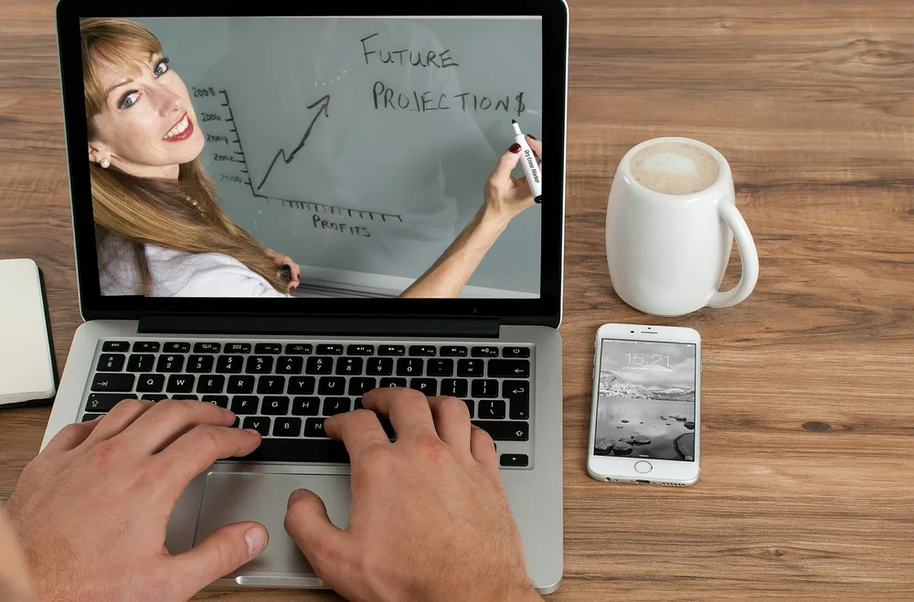
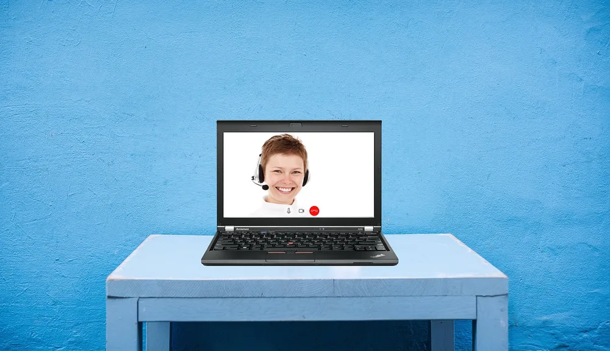
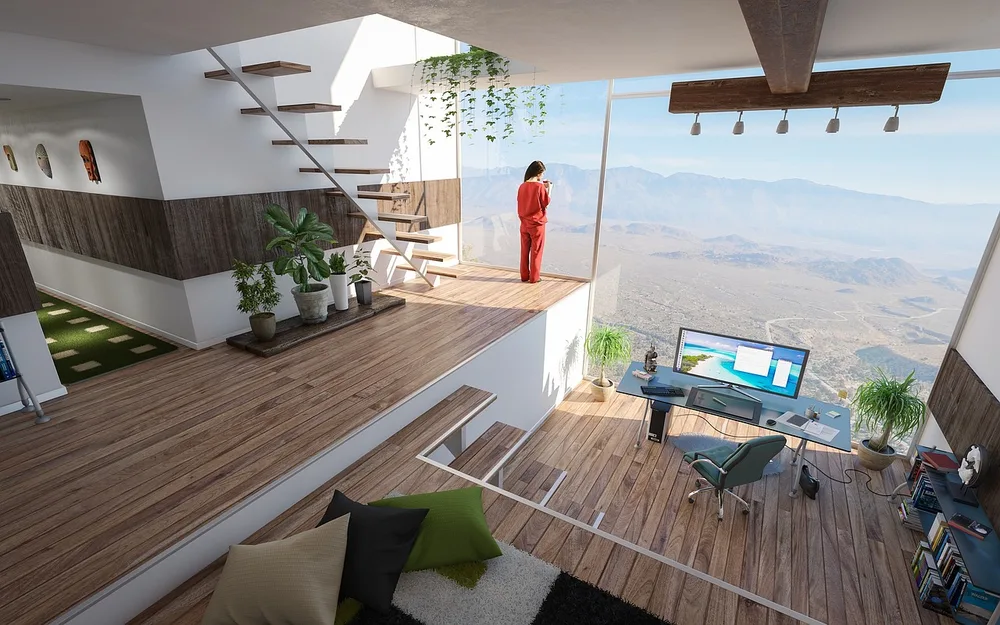
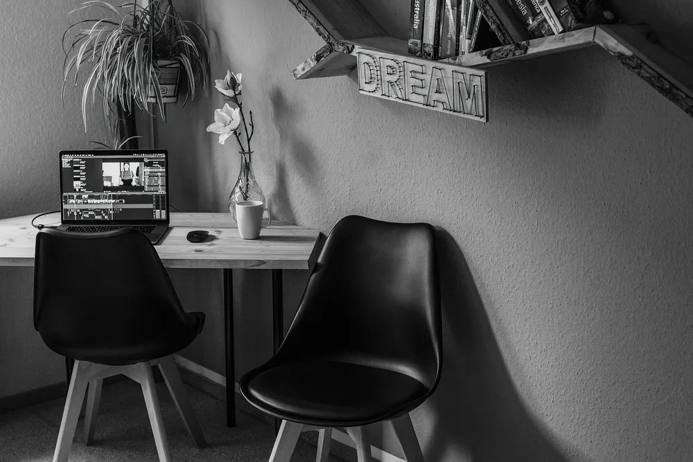
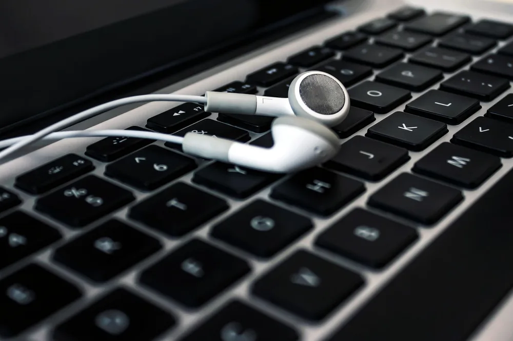
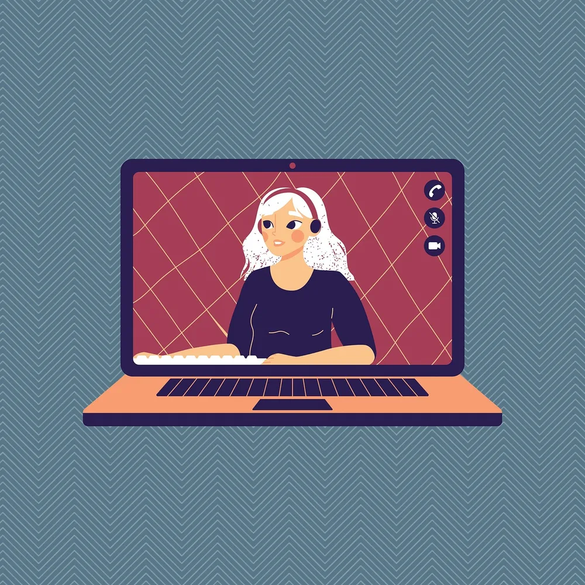
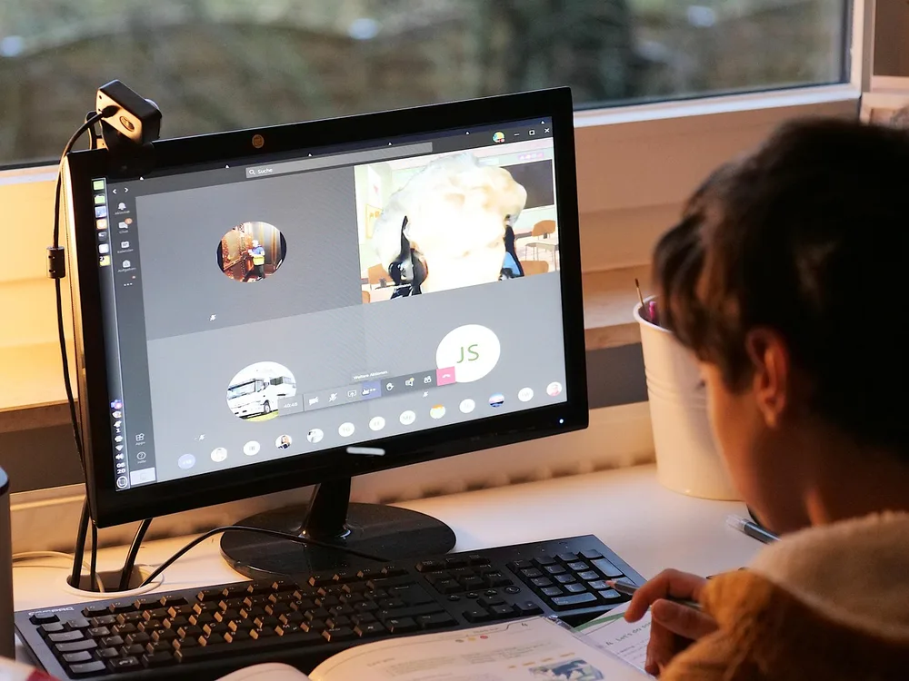

<figure class="pin-figure"><figcaption>Photo by <a href="https://pixabay.com/users/Mohamed_hassan-5229782/" rel="nofollow noopener" target="_blank">Mohamed_hassan</a> on <a href="https://pixabay.com/photos/training-course-3207841/" rel="nofollow noopener" target="_blank">Pixabay</a></figcaption></figure>

If you spend part of every day on video calls, your desk is doing a job it was never really designed for. The laptop camera points up at your chin, the window behind you turns your face into a shadow, and your voice bounces around an empty room.

The good news is that most of these problems can be fixed by moving things around, and you do not need a studio. These video call desk setup ideas cover camera height, light, background and sound, so that you look and sound clear in every meeting without buying much.

<h2>1. Bring the Camera Up to Eye Level</h2>

<figure class="pin-figure"><figcaption>Photo by <a href="https://pixabay.com/users/Sunriseforever-6314823/" rel="nofollow noopener" target="_blank">Sunriseforever</a> on <a href="https://pixabay.com/photos/computer-monitor-video-conference-6977449/" rel="nofollow noopener" target="_blank">Pixabay</a></figcaption></figure>

The most flattering change costs nothing at all. When the camera sits at eye level, you look straight at the other person instead of down at them. Most of the awkward angles people dislike in meetings come from a laptop sitting flat on the desk with its camera pointing upward.

Sit in your normal position and adjust the screen until the lens is level with your eyes. Leave a little space above your head in the frame, and keep your shoulders in view. If you can, sit about an arm&#39;s length away, so that your face looks natural and not stretched.

<h2>2. Raise Your Laptop on a Stand</h2>

<figure class="pin-figure"><figcaption>Photo by <a href="https://pixabay.com/users/Tumisu-148124/" rel="nofollow noopener" target="_blank">Tumisu</a> on <a href="https://pixabay.com/photos/webinar-online-virtual-meeting-5059837/" rel="nofollow noopener" target="_blank">Pixabay</a></figcaption></figure>

A laptop stand is the simplest way to get a built-in camera up to a good height. It also makes your neck more comfortable during a long day. If you do not have one, a sturdy stack of books will do the job well until you decide whether to buy one.

Once the laptop is raised, typing on it gets awkward, so add a separate keyboard and mouse if you use it for long stretches. Make sure the stand does not shake every time you touch the desk, because a wobbling camera is very noticeable to people on the other end.

<h2>3. Face a Window for Soft Natural Light</h2>

<figure class="pin-figure"><figcaption>Photo by <a href="https://pixabay.com/users/qimono-1962238/" rel="nofollow noopener" target="_blank">qimono</a> on <a href="https://pixabay.com/photos/interior-design-room-office-home-3778708/" rel="nofollow noopener" target="_blank">Pixabay</a></figcaption></figure>

Window light is the best free lighting you can get, as long as it falls on your face and not behind you. Turn your desk so that the window is in front of you or slightly to one side. Your features will look clear and even, without any special equipment.

On very bright days, a thin curtain softens the light and stops hard shadows. If your desk has to stay with its back to a window, close the blinds during calls. A bright window behind you will make the camera darken your face, however good the camera is.

<h2>4. Add a Soft Lamp for Early and Late Calls</h2>

<figure class="pin-figure"><figcaption>Photo by <a href="https://pixabay.com/users/doctor-a-5155982/" rel="nofollow noopener" target="_blank">doctor-a</a> on <a href="https://pixabay.com/photos/library-people-study-desk-studying-2245807/" rel="nofollow noopener" target="_blank">Pixabay</a></figcaption></figure>

Daylight is not always there when you need it, especially for early and late meetings. A small lamp placed behind your screen and a little above eye level fills in your face. Aim it at a wall or use a shade to spread the light, so it is not harsh.

Avoid sitting directly under a ceiling light, which tends to create dark shadows under your eyes. Warm white bulbs usually look more natural on camera than very cool ones. Test the setup with your camera app before a call and move the lamp until both sides of your face look even.

<h2>5. Keep the Background Simple and Real</h2>

<figure class="pin-figure"><figcaption>Photo by <a href="https://pixabay.com/users/moisemarian-2911339/" rel="nofollow noopener" target="_blank">moisemarian</a> on <a href="https://pixabay.com/photos/home-decoration-computer-laptop-7598667/" rel="nofollow noopener" target="_blank">Pixabay</a></figcaption></figure>

The background does not need to be impressive, it only needs to be tidy. A plain wall, a closed door or a neat bookshelf all work well. Check what the camera actually sees before your next call, because piles of laundry and open closets are easy to miss from where you sit.

A few books, a plant or a piece of art can add some character without distracting anyone. Sit a little away from the wall to add a sense of depth. A real tidy room usually looks better than a virtual background, which can cut off your hair and hands.

<h2>6. Use a Separate Microphone if You Talk a Lot</h2>

<figure class="pin-figure"><figcaption>Photo by <a href="https://pixabay.com/users/TheAngryTeddy-123386/" rel="nofollow noopener" target="_blank">TheAngryTeddy</a> on <a href="https://pixabay.com/photos/microphone-audio-recording-podcast-338481/" rel="nofollow noopener" target="_blank">Pixabay</a></figcaption></figure>

People will forgive a slightly soft picture, but poor audio quickly becomes tiring. Built-in laptop microphones pick up keyboard noise and room echo. A simple USB microphone placed on a small arm or stand, close to your mouth, can make a much greater difference than an expensive new camera.

Keep the microphone just out of frame and pointed at your mouth, and speak at your normal volume. Test it by recording a short clip and playing it back. Rooms with hard walls create an echo, and a rug, curtains or a few cushions will help soften it.

<h2>7. Wear a Headset in Noisy Homes</h2>

<figure class="pin-figure"><figcaption>Photo by <a href="https://pixabay.com/users/rupixen-11154019/" rel="nofollow noopener" target="_blank">rupixen</a> on <a href="https://pixabay.com/photos/desk-laptop-computer-macbook-4308177/" rel="nofollow noopener" target="_blank">Pixabay</a></figcaption></figure>

When your household is busy, a headset with a boom microphone is the most practical option. It stays close to your mouth wherever you turn your head and blocks out a lot of the background noise. You will also hear other people clearly, without your speakers causing an echo.

Choose one that is light enough to wear for a few hours, since heavy headsets can start to hurt by the afternoon. If you want a less noticeable look on camera, try a pair of wired earbuds with an inline microphone. Keep whichever you use within easy reach.

<h2>8. Put Your Notes Next to the Camera</h2>

<figure class="pin-figure"><figcaption>Photo by <a href="https://pixabay.com/users/18488631-18488631/" rel="nofollow noopener" target="_blank">18488631</a> on <a href="https://pixabay.com/photos/video-conference-work-laptop-5609682/" rel="nofollow noopener" target="_blank">Pixabay</a></figcaption></figure>

Looking down at your notes breaks eye contact, even if only for a moment. Keep the ones you need in a small window right below the camera on your screen. When you read them, your eyes stay close to the lens, and people feel like you are looking at them.

A second screen is useful for documents, chat and shared files, but try not to place it too far to one side. If you look away for long periods, it can seem as if your attention is elsewhere. Keep the meeting window on the same screen as your camera.

<h2>9. Add a Webcam if You Use a Monitor</h2>

<figure class="pin-figure"><figcaption>Photo by <a href="https://pixabay.com/users/AbouYassin-12243386/" rel="nofollow noopener" target="_blank">AbouYassin</a> on <a href="https://pixabay.com/photos/child-student-video-conference-5976951/" rel="nofollow noopener" target="_blank">Pixabay</a></figcaption></figure>

If you work on an external monitor with your laptop off to one side, its built-in camera will show you from an odd angle. A small webcam clipped to the top of the monitor solves this problem right away and keeps your eyes close to where the meeting appears.

Choose one that handles low light fairly well, as that usually matters more than a very high resolution. Wipe the lens from time to time, since a smudge can make the whole picture look soft. A sliding cover is a simple way to get some extra privacy between meetings.

<h2>10. Run a Quick Check Before Each Call</h2>

<figure class="pin-figure"><figcaption>Photo by <a href="https://pixabay.com/users/Bangladeshipictures-23163946/" rel="nofollow noopener" target="_blank">Bangladeshipictures</a> on <a href="https://pixabay.com/photos/woman-technology-workplace-office-6587249/" rel="nofollow noopener" target="_blank">Pixabay</a></figcaption></figure>

A one-minute check prevents most small embarrassments. Before you join, look at your camera preview and see if the framing and light look right, then test your audio, close any apps that send noisy alerts and silence your phone. Doing it every time turns the check into an easy habit.

Keep a glass of water within reach, but away from your keyboard, and let the people at home know that you will be on a call. Have your charger plugged in. These small steps let you relax and focus on the conversation instead of the technology in front of you.

<h2>Final Thoughts</h2>

A good video call desk setup comes down to three things: a camera at eye level, soft light on your face and clear sound. Begin with the changes that cost nothing, such as moving your desk and raising your laptop, and then add a microphone or lamp if you still need them.

